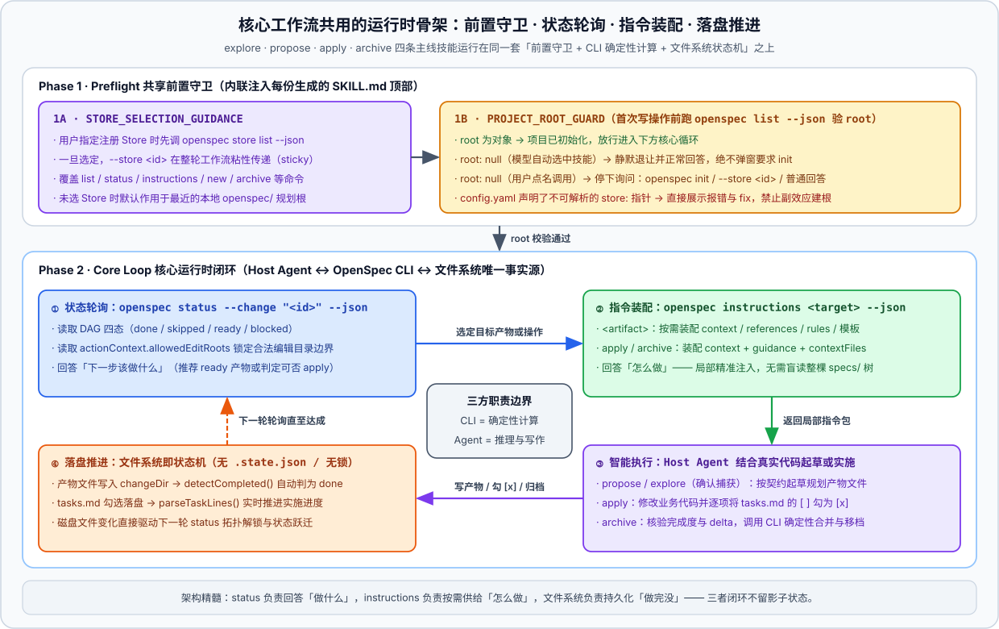

# 00 — 四条命令的共有机制

explore、propose、apply、archive 表面上做完全不同的事，但运行在同一套基础设施上。理解这套"共性层"才能看懂每条命令为什么那样工作。

> **范围说明**：OpenSpec 的 core profile（`CORE_WORKFLOWS` in `src/core/profiles.ts`）实际包含 **6 条** workflow：`propose`、`explore`、`apply`、**`update`**、**`sync`**、`archive`。本目录聚焦于"规划 → 实施 → 归档"主线上的四条；`sync`（把 change 的 delta spec 合并到主 spec 基线，可独立于 archive 调用）在 `04-archive` 第 5 节作为"archive 内部步骤的独立化"一并讨论，不单独成篇。另外 `ALL_WORKFLOWS` 还包含 `new`、`continue`、`ff`、`verify`、`bulk-archive`、`onboard` 等辅助 workflow，本目录不展开。



## 1. OpenSpec 的 meta 本质：框架，不是工具

OpenSpec 不是一个"帮你写 spec"的工具。它是一个**告诉 AI agent 如何写 spec 的框架**。

打个比方：大多数工具是菜谱（告诉你放什么料、炒几分钟），OpenSpec 是厨房（提供灶台、锅铲、计时器，但菜谱你自己定）。

三层分工：

```
spec-driven schema (YAML + templates)  ──  "做什么菜、先后顺序、每个步骤干什么"
CLI (Commander.js, ~1000行 TypeScript) ──  "计时器响了没、食材在哪、锅热了没"（纯确定性计算）
AI Agent (Claude Code / Cursor 等)      ──  "实际切菜炒菜的人"（生成性工作）
```

**关键推论**：OpenSpec 的行为不是硬编码的。改 `schema.yaml` 和 `templates/` 就能改整个工作流，一行 TypeScript 都不用动。spec-driven 只是默认 schema —— 你可以写自己的。

---

## 2. 三方架构

每次宿主 workflow 调用（例如 Claude 的 `/openspec-propose`，或 Codex 的 `$openspec-propose`）实际运转的是三方接力：

```
User（人类）
  │  "propose add-dark-mode"（宿主语法不同）
  ▼
Host Agent（Claude Code / Cursor / Cline）
  │  读取 SKILL.md 中的指令
  │  执行: openspec new change "add-dark-mode"
  │  执行: openspec status --change "add-dark-mode" --json
  │  执行: openspec instructions proposal --change "add-dark-mode" --json
  │  写文件: proposal.md, specs/*.md, design.md, tasks.md
  ▼
OpenSpec CLI（确定性内核）
  │  读 schema.yaml → 构建 artifact DAG
  │  读文件系统 → 检测哪些 artifact 已完成
  │  读 config.yaml → 提取 context / rules
  │  读 templates/*.md → 加载输出骨架
  │  组合成 structured JSON 返回给 agent
  ▼
文件系统（唯一事实源）
  openspec/changes/<name>/  — change 目录
  openspec/specs/           — 主 spec 基线
  openspec/config.yaml      — 项目配置
```

**CLI 只做确定性计算，从来不做生成**。它读文件、算状态、组合指令。文本内容是 AI agent 写的。

---

## 3. Schema：控制一切的"源码"

`schemas/spec-driven/schema.yaml`（273 行）是整个工作流的定义文件，等价于"源码"。它声明了：

### Artifact 定义

```yaml
artifacts:
  - id: proposal
    generates: proposal.md          # 输出文件路径
    description: "Initial proposal..."
    template: proposal.md           # 模板文件名（相对于 templates/）
    instruction: |                  # 给 AI 的指导
      Create the proposal document...
    requires: []                    # 依赖（空 = 立即可做）

  - id: specs
    generates: "specs/**/*.md"      # glob 模式匹配多文件
    template: spec.md
    instruction: |
      Create specification files...
    requires:
      - proposal                    # 必须等 proposal 完成

  - id: design
    generates: design.md
    template: design.md
    requires:
      - proposal                    # 只依赖 proposal（和 specs 并行）

  - id: tasks
    generates: tasks.md
    template: tasks.md
    requires:
      - specs                       # 必须等 specs 和 design 都完成
      - design
```

### DAG 可视化

```
         proposal (ready immediately)
           /          \
          ▼            ▼
        specs        design
          \          /
           ▼        ▼
            tasks
              │
              ▼
            apply (requires: [tasks], tracks: tasks.md)
```

### Apply Phase 定义

```yaml
apply:
  requires: [tasks]      # 哪些 artifact 完成后才能 apply
  tracks: tasks.md       # checkbox 文件，用来跟踪进度
  instruction: |
    Read context files, work through pending tasks...
```

`requires: [tasks]` 的语义是 **tasks artifact 处于 `done` 状态**，即 `tasks.md` 文件**存在于磁盘上**（由第 4 节的 `detectCompleted()` → `artifactOutputExists()` 判定，**只看文件是否存在，不读 checkbox 内容**）。

它**不直接检查 checkbox 是否全部打勾**。checkbox 的完成度是 apply 内部的另一层判断——由 `generateApplyInstructions()` 解析 `tracks` 文件（`tasks.md`）的 checkbox 后，将 apply 阶段分为 `blocked` / `ready` / `all_done` 三态（详见 `03-apply` 第 2 节）。换句话说：

- `apply.requires: [tasks]` + `tasks.md` 存在 → apply 阶段**可进入**
- `tasks.md` 里 checkbox 全部 `- [x]` → apply 阶段 `state: "all_done"`（实施完成）

不要把这两层混为一谈。

---

## 4. 文件系统即状态

OpenSpec 没有数据库，没有 `.state.json`，没有 lock file。**artifact 是否完成 = 它 generates 的文件是否存在于磁盘上**。

关键代码路径：`detectCompleted()`（`src/core/artifact-graph/state.ts`）和 `resolveArtifactOutputs()` / `artifactOutputExists()`（`src/core/artifact-graph/outputs.ts`）。

```typescript
export function detectCompleted(graph: ArtifactGraph, changeDir: string): CompletedSet {
  const completed = new Set<string>();

  // Handle missing change directory gracefully
  if (!fs.existsSync(changeDir)) {
    return completed;
  }

  for (const artifact of graph.getAllArtifacts()) {
    if (isArtifactComplete(artifact.generates, changeDir)) {
      completed.add(artifact.id);
    }
  }

  return completed;
}
```

内部调用私有 `isArtifactComplete(generates, changeDir)`（注意**参数顺序**与旧文档写的 `artifactOutputExists(changeDir, generates)` 相反），它通过 `resolveArtifactOutputs()` 判断是否有具体输出文件：

- 对于简单路径如 `proposal.md`：检查 `changeDir/proposal.md` 是否存在且是文件（`statSync(...).isFile()`），目录不算完成。
- 对于 glob 如 `specs/**/*.md`：用 `tinyglobby`（v1.14.3 #2103 起；此前是 `fast-glob`）在 `changeDir` 下匹配，选项集中在 `ARTIFACT_GLOB_OPTIONS`（`onlyFiles: true`、`followSymbolicLinks: true`、`braceExpansion: false`、`expandDirectories: false`、`absolute: true`）；**只要匹配到至少一个文件就算完成**。

**这个设计的意义**：
- 状态和内容在同一个地方（文件系统），不会出现"数据库说完成了但文件不存在"的一致性问题
- agent 不需要学任何新概念，"写完文件"和"标记完成"是同一件事
- git diff 自然就能看到变化

---

## 5. 四层注入机制

当 agent 调用 `openspec instructions <artifact> --change X --json` 时，CLI 组装了四层信息。核心入口是 `generateInstructions()` in `src/core/artifact-graph/instruction-loader.ts`。

### 四层结构

| 层级 | 来源 | 作用 | 给谁看 |
|------|------|------|--------|
| **context** | `config.yaml` 的 `context` 字段 | 项目背景信息（技术栈、领域术语等） | artifact instruction，以及 Apply/Archive operation input |
| **rules** | `config.yaml` 的 `rules[artifactId]` | 该 artifact 特有的约束 | 只进入同名 artifact instruction，**不写入** artifact |
| **instruction** | `schema.yaml` 的 `artifact.instruction` | 这个 artifact 应该包含什么、常见坑 | AI 参考，不要求逐字复制 |
| **template** | `templates/<name>.md` | 输出文件的结构骨架 | **这就是输出文件的格式** |

### 注入顺序

以下是四层在 `printInstructionsText()` 输出中的排列（简化视图，实际输出还包含 `<artifact>` 外层包装、`<task>`、`<dependencies>`、`<output>`、`<success_criteria>`、`<unlocks>` 等结构标签）：

```
<project_context>
  <!-- 这是背景信息，不要包含在你的输出中 -->
  Tech stack: TypeScript, React, Node.js
  We use conventional commits.
</project_context>

<rules>
  <!-- 这些是约束，不要包含在你的输出中 -->
  - Keep proposals under 500 words
  - Always include a "Non-goals" section
</rules>

<instruction>
  Create the proposal document that establishes WHY this change is needed.
  Sections: Why, What Changes, Capabilities, Impact...
</instruction>

<template>
  ## Why
  <!-- 解释此变更的动机 -->

  ## What Changes
  <!-- 描述什么会改变 -->
  ...
</template>
```

**关键区分**：context 和 rules 位于 `<!-- -->` 注释中，并明确标注 "Do NOT include in your output"。它们是给 AI 的内部约束，不是给 artifact 的内容。template 才是输出骨架。

Apply 和 Archive 不是 artifact，因此它们不读取 `rules.apply` / `rules.archive`。应把稳定的 operation guidance 放在 `operations.apply.guidance` / `operations.archive.guidance`；`openspec instructions apply/archive` 会连同 project `context` 提供给对应 workflow。Explore 读取 project context 与 artifact rules，但没有 `operations.explore`。

### 代码路径

`generateInstructions()` (`src/core/artifact-graph/instruction-loader.ts`) 的执行顺序：

1. 从 graph 查找 artifact (`context.graph.getArtifact(artifactId)`)
2. 调用 `loadTemplate()` 加载模板文件内容
3. 调用 `getDependencyInfo()` 收集依赖项状态（哪些完成了、输出路径在哪）
4. 调用 `getUnlockedArtifacts()` 计算"完成本 artifact 后会解锁哪些"
5. 读取 `config.yaml`（resilient —— 读不到就跳过）
6. 验证 config 的 rules 字段中的 artifact ID 是否在 schema 中存在（无效 ID 产生 warning，每个 session 只警告一次）
7. 提取 `configContext`（来自 `config.context`）
8. 提取 `configRules`（来自 `config.rules[artifactId]`）
9. 返回 `ArtifactInstructions` 对象

最后 `printInstructionsText()` (`src/commands/workflow/instructions.ts`) 将 `ArtifactInstructions` 格式化为 XML-tagged 文本输出。

---

## 6. status + instructions：核心配合模式

这是四条命令共享的核心循环：

```
status   →  告诉 agent "该做什么"（哪些 artifact ready，哪些 blocked）
instructions → 告诉 agent "怎么做"（四层注入后的完整操作包）
```

### status 的输出 (`formatChangeStatus()` in `src/core/artifact-graph/instruction-loader.ts`)

```json
{
  "changeName": "add-dark-mode",
  "schemaName": "spec-driven",
  "changeRoot": "/project/openspec/changes/add-dark-mode",
  "planningHome": { "kind": "repo", "root": "/project", "changesDir": "/project/openspec/changes", "defaultSchema": "spec-driven" },
  "artifactPaths": {
    "proposal": { "outputPath": "proposal.md", "resolvedOutputPath": "...", "existingOutputPaths": [] },
    "specs":    { "outputPath": "specs/**/*.md", "resolvedOutputPath": "...", "existingOutputPaths": [] },
    ...
  },
  "artifacts": [
    { "id": "proposal", "outputPath": "proposal.md", "status": "ready", "requires": [] },
    { "id": "specs",    "outputPath": "specs/**/*.md", "status": "blocked", "requires": ["proposal"], "missingDeps": ["proposal"] },
    { "id": "design",   "outputPath": "design.md", "status": "blocked", "requires": ["proposal"], "missingDeps": ["proposal"] },
    { "id": "tasks",    "outputPath": "tasks.md", "status": "blocked", "requires": ["specs", "design"], "missingDeps": ["specs", "design"] }
  ],
  "applyRequires": ["tasks"],
  "isPlanningComplete": false,
  "isComplete": false,
  "nextSteps": ["Run openspec instructions proposal --change \"add-dark-mode\" --json before writing that artifact."],
  "actionContext": {
    "mode": "repo-local",
    "sourceOfTruth": "repo",
    "planningArtifacts": ["proposal", "specs", "design", "tasks"],
    "linkedContext": [],
    "allowedEditRoots": ["/project"],
    "requiresAffectedAreaSelection": false,
    "constraints": ["Repo-local change artifacts and implementation edits are scoped to this project."]
  }
}
```

关键字段：
- **`artifacts[].status`**: `done`（文件存在）| `ready`（依赖满足）| `blocked`（有未满足的依赖）| `skipped`（change 声明 `skip_specs` 后跳过、视为已满足）；每项同时始终携带 **`requires`**（直接依赖边，即使已是 `done` 也保留，供 `propose`/`ff` 计算传递依赖闭包）
- `skip_specs` 可由纯非行为 change 手写，也可由 `new change` 在所选 schema 不产生 specs artifact 时自动写入；`./specs/`、`specs/` 与 Windows separator 会先归一化。
- **`isPlanningComplete`**: 所有非 skipped 的 planning artifact 都存在才算 planning 完成（主字段；`isComplete` 是兼容别名，二者同值）
- **`applyRequires`**: 来自 schema 的 `apply.requires`，告诉 agent 哪些 artifact 全做完才能进入实施
- **`nextSteps`**: 纯文本建议，给人类和 agent 看
- **`actionContext`**: 机器可读的编辑边界约束（`src/core/change-status-policy.ts:58-102`）。契约键 `mode: "repo-local"` / `sourceOfTruth: "repo"` 保持固定；本地规划根下 `allowedEditRoots` 为 `[projectRoot]`；当选中独立 store 作为规划根时（#2013 / #2014），若当前路径上的项目通过 `store:` 声明了该 store，`editScope()` 会把代码实现仓 `implementationRoot` 一并放入 `allowedEditRoots: [implementationRoot, storeRoot]`，并在 `constraints` 中指明规划产物在 store、代码改动落在声明它的项目仓（若无法唯一判定实现仓则仅保留 `[storeRoot]` 并要求先询问用户）

### instructions 的输出 (`generateInstructions()`)

每个字段的精确含义（`--json` 输出时命令层还会附上 `root: toRootOutput(root)`）：

| 字段 | 含义 |
|------|------|
| `planningHome` | 当前 change 的规划根摘要（`{ kind, root, changesDir, defaultSchema }`），store 场景指向 store 根 |
| `context` | `config.yaml` 的 `context`，AI 约束 |
| `rules` | `config.yaml` 的 `rules[artifactId]`，AI 约束 |
| `references` | `config.yaml` 声明 `references:` 时装配的上游只读 store 索引（未声明或自引用过滤为空时省略） |
| `instruction` | `schema.yaml` 的 `artifact.instruction`，创建指导 |
| `template` | 模板文件的原始内容，**输出格式** |
| `dependencies` | 依赖项列表（`id`, `done`, `path`, `description`，以及因 `skip_specs` 被跳过满足时的 `skipped?: true`） |
| `unlocks` | 完成后会解锁哪些 artifact（保持 schema 声明顺序） |
| `resolvedOutputPath` | 文件应该写到哪的绝对路径或绝对 glob |
| `existingOutputPaths` | 已存在的输出文件（覆盖前先读） |
| `skipped` / `warning` | 当 change 声明 `skip_specs: true` 且本 artifact 被跳过时返回（`skipped: true` + `SKIP_SPECS_INSTRUCTIONS_WARNING`），禁止创建文件 |
| `warnings` | 非致命元数据诊断（例如 `.openspec.yaml` 含未知顶层键时的告警列表） |

---

## 7. 关键 CLI 命令一览

| 命令 | JSON 支持 | 作用 | 谁调用 |
|------|----------|------|--------|
| `openspec list --json` | 是 | 列出所有活跃 change（及任务进度）并校验规划根 | explore/propose/apply/archive 等 |
| `openspec status --change X --json` | 是 | 获取 artifact DAG 状态与路径上下文 | 所有四条命令 |
| `openspec instructions <id> --change X --json` | 是 | 获取创建某 artifact 的完整指令 | propose/explore/sync/archive |
| `openspec instructions apply --change X --json` | 是 | 获取实施的 work order | apply |
| `openspec instructions archive --change X --json` | 是 | 获取归档阶段的 `context` 与 `operationGuidance` | archive/bulk-archive |
| `openspec new change X` | **是** | 创建 change 目录骨架与 `.openspec.yaml` | propose/explore/new/ff |
| `openspec context --json` | 是 | 解析权威规划根与关联 `references` 工作集 | propose |
| `openspec schemas --json` | 是 | 列出可用 schema | propose（辅助） |
| `openspec templates --json` | 是 | 列出某 schema 的所有模板路径 | （辅助） |

---

## 8. 交付机制（v2.x 只剩 skills）

`openspec init` 按 profile 生成技能文件（见 `src/core/init.ts`）。**v2.0.0 起 `delivery` 退役**（#2223），不再有「skills / commands / both」三态，一律 skills；下面的 Commands 小节是 1.x 的历史形态。

### Skills（`SKILL.md`）

**v2.x 的布局**：支持 `project`（项目内 `.agents/skills/openspec-<workflow>/SKILL.md`）与 `global`（本机 `~/.agents/skills/`，v2.1.0 起）两种作用域，偏好记录在 `openspec/config.yaml` 的 `skillsScope`。真身只有一份，在共享 `.agents/skills/` 目录；只读自己目录的工具（如 Claude Code 的 `.claude/skills/`）放一条**指向真身的链接**，建不了链接时退化为拷贝（`src/core/shared/skill-links.ts`，安装动作交给运行时依赖 `skills` 包）。详见 `../mechanisms/02-tool-delivery.md`。

**v1.x 的布局**（历史）：每个工具目录各写一份 `.claude/skills/openspec-<workflow>/SKILL.md`，另有 Codex / Zed / vendor-neutral `agents` 三方共用的 `.agents/skills/` 根，靠 `.openspec-target` marker 判定 active writer。

`generateSkillContent()`（`src/core/shared/skill-generation.ts:146-168`）生成的 `SKILL.md` 带有完整 YAML frontmatter：
```markdown
---
name: openspec-propose
description: Propose a new OpenSpec change with all artifacts generated in one step...
allowed-tools: Bash(openspec:*)
license: MIT
compatibility: Requires openspec CLI.
metadata:
  author: openspec
  version: "1.0"
  generatedBy: "2.1.1"
---
Propose a new change - create the change and generate all artifacts in one step.
...
```

> 注：`allowed-tools: Bash(openspec:*)`（来自 `src/core/shared/allowed-tools.ts`）预授权 `openspec` CLI 调用以避免每次命令弹窗（只做预批准，不限制 Read/Write 等其他工具）。写入仓库发布目录 `skills/` 与项目/全局 `.agents/skills/` 时，`stripVolatileFrontmatter()`（`skill-generation.ts:75-77`）会剥掉随版本变化的 `  generatedBy: ...` 行，使技能正文未改动的发版保持字节稳定。

Skills 是**主要机制** —— agent 通过 skill 名匹配激活对应的行为指令。

### Commands（slash commands）— v2.0.0 起已移除

**不再生成**。1.x 时代对 Claude Code 等支持原生 slash command 的工具会额外生成 `.claude/commands/opsx/<id>.md`，内容与 skill 基本相同、只换外壳。2.0 把这层删掉：34 个 command adapter 仍保留，但只用于识别旧文件路径（迁移、清理、漂移检测），不再产出任何文件。

### Profile 控制安装什么

`CORE_WORKFLOWS` in `src/core/profiles.ts`：
```typescript
const CORE_WORKFLOWS = ['propose', 'explore', 'apply', 'update', 'sync', 'archive'];
```

**core profile**（默认）：6 个 workflow。也就是技能 `openspec-explore`、`openspec-propose`、`openspec-apply-change`、`openspec-update-change`、`openspec-sync-specs`、`openspec-archive-change`（1.x 写作 `/opsx:explore`、`/opsx:propose`、`/opsx:apply`、`/opsx:update`、`/opsx:sync`、`/opsx:archive`）。

用户可切换到 custom profile，自定义 workflow 列表。

### 模板源文件

所有技能的内容模板在 `src/core/templates/workflows/*.ts`，每个 workflow 一个文件：

| 文件 | 导出函数 |
|------|---------|
| `explore.ts` | `getExploreSkillTemplate()`, `getOpsxExploreCommandTemplate()` |
| `propose.ts` | `getOpsxProposeSkillTemplate()`, `getOpsxProposeCommandTemplate()` |
| `apply-change.ts` | `getApplyChangeSkillTemplate()`, `getOpsxApplyCommandTemplate()` |
| `archive-change.ts` | `getArchiveChangeSkillTemplate()`, `getOpsxArchiveCommandTemplate()` |

---

## 9. 四条命令在这套基础设施上的差异

| | explore | propose | apply | archive |
|------|------|------|------|------|
| **创建 artifact** | 默认否；经用户明确确认或主动要求捕获后，可创建 change 并草拟/更新受确认的 artifacts | 是（传递依赖闭包内全部） | 否（只改 checkbox） | 否（只合并+移动） |
| **核心 CLI/模板动作** | `list`, `list --specs`, `show`, `status`（确认捕获时调 `new change`, `instructions`） | `context`, `new change`, `status`, `instructions` (循环) | `status`, `instructions apply` | `instructions archive`, `status`, `list`, sync 评估/合并, archive 移动 |
| **DAG 角色** | 旁观与探索（确认捕获后按依赖序草拟所求 artifact） | 按 DAG 依赖序构建 `applyRequires` 传递闭包 | 依赖 DAG 的 apply 阶段 | 消费 DAG 的最终产物 |
| **修改什么** | 默认无（绝不改业务代码或 `config.yaml`/schema；确认后仅写受确认的 change artifacts） | 创建 proposal/specs/design/tasks | 修改 tracked tasks checkbox + 业务代码 | 合并/退役主 specs + 移动 change 目录 |
| **schema 依赖** | 中（读 `artifactPaths`；捕获时读 `instructions` 与条件跳过规则） | 强（控制创建顺序和内容） | 中（apply phase 定义） | 强（控制合并逻辑） |
