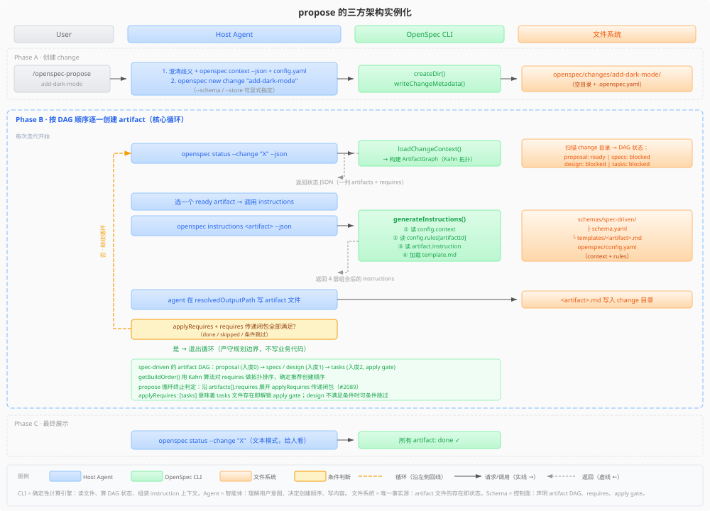

# 02 — propose：Proposal 生成

propose 是四条命令中最核心的一条。它执行完整的“从零到可实施”流程：创建 change、按 DAG 的可用性推进 artifact，直到满足 apply 条件。调用写法由宿主决定：Claude Code 等是 `/openspec-propose`，Codex 是 `$openspec-propose`（1.x 的 `/opsx:propose` 已随命令文件在 v2.0.0 移除）。

---

## 1. 前置边界与完整流程（7 步）



来自 `src/core/templates/workflows/propose.ts`（342 行）。在进入编号步骤前，模板先钉死三条硬边界：

- **Planning boundary（规划边界，`propose.ts:23`）**：本工作流**只创建规划产物，绝不修改项目业务代码**。即使触发本次工作流的用户原始消息同时说了"顺便实现/修复它"，该授权也只覆盖规划阶段——产物写完后必须立即停止并等待用户在新一轮消息里显式发起 apply。
- **`STORE_SELECTION_GUIDANCE`（`propose.ts:37`）**：若点名或关联独立 store，先跑 `openspec store list --json` 查注册表，并在后续支持 `--store <id>` 的命令（`context`、`schemas`、`new change`、`status`、`instructions` 等）上全程粘滞传递。
- **`PROJECT_ROOT_GUARD`（`propose.ts:39`）**：首次写操作前先以 `openspec list --json` 校验规划根；若 `config.yaml`/`.yml` 的 `store:` 声明无法解析或格式错误（报 `Declared in` / `Invalid store declaration in`），立即停止并展示 `message` 与 `fix`；若项目无根，自动选技能时静默退回普通回答，显式点名 OpenSpec 时询问用户如何处理，绝不静默创建 `openspec/`。

### Step 1：理解请求并澄清实质性歧义（`propose.ts:45-54`）

若输入不明确，先用开放式提问（不给预设选项）询问用户想构建或修复什么，再从描述导出 kebab-case 名称：

```
User: "add user authentication"  →  change name: "add-user-auth"
```

- **歧义分级**：凡是会实质性改变范围、外部可观测行为、兼容性或验收标准的歧义，必须在创建 change **之前**先问用户；细枝末节才做合理假设并记入规划产物（与一律做假设推进的 `ff` 区分开）。
- **name 验证规则**（`validateChangeName()` in `src/utils/change-utils.ts`）：
  - 正则：`KEBAB_ID_REGEX = /^[a-z0-9]+(?:-[a-z0-9]+)*$/u`（`src/core/id.ts`，store id / change id 共用同一套文法；`validateChangeName()` 额外加「非空」和「≤200 字符」）
  - 拒绝：大写字母、空格、下划线、首尾连字符、连续连字符、`[a-z0-9-]` 之外的字符
  - **不拒绝数字开头**——`123-abc` 是合法 change 名（这一点常被误记，早期文档也写错过）

### Step 2：加载项目上下文（`propose.ts:56-64`）

1. 在当前目录运行 `openspec context --json`（显式指定 store 时带 `--store "<store-id>"`），以返回的 `root.path` 作为权威规划根：
   - 若返回 `no_openspec_root`：不建任何文件，按 `PROJECT_ROOT_GUARD` 分支处理（仅显式请求时提供 `openspec init` 并等待确认，初始化后重跑本步）。
   - 其他任何 context 失败直接停止报错，不回退到当前目录。
2. 拿到 `root.path` 后读取 `<root.path>/openspec/config.yaml`；**仅当 `config.yaml` 不存在时才回退读 `config.yml`**（若 `config.yaml` 存在但不可读或 YAML 非法，**禁止**回退到 `config.yml`，直接按无项目上下文继续）。
3. 若 YAML 解析为对象且 `context` 字段是 UTF-8 字节数 **≤ 51,200 字节（50 KB）**的字符串，在探索代码库和做规划决策前先应用该背景约束（与 CLI `readProjectConfig` 一样独立校验单字段；禁止把 `context` 原文复制进产物，且它不能凌驾于用户授权或规划边界之上）。

### Step 3：确定工作流 schema（`propose.ts:66-74`）

默认不传 `--schema`，沿用项目配置的默认 schema。仅在两种情况下切换：
- 用户显式点名某个 schema → 传 `--schema "<schema-name>"`
- 用户询问有哪些工作流（"show workflows" / "what workflows"）→ 先跑 `openspec context --json` 拿权威 `root.path`，再以 `root.path` 为工作目录运行 `openspec schemas --json`（显式选了 store 时同步带 `--store "<store-id>"`）供用户选择，从而保留本地 `store:` 指针或全局 `defaultStore` 的根解析结果。

### Step 4：创建 change 目录（`propose.ts:76-89`）

```bash
openspec new change "<name>"
# 或显式指定 schema：
openspec new change "<name>" --schema "<schema-name>"
```

**实际行为**（`createChange()` in `src/utils/change-utils.ts`）：

1. 创建目录：`<changesDir>/<name>/`
2. 创建 `.openspec.yaml` 元数据文件：
   ```yaml
   schema: spec-driven        # 解析后的 schema 名
   created: 2026-06-14        # 创建日期（yaml.stringify 输出，不加引号）
   skip_specs: true           # 仅当所选 schema 不产生 specs artifact 时自动写入
   ```
3. **仅当 `--description` 提供时**才创建 `README.md`（内容为 `# <name>\n\n<description>`；若传 `--goal` 则写入 `.openspec.yaml` 的 `goal` 字段）

**重要**：此时不创建任何 artifact 文件（proposal.md、design.md 等）。这些由 agent 在后续步骤中逐个创建。

#### Step 4.5（隐含）：CLI 内部的 schema 解析优先级

`new change` 内部解析 schema 的优先级（`newChangeCommand` in `src/commands/workflow/new-change.ts:155-156` + `createChange()` in `change-utils.ts`）：

1. 显式 `--schema` flag
2. `<root.path>/openspec/config.yaml`（或 `.yml`）中的 `schema` 字段
3. `root.defaultSchema`，回退到硬编码 `DEFAULT_SCHEMA = 'spec-driven'`

解析结果写入 `.openspec.yaml` 的 `schema` 字段。

### Step 5：获取 artifact 构建顺序与状态（`propose.ts:91-98`）

```bash
openspec status --change "<name>" --json
```

此时目录为空，除 `proposal` 是 `ready` 外其余均为 `blocked`。返回的关键字段：
```json
{
  "artifacts": [
    { "id": "proposal", "status": "ready",   "requires": [] },
    { "id": "specs",    "status": "blocked", "requires": ["proposal"], "missingDeps": ["proposal"] },
    { "id": "design",   "status": "blocked", "requires": ["proposal"], "missingDeps": ["proposal"] },
    { "id": "tasks",    "status": "blocked", "requires": ["specs", "design"], "missingDeps": ["specs", "design"] }
  ],
  "applyRequires": ["tasks"]
}
```

注意每个条目都携带直接依赖边 `requires`，同时顶层返回 `planningHome`、`changeRoot`、`artifactPaths` 与 `actionContext`（禁止硬编码假设 repo-local 路径）。

### Step 6：核心循环 —— 构建 `applyRequires` 的传递依赖闭包（`propose.ts:100-143`，#2089）

这是 propose 最关键的部分。早期只检查 `applyRequires` 是否 `done` 有一个严重漏洞：`status` 只看文件是否存在，若先写了 `tasks.md`，`tasks` 就变成 `done`，但 `specs` 可能根本没写！因此当前循环以**传递必需集合（transitive required set）**为准：

- **传递必需集合定义**：`applyRequires` 加上从它们出发沿 `status --json` 中每个 artifact 的 `requires` 边传递可达的全部上游 artifact（无论某节点当前是否已标 `done`，都继续沿其 `requires` 展开；对 `spec-driven` 而言闭包就是 `{proposal, specs, design, tasks}`）。不在该集合内的下游可选产物保持不动。

```
计算 requiredSet = transitiveClosure(applyRequires, artifacts[].requires)
while (requiredSet 中仍有未满足项):
    取一个状态为 ready（或仅因已记录的条件跳过而显示 blocked）的必需 artifact
    调用: openspec instructions <artifact-id> --change "<name>" --json
    若返回 skipped: true（change 声明了 skip_specs），切勿创建该文件，换下一个
    若 instruction 声明该项为条件可选（如 design "create only if..."）且当前变更不满足条件:
        告知用户并记录一次有意识的条件跳过（deliberate skip），不再重审
        continue
    从磁盘重读已完成的依赖文件（dependencies），并按需只读探查目标代码库/测试/配置/文档
    选定输出路径（glob 需落在 changeRoot 内并校验 symlink 未逃逸），按 template + instruction 落盘并核实文件存在
    重新调用: openspec status --change "<name>" --json
```

**循环终止条件（`propose.ts:138`）**：传递必需集合 `requiredSet` 中的每一个 artifact 都处于以下三态之一：
1. `status: "done"`（文件已创建）
2. `status: "skipped"`（`.openspec.yaml` 声明 `skip_specs: true` 自动满足，严禁创建对应文件）
3. **已被明确记录为有意识的条件跳过**（仅限其自身 `instruction` 标明可选的产物，如 `spec-driven` 的 `design.md`；`specs` 只能通过 `skip_specs` 进入 `skipped`，绝不允许 agent 自行主观跳过）。且“Dependencies are enablers, not gates”——下游项（如 `tasks`）若**仅仅**因为上游条件项（`design`）被有意识跳过而显示 `blocked`，直接拉 `instructions` 照常创建。

### Step 7：最终状态展示（`propose.ts:144-147`）

```bash
openspec status --change "<name>"     # 纯文本模式，给人看
```

---

## 2. 每个 artifact 的创建细节

### 2.1 proposal（立即可做，`requires: []`）

**模板** (`schemas/spec-driven/templates/proposal.md`；v1.13.1 起以顶层标题 `# Proposal` 开头，markdownlint MD041 不再报——下例省略该行)：
```markdown
## Why
<!-- Explain the motivation for this change. What problem does this solve? Why now? -->

## What Changes
<!-- Describe what will change. Be specific about new capabilities, modifications, or removals. -->

## Capabilities
### New Capabilities
<!-- Capabilities being introduced. Name each capability for a cohesive system
     behavior that can own related requirements as the system evolves. Do not name
     implementation tasks or proposal sections. Avoid broad catch-all names. Use
     kebab-case for path segments you introduce (e.g., user-auth or identity/user-auth)
     that follow the project's existing spec organization. Each creates
     specs/<capability-path>/spec.md. -->
- `<capability-path>`: <brief description of what this capability covers>

### Modified Capabilities
<!-- Existing capabilities whose REQUIREMENTS are changing (not just implementation).
     Only list here if spec-level behavior changes. Each needs a delta spec file.
     Use the exact existing path under openspec/specs/. Leave empty if no requirement
     changes. A change with no capabilities at all (pure refactor, tooling, docs)
     must set `skip_specs: true` in its .openspec.yaml - openspec validate rejects
     a zero-delta change without that marker. Do not invent a requirement just to
     satisfy validation. -->
- `<existing-capability-path>`: <what requirement is changing>

## Impact
<!-- Affected code, APIs, dependencies, systems -->
```

**instruction** (`schema.yaml:5-49`) 强调的关键点（v1.13.x 起新增 inventory-first 要求——填 Capabilities 前先跑 `openspec list --specs` 查 capability inventory，再对相关者 `openspec show "<spec-id>" --type spec --json --no-scenarios` 看概要；裸 `openspec list` 列的是 in-flight changes 不是 specs；决定覆盖范围前还要全文读相关 spec；复用已有 capability 的确切 path，不造近义名）：
- Capabilities 部分是**关键契约** —— 它建立了 proposal 和 specs 阶段之间的连接
- 每个列出的 capability 需要一个对应的 spec 文件（`specs/<capability-path>/spec.md`）；可以用嵌套 path，如 `identity/session`。
- **按耐久的系统行为命名 capability**（v1.14.0 起，`e70dcc7`）：名字指向一个能随系统演化持续拥有相关 requirement 的内聚行为（如 `user-auth`），而不是本次改动的工作（如 `add-login-endpoint`）；不要用实现任务或 proposal 章节命名，也避免大而全的 catch-all capability。模板的 New Capabilities 注释同步写了同样的引导。
- "Keep it concise (1-2 pages). Focus on the 'why' not the 'how' — implementation details belong in design.md."

**proposal 在 DAG 中的位置**：`requires: []`，是 DAG 的根节点，立即可做。完成后解锁 specs 和 design。

### 2.2 specs（依赖 proposal，`requires: [proposal]`）

**模板** (`schemas/spec-driven/templates/spec.md`)：
```markdown
# Spec Delta

## Purpose
<!-- New capabilities only: one or two sentences (50+ characters) on what this capability is for. Delete this section for an existing capability. -->

## ADDED Requirements

### Requirement: <!-- requirement name -->
<!-- requirement text -->

#### Scenario: <!-- scenario name -->
- **WHEN** <!-- condition -->
- **THEN** <!-- expected outcome -->
```

模板包含顶层标题 `# Spec Delta`、仅供新 capability 使用的 `## Purpose` 占位块与 `## ADDED Requirements` 骨架；instruction (`schema.yaml:50-161`) 则详细定义了全部四种 delta 操作与编写纪律：

```
## ADDED Requirements
### Requirement: <name>
<SHALL/MUST text>
#### Scenario: <name>
- **WHEN** <condition>
- **THEN** <expected outcome>

## MODIFIED Requirements
### Requirement: <name>
<full updated requirement text including all scenarios>

## REMOVED Requirements
### Requirement: <name>
**Reason**: <why>
**Migration**: <how to handle>

## RENAMED Requirements
FROM: ### Requirement: <old-name>
TO: ### Requirement: <new-name>
```

**instruction 中的关键约束**：

1. **Scenario 必须用 4 个 hashtag**（`#### `）。用 3 个或 bullet 会被 `openspec validate` **明确报 ERROR**（`ADDED "<name>" must include at least one scenario`）——`SCENARIO_HEADER = /^####\s+/` 不匹配，`countScenarios` 返回 0。schema instruction 里的 `will fail silently` 说的是**不跑 validate 的人**。约定写法是 `#### Scenario:`；validate/archive 的 scenario-loss 把 requirement 下任何非 fence 的 `#### ` 子标题都算作 scenario（`#### Edge case` 也会被计数，省略它会在 authoring 阶段失败）。
2. **每个 requirement 至少要有一个 scenario**，且**每个 `#### Scenario:` 都必须同时包含触发步骤（`**WHEN**` 或 `**GIVEN**`）与结果步骤（`**THEN**`）**（#2079，`schema.yaml:108`，校验逻辑在 `src/core/validation/validator.ts:1147-1168`）。只有 `AND` 行或纯散文的 scenario 仍计入 scenario 数量，但 `openspec validate` 会报 **WARNING**（普通模式通过，`openspec validate --strict` 失败；非 `Scenario:` 标签的 `#### Notes` 等四级标题豁免该步骤检查）。
3. **按 capability 逐个文件落盘（#2037，`schema.yaml:80-90`）**：写前比对 `proposal.md` 列出的 capabilities 与已存在的 `specs/<capability-path>/spec.md`，从首个缺失 capability 开始，不擅自重写已有文件；每个文件落盘前用一句话说明正在写哪个 capability，起草完一个立刻写盘，不要等全部构思完再落第一个，使中断运行仍能保留已写进度。
4. **新 capability 必填 `## Purpose`（≥50 字符，`schema.yaml:111-125`）**：仅在新 capability 的 delta spec 首节写一两句 `## Purpose`（解析后少于 50 字符会被 `validate --strict` 报 `PURPOSE_TOO_BRIEF`，归档时也会出告警）；无 `## Purpose` 时归档会退回 `TBD ... Update Purpose after archive` 占位符。**严禁**给已有 capability 的 delta 加 `## Purpose`（主 spec 已有 Purpose 时 delta 的会被忽略并告警；要改既有 Purpose 应直接编辑 `<planningHome.root>/openspec/specs/<capability-path>/spec.md`）。
5. **MODIFIED 必须复制完整的 requirement block**（包括所有存活 scenario）—— "Common pitfall: Using MODIFIED with partial content loses detail at archive time." 若漏掉主 spec 仍有的 scenario，`openspec validate` 与 `openspec archive` 都会报 ERROR 拒绝。
6. **用 SHALL/MUST** 写规范性需求，避免 should/may。normal 模式下这条只是 guidance（缺失给 WARNING，非英语 spec 也能过），只有 `validate --strict` 才强制；写作建议不变。
7. **requirement 描述控制在 500 字符以内**（`### Requirement:` 与首个 scenario 之间的正文，`MAX_REQUIREMENT_TEXT_LENGTH = 500`）：
   - 对主 spec 与 change 里的 **ADDED** requirement：正文 `> 500` 字符时 `openspec validate` 报 **WARNING**（normal 仍通过，`--strict` 失败）。
   - 对 change 里的 **MODIFIED** requirement（v2.1.1 **#2265**，`src/core/validation/validator.ts:789-801`）：当 **`nextText.length > 500 && nextText.length > currentTextLength`**——即 **MODIFIED 替换后的描述总长度超过 500 字符，且比主 spec 基线里的原描述更长（哪怕只多 1 个字符）**时，`openspec validate` 同样报 **WARNING**，使 `validate --strict` 能在归档前拦住退化膨胀；若既有超长基线在本次修改中未继续变长，则不报警告。
   - 写作准则（`schema.yaml:109`）：写**新** requirement 时坚持「一条行为一条 requirement」，把示例和边界情况移入 scenario；**MODIFIED 下保持既有 requirement block 完整**，切勿为了凑字数擅自拆分、删减或改写既有文本（仅当用户专门发起拆分变更时，才在 MODIFIED 中保留标题与全部 scenario 并把描述收窄为单一行为，同时把拆出的其余行为各自建成独立的 ADDED requirement）。
8. MODIFIED 的 workflow：
   > 1. 从 instructions JSON 读取 `planningHome.root`，在 `<planningHome.root>/openspec/specs/<capability-path>/spec.md` 中找到已有 requirement
   > 2. 复制完整的 requirement block（从 `### Requirement:` 到所有 scenario）
   > 3. 粘贴到 `## MODIFIED Requirements` 下，编辑以反映新行为
   > 4. 确保 header 文本完全匹配（逐字一致，只做「剥收尾 `#` run + trim」的规范化；大小写和内部空白都不会被忽略）

**specs 在 DAG 中的位置**：`requires: [proposal]`。和 design 并行。完成后（与 design 一起）解锁 tasks。

**generates 的特殊性**：`specs/**/*.md` 是 glob 模式。`detectCompleted()` 用 `tinyglobby`（`ARTIFACT_GLOB_OPTIONS`）检查 —— 只要 `specs/` 下存在至少一个 `.md` 文件就算完成。这意味着 specs 可以是一个文件（`specs/data-export/spec.md`）也可以是多个；每个 capability 的身份是 `specs/` 下的相对 path，而不是仅仅末级目录名。change delta 必须用同一相对 path，根级 `changes/<change>/specs/spec.md` 不构成 capability，会被 validate/archive 拒绝。

### 2.3 design（依赖 proposal，`requires: [proposal]`）

**模板** (`schemas/spec-driven/templates/design.md`，仅含顶层 `# Design` 与 **4 个核心二级标题**)：
```markdown
# Design

## Context
<!-- Current state and constraints that shape the approach. See proposal.md for motivation - don't restate it -->

## Goals / Non-Goals
**Goals:**
<!-- What this design aims to achieve -->

**Non-Goals:**
<!-- What is explicitly out of scope -->

## Decisions
<!-- Key design decisions with rationale and alternatives considered -->

## Risks / Trade-offs
<!-- Known risks and trade-offs -->
```

> **模板骨架与 `schema.yaml` instruction 的区分**：`templates/design.md` 文件本身只有上述 4 个 `##` 章节；另外两个条件章节写在 **`schema.yaml:182-189` 的 `instruction` 字段**里，仅在需要时补充：
> - **`Migration Plan`**（如适用）：部署步骤与回滚策略
> - **`Open Questions`**（无则省略）：仅用于**真正可安全延后**、回答不会改变 specs、技术路线或任务拆解的未知项；凡是会影响 specs、路线选型或 tasks 拆解的问题，必须当场向用户提问解决，绝不能塞进 Open Questions 逃避决策

**instruction** (`schema.yaml:168-196`) 的关键约束：
- **不是每次都要创建 design.md**。只有满足以下条件之一才需要（全部不满足时，`propose`/`ff`/`explore` 允许有意识地条件跳过它）：
  - 跨多个服务/模块的变更，或新的架构模式
  - 新的外部依赖，或重大数据模型变更
  - 涉及安全、性能或迁移复杂度
  - 在写代码前需要技术决策来消除歧义
- design 关注"为什么做这个技术决策"（含备选方案权衡，而不是具体怎么逐行实现）
- 动机指向 `proposal.md`，需求指向 `specs`——若某段只是复述两者，直接引用而非重抄

**design 在 DAG 中的位置**：`requires: [proposal]`，和 specs 是并行的。

### 2.4 tasks（依赖 specs 和 design，`requires: [specs, design]`）

**模板** (`schemas/spec-driven/templates/tasks.md`)：
```markdown
# Tasks

## 1. <!-- Task Group Name -->

- [ ] 1.1 <!-- Task description -->
- [ ] 1.2 <!-- Task description -->

## 2. <!-- Task Group Name -->

- [ ] 2.1 <!-- Task description -->
- [ ] 2.2 <!-- Task description -->
```

**instruction** (`schema.yaml:203-264`) 与解析器（`src/utils/task-progress.ts`）的约束：

1. **动笔前先核查 `design.md` 的 `Open Questions`（`schema.yaml:206-208`）**：若其中任何未决问题会改变实际要构建的内容，必须先与用户澄清解决，严禁把未声明的假设直接写进任务列表。

2. **checkbox 解析与完成态口径**（统一走 `parseLocatedTaskLines()` / `parseTaskLines()` in `src/utils/task-progress.ts:55,126-150`）：
   ```typescript
   const TASK_LINE_PATTERN = /^\s*(?:[-*+]|\d{1,9}[.)])\s*\[(?:\s*([^\]\s]?)\s*\](?![([])|\s+\])\s*(.*)/;
   // done = (match[1] ?? '').toLowerCase() === 'x'
   ```
   - 仅当方括号内只含 `x` 或 `X`（忽略大小写与两侧空格，如 `- [x]`、`- [X]`、`- [ x]`）才算完成（`done: true`）
   - **其余所有单字符非空白标记与空方括号均计入任务总数且算作未完成（`done: false`）**——包括 `- [ ]`、`- [~]`、`- [-]`、`- [?]` 以及空 `- []`（避免标了 `[~]` 反而缩减分母导致归档误判完成，#1761；后接 `(` 或 `[` 的单字符 Markdown 链接如 `- [A](url)` 被负向先行断言排除）
   - 无 checkbox 的普通列表行完全不纳入追踪
   - **多行折行任务解析（v2.0.0 #2228，`parseLocatedTaskLines`）**：任务描述会读取整个首段落——后续未触发 `TASK_TEXT_BREAK_PATTERN`（空行、标题、围栏代码块、引用、HTML 注释/声明、分隔线或下一个列表项）的折行会以单空格拼接到 `description`（行尾奇数个 `\` 硬换行符先剥掉再拼接），修复了长任务在首个换行处被腰斩的问题
   - 允许前导缩进（`  - [ ] 1.1.1` 子任务照常计数），列表标记支持 `-`、`*`、`+` 与 1–9 位有序标记 `1.` / `1)`；`X.Y` 编号是 `spec-driven` 的规范（`validate` 会对内置 `spec-driven` 检查编号歧义），解析器本身不强求

3. 分组用 `## N. Group Name` 二级标题；每个 task 应小到可在单次会话内完成，并按依赖顺序排列。

4. **归档及归档后事项放入 `## Workflow follow-up` 普通列表（`schema.yaml:221-225, 255-261`）**：checkbox 只追踪**归档前**能完成的实施与验证工作；若用户请求的工作流包含归档或依赖归档完成后才能做的后续动作，必须把这些步骤写成**不带 checkbox 的普通无序列表项**，放在 `tasks.md` 末尾可选的 `## Workflow follow-up` 章节中，以免卡死归档前的任务完成度检查。

5. 每个 checkbox 必须在本项描述内写明如何验证完成（test、command、observable behavior 或 delivered artifact）；只有跨多个实现项的系统级验证才单列验证任务。

6. 每个 task group 必须同步落地本组工作所需的测试与文档（v1.14.0 起）：禁止把测试或文档集中堆到最后一个 group（脚手架/装依赖等无需测试文档的组则两者都不带，末尾 group 只做集成检查）。

**tasks 在 DAG 中的位置**：`requires: [specs, design]`。是 DAG 最后一个 artifact。完成后 + 所有 applyRequires 满足 → propose 阶段完成。

---

## 3. DAG 顺序保证

agent 不是随意创建 artifact 的。顺序由 `ArtifactGraph.getBuildOrder()` (`src/core/artifact-graph/graph.ts`) 保证 —— 用 **Kahn 算法**（拓扑排序）：

1. 计算每个节点的初始入度 = **`requires` 数组的完整长度**（不考虑完成状态；这是静态 DAG 的拓扑排序，与运行时哪些 artifact 已完成无关）
2. 入度为 0 的节点进入 ready 队列（排序以保证确定性输出）
3. 弹出 ready 队列中第一个节点，加入 `buildOrder`
4. 遍历所有"requires 中包含该节点"的后继，后继入度减 1；若后继入度变为 0，加入 ready 队列
5. 重复直到 ready 队列为空

> **注意区分两个概念**：
> - `getBuildOrder()`（这里描述的 Kahn 算法）计算的是**静态拓扑序**，入度 = `requires.length`，与任何 `completed` 集合无关。它用于决定"理想创建顺序"。
> - 运行时判断"现在哪些 artifact 可以创建"的是 `getNextArtifacts(completed)`（`src/core/artifact-graph/graph.ts`），它检查的是 `requires` 中**未完成**的依赖是否为空。`getBlocked()` 返回每个 blocked artifact 的未满足依赖列表，用的才是 `requires.filter(req => !completed.has(req))`。不要把这三者混淆。

对于 spec-driven：
```
初始：proposal 入度 0，specs/design 入度 1，tasks 入度 2
proposal done → specs 入度 0，design 入度 0
specs done + design done → tasks 入度 0
```

循环检测在 schema 解析时做（`src/core/artifact-graph/schema.ts`，DFS），有环直接报错拒绝加载。

---

## 4. agent 如何使用 instructions 的返回

当 agent 调用 `openspec instructions <artifact> --change X --json`，它得到 `ArtifactInstructions` 对象。agent 的使用方式（来自 `propose.ts` 模板）：

1. **读 `dependencies`**：把已完成依赖文件读了作为上下文
2. **用 `template` 作为结构**：填充模板的各个 section
3. **应用 `context` 和 `rules` 作为约束**：它们影响 agent 写什么，但**不写进文件里**
4. **遵循 `instruction`**：来自 schema 的指导，比如"specs 的 scenario 必须用 4 个 hashtag"
5. **写到 `resolvedOutputPath`**：绝对路径，agent 直接写

新 capability 的 delta 可以在 requirements 前写 `## Purpose`；archive 会把可读 Purpose 带入新 main spec。既有 main spec 的 Purpose 不会被 delta 覆盖；没有可读 Purpose 时才回退占位文字。

specs instruction 还把 main-spec 读写根固定为 instructions JSON 中的 `planningHome.root`。它可能指向当前 repo，也可能指向被选择的 store；不能从 cwd 拼 `openspec/specs/...`，也不能把 referenced-store 索引误解成自动加载 spec 正文。

**agent 绝对不应该做的事**：
- 把 `context`、`rules`、`<project_context>` 标签复制到 artifact 文件中
- 跳过依赖文件不读就创建 artifact
- 不按模板结构自由发挥

---

## 5. propose 完成后的状态

当循环结束，文件系统状态：

```
openspec/changes/<name>/
  .openspec.yaml          ← schema + 创建日期
  proposal.md             ← 为什么做、做什么
  specs/
    <capability-path>/spec.md  ← delta spec（ADDED/MODIFIED/REMOVED/RENAMED，可嵌套）
  design.md               ← 技术方案（如果需要的话）
  tasks.md                ← 实施清单（checkbox 格式）
```

`openspec status --change "<name>" --json` 返回：
```json
{
  "isPlanningComplete": true,
  "isComplete": true,
  "applyRequires": ["tasks"],
  "artifacts": [
    { "id": "proposal", "status": "done", "requires": [] },
    { "id": "specs",    "status": "done", "requires": ["proposal"] },
    { "id": "design",   "status": "done", "requires": ["proposal"] },
    { "id": "tasks",    "status": "done", "requires": ["specs", "design"] }
  ]
}
```

> 注：若 `design.md` 因不满足条件被有意识跳过，则 `design` 在文件存在式 `status` 中仍显示 `ready`，`isPlanningComplete` 为 `false`，但因为 `tasks.md` 已落盘（满足 `apply.requires: [tasks]`），apply gate 照常放行进入 `ready`。

若这次变更确实没有 spec-level 行为变化，可在 `.openspec.yaml` 中显式写 `skip_specs: true`：`specs` artifact 会标为 `skipped`，tasks/apply 可继续；它不能与 `specs/` 下任何文件共存。全部产物就绪后，skill 输出工作流无关的自然语言交接提示（`propose.ts:155`）：`"The plan is ready for review. When you’re ready, ask me to apply it."`（用户随后可在新消息中说 "apply it"，或显式触发 `/openspec-apply-change` / `$openspec-apply-change`）。

## v1.13.x 流程前提变化

- **context-first（`6d2dbe62`）**：propose 在任何规划决策前先从选定项目/store root 加载 project context；无 OpenSpec root 的目录里 propose 直接停止并提示 init，不静默创建 `openspec/`。
- **code-grounded（`98bf53e5`，propose 与 ff 共享）**：起草 artifact 前先检查相关代码、测试与文档，让计划落在既有实现上，而不是把基本 discovery 推迟到 implementation tasks。
- **顶层标题（`3312af47`）**：四个模板（proposal/spec/design/tasks）均以 `# <Artifact>` 顶层标题开头；`show --json`/`change list --json`（**已弃用别名**，其 JSON 是裸数组、字段为 `id`/`title`/`deltaCount`/`taskStatus`，与推荐的 `list --json` 信封形状不同——见 [`02-machine-facing-cli.md`](../spec_cli/02-machine-facing-cli.md) 的对照）对以裸 `# Proposal` 开头的 proposal 仍按 change id 命名。
