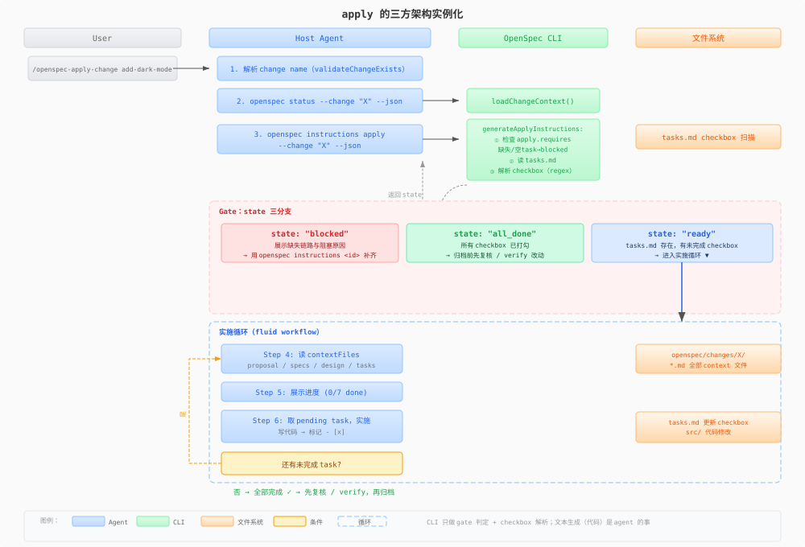

# 03 — apply：实施执行

apply 是 propose 的自然延续 —— 当所有规划 artifact 就绪，agent 按 tasks.md 中的清单逐一实施，标记 checkbox，直到全部完成。

---

## 1. Apply Gate：为什么需要"准入检查"



apply 不是"用户说 apply 就开始写代码"。它有一个**gate 机制** —— `openspec instructions apply --change X --json` 会根据前提条件是否满足返回不同状态，agent 根据状态决定是否允许实施。

这个设计的意义：**防止 AI 在没有充分规划的情况下写代码**。apply 拒绝在 specs/design/tasks 缺失时执行。

---

## 2. `openspec instructions apply` 的内部逻辑

实现位于 `src/commands/workflow/instructions.ts` 中的 `applyInstructionsCommand`。

### 2.1 执行流程

1. 解析 change name（与 propose 同款 `validateChangeExists`）
2. 调用 `loadChangeContext()` 加载 schema、构建 DAG、检测 completion
3. 从 schema 获取 `apply.requires` 和 `apply.tracks`。对于 spec-driven，`apply.requires: [tasks]`，`apply.tracks: tasks.md`。如果 schema 没有定义 `apply.requires`，`generateApplyInstructions()` 会回退为 schema 的全部 artifact ID（`schema.apply?.requires ?? schema.artifacts.map(a => a.id)`）
4. 调用 `generateApplyInstructions()`

### 2.2 generateApplyInstructions 的核心逻辑

1. **检查缺失 artifact**：遍历 `apply.requires`，对每个 artifact 检查其输出文件是否存在。如果任何必需 artifact 缺失 → `state: "blocked"`，并列出 `missingArtifacts`
2. **读取 tracks 文件**（通常是 tasks.md）：apply.tracks 按 artifact outputs 解析，glob 匹配到的每个具体任务文件都会被解析（自定义 artifact 名/输出路径/glob 均可）；如果 tracks 没匹配到任何文件 → `state: "blocked"`；读得到的文件里某个读失败则记入 `unavailableTrackingFiles`
3. **解析 checkbox**：逐行扫描每个任务文件，用正则匹配 checkbox 格式
4. **计算进度**：total / complete / remaining（对每个解析出的 checkbox 计数，与 `openspec list`、archive 同一口径）
5. **判断状态**：
   - `blocked`：缺少必需 artifact、缺少 tracks 文件，或 tracks 文件存在但没有任何 checkbox task
   - `all_done`：所有 checkbox 已标记。此时 `instruction` 是 `All tracked tasks are complete.\nReview or verify the change as appropriate before archiving.`——**只说明跟踪任务完成，不宣称可以归档**（v1.14.1 #1791）
   - `ready`：两种来源——① tasks.md 存在且有未完成任务；② **schema 根本没配置任务追踪文件**（`!tracksFile`，此时 `instruction` 是 schema 自己的 apply instruction 或 `All required artifacts complete. Proceed with implementation.`）。第二种很容易被误读成 all_done，区别是它从不数 checkbox

### 2.3 返回的 JSON 结构

```json
{
  "state": "ready",
  "contextFiles": {
    "proposal": ["/project/openspec/changes/add-dark-mode/proposal.md"],
    "specs": ["/project/openspec/changes/add-dark-mode/specs/theme/spec.md"],
    "design": ["/project/openspec/changes/add-dark-mode/design.md"],
    "tasks": ["/project/openspec/changes/add-dark-mode/tasks.md"]
  },
  "progress": {
    "total": 7,
    "complete": 0,
    "remaining": 7
  },
  "tasks": [
    {
      "id": "1",
      "description": "1.1 Create theme context",
      "done": false,
      "sourcePath": "/project/openspec/changes/add-dark-mode/tasks.md",
      "line": 6
    },
    {
      "id": "2",
      "description": "1.2 Add CSS variable generation",
      "done": false,
      "sourcePath": "/project/openspec/changes/add-dark-mode/tasks.md",
      "line": 7
    }
  ],
  "taskTrackingConfigured": true,
  "instruction": "Read context files, work through pending tasks, mark complete as you go..."
}
```

**关键字段**：

- **`state`**：三种状态 —— agent 必须根据状态走不同分支
- **`contextFiles`**：artifact ID → 文件路径数组。**agent 必须在开始实施前读完所有这些文件**。这个列表是 schema 驱动的，不是硬编码的 —— 不同 schema 可能包含不同的 artifact
- **`progress`**：total/complete/remaining 计数
- **`tasks`**：解析后的 checkbox 列表，每项带 `id`、`description`、`done`，以及 v1.14.0 起的来源定位 **`sourcePath` + 1-based `line`**（`e7a9512d`；实现在 `src/commands/workflow/instructions.ts` 的 `LocatedTask`/`parseLocatedTasks`——只在共享 parser 结果上补位置，不改任务解析本身）。无描述文本的 checkbox 不进列表但仍计入 progress，所以列表可比 total 短
- **`taskTrackingConfigured`** / **`unavailableTrackingFiles`**：schema 是否配置了任务追踪；追踪文件存在但读不到时逐个列出 path 与原因（verify 用它判 "not verified"，不在 verify 语境下对 apply 只是信息）
- **`missingArtifacts` / `missingPrerequisites`**（缺前置产物时）：`missingArtifacts` 列出 `apply.requires` 的直接缺口；`missingPrerequisites`（`collectMissingPrerequisites`，`instructions.ts:437-465`）则沿 `requires` 边传递收集并按拓扑构建序排列整条缺失链路（防 #834/#869 看到只缺 `tasks` 就跨过 `specs` 直接手写 `tasks.md`）。注意：tracks 文件缺失或 `tasks.md` 没有任何有文本的 checkbox 时也会 `blocked`，但此时没有 `missingArtifacts`
- **`warnings`**（非 `blocked` 时按需附带，`collectApplyWarnings`）：例如 change 未声明 `skip_specs: true` 却没有 delta spec，或 `specs/` 下放了合并路径不会读的非 `<capability>/spec.md` 文件，或 `.openspec.yaml` 含未知键
- **`context` / `operationGuidance`**（可选）：来自 `<root.path>/openspec/config.yaml` 的项目背景与 `operations.apply.guidance` 建议性指导

---

## 3. Checkbox 与多行任务解析机制

### 3.1 正则与单字符标记规则

计数器位于 `src/utils/task-progress.ts`（`parseLocatedTaskLines` / `parseTaskLines` / `getTaskProgressDetailForChange`），`list` / `view` / `instructions apply` / `validate --archived` / `archive` 共享同一套解析器；另注意 `src/core/validation/task-checkboxes.ts` 职责不同——它只做「tracked tasks 文件有列表项但一个 checkbox 都没有」的检测，供 `validate` 报 WARNING（`09984b8`）：

```typescript
const TASK_LINE_PATTERN = /^\s*(?:[-*+]|\d{1,9}[.)])\s*\[(?:\s*([^\]\s]?)\s*\](?![([])|\s+\])\s*(.*)/;
// done = (match[1] ?? '').toLowerCase() === 'x'
```

四个关键点：

- **列表标记与缩进** — `-`、`*`、`+` 与有序标记（`1.`、`1)`，最多九位数字）都算（v1.13.1 `8fc65b7f`）；允许前导缩进，**缩进的子任务（如 `  - [ ] 1.1.1`）照常计数**。
- **任意单非空白字符或空框均匹配（#1761）** — 方括号内**不再局限于空白与 `x`/`X`**，而是匹配「至多一个非 `]` 非空白字符（两侧允许空白）」或「纯空白 `\s+`」。其中**只有 `x`/`X` 计为完成（`done: true`），其余一切单字符标记（如 `[~]`、`[-]`、`[?]`、`[1]`）与空框 `[]` 全部计入分母且算作未完成（`done: false`）**！这样把进行中任务标成 `- [~]` 不会静默掉出分母、让 `archive` 误报 "✓ Complete"。
- **单字符 Markdown 链接守卫 `(?![([])`** — 闭合 `]` 后不能紧跟 `(` 或 `[`，把 `- [A](https://example.com)` 与 `- [1][ref]` 这类单字符标签的链接列表项排除在外（纯空白框 `- [ ](...)` 例外，仍保守算作未完成任务）。
- **`\s*(.*)`** — 尾部不锚定 `$`，描述可为空（空描述行计入 `progress` 总数但被 `toTaskItems` 过滤出待办列表）；`\r` 不会被 `.` 吞掉，CRLF 的 `tasks.md` 也能正常解析。

### 3.2 什么算 checkbox

- `- [ ] Task` → 未完成（`done: false`）
- `- [x] Task` / `- [X] Task` / `- [ x] Task` → 完成（`done: true`）
- `- [~] Task`、`- [-] Task`、`- [?] Task`、空 `- [] Task` → **均算 checkbox，且全部为未完成（`done: false`）**
- `* [ ]`、`+ [ ]`、`1. [ ]`、`1) [ ]` → 均支持（全 CommonMark 列表标记）
- `  - [ ] 1.1.1 子任务` → **算**（允许任意前导缩进）

### 3.3 什么不算 checkbox

- 没有方括号的普通列表项 `- Task` → 不算
- **多字符方括号**如 `- [WIP] Task` → 不算（保持单字符宽度，防止吞掉普通 Markdown 链接列表）
- **单字符 Markdown 链接**如 `- [A](url)` / `- [1][id]` → 不算（被 `(?![([])` 拦截）
- 非列表项中的 `[ ]` → 不算（必须以列表标记开头）
- **整份 tasks 文件只有列表项、一个 checkbox 都没有** → v1.13.1 起 `validate` 会报 WARNING 并指出第一处 offending line（`09984b8`）

### 3.4 多行折行任务合并（v2.0.0 #2228）

早期实现只取匹配 `TASK_LINE_PATTERN` 的那一行文本，导致按列宽折行的长任务在第一个换行符处被截断，`instructions apply` 交到 agent 手里的只有半句话。v2.0.0（#2228，`parseLocatedTaskLines` in `src/utils/task-progress.ts:83-150`）改为读取列表项的**完整首段落**：

- 紧跟在任务行之后、凡**未命中 `TASK_TEXT_BREAK_PATTERN`**（空行、ATX `#` 标题、` ``` `/`~~~` 围栏、`>` 引用、`<!--`/`<!`/`<?`、setext `===`/`---` 下划线或分隔线、任何新的无序/有序列表项）的续行，都会 trim 后以单个空格拼接到当前任务的 `description` 末尾（若上一行末尾有奇数个 `\` Markdown 硬换行符，先剥除末尾 `\` 再拼接）。
- `line` 仍记录 checkbox 所在的 1-based 起始行号；续行本身不会额外增加任务计数。

### 3.5 编号约定

`X.Y` 格式（如 `1.1`、`2.3`）纯粹是约定，解析器不强求。建议 agent 使用它来保持可读性，但 `- [ ] Do the thing` 同样能正常被追踪。

---

## 4. 完整实施流程（7 步）

> **机制 vs 行为**：下面描述的 7 步流程来自 skill 模板（`src/core/templates/workflows/apply-change.ts`）——它告诉 AI agent "应该怎么做"，而非 CLI 硬编码的执行逻辑。CLI 负责的是第 2 节的 apply gate（状态判定、checkbox 解析），agent 负责的是执行这些步骤。agent 理论上可以不按这 7 步走，但模板的设计意图就是引导 agent 遵循这个流程。

来自共享生成函数 `getApplyInstructions()` in `src/core/templates/workflows/apply-change.ts`（234 行；顶部 `:30-32` 注入 `STORE_SELECTION_GUIDANCE` + `PROJECT_ROOT_GUARD`，7 个编号步骤位于 `:38 / :47 / :56 / :93 / :103 / :111 / :129`）。

### Step 1：选定 change（`:38`）

优先级：
1. 用户提供的 change name（如 `/openspec-apply-change add-dark-mode`）
2. 从对话上下文推断
3. 如果只有一个活跃 change，自动选中
4. 如果有多个，运行 `openspec list --json` 并让用户选择

### Step 2：获取 schema 信息（`:47`）

```bash
openspec status --change "<name>" --json
```

目的：了解 `schemaName`、`planningHome`、`changeRoot`、`actionContext`。

### Step 3：获取 apply 指令（`:56`）

```bash
openspec instructions apply --change "<name>" --json
```

解析返回的 JSON，**根据 `state` 走不同分支**：

| state | agent 行为 |
|-------|----------|
| `"blocked"` | 暂停实施并展示阻塞信息。若 `missingArtifacts` 非空，展示缺失产物与 CLI `instruction` 字段给出的 CLI 恢复命令——即 **`openspec instructions <artifact> --change <name>`**（配合 `openspec status --change <name>` 查看剩余项，并保持 `--store`；注意 `describeArtifactRemedy` in `instructions.ts:397-414` **不再推荐 `openspec-continue-change`**，因为默认 `core` profile 根本不安装 `continue` 技能！）；若只是追踪文件缺失或无有效 checkbox，按 CLI 指令基于既有规划产物创建或修复追踪文件 |
| `"all_done"` | 报告所有被追踪任务已完成，建议**在归档前按需复核或验证改动**（`Review or verify the change as appropriate before archiving`） |
| `"ready"` | 继续到 Step 4（同时读取可选的 `context` 与 `operationGuidance` 作为实施约束，但绝不把它们当成任务已完成的证据或绕过 `blocked` 的许可） |

### Step 4：读 context files

读取 `contextFiles` 中的每一个文件。对于 spec-driven schema 这意味着 proposal、specs、design、tasks。

**不要假设文件名** —— 始终跟 `contextFiles` 走。不同 schema 的文件列表不同。

### Step 5：展示进度

```
## Implementing: add-dark-mode (schema: spec-driven)
Progress: 0/7 tasks complete
```

### Step 6：实施循环

```
for each pending task:
    显示 "Working on task N/M: <description>"
    写代码（最小化、聚焦于该 task）
    编辑前确认 sourcePath:line 处的 checkbox 仍与任务描述一致；不一致则重跑 apply instructions，用刷新后的位置
    在返回的 sourcePath:line 处标记完成：- [ ] → - [x]
    重跑 apply instructions，确认该任务已 done 且 progress 变化
    继续下一个
```

v1.14.0 起（`e7a9512d`）这个循环是围绕 `sourcePath`/`line` 设计的：在该位置勾选 → 标记完成 → 重查进度。行号是 `instructions apply --json` 返回时刻的快照，所以模板要求"编辑前确认该处 checkbox 仍是这条任务"，防止编辑过程中 tasks.md 变动导致勾错行。

**暂停条件**（任一触发即停）：
- task 描述不清楚 → 请求澄清
- 实施中暴露出设计问题 → 建议更新 artifact
- 遇到错误或阻塞 → 报告并等待指导
- 用户中断

### Step 7：完成或暂停（`:129`）

- **全部完成**：展示汇总，报告所有被追踪任务已完成，提示**归档前先复核或验证改动**（`Review or verify the change as appropriate before archiving. Review the completed work, then ask to archive this change.`）
- **暂停了**：解释为什么停，等待指导

---

## 5. 实施中的流体工作流理念

apply 的 skill 模板 (`apply-change.ts`) 末尾有一段关键声明：

> "This skill supports the \"actions on a change\" model:
> - Can be invoked anytime: Before all artifacts are done (if tasks exist), after partial implementation, interleaved with other actions
> - Allows artifact updates: If implementation reveals design issues, suggest updating artifacts - not phase-locked, work fluidly"

这体现了 OpenSpec 的核心理念：**不是 phase-locked（阶段锁定）**。即使在 apply 阶段，agent 也可以回头修改 proposal/design/specs —— 因为实施过程中发现的问题可能颠覆之前的假设。apply → 发现设计问题 → 回到 propose 更新 design → 继续 apply，这是一个自然的循环，不是错误。

---

## 6. Apply Phase 的 schema 配置

`schemas/spec-driven/schema.yaml`：

```yaml
apply:
  requires: [tasks]
  tracks: tasks.md
  instruction: |
    Read context files, work through pending tasks, mark complete as you go.
    Pause if you hit blockers or need clarification.
```

`apply.requires` 决定了哪些 artifact 全部完成才算"可以实施"。对于 spec-driven，只有一个：tasks。但你可以定义自定义 schema 要求更多 —— 比如 `apply.requires: [specs, design, tasks, review]`。

`apply.tracks` 指定用哪个文件追踪进度。它总是指向一个有 checkbox 的文件。

`apply.instruction` 是 agent 在实施时收到的动态指导文字。v1.9.0 起共享 apply 模板还加了一条 **pause-on-scope** 护栏（`src/core/templates/workflows/apply-change.ts`）：任务需要的工作超出 spec/tasks 描述，或想靠 drop / narrow / defer / accept exceptions 塞进范围时，必须把新增范围摊开并暂停，不能默默缩小指定行为；只有指定行为全部落地才能勾 `- [x]`。这是 prompt 合同，不是 CLI 硬校验。

---

## 7. 与另外三条命令的关系

```
explore ──(洞察结晶)──→ propose ──(全部 artifact 完成)──→ apply ──(全部 task 完成)──→ archive
    ↑                       ↑                               │                            │
    │                       │                               │                            │
    └─── 任何阶段都可以 invoke explore ──────────────────────┘                            │
                            └─── 实施中发现问题可以回到 propose 更新 artifact ─────────────┘
```

apply 是唯一**真正修改应用代码**的阶段。explore 只读，propose 只写规划 artifact，archive 只合并和移动 —— 只有 apply 会动 `src/` 下的业务代码。
