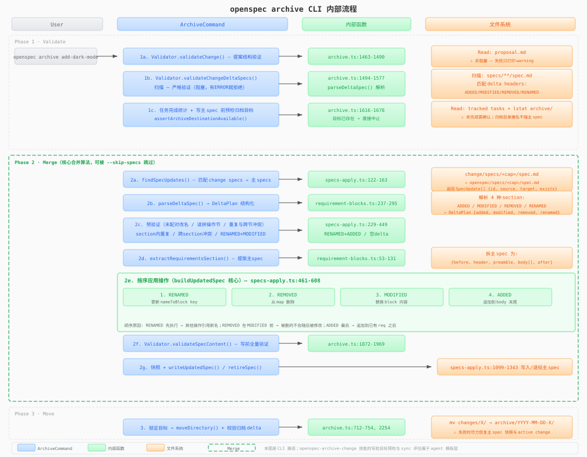

# 04 — archive：archive 合并

archive 是整个 change 生命周期的终点。它做三件事：验证 change、将 delta spec 合并到主 spec 基线、然后把 change 目录移到 archive 区。

这里需要先区分两条相关但不同的路径：

- **`openspec archive` CLI**：由 `ArchiveCommand.execute()` 执行，程序化完成验证、delta spec 合并和目录移动。
- **host 的 archive workflow skill/command 模板**：由 host agent 按 `archive-change.ts` 的指令执行，会先做 delta spec sync 状态评估，再按模板移动目录。Claude Code 等显示为 `/openspec-archive-change`；Codex 使用 `$openspec-archive-change` skill。它不是 `ArchiveCommand.execute()` 的逐字封装。

本篇主体讲 `openspec archive` CLI 的内部机制；第 5 节单独说明 host archive workflow 的 sync 检查与 operation inputs。

---

## 1. 三阶段总览



`openspec archive` 来自 `src/core/archive.ts` 的 `ArchiveCommand.execute()`。逻辑上可分为三大阶段（validate → merge → move），但 mutation 边界更准确地说是：① 结构/delta 验证与 tasks 检查 → ② 全量预构建 → ③ 全量 rebuilt validation → ④ 捕获 snapshots 后写入/退役 → ⑤ verified move。mutation 后任何一步失败都会尝试恢复 snapshots 和 active change；并发修改阻止安全恢复时显式报告 rollback failure。

```
Phase 1: Validate
  ├── proposal.md 验证（非阻塞，只警告）
  └── delta spec 验证（阻塞，有 ERROR 就拒绝 archive）

Phase 2: Merge（除非 --skip-specs）
  ├── 找到所有 delta spec
  ├── 全量构建更新后的 specs（buildUpdatedSpec）
  ├── 全量验证重建后的 specs
  ├── 检查 fingerprints 并捕获 mutation snapshots
  └── 写入或退役主 specs

Phase 3: Move
  ├── 创建 archive/ 目录
  ├── 无日期前缀时生成 YYYY-MM-DD-<changeName>
  ├── rename；EPERM/EXDEV 时走 private staging + verified copy
  └── 失败时尽力恢复 main specs 与 active change
```

---

## 2. 验证阶段

### 2.1 proposal 验证（非阻塞）

`archive.ts:1461-1491`（仅在非 `--json` 人类模式下执行）：调用 `Validator.validateChange(proposal.md)`（`src/core/validation/validator.ts:110-154`）按 `ChangeSchema` 检查 `proposal.md` 的结构（Why/What Changes 是否存在、长度上下限、**以及单 change 的 delta 条目数上限 `MAX_DELTAS_PER_CHANGE = 10`** 等，同时过滤掉 `deltas.<n>.requirement(s)` 避免重复告警）。**这里的任何 issue（哪怕在 `ChangeSchema` 里属于 `ERROR` 级）在 `openspec archive` 中都是纯信息性的 `Proposal warnings in proposal.md (non-blocking)`，绝不阻塞归档**。

### 2.2 delta spec 验证（阻塞）

`archive.ts:1494-1577`：扫描 `<changeDir>/specs/`（含根级误放的 `specs/spec.md`、合并路径不读的散落 delta 文件、以及 `skip_specs` 与 `specs/` 文件共存冲突），用 `Validator.validateChangeDeltaSpecs(changeDir)`（`src/core/validation/validator.ts:175-578`）做结构与内容验证：

| 检查项 | 级别（`openspec archive` 行为） |
|--------|------|
| 根级 `specs/spec.md` 或非 `<capability>/spec.md` 的散落 delta 文件 | **ERROR**（阻塞归档） |
| 无法识别的 `## ... Requirements` 标题（如 `## DEPRECATED Requirements`、`## Add Requirements`）下含 `### Requirement:`（#2207） | **ERROR**（阻塞归档；`buildUpdatedSpec` 也会二次拒绝） |
| 普通非 delta 章节（如 `## Notes`）下或首个 `## ` 之前的孤立 `### Requirement:` | WARNING（提示但放行） |
| 缺少合法 delta section，或 section 内无任何可解析条目 | **ERROR**（阻塞归档） |
| `RENAMED` 中存在未成对的孤立 `FROM:` / `TO:` 行 | **ERROR**（阻塞归档） |
| ADDED/MODIFIED requirement 正文缺失 | **ERROR**（阻塞归档） |
| requirement 正文存在但缺少英文 `SHALL`/`MUST` | WARNING（显示但不阻止归档；`validate --strict` 失败） |
| ADDED/MODIFIED requirement 缺少有效 scenario（空 scenario 标题不计数） | **ERROR**（阻塞归档） |
| `#### Scenario:` 缺少触发步骤（`WHEN`/`GIVEN`）或结果步骤（`THEN`）（#2079） | WARNING（显示但不阻止归档；`validate --strict` 失败） |
| 同一 section 内 requirement 名重复，或跨 section 冲突（含 `RENAMED`+`REMOVED` 大小写折叠冲突） | **ERROR**（阻塞归档） |
| ADDED requirement 正文 `> 500` 字符（或独立 `validate <change>` 下 MODIFIED 正文 `> 500` 字符且比主 spec 基线更长，#2265） | WARNING（显示但不阻止归档；`validate --strict` 失败） |
| delta spec 顶部 YAML frontmatter（#2273） | **合法放行**（`validate --strict` 亦不报错；合并时留在 change 内并在 `warnings` 说明） |
| `skip_specs: true` 与 `specs/` 下任何文件共存，或 `.openspec.yaml` 元数据非法导致标记无法生效 | **ERROR**（阻塞归档） |

> **易混纠偏**：`MAX_DELTAS_PER_CHANGE`（10）定义在 `ChangeSchema`（`src/core/schemas/change.schema.ts:32`），只走 2.1 节针对 `proposal.md` 的非阻塞 `validateChange()`，**不在** `validateChangeDeltaSpecs()` 中检查，因此超过 10 条 delta **不会**阻塞 `openspec archive`。

如果 `validateChangeDeltaSpecs` 存在任何 **ERROR**，**CLI 立即拒绝归档**；WARNING 只显示，不阻止。`--no-validate` 可跳过验证阶段，但需要额外确认（或 `--yes`，且跳过验证时永不触发 capability 退役）。

### 2.3 任务完成检查

`getTaskProgressForChange(changesDir, changeName, projectRoot)` 调用点：读取任务追踪文件，统计未完成 checkbox。如果有未完成任务，警告并要求确认。与 `list` / `view` / `instructions apply` 共用 `src/utils/task-progress.ts` 的同一 parser——**缩进的子任务也计入**（旧版只认列 0 的 checkbox，未完成的 `  - [ ] 1.1.1` 会被漏掉，archive 于是"✓ Complete"却带着半截活收档）。

---

## 3. 合并阶段：核心算法

这是整个 OpenSpec 中最精密的单段算法。核心入口是 `buildUpdatedSpec()` in `src/core/specs-apply.ts`。

### 3.1 找 delta spec

`findSpecUpdates()` (`src/core/specs-apply.ts`)：递归扫描 `<changeDir>/specs/`。对于每个包含 `spec.md` 的 capability path，查找相同相对路径的主 spec 文件：

```
change/specs/data-export/spec.md  →  openspec/specs/data-export/spec.md
change/specs/user-auth/spec.md    →  openspec/specs/user-auth/spec.md
change/specs/identity/session/spec.md → openspec/specs/identity/session/spec.md
```

返回 `SpecUpdate[]`，每个包含 `{source, target, exists}`（target 是主 spec 路径，exists 表示主 spec 是否已存在）。

`changes/<change>/specs/spec.md` 没有 capability folder，递归发现器不会把它当 update；validator/archive 会把这种根级 delta 作为 ERROR 拒绝，而不是静默跳过。

### 3.2 解析 delta plan

`parseDeltaSpec()` (`src/core/parsers/requirement-blocks.ts`)：将 delta 格式的 spec 文件解析成 `DeltaPlan`：

```typescript
interface DeltaPlan {
  added: RequirementBlock[];       // { headerLine, name, raw }
  modified: RequirementBlock[];
  removed: string[];               // 只是 requirement 名
  renamed: Array<{ from: string; to: string }>;
  sectionPresence: {               // 标记哪些 section 出现了
    added: boolean;
    modified: boolean;
    removed: boolean;
    renamed: boolean;
  };
}
```

解析过程：
1. 用 `splitTopLevelSections` 按 `##` headers 切分内容
2. 大小写不敏感匹配四个 section 类型
3. `parseRequirementBlocksFromSection()`：提取 `### Requirement:` header 和 body 内容（包括所有 `#### ` 级 scenario；不限于字面 `#### Scenario:`）
4. `parseRemovedNames()`：提取 requirement 名（可以是 `### Requirement:` header 或 bullet 中的引用）
5. `parseRenamedPairs()`：解析 `FROM:` / `TO:` 对

### 3.2.1 delta section 是 list，列表标记全接受

`DeltaPlan` 的 section 解析有两处保真修复（`src/core/parsers/requirement-blocks.ts`）：

1. **sections 从 title-keyed record 改为按书写顺序的 list**。之前重复写同一 header（如两个 `## ADDED Requirements`，或 fence 示例自带重复 header）时，后写的覆盖先写的，大小写折叠 lookup 只返回第一个匹配——被丢弃副本里的 requirement 在 validate/merge 之前就没了，但 `validate` 报零问题、`archive` 报成功，主 spec 悄悄和已审阅的 delta 不一致。现在每个 section 保留自己的出现次序和行号；lookup 返回所有匹配 section；`FROM:`/`TO:` 按 section 配对，一份里的 `FROM:` 不会和另一份的 `TO:` 配对。

2. **REMOVED 的 bullet 形式与 RENAMED 的 `FROM:`/`TO:` 行接受 `[-*+]` 全部 CommonMark 列表标记**。之前硬编码 `-`，用 `*`/`+` 写的删除/改名 delta 匹配不到任何东西——`validate` 报 valid、`archive` 退出 0，但需求根本没动。`FROM:`/`TO:` bullet 保持可选；`### Requirement:` header 形式不变。

### 3.2.2 scenario bullet 换行与 `<` 开头散文行不再误挡退役

`retire_capabilities` 全文件审计（`contentTheMergeCannotName` / `mayBeRawHtml` in `src/core/specs-apply.ts:735-1017`）经历两轮关键保真收敛：
- **折行列表项与 `+` 标记识别**：把缩进或懒折行续行识别为同一条 scenario bullet，且支持 `[-*+]` 与 1–9 位有序标记（此前换到第二行的 bullet 或 `+` 标记写的 scenario 会被误判为无法归属内容，卡死退役）。
- **`<` 开头的普通散文行放行（v2.1.1 #2266）**：`mayBeRawHtml()` 仅将真正的 CommonMark HTML 块（kinds 1–6，如 `<details>`/`<div>`/`<!--`）或整行独立闭合标签（kind 7）判为原始 HTML；像 `<args> are passed on` 这类碰巧以 `<` 开头的折行英文散文按普通文本放行，不再无故阻止能力退役。

### 3.3 预验证与新 spec 骨架（合并前）

`buildUpdatedSpec()`（`specs-apply.ts:229-449`）在修改任何文件之前先做结构与冲突检查：

1. **未配对 `RENAMED` 拒绝**：任何孤立的 `FROM:` 或 `TO:` 行直接报错拒绝，绝不猜测错位配对。
2. **误拼 `## ... Requirements` 章节拒绝（#2207）**：若 `orphanedRequirements` 落在非四类标准名的 `## ... Requirements` 标题下（`isUnrecognizedDeltaSection`），直接抛错中止；落在普通散文标题下的孤立 requirement 则记入 `warnings`；delta 顶部的 YAML frontmatter（#2273，`hasFrontmatter`）保持在 change 内并记一条说明性 warning。
3. **section 内重复**：同一个 ADDED/MODIFIED/REMOVED/RENAMED section 内不能出现同名 requirement。
4. **跨 section 冲突**：同一 requirement 不能同时出现在多个操作节中（其中 `RENAMED` 的 `FROM` 与 `REMOVED` 采用大小写/空白折叠比对）。
5. **RENAMED + MODIFIED / ADDED 交互**：若 `RENAMED` 将 `OldName` → `NewName`，`MODIFIED` 必须引用新名 `NewName`，且 `ADDED` 不能与 `NewName` 撞名。
6. **空 delta 防护**：至少解析出一个 delta 操作。

如果目标 spec 不存在（新 capability）：
- 只允许 ADDED；含 MODIFIED 或 RENAMED 直接报错；含 REMOVED 则忽略并产生警告。
- **`buildSpecSkeleton()`（`specs-apply.ts:1458-1464`）**：若 delta 含可读的 `## Purpose`（不含未闭合 fence 或 HTML 注释），将其拷入新主 spec（少于 50 字符时额外提示 `validate --strict` 会报过短），缺失或不可读时回退到 `TBD ...` 占位符；v2.1.1 **#2267** 起生成的骨架固定为 `# <spec> Specification\n\n## Purpose\n\n<body...>\n\n## Requirements\n`——在 `## Purpose` 标题后补齐空行，使新建主 spec 天然通过 Prettier 与 markdownlint `MD022`。已有主 spec 的 `## Purpose` 永不被 delta 覆盖（若两侧不同会给出忽略提示）。

### 3.4 提取主 spec 的 Requirements section

`extractRequirementsSection()` (`requirement-blocks.ts`)：将目标 spec 的内容拆分为：

```
before:   "# Capability Specification\n\n## Purpose\n..."
header:   "## Requirements"
preamble: ""（或 header 后的文字直到第一个 requirement）
body:     [RequirementBlock, RequirementBlock, ...]
after:    ""（Requirements section 之后的文字）
```

然后构建 `nameToBlock` map：key 是 normalized requirement name（当前 `normalizeRequirementName()` 做的是「剥收尾 `#` run + `trim()`」，不 lower-case），value 是完整的 `RequirementBlock`。

注意：`normalizeRequirementName` 只做 trim，**不做 toLowerCase**。header 匹配用的 regex 是大小写不敏感的（`/^###\s*Requirement:\s*(.+)\s*$/i`），但 map key 保留原始大小写。这意味着 `### Requirement: User Auth` 和 `### Requirement: user auth` 的 header 能被同一个 regex 匹配，但它们在 map 中是不同的 key。

### 3.5 按序应用操作

这是整个 archive 流程中最关键的代码段（`buildUpdatedSpec()` 的合并主体，`specs-apply.ts` 的 `// RENAMED` / `// REMOVED` / `// MODIFIED` / `// ADDED` 四个注释块）。操作有严格的顺序，**不能打乱**：

#### 第一：RENAMED（`specs-apply.ts:462-519`）

```typescript
// 1. 在 map 中查找 from：
//    - 若 from 不在但 to 已在（且无大小写/空白近似拼写残留）→ early-sync 幂等 no-op，直接 continue
//    - 若 from 与 to 都不在（或存在近似拼写歧义）→ 报错
// 2. 检查 to 是否已被占用（含大小写/空白近似冲突）→ 已占用报错
// 3. 获取 from 的 block，改写 header 行，删除旧 key 并写入新 key，原位更新 orderedKeys[orderIndex] = to
```

为什么 RENAMED 必须最先做？因为如果 RENAMED 在后，MODIFIED 只能引用旧名字，导致改名后 MODIFIED 的内容丢失。

**修复**：rename 操作使用 `orderedKeys` 列表追踪位置标识。rename 更新 key 而不把块移到 spec 尾部（之前的 Map delete+set 会将条目移到插入顺序末尾），因此 RENAMED + MODIFIED 同一条时 rename 保持在原位置，archive diff 更易读。

#### 第二：REMOVED（`specs-apply.ts:521-547`）

```typescript
// 1. 在 map 中查找 name：
//    - 若不存在：若 map 中有大小写/空白近似名（疑似拼错）→ 报错；否则视为已 early-sync 移除，发 warning 并 continue
// 2. 存在则从 map 中 delete，removedApplied++
```

为什么 REMOVED 在 MODIFIED 前？因为如果 MODIFIED 在 REMOVED 前，REMOVED 会删除 MODIFIED 的结果。正确的语义是：先移掉不需要的，再修改保留的。

为什么 REMOVED 在 RENAMED 后？因为 RENAMED 改了 key，REMOVED 应该针对的是新 key。

#### 第三：MODIFIED（`specs-apply.ts:549-578`）

```typescript
// 1. 在 map 中查找 name → 找不到报错
// 2. 验证新 block 的 header 与 key 一致，并用 diffScenarioNames 检查未丢掉主 spec 现存 scenario（漏掉直接报错）
// 3. 替换 map 中的 block（仅当 normalizeBlockRaw 内容真有变化时才递增 modifiedApplied，幂等兼容 early-sync）
```

完整的 requirement block（包括所有 scenario）必须在 MODIFIED 中提供 —— 不是 diff，是整个替换。这就是为什么 schema instruction 反复强调"copy the ENTIRE requirement block"。

#### 第四：ADDED（`specs-apply.ts:580-607`）

```typescript
// 1. 在 map 中查找 name：
//    - 若同名已存在且 normalizeBlockRaw 完全一致 → early-sync 幂等 no-op，直接 continue
//    - 若同名已存在但内容不同，或存在大小写/空白近似名 → 报错
// 2. 插入新 block，addedApplied++
```

为什么 ADDED 最后？因为如果在 RENAMED 之前做 ADDED，RENAMED 的 TO 可能和 ADDED 冲突检测为假阴性。ADDED 应该检测合并后的最终状态。

### 3.6 重建 spec（保序与围栏外空行折叠）

此前 rename 操作通过 Map delete+set 将块移到 insertion-order 尾部。当前使用 `orderedKeys` 列表独立追踪位置标识（`specs-apply.ts:612-670`）：

```typescript
// orderedKeys 保持源块的顺序标识，rename 更新 orderedKeys[index] = to 而非移到尾部
const orderedKeys = parts.bodyBlocks.map((b) => normalizeRequirementName(b.name));
// ...
for (let index = 0; index < parts.bodyBlocks.length; index++) {
  const key = orderedKeys[index];
  const replacement = nameToBlock.get(key);
  if (replacement) {
    keptOrder.push(replacement); // 原位保留或替换
    seen.add(key);
  }
}
for (const [key, block] of nameToBlock.entries()) {
  if (!seen.has(key)) keptOrder.push(block); // 全新追加到末尾
}

// 非空切片用双换行拼接，再仅在代码围栏外折叠多余空行（确保末尾单 LF）
const rebuilt =
  collapseBlankRunsOutsideFences(
    [parts.before.trimEnd(), parts.headerLine, reqBody, parts.after.trim()]
      .filter((s) => s !== '')
      .join('\n\n')
  ).trimEnd() + '\n';
```

新内容（ADDED）仍追加到末尾。保留的块中有 `## Scenario:` 等被 MODIFIED 吸收的 tail 内容时，会检测 `firstForeignTail` 并标记 loss 信息。

**对顺序的尊重**：已有的 requirement 保持它们原来的相对位置。新的 requirement 追加到 Requirements section 末尾。这避免了每次archive 打乱整个 spec，让 git diff 可读。

**空行压缩不碰代码 fence**。`buildUpdatedSpec()` 末尾的空行压缩（`.replace(/\n{3,}/g, '\n\n')`）之前是无差别作用于整个重建文档——需求里 YAML block scalar、Python、expected-output 样例只要含两个以上连续空行，archive 每次跑都会「整理」一次，而空白在那些上下文里携带语义。现在改用 `collapseBlankRunsOutsideFences`（复用模块内已有的 `buildCodeFenceMask`），只在 fence 外折叠空行；fence 内原样保留。fence 外行为不变：只有真正空行算 blank，纯空格行永不作为折叠边界。

### 3.7 写前验证

CLI 会先对所有 `SpecUpdate` 调用 `buildUpdatedSpec()`，把 rebuilt 内容准备好；如果这一步任何一个 spec 失败，会在写入前中止并提示 "No files were changed."。

随后先对 prepared 列表中所有需要写回的 rebuilt spec 运行 `Validator.validateSpecContent()`（`src/core/validation/validator.ts`）。只有**全部 rebuilt validation 通过**，才会检查 archive 目标、验证输入 fingerprint、捕获每个 mutation target 的 snapshot，然后进入写入/退役阶段。

写入、退役或最终移动 change 失败时，CLI 会调用 `restoreSpecSnapshots()`，并在 change 已移动时尝试把 archive 目录移回 active 位置。因此当前边界是“尽力事务式回滚”，不是“写过就不恢复”。若并发外部修改使安全恢复不再可能，CLI 会保留现场并显式报告 `Rollback also failed`；这种 rollback failure 才需要人工按报错路径恢复。

**快照与回滚细节**（`archive.ts` 的 `captureSpecSnapshots()` / `restoreSpecSnapshots()`，v1.13.2 起为 Windows 复制回退配套）：写入/退役前对每个 mutation target 捕获快照——已存在的普通文件记录原始内容与 mode；symlink 记录 `readlink` 结果（outcome 为 write 时再尽力读取其指向的当前内容，作为"原本是否存在内容"的依据）；不存在的 target 记录 `pruneBoundary`（从 target 目录向上找到的、`mainSpecsDir` 下最深的已存在祖先目录）。回滚按逆序执行，且恢复前先复核：当前内容仍等于快照内容、或等于 archive 刚写入的 rebuilt 内容、或 symlink 指向未变——检测到并发修改就拒绝覆盖并报错，而不是清掉别人的改动。

**新建 spec 的回滚剪裁**（`f2812f6d`）：`existed: false` 的 target 回滚时只删这次写入创建的文件，并只向上清空**本次写入自己创建的 capability 目录**（prune 以 `pruneBoundary` 为边界）；用户本就存在的目录——哪怕为空——不会被移除，mode 也原样保留。

### 3.8 已 early-sync 的 delta 不再一律失败

识别“agent sync 已把同一内容写入 main spec”的正常模式：内容相同的 ADDED/MODIFIED、已消失的 REMOVED、以及 source 已消失但 target 已存在的 RENAMED 都是 no-op，archive 不会为它们重写 main spec。REMOVED 的 no-op 会携带 warning，JSON archive 结果也可返回 `warnings`。

这个宽容只针对**确实已应用的同一操作**。主 spec 里仍存在仅大小写或空白不同的近似 requirement 时，工具会明确报错要求精确匹配；内容不同的 ADDED 仍是 collision。fenced code 中的 scenario/header 也不会参与 drift 比较，UTF-8 BOM 不会让首个 delta section 失效。

---

## 4. 移动阶段

### 4.1 生成archive 名

```typescript
const archiveName = /^\d{4}-\d{2}-\d{2}-/.test(changeName)
  ? changeName
  : `${formatLocalDate()}-${changeName}`;
// "add-dark-mode" -> "2026-06-14-add-dark-mode"
// "2026-06-01-add-dark-mode" -> 保持原名，不重复前缀
```

### 4.2 冲突检测

如果 `archive/2026-06-14-add-dark-mode/` 已存在 → 报错退出。建议用户改名或删除重复 archive。

### 4.3 移动

`moveDirectory()` 先用 `fs.rename()` 尝试原子移动。如果失败且错误码为 `EPERM` 或 `EXDEV`（Windows/跨设备常见），不会直接从仍可能被编辑的 active path 复制并删除，而是：

```text
active source
  -> rename 到同级私有 .openspec-move-<uuid>
  -> fingerprint staged source
  -> 复制到目标
  -> 验证 source/destination fingerprint 与 archived deltas
  -> 删除 staged source
```

复制或验证失败时，CLI 清理自己创建的目标并把 staged source 改回 active path。若最后清理 staged source 失败但目标已是唯一完整副本，则保留完整目标并给 recovery 错误，而不是为追求表面原子性再把目标删除。

### 4.4 最终状态

```
openspec/changes/archive/2026-06-14-add-dark-mode/
  .openspec.yaml
  proposal.md
  specs/
    theme/spec.md
  design.md
  tasks.md

openspec/specs/theme/spec.md    ← 已更新（如果有 delta spec）
```

---

## 5. Sync 检查与 operation inputs（host workflow 层面）

host archive workflow (`archive-change.ts`) 在选择 change 后先调用 `openspec instructions archive --change <name> --json`。返回的 `context` 是项目级 prompt input，`operationGuidance` 是适用时遵守的 advisory guidance；它们不改变 CLI root、validator、任务确认或 merge 规则。随后 workflow 才在移动之前检查 delta spec 是否已经合并到主 spec。这个检查属于 **agent 模板层**，不是 `ArchiveCommand.execute()` 的内部步骤。

```text
if delta specs exist:
   对比 change 中的 delta spec 和主 spec
   提示用户四选一：
     - "Sync now (recommended)"  → inline 执行 sync → 验证全部 capability → 通过后才 mv
     - "Archive without syncing" → 直接 archive
     - "Cancel"                  → 停止，changeRoot 完整
     - 其他输入                  → 重新询问
```

**当前加固行为**：
- **在接触任何主 spec 之前预检归档目标目录（v2.1.1 #2277，`archive-change.ts:127-130, 157`）**：Step 4 一开头（评估 delta 前）以及用户确认同步、即将写主 spec 前，都会先推导 `<target-name>` 并检查 `<planningHome.changesDir>/archive/<target-name>` 是否已存在——一旦重名冲突，**在写入或退役任何主 spec 之前立即中止**，避免改完主 spec 才在 Step 5 `mv` 时发现归档目标已被占用。CLI `archive.ts:1662-1678` 同样在进入 spec 更新分支前先跑 `assertArchiveDestinationAvailable()`。
- **sync 技能缺失时的内联合并回退与 `validate --specs` 兜底（#1977，`archive-change.ts:29-31, 168, 234-235`）**：正常情况下在写出主 spec 前先拉一次 `openspec instructions specs --change "<name>" --json` 规则快照并传给 `openspec-sync-specs` 技能内联执行；若项目自定义裁剪掉了 `sync` 技能，agent 会直接在当前流程内完成等效的智能合并，且必须遵守 `SYNC_FALLBACK_SAFEGUARDS`——仅在 `.openspec.yaml` 声明 `retire_capabilities: true`、无额外手写章节且路径解析在真实 specs 根内时才允许删除空主 spec，并在合并后强制运行 **`openspec validate --specs`**（校验失败即按 sync 失败中止归档，不移动 `changeRoot`）。
- sync 必须 **inline** 执行（不等完成绝不 mv——防止 changeRoot 被移走后 sync 读不到 delta spec）。若 agent 只能通过委托运行 sync，也必须**同步**委托并等待结果，不得丢给后台
- **sync 报任何 stop/blocking 条件即视为 sync 失败**（v1.14.0 起，`0ff63dba`）：立即停止归档，不做 post-sync 内容比对、不移 `changeRoot`。一切未动，用户可修复阻塞条件或重跑 sync
- sync 完成后对 `artifactPaths.specs.existingOutputPaths` 中**每个 capability** 重新验证：ADDED 存在、MODIFIED 含变更且其他 scenario 完整、REMOVED 消失、RENAMED 用新名
- **sync 后结构验证**（canonical sync contract）：主 spec 不得残留 `## ADDED/MODIFIED/REMOVED/RENAMED Requirements` 等 delta header；sync 写入/改动的 requirement block 用 `### Requirement:` 标题、scenario 用 `#### Scenario:` 标题，置于 `## Requirements` 下；REMOVED 的 requirement 必须已删；retire 掉的 capability（最后一个 requirement 被移除、`## Requirements` 变空）其主 spec 被删除而非留空。新主 spec 以 `# <capability> Specification` 开头、`## Purpose` 从 delta 原样复制；已有主 spec 的标题与 Purpose 完全不动
- 任何 mismatch 都停止 archive，changeRoot 保持完整
- main spec 路径改用 store-aware `planningHome.root`，不硬编码当前 repo 路径
- 新增 **Cancel** 选项

---

## 6. 命令行标志

| flag | 作用 |
|------|------|
| `-y, --yes` | 跳过所有确认提示（未完成任务确认、spec 更新确认、`--no-validate` 确认） |
| `--skip-specs` | 跳过 spec 合并（只做校验、任务检查与目录移动） |
| `--no-validate` | 跳过验证（不推荐，需要额外确认或配合 `--yes`；且跳过验证时永不触发 capability 退役） |
| `--json` | 输出结构化 JSON（成功返回 `{ archive, root }`，阻塞返回 `{ archive: null, root?, status: [diagnostic] }` 并退出 1；全程无交互，要求显式提供 `<change-name>` 并在需确认路径配合 `--yes`） |
| `--store <id>` | 作用于本机已注册的独立规划 store 根而非本地仓库 `openspec/` |

---

## 7. archive 后的不可逆性

archive 操作没有"unarchive"。一旦 change 移入 `archive/`，它就从活跃工作流中消失了。如果 spec 合并出问题，只能手动修正主 spec 文件然后重新提交。

这也是为什么验证阶段如此严格 —— 一旦写入主 spec，错误的 requirement 就会成为系统的正式基线。

---

## 8. 当前行为摘要

| 变更 | 影响位置 | 说明 |
|---|---|---|
| date prefix 防堆叠 | `archive.ts`：move 前检测 change name 是否已有 `YYYY-MM-DD-` 前缀 | 已有前缀则不再叠加，避免 `2026-07-21-2026-06-14-xxx` |
| recursive capability path | `spec-discovery.ts` / `findSpecUpdates()` | 支持 `specs/identity/session/spec.md`；delta/main 同路径；根级 delta 会报错 |
| Purpose carry-through | `specs-apply.ts` | 新 capability 的 delta Purpose 进入新 main spec；existing Purpose 保持权威 |
| early-sync no-op | `specs-apply.ts` | 完全一致的 ADDED/MODIFIED、已移除 REMOVED、已改名 RENAMED 不造成无意义失败或重写 |
| parser / drift robustness | `requirement-blocks.ts` / `code-fence.ts` | BOM、fenced code 不再造成假 delta 或 scenario drift |
| inline verified sync | `archive-change.ts` | agent sync 后逐 capability 验证 + 结构验证（无 delta header 残留、REMOVED 已删、retired 主 spec 删除）才允许移动 change；Cancel 保留 changeRoot |
| sync 阻塞即停止归档 | `archive-change.ts`（agent 模板层） | sync 报任何 stop/blocking 即视为失败，立即停止归档：不做 post-sync 内容比对、不移 `changeRoot`；一切未动，可修复后重跑。inline sync 不得委托后台（step 5 会把 `changeRoot` 移走） |
| **retire_capabilities** | `.openspec.yaml` marker（`archive.ts` / `specs-apply.ts`） | change 的 REMOVED 拿掉某 capability 最后一个 requirement 时，声明 `retire_capabilities: true` 可让 archive 删除整个 main spec，而不是以 "at least one requirement" 中止；无 marker 时行为不变。退役只发生在 spec 确实无法保留时，输出会列出被删 section 并给可粘贴的 `git checkout` 恢复命令；`--no-validate` 永不触发退役。与退役 capability 的 in-flight MODIFIED change 会 validate 通过、archive 拒绝（blocked-content 细分见下） |
| 重复 canonical 名拒绝 | `archive.ts` | main spec 存在重复 canonical requirement 名时拒绝归档，避免 delta reconciliation 压掉重复块之一 |
| note-loss 提示 | `archive.ts` | 重建 spec 会丢失 requirement 旁的 note（缩进 note、未识别 heading）时，先指名会删的内容与迁移位置；merge 本身不自动搬移 |
| 交互失败可重跑 | `archive.ts` 的 `confirmOrBlock()` | agent 以 stdin closed 跑 archive 时，每个被阻塞的确认会给出需要哪个 flag 和携带原 flags 的可粘贴重跑（如 `openspec archive <name> --skip-specs --yes`）；无 change 名时从 exit 0 吞错改为 exit 1 请求 change 名 |
| 非 TTY 无 ANSI | `src/utils/interactive.ts` | stdout/stdin 不是终端时 confirm 走纯文本；无 change 名时要求先传入名字，不画菜单。避免捕获日志里塞满 cursor-move 转义 |
| spec 重建保空白 | `specs-apply.ts` | 保留 `## Requirements` 周围空行，文件末尾恰好一个 LF，避免 Markdown whitespace 检查失败 |
| scenario-loss 认所有 `####` | `requirement-text.ts` `SCENARIO_HEADER` | requirement 下任何非 fence 的 `#### ` 子标题都算 scenario；比较时剥可选 `Scenario:` 前缀 |

### 归档成功但清理失败（v1.14.1 #1792）

退役能力的备份收尾是**归档之后**的动作（`finalizeRetirementBackups`）。它失败时语义在 v1.14.1 被改对了——之前是与归档失败共用一个错误码、且文案断言了一个可能不成立的事实：

| | 旧 | 现在 |
|---|---|---|
| 异常类 | `RetirementBackupsRetainedError` | `RetirementCleanupError` |
| 诊断码 | 通用 `archive_error` | **`archive_retirement_cleanup_failed`** |
| 文案 | "The change remains archived and each listed backup was retained for recovery." | "The change **was** archived, but retirement cleanup did not complete. Inspect all reported recovery paths before recovery or cleanup." |
| 逐条 | "Could not remove the committed retirement backup at …" | "Could not **finalize** the retirement backup at …" |
| fix | 无 | "Inspect the archived change and all recovery paths in this diagnostic; preserve any needed content before cleanup." |

关键区别：**change 已归档**（目录已移动，retry 不会回到从前），**清理未完成**（备份可能只删了一部分）。旧文案说"每个列出的备份都被保留"，部分成功时并不成立。

### 包含检查：三个目录可以是 symlink，archive/ 不行（v1.14.2 #2052）

archive 前置的路径检查从单一的 `assertPathWithin` 拆成按目录区分的四组：

| 受管目录 | 允许边界 | 叶子可以是链接？ |
|---|---|---|
| `openspec/` | 项目根 | ✅ |
| `changes/` | `openspec/` | ✅ |
| `archive/` | `changes/` | ❌ 必须留在所在 changes 目录内 |
| `specs/` | `openspec/` | ✅ |

即"项目自有 symlink"是允许的（典型场景：`openspec/` 或 `specs/` 指向一个共享文档仓库），但 `archive/` 必须真的在 changes 里——否则归档会写到项目外。`assertPathWithinAllowingLinkedLeaf` 要求链接 resolve 到已存在的路径（悬空链接报错）。

配套修正：归档后校验 delta 时，相对路径基准从 `changeDir` 改为 `canonicalChangeDir = canonicalizeExistingPath(changeDir)`。因为 `update.source` 是 canonical 的，而 `changes/` 自身可能是链接——旧算法会算出错误的相对路径，导致"归档后内容比对失败"的假警报。

### retirement 的三分支

| 重建后状态 | archive 的诊断 | 正确处理 |
|---|---|---|
| 空 capability，除 title/Purpose/requirements 外无内容，且只缺 marker | 提示添加 `retire_capabilities: true` | 在有效 `.openspec.yaml` 中与 `schema:` 并列添加后重跑 |
| 空 capability，但有 `## Notes`、orphan section、requirement 外注释等 unaccounted content | 列出 blocking lines；不会建议 marker | 把内容移入 `## Purpose` 或 canonical requirement，或人工删除 spec，再重跑 |
| marker 已存在但不能 honor，或 marker 有效但仍有 blocking content | 报具体 invalid reason，或明确“declares retire_capabilities, but ...” | 先修 YAML/schema/boolean marker，或清理 blocking content；marker 不能绕过内容丢失保护 |

### archive / parser 加固

| 变更 | 影响位置 | 说明 |
|---|---|---|
| rename 保序 | `specs-apply.ts` `buildUpdatedSpec()` | `orderedKeys` 独立追踪位置标识，RENAMED 更新 key 但不移到 spec 尾部 |
| Purpose 占位符检测 | `src/core/validation/purpose-placeholder.ts` | validate 检测 archive 遗留的 `TBD - created by archiving change ...`，WARNING 级、`--strict` 失败 |
| advisory merge preflight | `src/core/validation/` | delta 与 main spec 的合并冲突在 validate 阶段报为 informational findings，不改退出码；FS 读取错误保留为 error |
| delta section 改 list | `requirement-blocks.ts` | 重复 `## ADDED/...` header 全部应用，不再互相覆盖；FROM/TO 按 section 配对 |
| 全 CommonMark 标记 | `requirement-blocks.ts` | REMOVED/RENAMED 接受 `[-*+]`；此前 `*`/`+` 写的 delta 静默不生效 |
| 换行 scenario bullet | `specs-apply.ts` / retirement | 包裹换行的 bullet 读成一条，`+` 标记也识别 |
| fence 内空行保真 | `specs-apply.ts` `collapseBlankRunsOutsideFences` | 只折叠 fence 外空行；YAML block scalar / Python / expected-output 样例不再被整理 |
| unapplied 文本告警（v1.14.2 #2054） | `requirement-blocks.ts` `findUnappliedContent` / `describeUnappliedContent` | `DeltaPlan` 新增 `unappliedContent: {section, line}[]`；archive 在 `buildUpdatedSpec` 时 `warn()`，validate 报 WARNING。**搬运行为不变** |
| 未识别 `## ... Requirements` 拒绝（#2207） | `requirement-blocks.ts` `isUnrecognizedDeltaSection` / `specs-apply.ts` | 误拼 delta 操作节下的 `### Requirement:` 在 validate 报 ERROR、在 archive 直接抛错中止，不再当作普通孤立块放过 |
| delta YAML frontmatter 豁免（v2.1.1 #2273） | `requirement-blocks.ts` `findFrontmatterEnd` / `specs-apply.ts` | delta 顶部的 frontmatter 不计入 `unappliedContent`，`validate --strict` 放行；archive 将其留在 change 并记录说明 |
| 新主 spec `## Purpose` 空行（v2.1.1 #2267） | `specs-apply.ts` `buildSpecSkeleton()` | `## Purpose` 标题后固定补空行，满足 Prettier 与 markdownlint `MD022` |
| `<` 开头折行散文放行退役（v2.1.1 #2266） | `specs-apply.ts` `mayBeRawHtml()` | 仅拦截真正的 CommonMark HTML 块/独立标签，`<args> ...` 等折行散文不再卡死 `retire_capabilities` |
| 写主 spec 前预检归档目标（v2.1.1 #2277） | `archive-change.ts` Step 4（及 `archive.ts:1677`） | 先校验 `<changesDir>/archive/<target-name>` 未占用再改主 spec，杜绝改完 spec 才撞名失败 |
| retirement 清理错误码（v1.14.1 #1792） | `archive.ts` `toArchiveDiagnostic` | `RetirementCleanupError` → `archive_retirement_cleanup_failed`，独立 fix 文案 |
| 三个目录允许 symlink（v1.14.2 #2052） | `archive.ts` 前置检查 + `file-system.ts` | `openspec/`、`changes/`、`specs/` 可链接；`archive/` 不可 |

安全输出也有硬边界：blocking content 最多展示 3 行，每行按 Unicode code point 截到 200，超出加省略号并汇总剩余行数；NUL–US、DEL 等控制字符替换为 `?`。marker 无法 honor 的 reason 同样清理控制字符，避免伪造终端行或重绘屏幕。


## v1.13.0 delta parser 语义更新

v1.13.0 统一并收紧了 delta 解析规则（`46ff91f2` 起 archive 与 validate 共用同一 reader）：

- **列表标记**：delta section 下的 requirement 接受 `-`/`*`/`+` 全部 CommonMark 标记（此前 `*`/`+` 被静默忽略——validate 通过、archive 报成功但没生效）。
- **多 section**：同一文件内重复的 `## ADDED/MODIFIED/REMOVED/RENAMED Requirements` 段落全部应用（此前只应用一份）。
- **scenario bullet**：包裹换行的 bullet 读为单条；无正文的 scenario header 被 validate 拒绝。
- **requirement 名**：剥收尾 `#`；仅大小写不同的名字被 archive 拒绝；畸形 RENAMED 对被拒绝。
- **section 外 requirement**：写在 delta section 之外的 requirement 会被 validate 报告（此前无视）。
- **fence 内空行**：archive 的空白行整理变为 fence-aware，代码样例不再被重写。
