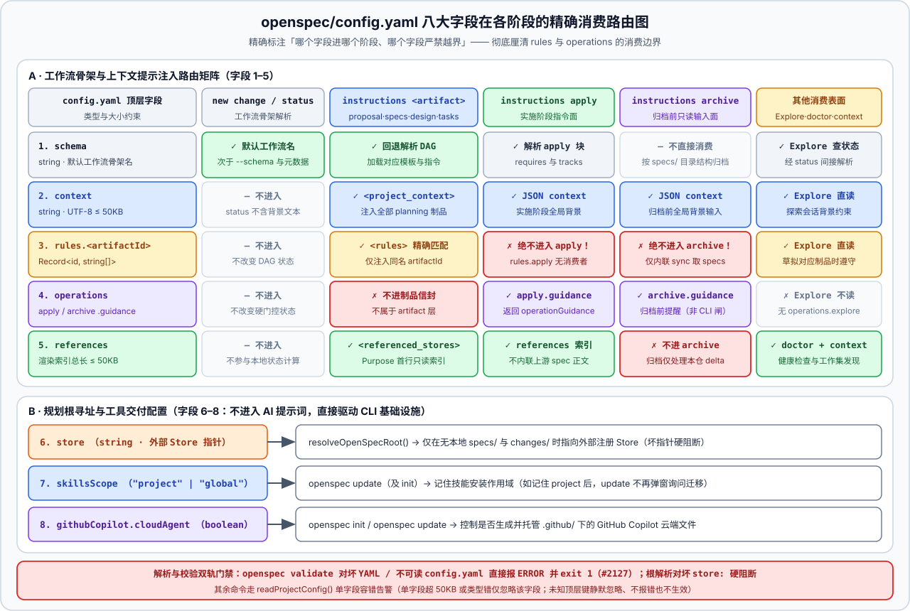

# 06 — config.yaml 的机制与约束

前五篇讲的是 schema 驱动的四条命令。但还有一层控制面经常被忽略：`openspec/config.yaml`。它不定义工作流的结构（那是 schema 的事），但会在 artifact 指令、Apply/Archive operation inputs，以及 Explore 会话初始化时被读取。

这篇从源码出发，精确说明 config.yaml 是什么、有什么约束、如何被使用、以及怎样利用它。

---

## 1. config.yaml 是什么

位于 `<projectRoot>/openspec/config.yaml`（也接受 `.yml`）。它是 **项目级的配置补丁**，叠加在 schema 之上。

**它不是什么**：
- 不是 schema（不定义 artifact DAG）
- 不是 spec（不定义系统能力）
- 不是 change 元数据（不写 `.openspec.yaml` 里的东西）

**它是**：一份告诉 OpenSpec CLI "在这个项目里，AI agent 在生成内容时应该知道哪些背景、遵守哪些约束"的配置文件。

---

## 2. Zod Schema：精确的类型约束

定义在 `src/core/project-config.ts`：

```typescript
const ProjectConfigSchema = z.object({
  schema: z
    .string()
    .min(1)
    .describe('The workflow schema to use (e.g., "spec-driven")'),
  context: z
    .string()
    .optional()
    .describe('Project context injected into all artifact instructions'),
  rules: z
    .record(
      z.string(),
      z.array(z.string())
    )
    .optional()
    .describe('Per-artifact rules, keyed by artifact ID'),
  operations: z.object({
    apply: z.object({ guidance: z.array(z.string()).optional() }).optional(),
    archive: z.object({ guidance: z.array(z.string()).optional() }).optional(),
  }).optional(),
  store: z.string().optional(),
  githubCopilot: z
    .object({ cloudAgent: z.boolean().optional() })
    .optional()
    .describe('GitHub Copilot integration preferences'),
  skillsScope: z
    .enum(['project', 'global'])
    .optional()
    .describe('Where this project keeps its OpenSpec skills'),
});
```

其中 `githubCopilot` 目前只识别 `cloudAgent` 一个布尔子字段（`project-config.ts:79-87`、解析在 `:436-451`）：`cloudAgent` 是 boolean 才收下，给了非 boolean 会 warn `Invalid 'githubCopilot.cloudAgent' field in config (must be a boolean)`；`githubCopilot` 本身不是对象则 warn `Invalid 'githubCopilot' field in config (must be an object)`；其他子字段静默丢弃。`skillsScope`（v2.1.0 起，`project-config.ts:89-96`、解析在 `:453-460`）记录团队选择的技能安装作用域（`"project"` 或 `"global"`），使 `openspec update` 不再重复询问是否迁移到全局技能目录；非法值会 warn `Invalid 'skillsScope' field in config (must be "project" or "global")` 并忽略。

> **注意**：Zod schema 中 `context` 字段**只有 `z.string().optional()`，没有 `.max(...)` 约束**。50KB 的长度上限是**在 `readProjectConfig()` 运行时手动检查**的（`project-config.ts:357-365`，用 `Buffer.byteLength` 比对 `MAX_CONTEXT_SIZE`），不在 Zod 类型定义里。Zod schema 在这里主要起"类型推导 + 文档"作用；真正的逐字段容错解析逻辑写在 `readProjectConfig()` 函数体中，而非依赖 `ProjectConfigSchema.safeParse()` 整体校验。

### 字段约束表

| 字段 | 必填 | 类型 | 约束 | 默认值 |
|------|------|------|------|--------|
| `schema` | 是 | `string` | 非空 | 无（`openspec init` 自动写入 `spec-driven`） |
| `context` | 否 | `string` | 最大 **50KB**（51,200 字节，运行时检查） | 无 |
| `rules` | 否 | `Record<string, string[]>` | key 应为合法的 artifact ID；值必须是字符串数组 | 无 |
| `operations` | 否 | object | 只接受 `apply` / `archive`；各自只接受字符串数组 `guidance` | 无 |
| `store` | 否 | `string` | config-only root 的默认 store 指针；根解析走严格的 `readStorePointer()` | 无 |
| `references` | 否 | string 或 `{id, remote}` 数组 | 由 `readProjectConfig()` 手工解析；渲染出的索引共享 **50KB** 上限（`MAX_RENDERED_INDEX_SIZE`） | 无 |
| `githubCopilot` | 否 | `{ cloudAgent?: boolean }` | GitHub Copilot cloud coding-agent 生成开关 | 无 |
| `skillsScope` | 否 | `'project' \| 'global'` | 项目 OpenSpec skills 的存放作用域（项目内 `.agents/skills/` 或本机 `~/.agents/skills/`） | 无 |

当前项目级 `openspec/config.yaml` 的已消费顶层字段共有**八个**：`schema`、`context`、`rules`、`operations`、`store`、`references`、`githubCopilot` 与 **`skillsScope`**。其中 `rules` 只属于 artifact prompt 注入层；`context` 同时进入 artifact 与 operation input；`operations` 只为 Apply/Archive 提供 advisory guidance；`schema` 属于 workflow schema 选择层；`store` / `references` 处理 root 与跨 store 上下文；`githubCopilot` 控制云端 agent 文件生成；`skillsScope` 记录技能安装作用域。



如果 YAML 顶层额外写了其他 key，例如 `team:`、`metadata:`、`owner:`，当前实现会被 YAML parser 读到，但不会成为 OpenSpec 的运行时配置。结果就是：**静默忽略，不报错，也不生效**；不要把自定义 metadata 与上述已消费字段混在一起期待它被 workflow 使用。

### 50KB 限制（`context` 与 `references` 索引共享）

`project-config.ts:256`（并由 `src/core/references.ts:46` 复用为 `MAX_RENDERED_INDEX_SIZE = MAX_CONTEXT_SIZE`）：
```typescript
export const MAX_CONTEXT_SIZE = 50 * 1024; // 50KB hard limit, shared with the references index
```

- 如果 `context` 字段超过 50KB，**该 context 字段被忽略并打印 warning**（不截断，全有或全无），**不影响 config 的其他字段** —— `schema` 和 `rules` 照常生效（`project-config.ts:357-365`）。
- 同样地，`references` 组装并按 XML 渲染出的上游 store 索引总大小也受同一个 50KB UTF-8 字节上限约束（`MAX_RENDERED_INDEX_SIZE`），超出部分截断并附带 warning 诊断。

### rules key 与元素形状验证

1. **元素形状诊断与引号修复提示（#1984，`describeRulesShapeError` in `project-config.ts:265-294, 400`）**：当 `rules.<artifactId>` 不是字符串数组时（最常见踩坑是裸 `-` 列表项里写了未加引号的 `": "`，被 YAML 解析成了键值映射 mapping），告警会精确点名每个违规下标及其实际 YAML 类型（如 `rules.proposal[0] is a mapping`），并在检测到 mapping 时主动追加修复提示：`— an unquoted ": " makes YAML read the item as a key/value pair; quote the whole scalar to keep it a string.`。
2. **artifact ID 存在性校验**：`config.yaml` 的 `rules` 字段 key 不强制与当前单 change schema 绑定——但若写了一个在**任何可用 schema 中都不存在**的 artifact ID，会在**每次 session 首次生成指令时**产生一个 warning（`project-config.ts:514-531` 的真实文案）：

```
Unknown artifact ID in rules: "review". It matches no artifact in any available schema. Known artifact IDs: <sorted ids>
```

**关键：校验基准是「所有可用 schema 的 artifact ID 并集」，不是当前 change 所选 schema 的 artifact 列表。** 所以 `specs`、`review` 这类 key 只要任何一个已安装 schema 里有同名 artifact 就不报警。验证入口在 `generateInstructions()`（`instruction-loader.ts:381-394`）：
```typescript
if (projectConfig?.rules) {
  const validArtifactIds = new Set(
    listSchemasWithInfo(effectiveProjectRoot ?? undefined).flatMap((s) => s.artifacts)
  );
  const warnings = validateConfigRules(projectConfig.rules, validArtifactIds);
  for (const warning of warnings) {
    if (!shownWarnings.has(warning)) {
      console.warn(warning);
      shownWarnings.add(warning);  // 每个 session 只警告一次
    }
  }
}
```

---

## 3. config.yaml 在何时被读取

config.yaml 不是在启动时一次性全局读取的，而是**在需要时才读**。具体时机：

### 时机 1：`openspec instructions <artifact>` 调用时

`src/core/artifact-graph/instruction-loader.ts`：
```typescript
let projectConfig = null;
if (effectiveProjectRoot) {
  try {
    projectConfig = readProjectConfig(effectiveProjectRoot);
  } catch {
    // 读不到就跳过，不阻塞指令生成
  }
}
```

即每次 agent 调用 `openspec instructions proposal --change X --json`，都会重新读 config.yaml。这保证了**最新修改立即生效**，不需要重启或重新 init。

### 时机 2：`openspec new change` 创建 change 时

`change-utils.ts:132-147`：读取 `config.schema` 来决定新 change 的默认 schema。

### 时机 3：Apply / Archive / Explore

- `openspec instructions apply --change X --json` 读取 `context` 与 `operations.apply.guidance`，同时返回 change-local `contextFiles`。
- `openspec instructions archive --change X --json` 读取 `context` 与 `operations.archive.guidance`；Archive agent workflow 在归档前调用它。确定性的 `openspec archive` CLI 不把 prompt guidance 变成 merge 规则。
- Explore workflow 从 resolved root 直接读取 `context` 和 `rules`，作为会话/写 artifact 时的约束；它不消费 `operations`。

### status 的边界

`openspec status` 会通过 change metadata / schema / planning home 构造 artifact 状态、`nextSteps` 和 `actionContext`。

其中 `actionContext` 来自 planning home、project root 和 artifact IDs（`src/core/change-status-policy.ts` 的 `buildActionContext()`），**不是**从 project context 或 artifact rules 注入。

### resilience 设计与两条显式硬阻断例外

在常规 prompt/指令读取链路上，`readProjectConfig()` 自身吞掉所有异常并返回 `null` 或部分 config（源码注释：`readProjectConfig never throws: missing/unparseable configs are null.`），所以 `loadRootConfigContext()`、`createChange()` 等消费点直接调用即可，不会抛异常中断生成。

**但有两条关键路径特意绕开 fail-open，实行硬阻断（fail-closed）**：
1. **`openspec validate` 拦截不可读或语法损坏的 `config.yaml`/`.yml`（#2127 / #1892）**：`ValidateCommand.execute()`（`src/commands/validate.ts:123-141`）在校验任何 spec/change 之前先调用 `readConfigParseError(root.path)`（`project-config.ts:477-498`）。一旦 `openspec/config.yaml`（或 `.yml`）无法读取（`unreadable_config`）或不是合法 YAML（`unparseable_config`），`openspec validate` **直接报错并以退出码 `1` 终止**，确保 CI 能抓出损坏的项目配置。
2. **根解析与 `init` 守卫拦截畸形 `store:` 指针**：根解析不走 `readProjectConfig()` 的静默丢弃分支，而是调用 `readStorePointer()`（`project-config.ts:628-653`）。若配置文件因 YAML 语法错误无法解析（`malformed: 'unparseable'`）或 `store:` 不是单个字符串（`malformed: 'non_string'`），根解析直接报 `invalid_store_pointer` 错误阻断，防止因丢掉 `store:` 指针而悄悄把工作写错到本地目录。

---

## 4. context、rules 与 operation guidance 如何进入指令

### 4.1 context 的注入

来自 `config.context`。在 `generateInstructions()` (`src/core/artifact-graph/instruction-loader.ts`)：

```typescript
const configContext = projectConfig?.context?.trim() || undefined;
```

注入后的效果（printInstructionsText 的格式化输出）：

```xml
<project_context>
<!-- This is background information for you. Do NOT include this in your output. -->

Project: ProcureFlow
Domain: Internal procurement request and approval platform
Stack: TypeScript, React, Node.js, PostgreSQL
</project_context>
```

**关键**：`context` 位于 `<!-- -->` 注释中，且明确标注 "Do NOT include this in your output"。它是给 AI agent 看的背景信息，**不是给输出文件的内容**。

### 4.2 rules 的注入

来自 `config.rules[artifactId]`。在 `generateInstructions()` (`src/core/artifact-graph/instruction-loader.ts`)：

```typescript
const rulesForArtifact = projectConfig?.rules?.[artifactId];
const configRules = rulesForArtifact && rulesForArtifact.length > 0 ? rulesForArtifact : undefined;
```

注入后的效果：

```xml
<rules>
<!-- These are constraints for you to follow. Do NOT include this in your output. -->
- Keep proposals under 500 words
- Always include a "Non-goals" section
</rules>
```

同样位于注释中，同样标注 "Do NOT include in your output"。

### 4.3 context vs rules 的区别

| | context | rules |
|------|------|------|
| **作用范围** | 所有 artifact 共享 | 按 artifact ID 分别注入 |
| **内容类型** | 项目背景信息（技术栈、领域等） | 可执行的工程约束 |
| **AI 怎么用** | 理解项目上下文 | 遵守具体规则 |
| **典型长度** | 屏幕半页 | 3-5 条规则 |
| **注入位置** | `<project_context>` 标签 | `<rules>` 标签 |

### 4.4 `operations`：给 Apply / Archive 的专用 guidance

```yaml
operations:
  apply:
    guidance:
      - Keep data migrations reversible.
  archive:
    guidance:
      - Confirm compatibility evidence before archiving.
```

`operations.apply.guidance` 和 `operations.archive.guidance` 是两条独立 operation surface。它们与 `context` 一起分别出现在 `openspec instructions apply`、`openspec instructions archive` 的 JSON 中；它们是 agent 应考虑的提醒，不能绕过 CLI `blocked` 状态、root 选择、validator 或 archive merge。

这也解释了一个常见边界：`rules.tasks` 可以约束任务清单的写法，却不会在 Apply 时重复注入；要给实施期稳定提醒，写 `operations.apply.guidance`，不是 `rules.apply`。

---

## 5. config.yaml 与 schema.yaml 的交互

### 5.1 `config.schema` 是桥梁

```yaml
# config.yaml
schema: spec-driven     # 选择用哪个 schema
```

这个字段决定了：
- `openspec new change` 创建 change 时用哪个 schema
- `openspec instructions` 加载哪个 DAG 的 artifact 定义
- `openspec status` 在 metadata 缺失时可通过 schema 解析回退链确定用哪个 DAG 判断 artifact 状态；正常新 change 会优先使用 `.openspec.yaml` 中已写入的 schema

### 5.2 rules key 校验依赖「所有可用 schema」

`config.rules` 的 key（artifact ID）是否合法，取决于**任何已安装 schema** 是否定义了该 artifact（取并集，不是只看当前 change 用的那个 schema）：

```yaml
# config.yaml
schema: spec-driven
rules:
  proposal: [...]    # ✓ spec-driven 有 proposal artifact
  specs: [...]       # ✓ spec-driven 有 specs artifact
  review: [...]      # ✗ 任何已安装 schema 都没有 review → 会产生 warning
```

### 5.3 context 的 50KB 限制是全局的

无论选什么 schema，`context` 字段共享同一个 50KB 上限。这是运行时硬限制，不在 schema 定义中。

---

## 6. 实践建议

### 6.0 两条语言配置路径

新项目可直接：

```bash
openspec init --language "Portuguese (pt-BR)"
```

它只在新 config 中种下合法 YAML string：

```yaml
schema: spec-driven
context: |
  Language: Portuguese (pt-BR)
  All artifacts must be written in Portuguese (pt-BR).
  Keep OpenSpec structural headings and SHALL/MUST keywords in English.
```

已有 `openspec/config.yaml` 时 flag 拒绝覆盖，应手工把同等说明合并进 `context`。language 先 trim；空值、多行、控制/不可见格式字符被拒绝，格式化后的 context 仍受 50KB 字节上限。可本地化的是 proposal/spec/design/tasks 的 prose；`## ADDED/MODIFIED/REMOVED/RENAMED Requirements`、`### Requirement:`、`#### Scenario:` 与规范关键字 `SHALL/MUST` 保持英文，normal/strict 的 validator 边界不因此改变。

### 6.1 rules 应该按 artifact 角色写

不同 artifact 在 DAG 中有不同角色，rules 应该匹配这种角色差异：

```yaml
rules:
  proposal:
    # proposal 是 scope 文档 → 约束 scope
    - Each proposal must identify affected existing capabilities
    - Breaking changes must be explicitly called out with **BREAKING**

  specs:
    # specs 是行为规约 → 约束行为完整性
    - Every requirement must have at least one unhappy-path scenario
    - Role-sensitive behavior must include explicit authorization scenarios

  design:
    # design 是技术方案 → 约束技术决策质量
    - Design decisions must include the alternative that was rejected and why
    - Migration risk must be explicitly assessed

  tasks:
    # tasks 是实施清单 → 约束可追踪性
    - Each task group must reference the spec requirement it implements
    - Tasks must be ordered by dependency
```

### 6.2 context 应包含"不变的背景"，不包含"这次要做什么"

- **放**：技术栈、领域术语、质量优先级、兼容性约束
- **不放**：这个 sprint 的目标、当前 change 的具体内容、临时的技术决策

因为 context 会被注入到**所有** artifact 的所有指令中，临时内容会反复干扰 agent。

### 6.3 新项目从 4 行 context + 1-2 条 rules 开始

```
context: 项目名、领域、技术栈、质量优先级
rules:
  proposal: 1-2 条最关键的 scope 约束
```

不要一开始写满。在用了几个 change 之后，看 agent 反复犯什么错误，再针对性地加 rules。

### 6.4 弱规则不如不写

弱规则（没有判断力，浪费 token）：

```yaml
rules:
  proposal:
    - Write clean code
    - Follow best practices
```

强规则（有对象、有约束、有判断方向）：

```yaml
rules:
  proposal:
    - Changes affecting the authorization module must reference existing auth spec requirements
    - New public API endpoints must document their error response contract
```

---

## 7. 常见误用（从源码角度看为什么是误用）

### 误用 1：把 rules 当成 "所有 artifact 都用同一套规则"

`config.rules` 是按 artifact ID 分别注入的。如果你写：

```yaml
rules:
  all:
    - Write good code
```

`all` 不是任何 schema 的合法 artifact ID → 每次生成指令都会收到 warning → 这条规则**永远不会被注入**。

**正确做法**：明确写清楚每条规则属于哪个 artifact：

```yaml
rules:
  proposal:
    - ...
  specs:
    - ...
```

### 误用 2：在 context 里写 PRD

context 50KB 限制的存在是有原因的 —— 太长的 context 会挤占 agent 的注意力。如果把 PRD 的详细功能列表放进 context，agent 在面对每个 artifact 时都会被这些细节干扰。

**更合适的做法**：PRD 级别的详细需求应该放在 `openspec/specs/` 中作为主 spec，然后在 proposal 中引用。

### 误用 3：在 rules 里引用只有当前 change 才相关的信息

```yaml
rules:
  tasks:
    - The CSV export must use RFC 4180 format
```

这条规则只对 "add-csv-export" 这个 change 有意义。它应该写在那个 change 的 spec 中，而不是全局 config。

### 误用 4：context 超过 50KB

超过后**该字段被忽略并 warning**（全有或全无）。如果你发现 agent 好像看不到你的 context，检查文件大小。

---

## 8. config.yaml 的解析容错策略与硬门禁边界

`readProjectConfig()` (`project-config.ts:325-470`) 的设计是 **逐字段 fail-open**（field-by-field resilient parsing），而非用 `ProjectConfigSchema.safeParse()` 做整体校验：

1. 文件不存在（`resolveConfigFilePath` 依次探测 `config.yaml` → `config.yml` 均无果）→ 返回 `null`（`project-config.ts:326-329, 656-663`；注意若 `config.yaml` 存在但损坏，**不会**回退读 `config.yml`）
2. YAML 解析失败或顶层非对象 → 在 `readProjectConfig()` 中 warn 并返回 `null`（`:335-338, :464-469`）；**但在 `openspec validate` 中会通过 `readConfigParseError()` 直接报 `unreadable_config` / `unparseable_config` 并退出 `1`（#2127），在 config-only 目录做根解析时也会被 `readStorePointer()` 判定为 `unparseable` 硬阻断**
3. `schema` 字段缺失或无效 → warn，返回的 config 中**不含 `schema` 字段**。**默认值 `'spec-driven'` 的回退发生在消费端** `resolveSchemaForChange`（`change-metadata.ts`），不在 `readProjectConfig` 内部
4. `context` 超过 50KB 或非 string → 忽略 `context` 字段并 warning（其他字段不受影响）
5. `rules` 不是合法对象，或某个 `rules.<id>` 含非字符串元素 → `describeRulesShapeError()` 逐下标报出 YAML 形状与 `": "` 加引号提示（#1984），仅忽略该受损条目集
6. `rules` 中有未知 artifact ID → 按所有可用 schema 的 artifact ID 并集校验，首次命中时 warning，不阻断
7. `store` 非字符串 → 在 `readProjectConfig()` 中 warn 并忽略；**但在根解析与 `openspec init` 指针守卫中，`readStorePointer()` 返回 `malformed: 'non_string'` 并直接报错拒绝执行**
8. `skillsScope` 非 `'project' | 'global'`，或 `githubCopilot.cloudAgent` 非 boolean → warn 并忽略该字段
9. 未知顶层 key → 不报错、不 warning，但也不会生效；不要依赖它承载自定义 metadata

这种分层设计的意图是：**常规指令读取容忍局部配置瑕疵、不让单字段拼写错误卡死日常对话；而涉及目标根路由（`store:`）和 CI 质量门禁（`openspec validate`）时，则严格报错拦截**。
