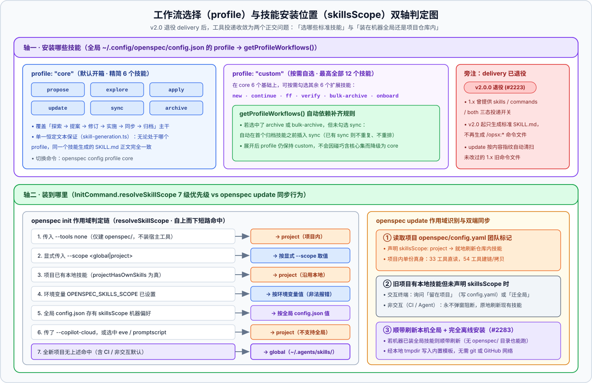

# 配置、Profile 与 Delivery

这一层非常关键，因为它解释了为什么同样是 OpenSpec，在不同项目、不同 AI 工具里看到的工作流外壳会不一样。

> **阅读注记**：本文第三节讲 `delivery`（skills / commands / both），那是 **1.x 的机制**。**v2.0.0 起 `delivery` 退役**（#2223），一律投递 skills；配置里不再有这一项。当前的「投递差异」只剩两件事：技能装在本机全局（`~/.agents/skills/`）还是项目内（`.agents/skills/`），以及项目内工具是直接读 `.agents/skills/` 还是在自己目录放一条链接。详见 §3bis。

## 1. 为什么这层重要

如果只看业务命令，会以为 OpenSpec 是一个纯项目内工具。但 `init` / `update` 的源码说明，OpenSpec 还负责把工作流“投递”到具体 AI 工具。

这就引出了三个关键概念：

- profile
- workflows
- delivery



## 2. `profile` 是选什么 workflow

`profile` 决定“启用哪些工作流”。

当前核心认识：

- `core` profile 会启用默认核心 workflows。
- `custom` profile 允许用户自定义启用哪些 workflows。

在当前源码里，`core` 默认工作流是 6 个：

- `propose`
- `explore`
- `apply`
- `update`
- `sync`
- `archive`

系统里可用的全部 workflows 则更广（12 个），包括：

- `propose`
- `explore`
- `new`
- `continue`
- `apply`
- `ff`
- `sync`
- `archive`
- `bulk-archive`
- `verify`
- `onboard`
- `update`

所以，profile 回答的是：

“这套项目/用户要安装哪几条工作流路径？”

## 3. `delivery` 是怎么投递（1.x 机制）

### custom profile 的依赖展开

custom 选择 `archive` 或 `bulk-archive` 时，`getProfileWorkflows()` 会确保 `sync` 在第一个依赖者之前；若已有 `sync`，不重复也不重排其余项。展开后的结果仍是 custom selection，不因“碰巧含 core workflow”而降级成 core。

**（1.x 历史）** `delivery` 决定“以什么形式把 workflow 安装进工具”。

它通常有三种意义：

- `skills`
- `commands`
- `both`

也就是说，同一份 OpenSpec workflow 内容，不一定总以同一种形式出现。

例如：

- 某些工具更适合读 skill 文件。
- 某些工具更适合读 slash command 文件。
- 有的场景则两者都要生成。

所以，delivery 回答的是：

“这些 workflow 产物最终要以什么外壳落到工具目录里？”

### v1.13.x→v2.0.0：从按 profile 拼装 handoff 到「每个技能单一恒定文本」

v1.13.1 曾引入 `src/core/templates/optional-workflow.ts`，在生成时按当前 profile 动态改写工作流间的 handoff 文案；**v2.0.0 已彻底删除 `optional-workflow.ts`**，`src/core/shared/skill-generation.ts:57-58` 现在明确保证：`workflowFilter` 只决定返回**哪些**技能，绝不改变任何技能的文本——**无论在哪个 profile 下，同一个 skill 的正文永远是完全相同的单一恒定文本**（如 `archive` / `bulk-archive` 模板内直接写明“已装 sync 技能则 inline 跑它，未装则由 agent 自行 inline 合并并跑 `openspec validate --specs`”）。配套地，每个 workflow skill 的 frontmatter `description` 含自然语短语（"openspec propose"、"opsx apply"，`5f5914e7`）；而 `openspec update` 这个 CLI 命令刻意不归任何 workflow skill 认领。

## 3bis. v2.x 接替 delivery 的两个东西

`delivery` 退役后，原来由它回答的问题拆成两半：

**① 装在哪一层作用域（`skillsScope` 的两处配置，切勿混同）**：

- **机器级默认偏好（全局 `~/.config/openspec/config.json` 的 `skillsScope: "global" | "project"`，`src/core/global-config.ts:47`）**：由 `openspec init` 在新项目尚未做出选择时读取；未配置时新项目 `init` 默认采用 `'global'`（写入 `~/.agents/skills/` 及各工具全局目录，并把 Git tree hash 记入 `$XDG_STATE_HOME/skills/.skill-lock.json` 或 `~/.agents/.skill-lock.json`）。
- **项目级团队选择（项目 `openspec/config.yaml` 的 `skillsScope: project`，`src/core/project-skills-scope.ts:15,36`）**：当团队选择把技能留在仓库内时写入 `openspec/config.yaml`，供 **`openspec update`** 读取（`keepsProjectSkills()`）——随 Git 提交后，团队其他成员跑 `update` 不会再被重复询问；若后续切回全局，`forgetProjectSkills()` 会将该键从 `openspec/config.yaml` 移除。非交互环境（CI、agent 调用）一律不弹问题，就地刷新。

```yaml
# openspec/config.yaml（仅在技能留在仓库内时记录）
skillsScope: project
```

**② 怎么落到每个工具** —— 全局离线安装 / 项目内一份真身 + 链接：

- **离线包内安装（v2.1.1 `#2283`）**：`installReleaseSkills()`（`src/core/skill-installer.ts`）把当前 CLI 内置的技能文本（经 `stripVolatileFrontmatter()` 剥离 `generatedBy:`）先写入本地临时目录 `os.tmpdir()/openspec-skills-*`，再调用运行时依赖 `skills` 包安装，**完全离线、无需 `git` 或 GitHub 网络**。
- **项目作用域下真身只有一份**：`.agents/skills/openspec-<workflow>/SKILL.md`（附 `.agents/skills/.openspec-target` 记录已配置工具列表）。
- **33 个直读 vs 54 个建链**：87 个工具里，33 个 `universal: true` 工具（如 `codex`、`cursor`、`gemini`、`github-copilot`、`cline`、`opencode`、`antigravity`、`zed`、`warp`、`amp`、`gsd`、`dsh`、`agents` 等）直接读取 `.agents/skills/`，不建链接；其余 54 个 `SKILL_LINKED_TOOL_IDS` 工具在各自 `skills/` 下放一条指向真身的相对链接，建不了链接（Windows 或 `eve`）则退化为拷贝（`eve` 额外剥离 `allowed-tools`）。
- Windows 上 checkout 提交进仓库的链接需要 `git config --global core.symlinks true` 与开发者模式，否则链接会变成普通小文件，`openspec update` 会把它替换成拷贝。

相关源码：`src/core/skill-installer.ts`、`src/core/global-skills.ts`、`src/core/project-skills-scope.ts`、`src/core/shared/shared-skill-install.ts`、`src/core/shared/skill-links.ts`（`SkillLinkSpot` 五态）。

**③ `update` 会就作用域提问**（终端里）：项目里已有自己的技能且 `openspec/config.yaml` 未记 `skillsScope: project` 时，交互式 `openspec update` 会问「这个项目的技能放在哪」——「留在这个项目」或「切到全局」。选「留在项目」会把 `skillsScope: project` 写进 `openspec/config.yaml` 并提示提交；选「切到全局」前，若仓库开着 GitHub Copilot cloud agent，会再确认是否关闭它（云端容器只看得到仓库内的技能）。同时，**当本机已安装全局 skills 时，`openspec update` 在没有 `openspec/` 的任意目录也能直接运行并刷新全局 skills**。

**两个机器级状态文件**（都在全局数据目录，从不出机器）：

| 文件 | 作用 |
|---|---|
| `projects.json` | `init` / `update` 记下「这台机器上用过 OpenSpec 的项目」，供后续迁移用。**没有任何东西依赖它**：读不了、写不了都当空处理，永不使命令失败 |
| `global-skills.lock` | 机器级安装的互斥锁（目录 + 里面写 pid）。因为 `skills` 包在多个项目间共用一个锁文件，同机并发安装会撞车。等锁最多 60s，锁超过 10 分钟视为陈旧；数据目录不可写时**放弃加锁继续执行**，不因此阻断安装 |

**共同的底座**：判断「这个文件是不是我没改过的」仍用 1.17.0 引入的内容指纹（`isReleasedGeneratedContent`），所以清理旧产物不需要 `--force`。

## 4. `init` 在做什么

`init` 的行为可以概括为：

1. 读取全局配置中的 profile（v2.x 无 delivery）。
2. 根据 profile 选出要启用的 workflows。
3. 生成技能内容（v2.x 只有 skills；1.x 还会按 delivery 决定是否生成 command）。
4. 确定作用域（`skillsScope`：项目或全局），把技能装到共享真身与各工具目录（链接或拷贝）。
5. 在必要时创建项目级 OpenSpec config。
6. 清理不再需要的旧产物（按内容指纹判断是否被用户改过）。

从系统角度看，`init` 是一次“工作流安装过程”。

## 5. `update` 在做什么

`update` 的本质不是重新安装，而是同步：

- 同步 OpenSpec 版本变化。
- 同步 profile 变化。
- 同步 `skillsScope` 变化（v2.x）／delivery 变化（1.x）。
- 同步 workflow selection 变化。
- 处理 legacy 目录和旧配置。

它还会判断：

- 哪些工具需要版本更新。
- 哪些工具虽然版本没变，但配置已经漂移，需要同步。
- 哪些 workflow 现在不再启用，需要删除对应文件。
- 本次实际更新的工具是否包含 IDE-resident surface；只有 registry 标为 `requiresIdeRestart` 且确实生成了对应 command/skill 时才提示 restart，CLI-only 工具更新不提示。

所以 `update` 更像“声明式同步器”。

## 6. Skills 与历史 Commands 的同源关系

源码里的 `skill-generation` 和 `command-generation` 很说明设计边界：

- 系统维护一组工具无关的 workflow 模板内容（`src/core/templates/workflows/`）。
- v2.0.0 起只把模板渲染为标准 `SKILL.md`，经 `skills` 包安装到全局或项目 `.agents/skills/`（+ 建链工具的相对链接）。
- 1.x 曾通过 34 个 command adapter 生成各工具私有的命令文件；v2.0.0 起这些 adapter 不再生成任何新文件，仅保留旧路径与格式规则供 `update` 清理历史命令文件。

这说明：

OpenSpec 真正稳定的资产不是某个具体工具的文件，而是“workflow 语义内容”。

skill（以及 1.x 已退役的 command）只是投递载体。

## 7. 为什么 `propose` 很特殊

从 profile 默认值和 `init` 完成后的 onboarding 提示可以看出，`propose` 放在非常显眼的位置。

这说明项目正在把默认体验向以下模式收束：

- 从用户意图出发，先 propose。
- 再通过 continue/apply/archive 等工作流推进。

也就是说，OpenSpec 并不只是维护静态规范文件，而是在尝试提供一个完整的变更工作流入口。

## 8. `config` 命令改变的不是业务数据，而是投递策略

这点非常重要。

用户运行 `openspec config`，通常不是在编辑某个 change，也不是在修改 schema 本身，而是在改：

- 启用哪些 workflow。
- 这些 workflow 怎样出现在 AI 工具里。

还要补一个实现边界（两处 `skillsScope` 的分工）：

- `openspec config` 改的是**全局配置** `~/.config/openspec/config.json`（`config --scope` 这一 CLI flag 目前只接受 `global`，意思是“改全局配置文件”）。
- 「新项目 `init` 把技能装在项目还是本机全局」由 `openspec init --scope <global|project>`、环境变量 `OPENSPEC_SKILLS_SCOPE`、或**全局 `config.json` 里的 `skillsScope`** 控制（见下方 `resolveSkillScope` 顺序）。
- 而**项目 `openspec/config.yaml` 里的 `skillsScope: project`** 则是“该项目已决定保留仓库内技能”的团队标记，由 **`openspec update`**（`keepsProjectSkills()`）读取，以及通过项目内已存在的技能目录间接让 `init` 的第 3 步 `projectHasOwnSkills()` 命中 `project`——`init` 本身并不直接读 `openspec/config.yaml` 的 `skillsScope` 字段。

**`init` 的作用域解析顺序**（`src/core/init.ts` 的 `resolveSkillScope`）：

1. `--tools none` → 一律 `project`
2. 显式 `--scope` → 用它
3. 项目里已有自己的技能（`projectHasOwnSkills`）→ `project`
4. `OPENSPEC_SKILLS_SCOPE` 环境变量 → 用它（取值非法会报错）
5. 全局 `config.json` 里的 `skillsScope` → 用它
6. 用了 `--copilot-cloud`，或所选工具里有**不支持全局技能**的（仅 `eve`、`promptscript`）→ `project`
7. 以上都没有 → **默认 `global`**

第 7 条是最容易被忽略的：**全新项目在非交互（CI、agent 调用）下不传 `--scope` 时，默认装到这台机器的全局位置 `~/.agents/skills/`**，不是装进项目。想在新项目初始化时直接把技能放进仓库，必须传 `openspec init --scope project`（或设 `OPENSPEC_SKILLS_SCOPE=project` / 全局 `config.json` `skillsScope: "project"`）。

所以 `config` 的影响路径通常是：

`config` -> `init/update` -> tool artifacts -> 用户/AI 的使用入口发生变化

而不是：

`config` -> 某个 proposal/spec/design 立即变化

**v1.13.1 起的全局 config 防重写保护（#1876）**：全局 config 文件存在但无法解析（或根不是 JSON 对象）时，任何命令——包括只读命令——都**不会隐式重写它**：不再把 fallback 默认值当遥测同意、不再铸造新匿名 ID 写回。telemetry 与 update check 将其视为已 opt-out；`config set`/`unset`/`profile` 直接报错并指向 `openspec config edit`；只有 `config reset --all` 仍会整体替换。此前一个尾逗号的手编 typo 就可能让 `openspec list` 悄悄覆盖掉整个 profile 与遥测选择。

## 9. 为什么需要把这一层单独写出来

如果不把 profile 与投递机制单独讲出来，很容易把 `init/update` 理解错：

- 误以为只是项目脚手架命令。
- 看不出 OpenSpec 其实还在做 AI 工具工作流投递。
- 看不出为什么 1.x 曾同时存在 skill 与 command 两种形态、而 2.x 能收敛为单一恒定 skill 真身 + 全局/项目双作用域。

但一旦理解了这一层，你就会明白：

OpenSpec CLI 同时管理三种空间：

- 项目内状态空间（repo-local `openspec/`）
- 工具侧入口空间（全局 `~/.agents/skills/` 或项目 `.agents/skills/` + 工具链接）
- Store 跨仓库引用空间（store registry + `references:` + `openspec context` working set）

而 `profile` 与 `skillsScope`（1.x 为 `delivery`）正是连接项目工作流定义与工具侧入口空间的桥。

（早期 v1.4 workspace 已被 store 模型替代；store 不通过技能投递机制暴露额外命令集，而是通过 `openspec context` 的 working set 与 `--store <id>` 提供给 agent。）
