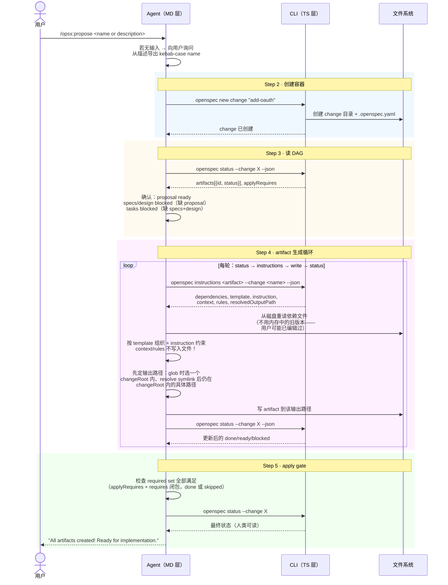

# Workflow · propose

## 源文件

`src/core/templates/workflows/propose.ts` → `getOpsxProposeSkillTemplate()` + `getOpsxProposeCommandTemplate()`

> **调用方式**：command adapter 可为 `/opsx:propose <change-name 或描述>`；Codex 用 `$openspec-propose`。下文的 `/opsx:` 仅表示前者。
> **agent 看到的名字**：`openspec-propose`（skill）/ `OPSX: Propose`（command）
> **独立 CLI 命令**：无——propose 内调 `openspec new change`，但 propose 本身没有对应的 CLI 命令。
> **profile**：core（大多数用户默认可见）

## 一句话

propose 是**默认快速路径**：从 change name/description 出发，创建 change 容器，然后循环 status → instructions → write → status，直到 schema 的 `apply.requires` 全部满足。它是规划类四个 workflow 里最"全自动"的一个。

## 和 new / continue / ff 的粒度区别

```text
propose:  create change + 生成全部 artifact → apply-ready（一口气）
new:      create change only → STOP（scaffold）
continue: 已有 change → 生成下一个 ready artifact → STOP（一步）
ff:       已有或新 change → 批量生成剩余 artifact → apply-ready（批量推进）
```

## CLI 命令调用序列

```text
1. openspec new change "<name>"           # 创建容器
2. openspec status --change "<name>" --json   # 读 DAG
3. loop:
   a. openspec instructions <artifact> --change "<name>" --json  # 取操作包
   b. [agent 读依赖 + 写 artifact 文件]
   c. openspec status --change "<name>" --json                   # 刷新状态
   until applyRequires 及其 requires 传递闭包全部 done 或 skipped
4. openspec status --change "<name>"       # 展示最终状态（人类可读）
```

## 时序图



## 关键指令：context 和 rules 绝不写入文件

template 里三次强调这一点：

```text
IMPORTANT: context and rules are constraints for YOU, not content for the file
Do NOT copy <context>, <rules>, <project_context> blocks into the artifact
These guide what you write, but should never appear in the output
```

这是 propose（以及 continue、ff）最容易踩的坑：agent 把 template 返回的 `<context>` 和 `<rules>` 标签复制进了 artifact 文件。

## 命名、顺序与无 spec change

- `openspec new change` 接受数字前缀的 kebab-case 名，例如 `100-add-feature`；不再把数字开头一概拒绝。
- **capability 命名引导**：proposal 的 Capabilities 段（schema instruction + proposal 模板注释，经 `openspec instructions proposal` 投递）引导 agent 用**耐久的系统行为**命名新 capability（如 `user-auth`），而不是本次工作（如 `add-login-endpoint`）；选一个能随系统演化持续拥有相关 requirement 的内聚边界，避免宽泛的 catch-all 名。新引入的路径段用 kebab-case，并沿用项目既有 spec 组织。
- `specs` 和 `design` 在 proposal 后都 ready，但 status/模板按 schema 声明顺序先推荐 specs。它不是新增的 `specs -> design` 依赖。
- 纯重构、工具或文档工作可在 `.openspec.yaml` 声明 `skip_specs: true`。此时 specs 是 `skipped`，而不是待生成的空文件；若需求出现 spec-level 行为变化，必须移除 marker 后再写 delta。
- nested layout 使用 `specs/<capability-path>/spec.md`，如 `specs/identity/session/spec.md`；默认 schema 文案仍偏 flat，团队应在 config/AGENTS 明确路径约定。

## 先读代码、先加载上下文

- propose 和 ff 模板在起草 artifact 前引导 agent 检查相关项目代码、测试、文档——计划反映现有实现，而不是把基础发现推迟成实施任务。
- 规划前加载所选项目/store root 的 `context`（遵守 config 优先级与验证上限）；无 root 时不写任何文件就停止并建议初始化，不再隐式创建 root。
- spec-driven 的 propose/specs 指令里，「研究现有能力」与「delta 路径匹配现有 spec」两步带 `--store "<id>"`；capability 读取用 `openspec show "<spec-id>" --type spec --json --no-scenarios`，resolve 到与 list 相同的 root。

## 先定输出路径，再创建（#2104）

artifact 循环里 `resolvedOutputPath` 有两副面孔：**具体路径**，或**glob 模式**（如 `specs/**/*.md`）。glob 模式下它不是可以直接写入的目标，模板因此把「选路径」提升成创建的前置步骤：

| 步骤 | 规则 |
|---|---|
| 1. 定路径 | `resolvedOutputPath` 是 glob 时，按 `instruction` 选一个落在 `changeRoot` 内、**且匹配该 glob** 的具体路径；它不是 glob 时，输出路径就是它本身 |
| 2. 校验 | 解析 symlink（父目录，以及已存在的文件本身）之后仍须在 `changeRoot` 内；不在就停下告知用户，**不写** |
| 3. 委托 | `instruction` 把创建委托给某个 skill/command 时，只有它**能写到这个输出路径**才调用，否则停下告知用户 |
| 4. 写 + 验 | 写到该输出路径，然后确认文件确实在那里 |

这条规则出现在 propose、ff、continue、explore 四套模板里（`update` 早就有等价口径；`apply` 不在其中——#2104 没碰 `apply-change.ts`）。措辞并不完全相同：propose 与 ff 是**逐字同一句**，continue 换了主语（"the `resolvedOutputPath` specified in instructions is a glob pattern"，并多一句"using the schema instruction and the change's context"），explore 则把它并进 capture 步骤 3 的长句里。四者**顺序与判定相同**：先选具体路径 → resolve symlink 后仍在 `changeRoot` 内 → 委托时只有对方能写到该路径才调用 → 写完确认文件在该路径。（#2104 之前只把 `resolvedOutputPath` 当作写入目标，glob 工件会落成字面文件名或逃出 change 目录。）它和 update 的 glob 例外（[`12-update.md`](./12-update.md#v1142-起例外写在两处2083)）是一对：一边是**新建**工件时选路径，一边是**修订**已有 change 时补缺失文件，两者的包含检查口径一致。

## Guardrails

| Guardrail | 含义 |
|---|---|
| 创建 ALL artifacts（required set = `applyRequires` + 沿 `requires` 边的传递闭包，不是只看 `applyRequires`） | 不半途而废 |
| 写之前重读依赖（从磁盘，不从内存） | 用户可能已编辑过 |
| context 不清时问用户 | 但优先保持 momentum |
| change 同名时问用户 | 避免覆盖 |
| 写完后验证文件存在 | 不假称完成 |
| 先定并校验输出路径，再创建任何东西 | glob 工件必须有具体且落在 `changeRoot` 内的路径 |

## 和 FAQ 的衔接

FAQ `04_propose-to-apply-ready/` 从工程视角分析了 propose 的 artifact DAG、instructions JSON 操作包、apply gate 两层定义。本文件从 "template 源码给了 agent 什么指令" 的视角补充。

## 源码锚点

| 内容 | 行号范围（propose.ts，v1.14.3） |
|---|---|
| SkillTemplate 定义 | L33-L194 |
| CommandTemplate 定义 | L199-L357（文件 358 行） |
| Step 1: 询问输入/澄清歧义 | L63-L72 |
| Step 2: 加载 context | L74-L82 |
| Step 3: schema 选择 | L84-L92 |
| Step 4: new change | L94-L107 |
| Step 5: status DAG | L109-L116 |
| Step 6: artifact 循环（含输出路径选择 L140-L142） | L118-L159 |
| Step 7: final status | L161-L164 |
| context/rules 警告 | L181-L183 |

## v1.12.0–v1.13.1 行为更新

- **context-first（v1.13.0，`6d2dbe62`）**：propose 在做任何规划决策前先从选定项目/store root 加载 project context；目录无 OpenSpec root 时停止并提示 init，不再静默创建。
- **code-grounded（v1.12.0，`98bf53e5`）**：起草 artifact 前先检查相关代码、测试和文档，proposal 建立在仓库现实之上。
- ff（fast-forward）与 propose 共享同一套 code-grounded 指令。
- **输出路径先定后写（v1.14.3，`276d0150` #2104）**：glob `resolvedOutputPath` 必须先选成 `changeRoot` 内的具体路径并做 symlink 后包含检查；委托给 skill/command 时只有它能写到该路径才调用。
