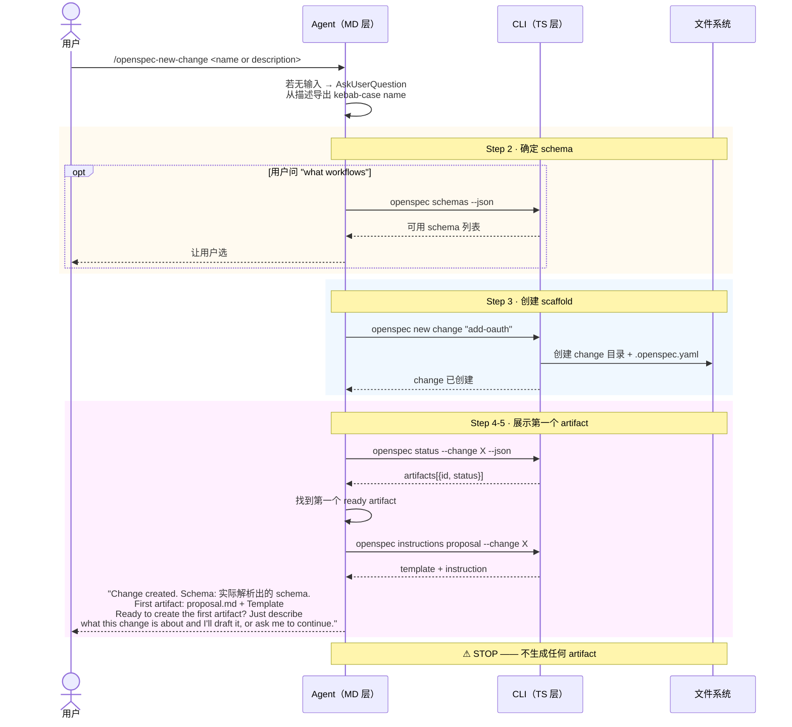

# Workflow · new

## 源文件

`src/core/templates/workflows/new-change.ts` → `getNewChangeSkillTemplate()` + `getOpsxNewCommandTemplate()`

> **调用方式**：技能 `openspec-new-change` <change-name 或描述>——Claude Code 等工具里 `/openspec-new-change` <change-name 或描述>，Codex 用 `$openspec-new-change` <change-name 或描述>。1.x 写作 `/opsx:new`；v2.0.0 起命令文件已移除，`/opsx:` 只用于历史解释。
> **agent 看到的名字**：`openspec-new-change`（skill）/ `OPSX: New`（command）
> **独立 CLI 命令**：有——`openspec new change "<name>"` 是 CLI 命令，`/openspec-new-change` 是围绕它的 agent 模板。两者不同：CLI 只创建目录；template 创建后还展示 instructions。
> **profile**：custom（需在 `customWorkflows` 中显式启用，不在默认 core 里）

## 一句话

new 是**最轻量的规划 workflow**：只创建 change scaffold（目录 + `.openspec.yaml`），不生成任何 artifact 内容。创建完后展示第一个 artifact 的 instructions，然后 **STOP**。

它的价值是把 "创建容器" 和 "生成内容" 拆开——适合先占位、显式选择 schema，随后一步步审慎推进（注：`--initiative` 和 `--areas` 选项已移除，跨仓协调改走 `--store <id>`）。

## 和 propose 的关键区别

| | propose | new |
|---|---|---|
| 创建 change 目录 | ✓ | ✓ |
| 生成 artifact | ✓（全部，直到 apply-ready） | ✗（STOP 在展示第一个 template 后） |
| 粒度 | 一口气完成 | scaffold only |
| 适用场景 | 用户已有明确意图 | 先占位，再逐步推进 |

## CLI 命令调用序列

```text
1. [可选] openspec schemas --json          # 仅当用户问"有哪些 workflow"
2. openspec new change "<name>"            # 创建容器（可能带 --schema）
3. openspec status --change "<name>" --json # 读 DAG
4. openspec instructions <first-artifact> --change "<name>"  # 展示第一个 template
5. STOP  ← 关键：到此为止
```

## 时序图



v1.15.0 起（#2120），`openspec new change` 的进度行显示**实际解析出的 schema**：`--schema` → 项目 `openspec/config.yaml` 的 `schema` → root 默认值，按这个优先级解析一次，并同时用于创建和进度行；不再固定报 `spec-driven`。

## 关键 guardrail：STOP

new 最关键的指令是 Step 6：

```text
STOP and wait for user direction
```

Guardrails 里再次强调：

```text
Do NOT create any artifacts yet - just show the instructions
Do NOT advance beyond showing the first artifact template
```

这意味着 agent 绝不能在这个 workflow 里写 proposal.md。它只负责搭好舞台，用户决定下一步。

## Guardrails

| Guardrail | 含义 |
|---|---|
| Do NOT create any artifacts | 不写 proposal/specs/design/tasks |
| Do NOT advance beyond first template | 停在展示阶段 |
| name invalid → ask for valid name | kebab-case 校验 |
| change 同名 → suggest continue | 避免重复创建 |
| Pass --schema if non-default | 尊重用户选择 |

## 和 continue 的配合

`new-change.ts:80` 的收尾提示采用自然语言（`"Ready to create the first artifact? Just describe what this change is about and I'll draft it, or ask me to continue."`），不硬绑任何斜杠命令。new 创建 scaffold 后，典型的逐步推进路径是配合 `continue`（注意 `ff` 只用于新建 change，不能直接挂在 `new` 已建好的同名 change 后面）：

```text
/openspec-new-change add-oauth
  → 创建目录与 .openspec.yaml，展示首个 ready 产物（proposal）的模板 → STOP
/openspec-continue-change
  → 创建 proposal.md → STOP
/openspec-continue-change
  → 创建 specs/<capability-path>/spec.md → STOP
/openspec-continue-change
  → 创建 design.md → STOP
/openspec-continue-change
  → 创建 tasks.md → 规划完成，提示开始 apply
```

## 源码锚点

| 内容 | 行号范围（`new-change.ts`，共 167 行） |
|---|---|
| 提示文案常量 | L11-L15 |
| SkillTemplate 定义 | L17-L92 |
| CommandTemplate 定义 | L94-L167 |
| Step 2: 确定 schema | L40-L48（command 版 L119-L127） |
| Step 3: `new change` | L50-L55（L129-L134） |
| Step 4: `status` | L57-L61（L136-L140） |
| Step 5: `instructions` | L63-L69（L142-L147） |
| Step 6: STOP | L71（L149） |
| Output 收尾提示 | L80（command 版 L158） |
| Guardrails | L82-L87（L160-L165） |
