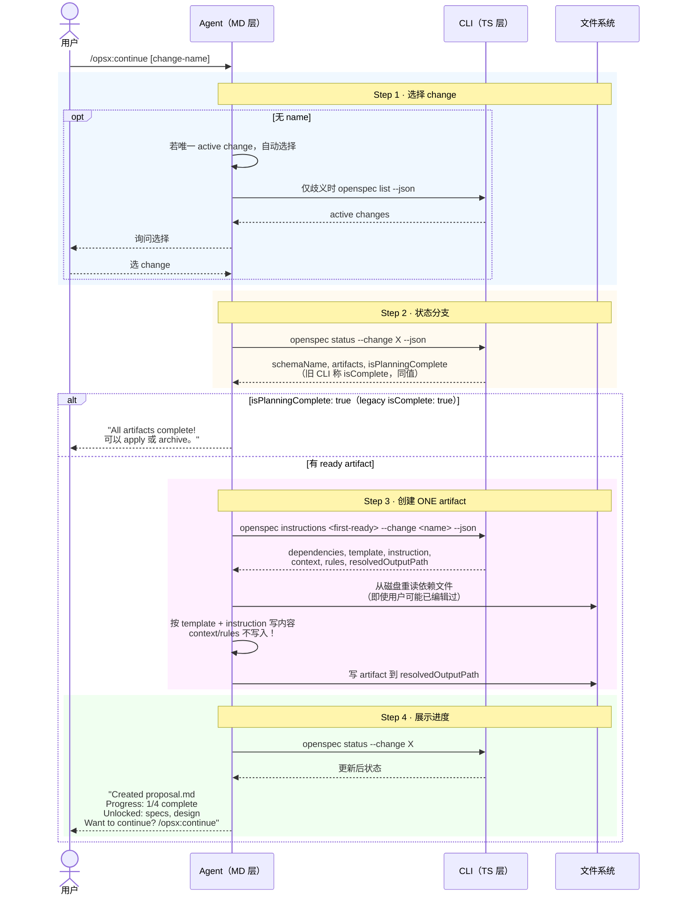

# Workflow · continue

## 源文件

`src/core/templates/workflows/continue-change.ts` → `getContinueChangeSkillTemplate()` + `getOpsxContinueCommandTemplate()`

> **调用方式**：command adapter 可为 `/opsx:continue [change-name]`；Codex 用 `$openspec-continue-change`。下文的 `/opsx:` 仅表示前者。
> **agent 看到的名字**：`openspec-continue-change`（skill）/ `OPSX: Continue`（command）
> **独立 CLI 命令**：无——continue 没有对应的 `openspec continue` CLI 命令。
> **profile**：custom（需显式启用，不在默认 core 里）

## 一句话

continue 是**增量路径**：每次调用只推进一个 ready artifact。它体现 artifact DAG 的逐步工作流——先 `status --json` 找 ready artifact，再 `instructions <artifact> --json` 获取执行包，写完一个 **STOP**。

## 和 propose / ff 的粒度区别

| | propose | ff | continue |
|---|---|---|---|
| 每次创建 | 全部 artifact | 全部剩余 artifact | **一个** artifact |
| 停止条件 | applyRequires 满足 | applyRequires 满足 | 写完一个立即 STOP |
| 适用 | 新 change，快速启动 | 已有 change，批量补齐 | 逐步推进，每步 review |

## 状态分支

continue 根据 `status --json` 的结果分成三段：一段**先于所有分支**执行的半写工件补完，加上 `status` 给出的三选一主分支（合计四条路径）：

| 状态 | agent 行为 |
|---|---|
| **先于所有分支**：有读作 `done` 的 glob 工件但文件不全 | 只补写缺失文件 → STOP（算作本次调用的那一个工件） |
| `isPlanningComplete: true`（legacy `isComplete: true`） | 祝贺 → 展示最终 status → 建议 apply 或 archive → STOP |
| 有 `status: "ready"` 的 artifact | 取第一个 → 定并校验输出路径 → instructions → 写 → STOP |
| 全部 blocked | 不应该发生 → 展示 status + 建议检查 |

## 半写工件：glob 工件的 done 不可全信

glob 工件（如 `specs/**/*.md`）只要存在**一个**匹配文件就被读作 `done`。一次在写第二个文件时被打断的运行，会留下「done 但文件不全」的状态，而下次调用看到 `done` 就直接往下走，不再读它的 instruction——于是缺失的 spec 文件永远不会被补上（#2034）。

`PARTIAL_ARTIFACT_CHECK` 段（skill 版与 command 版各注入一次）规定：

1. 对每个 `done` 的 glob 工件，先取它的 instructions，读已完成依赖推断出**应有文件**列表；
2. 与 `artifactPaths.<id>.existingOutputPaths` 比对。spec-driven 的 `specs` 具体是：读 proposal，按它列出的 capability 逐个核对 `specs/<capability-path>/spec.md`；
3. 每条期望路径先相对 `changeRoot` 解析，并校验解析 symlink 后（父目录与已存在的文件本身）仍在 `changeRoot` 内；
4. 只补写缺失的文件，**每个都写在校验过的路径上**；`instruction` 把创建委托给某个 skill/command 时，只有它能写到该路径才调用，否则停下告知用户；
5. 补写完成后 STOP——这算作本次调用的那一个工件。分不清某文件是刻意省略还是被漏掉时，问用户。

## CLI 命令调用序列

```text
1. [可选] 显式名称 → 对话推断 → 唯一 active change 自动选择；仅歧义时 `openspec list --json` 选 change
2. openspec status --change "<name>" --json  # 读 DAG → 判断分支
3. [若 ready] openspec instructions <first-ready> --change "<name>" --json
4. [agent 读依赖 + 写 artifact]
5. openspec status --change "<name>"         # 展示进度
6. STOP
```

## 时序图



## 关键 guardrail：一次只做一个

```text
Create ONE artifact per invocation
STOP after creating ONE artifact
```

这是 continue 和 propose 最核心的区别。propose 循环到 apply-ready，continue 每次只走一步。这让用户在每步之间可以 review、调整、甚至切换方向。

## 先定输出路径，再创建任何东西

v1.14.3 起，continue / propose / ff 三套模板统一了创建顺序（#2104）：

| 情形 | 规则 |
|---|---|
| `resolvedOutputPath` 是具体文件 | 输出路径就是它 |
| `resolvedOutputPath` 是 glob | 用 schema instruction 与 change 上下文选一个**落在 `changeRoot` 内**的具体路径，并校验 resolve symlink 后仍在 `changeRoot` 内；不合格则停下告知用户 |
| `instruction` 把创建委托给某个 skill/command | **只在它能把工件写到该校验过的路径时**才调用，否则停下告知用户；调用前后都确认文件存在于该路径 |

这条规则写在「读取依赖」之后、「创建文件」之前：路径选择是创建的前置条件，不是创建后的补救。

## Guardrails

| Guardrail | 含义 |
|---|---|
| Create ONE artifact per invocation | 核心约束 |
| Finish a partly written glob artifact first | `done` 只说明有一个匹配文件，先比对 `existingOutputPaths` 补缺 |
| Choose and check the output path before creating anything | glob 工件必须先定具体路径并做 symlink 后包含检查 |
| Always read dependency artifacts — re-read from disk, not memory | 用户可能已编辑过 |
| Never skip artifacts or create out of order | 遵守 DAG；`skip_specs: true` 的 specs 是显式 skipped，不应创建 spec 文件 |
| context unclear → ask before creating | 不猜 |
| Verify artifact file exists after writing | 确认写入 |
| Use schema's artifact sequence, don't assume names | schema-agnostic |

## common artifact patterns

template 里硬编码了 spec-driven schema 的 artifact 创建指引：

- **proposal.md**: 问清 change → 填 Why/What Changes/Capabilities/Impact。Capabilities 段决定后续 specs 文件数。
- **specs/<capability-path>/spec.md**: 按 proposal 的 Capabilities 列表，每个 capability path 一个 spec 文件；nested path 可用但需团队约定。
- **design.md**: 技术决策、架构、实现方案。
- **tasks.md**: checkbox 任务清单。

对于其他 schema，agent 应按 `instruction` field 而非硬编码规则。

## 源码锚点

| 内容 | 行号范围（continue-change.ts，v1.14.3） |
|---|---|
| `PARTIAL_ARTIFACT_CHECK` 共享片段 | 注释 L27-L31；常量 L32-L35 |
| SkillTemplate 定义 | L37-L158 |
| CommandTemplate 定义 | L161-L281 |
| Step 1: 选 change | L51-L65 |
| Step 2: status | L67-L75 |
| Step 2.5: 半写工件检查（注入点） | L81 |
| Step 3: 主分支三选一（含输出路径选择 L109 / L235） | L77-L129 |
| Output 段 | L130-L138 |
| Artifact Creation Guidelines | L139-L144 |
| Guardrails | L145-L155 |
| command 版对应锚点 | L177 / L193 / L203 / L235 / L256 / L265 / L271 |
