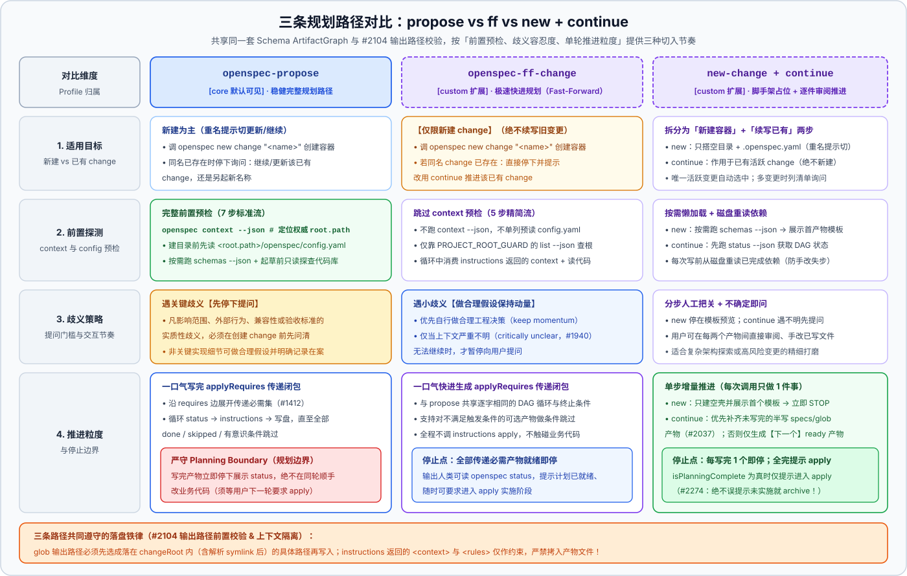

# Workflow · ff (fast-forward)

## 源文件

`src/core/templates/workflows/ff-change.ts` → `getFfChangeSkillTemplate()` + `getOpsxFfCommandTemplate()`

> **调用方式**：技能 `openspec-ff-change` <change-name 或描述>——Claude Code 等工具里 `/openspec-ff-change` <change-name 或描述>，Codex 用 `$openspec-ff-change` <change-name 或描述>。1.x 写作 `/opsx:ff`；v2.0.0 起命令文件已移除，`/opsx:` 只用于历史解释。
> **agent 看到的名字**：`openspec-ff-change`（skill）/ `OPSX: Fast Forward`（command）
> **独立 CLI 命令**：无。
> **profile**：custom（需显式启用，不在默认 core 里）

## 一句话

ff 是**面向新建 change 的极速规划路径（fast-forward）**：只新建 change（若同名 change 已存在则停下并建议改用 `continue`），跳过 `propose` 的 `openspec context --json` 预检与 schema 选择步骤，倾向自行做合理决策保持推进势头，一口气生成 `applyRequires` 传递依赖闭包内的全部必需产物。

## 和 propose 的源码级对比



ff 与 propose 共享完全相同的核心 artifact 生成循环，但在前置步骤、歧义策略和同名处理上有三处明确差异：

| 维度 | propose（7 步） | ff（5 步） |
|---|---|---|
| 前置声明 | 有显式 **Planning boundary** 段落（`propose.ts:23`） | 无单独 Planning boundary 段落（但在 Step 5 后同样停在交接提示） |
| 预加载与选 schema | 有 Step 2 `openspec context --json` + 预读 `config.yaml`（≤51,200B）及 Step 3 `--schema` / `openspec schemas --json` | **无这两步**（仅靠 `PROJECT_ROOT_GUARD` 的 `openspec list --json` 查根，以及 `instructions` 返回的 `context`/`rules`） |
| 歧义处理门槛 | 凡影响范围、外部可观测行为、兼容性或验收标准的实质性歧义，**创建前必须先停下问用户** | **倾向做合理假设以保持推进势头**（`prefer making reasonable decisions to keep momentum`），仅在上下文**严重不明（critically unclear）**时才提问 |
| `new change` | Step 4 固定跑 `openspec new change "<name>"`（仅限新建） | Step 2 固定跑 `openspec new change "<name>"`（**同样仅限新建**，不能作用于已有 change） |
| artifact 循环与终止 | 传递必需集（`applyRequires` + `requires` 边传递闭包，含先定输出路径与 `design` 条件跳过） | **逐字相同** |
| 同名 change 已存在时 | 询问是继续已有 change 还是另起新名（`ask if user wants to continue it or create a new one`） | skill 版：停下并**建议改用 continue 推进该已有 change**（`suggest continuing that change instead`）；command 版与 propose 相同 |

## CLI 命令调用序列

```text
1. openspec list --json                          # PROJECT_ROOT_GUARD 前置查根（不调 context --json）
2. openspec new change "<name>"                  # 创建新 change 容器（同名已存在则停下建议 continue）
3. openspec status --change "<name>" --json      # 读 applyRequires 与 artifacts[].requires
4. loop:
   a. openspec instructions <artifact> --change "<name>" --json
   b. [agent 从磁盘重读依赖 + 只读探查代码库 + 定输出路径 + 写 artifact（或记录条件跳过）]
   c. openspec status --change "<name>" --json
   until 传递必需集（applyRequires + requires 闭包）全部 done、skipped 或条件跳过
5. openspec status --change "<name>"
```

## 适用场景

| 场景 | 用什么 |
|---|---|
| 新 change，需严谨预检项目 context 并在实质歧义处先对齐 | `propose` |
| **新 change，意图清楚、希望尽量少被打断一次性生成全套产物** | **`ff`** |
| 新 change，先建空壳再一步步审阅 | `new` → `continue` × N |
| 已有 change，artifact 还没写完，继续往下补 | `continue`（注：`ff` 不会续写已有 change） |

## Guardrails

- 创建 `apply` 阶段传递依赖的全部必需产物，而非仅看 `apply.requires` 字面列表（#1412）
- 每次写新产物前从磁盘重读依赖文件（不信对话记忆）
- 仅在上下文严重不明（critically unclear）时才打断提问，优先做合理假设保持节奏
- 若同名 change 已存在，建议改用 `continue` 推进该已有 change，不覆盖重建
- 先选定并校验落在 `changeRoot` 内的具体路径，写完逐个确认文件落盘

## 起草前先读项目代码

ff 与 propose 共享同一段代码扎根指引（#1737，`ff-change.ts:75-78`）：起草每个 artifact 前先只读检查相关的实现代码、邻近测试、配置与文档，使范围、方案和任务建立在真实代码现状之上，而不是把基础发现留到实施阶段。

## 源码锚点

| 内容 | 行号范围（`ff-change.ts`，共 250 行） |
|---|---|
| 交接文案常量 `SKILL_APPLY_HANDOFF` / `COMMAND_APPLY_HANDOFF` | L11-L15 |
| SkillTemplate 定义 | L17-L133 |
| CommandTemplate 定义 | L135-L250 |
| Step 1–5（skill 版） | L31 / L40 / L46 / L55 / L99 |
| 输出路径选择（skill 版 / command 版） | L79 / L199 |
| 传递必需集循环终止条件（#1412） | L85-L93 / L205-L213 |
| Guardrails | L123-L128 / L243-L248 |

## 历史行为演进

- **code-grounded（`98bf53e5`，与 propose 共享）**：ff 起草 artifact 前先检查相关代码、测试与文档，计划落在既有实现上。
- **project-root 守卫（`project-root.ts`）**：首次写操作前通过 `openspec list --json` 校验规划根（注意 `ff` 不跑 `propose` 特有的 `openspec context --json` 步骤）。
- **澄清门槛收窄（v1.13.2，#1940）**：artifact 需要用户输入的判定从 "unclear context" 收紧为 "**critically** unclear context"——只在上下文严重不明时才打断用户。
- **传递必需集闭环与输出路径先定后写（#1412 / #2104）**：循环终止条件覆盖 `applyRequires` + `requires` 传递闭包；glob `resolvedOutputPath` 先选成 `changeRoot` 内具体路径并做 symlink 后包含检查。
