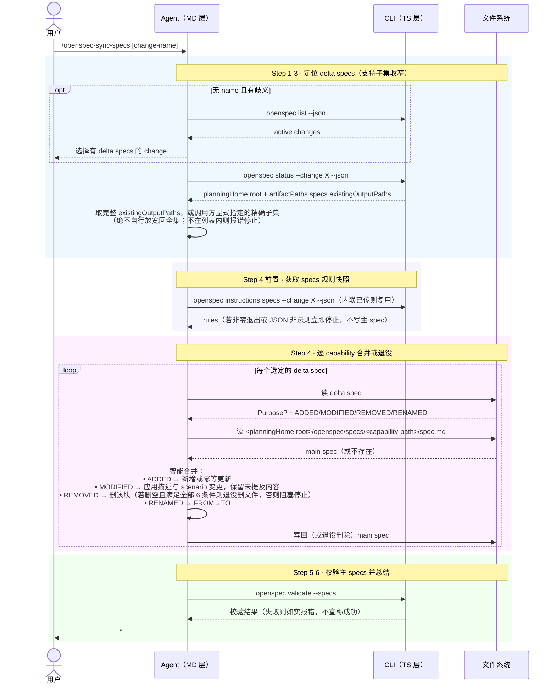

# Workflow · sync

## 源文件

`src/core/templates/workflows/sync-specs.ts` → `getSyncSpecsSkillTemplate()` + `getOpsxSyncCommandTemplate()`

> **调用方式**：技能 `openspec-sync-specs` [change-name]——Claude Code 等工具里 `/openspec-sync-specs` [change-name]，Codex 用 `$openspec-sync-specs` [change-name]。1.x 写作 `/opsx:sync`；v2.0.0 起命令文件已移除，`/opsx:` 只用于历史解释。
> **agent 看到的名字**：`openspec-sync-specs`（skill）/ `OPSX: Sync`（command）
> **独立 CLI 命令**：无——sync 是纯 agent-driven merge，和 `openspec archive` CLI 的 programmatic merge 是两条独立路径。sync 也会被 host archive workflow inline 调用（sync assessment 阶段）。
> **profile**：core（大多数用户默认可见）
> **要点**：main spec 路径使用 store-aware `planningHome.root`（`<planningHome.root>/openspec/specs/`）；status 提供的 delta path 可为 nested capability path；sync 在写前读取一次 `openspec instructions specs`，把返回的 artifact rules 只用于被写入 main specs 的内容/形式。

## 一句话

sync 是 **agent-driven spec merge**，不是 CLI 的 programmatic merge。agent 读 delta spec 和 main spec，在遵守 `MODIFIED` 完整块契约的前提下用语义判断做合并（保留主 spec 中未被提及的既有需求与顺序），并在落盘后运行 `openspec validate --specs` 自检。这和 `openspec archive` CLI 的 `buildUpdatedSpec()` 是两条独立的合并路径。

## 和 CLI archive 的合并方式对比

| | CLI archive (`buildUpdatedSpec`) | sync template (`openspec-sync-specs`) |
|---|---|---|
| 合并方式 | programmatic（确定性代码） | agent-driven（按模板契约智能编辑） |
| MODIFIED 契约 | delta 必须给出完整 requirement block（漏掉存活 scenario 直接报错），整块替换 | delta **同样必须给出完整 requirement block（含正文及全部存活 scenario，否则 `validate` 与 `archive` 都会拒绝）**；agent 将变更合并入主 spec 并保留主 spec 其余未提及内容 |
| 规则与校验 | 内置 `Validator` 写前全量校验 + 快照回滚 | 写前拉取一次 `openspec instructions specs` 规则快照；写后跑 **`openspec validate --specs`** |
| 子集同步支持 | 处理整个 change 的全部 delta | 默认同步全部 `existingOutputPaths`，也支持调用方传入显式收窄的子集（如 `bulk-archive` 的 `includedDeltas`） |
| change 是否保留 | 移动 change 到 `archive/` | **change 保持 active** |

## CLI 命令调用序列

```text
1. [可选] openspec list --json                              # 歧义时选 change
2. openspec status --change "<name>" --json                 # 取 planningHome.root 与 artifactPaths.specs.existingOutputPaths
3. openspec instructions specs --change "<name>" --json     # 首次写主 spec 前拉一次 rules.specs 快照（archive 内联调用已提供则直接复用；失败即停）
4. [agent 逐个选定 capability] 读 delta spec → 读 main spec → 智能合并（或满足 6 条件时退役删除）→ 写 main spec
5. openspec validate --specs                                # 校验更新后的主 specs（失败不得宣称 sync 成功）
```

注意：sync **不调用** `openspec archive` 也不调用 `openspec new change`。

## 时序图



## Key Principle: Intelligent Merging 与能力退役 6 条件

1. **`MODIFIED` 块完整性（`sync-specs.ts:247-253`）**：早期草稿曾误让人以为可以在 `MODIFIED` 下只贴新增的一条 scenario，但当前模板已明确纠偏，与 CLI `validate`/`archive` 完全对齐：
   ```text
   Unlike programmatic merging, you merge rather than overwrite:
   - A MODIFIED block carries the whole requirement - body plus every scenario that survives the change. `openspec validate` and `openspec archive` both reject one that drops a scenario the main spec still has.
   - Keep anything the delta does not mention, in the main spec's existing order
   - Use your judgment to merge changes sensibly
   ```
2. **能力退役（Capability Retirement）的 6 重硬条件（`sync-specs.ts:126-147`）**：当 `REMOVED` 删光主 spec 的最后一个 requirement 时，绝不允许写出空的 `## Requirements`；只有同时满足以下 **6 条条件**才可删除整份 `spec.md`（及随之变空的目录）：
   - ① **本次运行**移除需求后不再剩余任何 requirement block；
   - ② 其余结构合法（仍有 `## Purpose`）；
   - ③ 本次同步前主 spec 并非原本就是空的；
   - ④ 全文件所有非空行都能归属为标题、`Purpose`、`Requirements` 标题或规范 requirement 的正文/scenarios/fenced 示例（任何额外章节如 `## Notes` 都会阻断退役）；
   - ⑤ change 的 `.openspec.yaml` 显式声明了 `retire_capabilities: true`；
   - ⑥ `spec.md` 真实路径解析在 specs 根目录之内（绝不跟随 capability 目录 symlink 删除外部文件）。
   任一条件不满足即停止该 capability 的同步并报告阻塞原因（仅缺 marker 时明确提示补 `retire_capabilities: true`）。

## Guardrails

| Guardrail | 含义 |
|---|---|
| Read both delta and main specs before making changes | 双边读取 |
| Preserve existing content not mentioned in delta | 不丢数据，且绝不把带 delta 操作头的原文件直接拷成主 spec |
| Use only `artifactPaths.specs.existingOutputPaths` & honor narrowed subset | 不从无关产物推断 delta；调用方收窄了子集时绝不擅自扩回全量列表 |
| Fetch `openspec instructions specs` once (or reuse archive snapshot) | 非零退出或非法 JSON 时在写任何主 spec 前立即停止；`rules` 仅约束主 spec 内容/形式且不抄入正文 |
| Validate with `openspec validate --specs` after writing | 校验不过不得宣称同步成功 |
| Should be idempotent | 跑两次结果一致；新 capability 原样复制 delta `## Purpose`，已有主 spec 的 `Purpose` 保持权威 |

## 和 archive template 的关系

archive template 的 Step 4（sync assessment）会调 sync：

```text
archive template → 发现 delta specs → sync assessment
  → 用户选 "Sync now" → 调 openspec-sync-specs skill
  → 本 template 执行 agent-driven merge
  → 回到 archive template 继续 mv
```

## 源码锚点

| 内容 | 行号范围（`sync-specs.ts`，共 566 行） |
|---|---|
| SkillTemplate 定义 | L11-L288 |
| CommandTemplate 定义 | L290-L566 |
| Step 3: 找 delta specs（含子集收窄规则 L57-L69） | L49-L77 |
| Step 4: 拉取 `instructions specs` 规则快照 + 逐 capability 合并与 6 条件退役 | L79-L170 |
| Step 5: validate 主 specs（`openspec validate --specs`） | L171-L174 |
| Step 6: 总结 | L176-L185 |
| Delta / Main Spec Format Reference | L186-L245 |
| Key Principle: Intelligent Merging | L247-L253 |
| Guardrails | L272-L283（11 条） |
