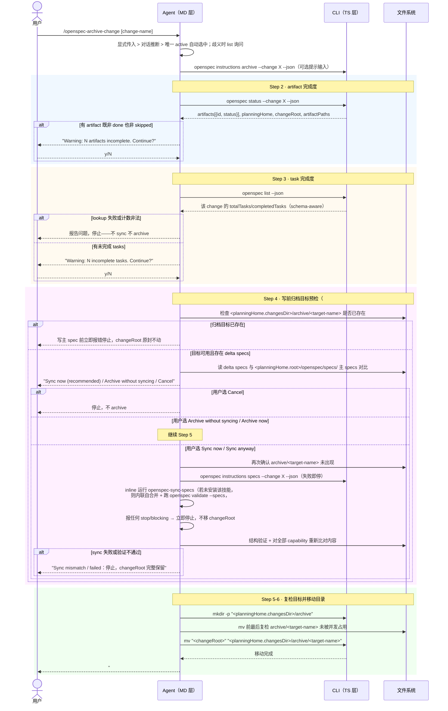

# Workflow · archive

## 源文件

`src/core/templates/workflows/archive-change.ts` → `getArchiveChangeSkillTemplate()` + `getOpsxArchiveCommandTemplate()`

> **调用方式**：技能 `openspec-archive-change` [change-name]——Claude Code 等工具里 `/openspec-archive-change` [change-name]，Codex 用 `$openspec-archive-change` [change-name]。1.x 写作 `/opsx:archive`；v2.0.0 起命令文件已移除，`/opsx:` 只用于历史解释；另有确定性 CLI `openspec archive <name>`。
> **agent 看到的名字**：`openspec-archive-change`（skill）/ `OPSX: Archive`（command）
> **独立 CLI 命令**：**有**——`openspec archive <name>` 做 programmatic validate → merge → move。host archive workflow 做 pre-flight checks + agent-driven sync + 手动 mv。**两条路径不同**：CLI 做完整替换式合并，agent workflow 做智能合并。
> **profile**：core（大多数用户默认可见）
> **要点**：① 选择 change 后先读取 `openspec instructions archive --json` 的 context/operation guidance；② status 的 `skipped` specs artifact 视为满足；③ sync 仍必须 inline 并逐 capability 验证——**不得委托后台任务**（只能同步等待，或"以同步方式委托并等待结果"）；④ CLI merge 对 fully early-synced operations 采用 no-op / warnings，而非无意义重写；⑤ 归档无法交互提问时会给出可重跑命令，change 移除某 capability 最后一个 requirement 时可声明 `retire_capabilities: true`；⑥ 任务完成度来自 `openspec list --json` 的 schema-aware `totalTasks`/`completedTasks`，lookup 失败即停止；⑦ sync 报任何 stop/blocking 条件即视为 sync 失败——立即停止归档，不做 post-sync 比对、不移 changeRoot；⑧ sync 通过后做结构验证：主 spec 不残留 delta headers、REMOVED 的 requirement 已删、retired capability 的主 spec 已删除。
> **追加**：非 TTY 时 confirm 无 ANSI、无 change 名则要求先传入名字；重建 spec 保留 `## Requirements` 周围空行且以单个 LF 结尾；scenario-loss 认所有 `####` 子标题。
> **追加**：CLI retirement 失败分为“只缺 marker”“有 blocking content”“marker 已读但不可 honor/仍被内容阻塞”三路；只有第一路建议添加 marker。

## 一句话

archive 是 agent 层的收尾操作手册。它和 `openspec archive` CLI 命令不同——template 做的是 pre-flight checks（artifact 完成度、task 完成度、delta spec sync assessment），然后由 agent 执行 `mv` 移动 change 目录。它不调用 CLI 的 programmatic merge。

## CLI archive vs host archive workflow

| | `openspec archive` CLI | host archive workflow |
|---|---|---|
| 合并方式 | programmatic merge（RENAMED→REMOVED→MODIFIED→ADDED） | agent-driven sync（读 delta + main → 智能合并） |
| spec update | `buildUpdatedSpec()` → `writeUpdatedSpec()` | 调 `openspec-sync-specs` skill |
| 是否可跳过 | `--skip-specs` / `--no-validate` | 用户可选择 "Archive without syncing" |
| 谁来执行 | CLI 进程 | agent 调 `mv` 命令 |

CLI 列中的完整 mutation 边界是：全量预构建 → 全量 rebuilt validation → fingerprints/snapshots → 写入或退役 → verified move。写入、退役或 move 失败时会尽力恢复 snapshots 和 active change；并发修改使安全恢复不可能时显式报告 rollback failure。host workflow 的手动 `mv` 不实现这套 CLI transaction；源码细节见 [`../internal-spec-driven/04-archive-归档合并.md`](../internal-spec-driven/04-archive-归档合并.md)。

## CLI 命令调用序列

```text
1. 显式名称 → 对话推断 → 唯一 active change 自动选中；仅歧义时 `openspec list --json` 让用户选
2. openspec instructions archive --change "<name>" --json  # 读取可选的 context + operationGuidance（失败不阻断）
3. openspec status --change "<name>" --json        # 检查 artifact 完成度；done / skipped 都满足
4. openspec list --json                            # 任务完成度：同名条目的 totalTasks/completedTasks（查找失败/非法即停）
5. [Step 4 写前预检 + sync 评估与执行]
   a. 先推导 <target-name>，预检 <planningHome.changesDir>/archive/<target-name> 是否已存在（#2277）
      → 若已存在，在写任何主 spec 前立即停止！
   b. 对比 artifactPaths.specs.existingOutputPaths 与 <planningHome.root>/openspec/specs/
   c. 用户可选 Cancel / Archive without syncing / Sync now / Sync anyway
   d. 若选 sync：再次检查归档目标未占用 → 拉一次 `openspec instructions specs --change "<name>" --json` 规则快照
      → 已装 `openspec-sync-specs` 技能则 inline 调用，未装则由 agent 自身按 `SYNC_FALLBACK_SAFEGUARDS` 内联合并并跑 `openspec validate --specs`（#1977）
      → 报 stop/blocking 即停；通过后做主 spec 结构验证 + 全 capability 内容复核
6. mkdir -p "<planningHome.changesDir>/archive"    # 创建 archive 目录
7. 再次检查 `<target-name>` 未占用 → mv "<changeRoot>" "<planningHome.changesDir>/archive/<target-name>"
```

注意：archive template **不调用** `openspec archive` CLI 命令。它自己完成预检、sync 协调与 `mv`。

## 时序图



## sync assessment 的选项和路由

template 规定 agent 必须做 delta spec 和 main spec 的对比分析，然后给用户选项。sync **必须 inline 执行且不得委托后台任务**，完成后必须重新对比全部 capability 做验证；archive inputs 的 context 是必读 prompt input、operation guidance 是可适用的建议，但二者不会改变任务确认、root 或 CLI merge 规则。

| 用户选择 | agent 行为 |
|---|---|
| **Cancel** | 停止，不 archive。changeRoot 完整保留。 |
| **Archive without syncing** / **Archive now** | 跳过 sync，直接进入 mv |
| **Sync now** / **Sync anyway** | ① 调 `openspec-sync-specs` **inline**——不委托后台任务（step 5 的 mv 会移走 changeRoot，后台 sync 读不到文件）；agent 只能同步委托并等待结果；② sync 报**任何 stop/blocking 条件**即视为 sync 失败：立即停止归档，**不做 post-sync 内容比对、不移 changeRoot**——一切未动，用户修复后可重跑；③ sync 完成后先做**结构验证**：主 spec 不得残留 `## ADDED/MODIFIED/REMOVED/RENAMED Requirements`、REMOVED 的 requirement 必须已删、retire 掉的 capability（最后一个 requirement 被移除、`## Requirements` 变空）其主 spec 已删除而非留空；④ 再对 `artifactPaths.specs.existingOutputPaths` 中的**每个 capability**（不只 sync 声称碰过的）重新内容比对——ADDED 存在、MODIFIED 含变更且其他 scenario 完整、REMOVED 消失、RENAMED 用新名；⑤ 全部通过才继续 archive；任何 sync 失败或 mismatch 都停止并报告 |
| 其他输入 | 重新询问，不 archive |

> **为什么必须 inline**：step 5 会 `mv changeRoot`。如果 sync 在后台运行而 mv 先执行了，sync 读不到 delta spec，结果是 change 已 archived 但 main specs 从未更新。inline 执行（同步等待）+ 完成后验证避免了这种竞态；而"sync 一报阻塞就整个停"保证了失败时 changeRoot 一定还在原地。

## 四种输出格式

| 场景 | 格式 |
|---|---|
| 成功（有 sync） | `## Archive Complete` + change/schema/location/specs: synced |
| 成功（无 delta） | `## Archive Complete` + specs: No delta specs |
| 成功（有 warning） | `## Archive Complete (with warnings)` + 列出所有 warning |
| 失败（目标已存在） | `## Archive Failed` + 原因 + 三个选项 |

## Guardrails

| Guardrail | 含义 |
|---|---|
| Announce the selected change; prompt when ambiguous | 唯一活跃 change（或对话明确指代）时自动选中并播报；仅在有歧义时弹列表让用户选（对比 `bulk-archive` 才是永不自动选） |
| Pre-check `<planningHome.changesDir>/archive/<target-name>` before writing main specs（#2277） | Step 4 开头、启动 sync 前、Step 5 `mv` 前三重检查，绝不改完主 spec 才发现归档目录重名 |
| Use artifact graph for completion checking | 不猜 |
| Task progress comes from schema-aware `openspec list --json` | 不自己数 checkbox；lookup 失败即停，不 sync 不 archive |
| Don't block archive on warnings | warning 只是确认 |
| Preserve .openspec.yaml when moving | 随目录移动 |
| If sync requested, run `openspec-sync-specs` **inline** or fallback inline merge + `validate --specs`（#1977） | 已装技能则复用 `instructions specs` 快照同步执行；未装技能则自合并并遵守 `SYNC_FALLBACK_SAFEGUARDS`（退役门禁 + `openspec validate --specs`） |
| If sync reports any stop/blocking condition, treat it as failed and stop | 不做 post-sync 比对、不移 changeRoot，一切未动可重跑 |
| Verify main-spec structure after sync（无 delta headers、REMOVED 已删、retired capability 主 spec 已删除） | 再逐 capability 内容比对，全过才 mv |
| Never archive while spec sync is still in flight | inline sync + verify before mv |
| If delta specs exist, always run sync assessment | 不跳过对比 |
| Route Cancel as stop | 不 archive，changeRoot 完整 |

## retirement 失败的操作步骤

当 `openspec archive` 移除 capability 最后一个 requirement 时：

1. 若输出只说缺授权，在有效 `.openspec.yaml` 中加入 `retire_capabilities: true` 后重跑。
2. 若输出列出 blocking lines（例如 `## Notes` 或 orphan prose），不要先加 marker；把它们迁入 `## Purpose`/canonical requirement，或经 review 人工删除 spec。
3. 若 marker 已存在，按输出修复无法 honor 的具体原因（无效 YAML、未知/坏 schema、非 boolean 值），或清理仍会随整文件删除的 blocking content。

CLI 最多安全展示 3 条 blocking line、每条 200 code points，控制字符转为 `?`；这属于 CLI 的 content-specific refusal。host archive template 只负责 pre-flight/sync/move，不应被描述为自己实现了这套退役内容分析。

## 归档成功但清理失败（v1.14.1 #1792）

退役能力的备份收尾（`finalizeRetirementBackups`）是归档**之后**的动作。它失败时的语义在 v1.14.1 被改对了：

| | 旧口径 | 现在 |
|---|---|---|
| 错误码 | 通用 `archive_error` | **`archive_retirement_cleanup_failed`** |
| 文案 | "The change remains archived and each listed backup was retained for recovery." | "The change **was** archived, but retirement cleanup did not complete. Inspect all reported recovery paths before recovery or cleanup." |
| 逐条原因 | "Could not remove the committed retirement backup at …" | "Could not **finalize** the retirement backup at …" |

为什么重要：旧文案断言"每个列出的备份都被保留"，但只有部分备份失败时这句话并不成立。现在的措辞让 agent 和用户分清两件事——**change 已经归档**（不可回退地用 retry 假装没发生），**清理没做完**（要按诊断里列出的所有 recovery path 逐个检查）。

## 归档会丢的文本现在会告警（v1.14.2 #2054）

`openspec archive` 走 CLI 的 programmatic merge 时，delta 里有些文本**不会被搬进主 spec**：第一个 `## ` 之前的正文、`## ADDED/MODIFIED Requirements` 里第一个 requirement 之前的散文、以及除 Purpose 与四类 delta 段之外的任何 `## ` 段（如 `## Notes`）。现在这些会触发 WARNING：

```text
... is not carried into the main spec by archive. Move it into a requirement,
or into proposal.md or design.md.
```

- 与其他警告同级：正常 validate/archive 通过，`validate --strict` 失败；
- **归档实际搬运的内容不变**——这只是提示你把该保留的内容挪到会被带走的地方；
- HTML 注释、`# ` 标题、Purpose 段、REMOVED/RENAMED 的正文都不告警（判定边界见 [`../specs_truth/06-源码锚点与缺口.md`](../specs_truth/06-源码锚点与缺口.md)）。

agent-driven 的 OPSX archive template 自己做 sync，不受这条告警约束；但它在做 sync assessment 时应当用同样的三处边界检查自己是否漏读了内容。

## 和 FAQ 的衔接

FAQ `07_archive-ready-to-archived/` 从 CLI 主线视角分析了 programmatic merge 算法。本文件从 OPSX template 视角分析了 agent 层的 pre-flight checks。

两者的关键差异：CLI archive 是 programmatic merge（MODIFIED=完整替换），OPSX archive template 是 agent-driven sync（MODIFIED=智能合并，可只加一个 scenario）。

## 源码锚点

| 内容 | 行号范围（`archive-change.ts`，共 510 行） |
|---|---|
| `SYNC_INLINE_HANDOFF` / `SYNC_GUARDRAIL` / `SYNC_FALLBACK_SAFEGUARDS`（#1977） | L19-L31 |
| SkillTemplate 定义 | L32-L247 |
| CommandTemplate 定义 | L249-L510 |
| Step 1: 选择 change + `instructions archive` | L48-L85 |
| Step 2: artifact 检查 | L87-L99 |
| Step 3: task 检查（schema-aware `list --json`） | L101-L123 |
| Step 4: 写前归档目标预检（#2277 L127-L130, L157）+ sync 评估 + `instructions specs` + 结构/内容验证 | L125-L188 |
| Step 5: 再次检查目标 + `mv` 移动目录 | L189-L204 |
| Step 6: 输出摘要 | L206-L226 |
| Guardrails | L228-L242（15 条） |

## v1.13.0–v1.13.1 正确性大修

v1.13.0 修掉了一批「写了但没生效、还报成功」的 archive/delta parser bug：

| 修复 | 之前的行为 |
|---|---|
| 接受所有 CommonMark 列表标记（`fadac3e1`） | `*`/`+` 写的 REMOVED/RENAMED 被静默忽略 |
| 应用每一个 delta section header（`8251763e`） | 两个 `## ADDED Requirements` 只应用一份 |
| 包裹换行的 scenario bullet 读为一个（`c170dc77`） | 折行 bullet 被拆开误读 |
| requirement 名剥收尾 `#`（`4b5c07a0`） | 带收尾 `#` 的名字匹配不上 |
| fence 内保留空行（`aedf4d0c`） | 代码样例的连续空行每次 archive 被重写 |
| 拒绝仅大小写不同的 requirement 名（`767d63c9`） | 静默接受 |
| archive 拒绝 merge path 读不到的 delta 文件（`e01ed070`） | 静默漏应用 |
| 拒绝无正文的 scenario header（`db560ae3`） | — |

另外 v1.13.1：bulk-archive 移动 changeRoot 前先检查目标（`e67ac47f`）。
