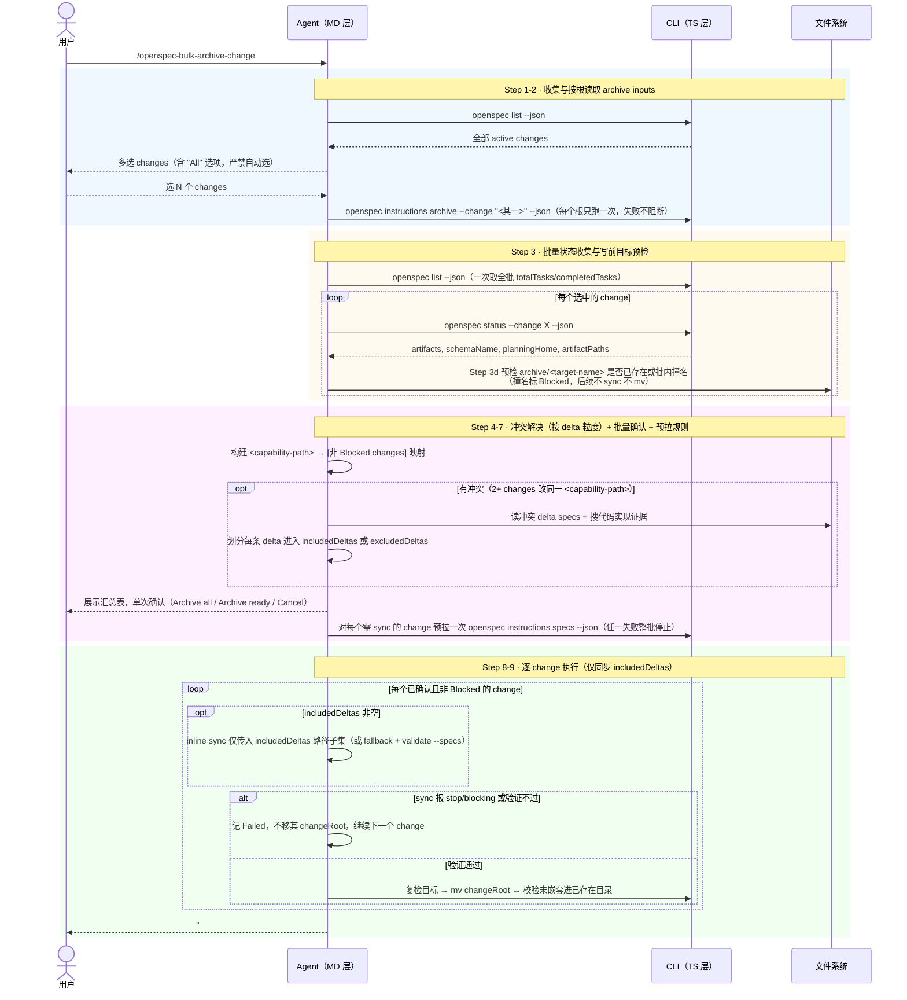

# Workflow · bulk-archive

## 源文件

`src/core/templates/workflows/bulk-archive-change.ts` → `getBulkArchiveChangeSkillTemplate()` + `getOpsxBulkArchiveCommandTemplate()`

> **调用方式**：技能 `openspec-bulk-archive-change`——Claude Code 等工具里 `/openspec-bulk-archive-change`，Codex 用 `$openspec-bulk-archive-change`。1.x 写作 `/opsx:bulk-archive`；v2.0.0 起命令文件已移除，`/opsx:` 只用于历史解释。
> **agent 看到的名字**：`openspec-bulk-archive-change`（skill）/ `OPSX: Bulk Archive`（command）
> **独立 CLI 命令**：无——没有 `openspec bulk-archive` CLI 命令。这是纯 agent 模板，批量编排 archive + sync + 冲突解决。
> **profile**：custom（需显式启用，不在默认 core 里）

## 一句话

bulk-archive 是 archive 的批量版。它的核心复杂度不在单个 merge 算法，而在**冲突检测和解决**：当多个 changes 同时触达同一个 capability 的 delta spec 时，agent 需要读真实代码来判断"到底哪个 change 的实现真正落地了"。

## 和 archive 的关键区别

| | archive | bulk-archive |
|---|---|---|
| change 数量 | 1 个 | 2+ 个 |
| 核心挑战 | sync assessment | **跨 change 冲突检测 + 解决** |
| spec 冲突 | 不存在（只有一个 change） | 2+ changes 改同一个 capability |
| 冲突解决方式 | N/A | agent 读代码判断谁真正实现了 |

## CLI 命令调用序列

```text
1. openspec list --json                                      # 获取全部 active changes
2. [用户多选 changes（严禁自动选择）]
   → 从当前根挑一个已选 change 跑一次 `openspec instructions archive --change "<selected-change>" --json`
     （按根只读一次 context / archive guidance；失败也不阻塞整批）
3. 批量预检（写任何主 spec 前完成）：
   - openspec list --json（一次）读取全部选中 change 的 schema-aware totalTasks/completedTasks（失败/遗漏/计数非法即停止整批）
   - for each selected change:
     a. openspec status --change "<name>" --json             # artifact 状态（done / skipped 满足）与 artifactPaths
     b. 核对 totalTasks / completedTasks
     c. 读取 artifactPaths.specs.existingOutputPaths（唯一合法 delta 来源）
     d. **预检归档目标目录**：计算一次 `<target-name>` 并检查 `<planningHome.changesDir>/archive/<target-name>` 是否已存在（或与批内其他 change 撞名）
        → 撞名者立即标为 `Blocked`（绝不参与冲突消解、绝不写主 spec、绝不移动）
4. [冲突检测：按完整 `<capability-path>` 映射 `capability-path → [changes]`]
5. [对每个冲突：读 delta specs + 搜代码实现证据 → 按 delta 粒度划分 `includedDeltas` 与 `excludedDeltas`]
6. [展示汇总表 + 单次批量确认]
   → 在第一次写主 spec 或移动前，对每个含 `includedDeltas` 的已确认 change 各拉一次 `openspec instructions specs --change "<name>" --json`（任一失败则整批原子中止）
7. [按决定的顺序逐个已确认 change 执行]：
   a. 仅将 `includedDeltas` 路径子集传给 `openspec-sync-specs` inline 同步（未装该技能则按 `SYNC_FALLBACK_SAFEGUARDS` 内联合并 + `validate --specs`），显式忽略 `excludedDeltas`
   b. 仅对 `includedDeltas` 做结构与内容复核
   c. `mv` 前再次检查目标未占用 → `mv "<changeRoot>" "<planningHome.changesDir>/archive/<target-name>"` → **检查未发生嵌套移动**（`<archive>/<target-name>/<change-dir>` 出现则移回并记 Failed）
```

## 时序图



## 冲突解决的三种策略

template 规定 agent 必须读代码来判断：

| 代码事实 | 解决方式 |
|---|---|
| 只有一个 change 的实现存在 | sync 那个 change 的 specs |
| 两个都实现了 | 按时间顺序（旧→新），后者覆盖 |
| 都没实现 | 跳过 spec sync，warn 用户 |

这体现了 OpenSpec 的核心工程思想：**代码是最终事实源**。当 delta specs 冲突时，不看谁写得好，看谁的代码真正存在。

## 按 delta 粒度的 `includedDeltas` / `excludedDeltas` 与 sync 阻塞语义

1. **逐 delta 决策而非逐 change 一刀切（`bulk-archive-change.ts:209-213, 259`）**：同一个 change 可能改了两个 capability，其中一个已落地实现、另一个冲突且未实现。模板将决策拆成两个集合：
   - **`includedDeltas`**：所有无冲突 delta + 冲突解决后确认要同步的 delta；执行时只把这部分具体路径传给 `openspec-sync-specs`（利用 `sync` 的 `existingOutputPaths` 子集收窄契约），并只对它们做合并后验证。
   - **`excludedDeltas`**：因未在代码库找到实现证据而被排除的冲突 delta；它们保持不同步、不验证，但**该 change 本身仍正常归档移动**，并在最终汇总中单列为 `sync skipped`（与跳过整个 change 归档的 `Skipped` 严格区分）。
2. **写前目标预检与防嵌套移动（`bulk-archive-change.ts:114-120, 241-253`）**：
   - Step 3d 在写任何主 spec 之前就计算并锁定每个 change 的 `<target-name>`，一旦发现 `archive/<target-name>` 已存在或两个选中 change 解析到同一目标名，直接标 `Blocked`，不参与冲突消解、不改主 spec、不移动。
   - Step 8c 在 `mv` 前再次复检目标，并在 `mv` 后检查是否出现了 `<archive>/<target-name>/<change-dir-name>`（防止并发创建的同名目录让 `mv` 静默退出 0 并把 change 塞进子目录里）——若嵌套发生，立即移回 `changeRoot` 并记为 Failed。
3. **sync 阻塞与无技能兜底（#1977）**：
   - inline sync 不得委托后台任务；若未安装 `openspec-sync-specs` 技能，则按 `SYNC_FALLBACK_SAFEGUARDS` 在当前会话内自合并并运行 `openspec validate --specs`。
   - 任何 sync stop/blocking 或验证失配都把该 change 记为 **Failed**，保持其 `changeRoot` 原封不动，继续处理批内其余 change。

## Guardrails

| Guardrail | 含义 |
|---|---|
| Always show what will happen before executing | 预览汇总表，单次批量确认；用户选 Cancel 则整批零改动退出 |
| Don't auto-select changes | 用户必须显式多选 |
| Fetch archive inputs **once per selected root** | 在 Step 2 挑一个选中 change 调一次 `openspec instructions archive --json`（失败不阻断整批） |
| Check every archive target in **Step 3d before writing any main spec** | 目标已存在的 change 标 `Blocked`，绝不改主 spec 或移动；跨午夜批次复用 Step 3d 锁定的 `<target-name>` |
| Pre-fetch all `openspec instructions specs` snapshots atomically in Step 7 | 在第一次写主 spec 前拉齐；任一查询失败即整批原子中止 |
| Carry per-delta `includedDeltas` / `excludedDeltas` into sync & verification | 只同步并验证 `includedDeltas`；`excludedDeltas` 单报 `sync skipped` |
| Task progress comes from schema-aware `openspec list --json` | 不自己数 checkbox；lookup 失败即停整批 |
| Treat a sync stop/blocking as that change's failure | 记 Failed、不移其 changeRoot，批内其他 change 继续 |

## 源码锚点

| 内容 | 行号范围（`bulk-archive-change.ts`，共 757 行） |
|---|---|
| 导入 `SYNC_FALLBACK_SAFEGUARDS` + 内联交接常量 | L8, L20-L24 |
| SkillTemplate 定义 | L26-L391 |
| CommandTemplate 定义 | L393-L757 |
| Step 1–2: 获取 active changes + 多选 + **按根读一次 `instructions archive`** | L44-L82 |
| Step 3: 批量收集（`status`、`list --json`、`existingOutputPaths`、**3d 写前归档目标预检 L114-L120**） | L84-L120 |
| Step 4: 冲突检测（键是**完整 `<capability-path>`**，不是末级名） | L121-L131 |
| Step 5: 冲突解决 | L132-L152 |
| Step 6: 汇总状态表 | L153-L177 |
| Step 7: 批量确认 + 原子预拉 `instructions specs` 快照（L197-L205） | L178-L206 |
| Step 8: 按 `includedDeltas`/`excludedDeltas` 执行 sync、验证、`mv` 与防嵌套检查（L253） | L207-L260 |
| Step 9: 输出摘要 | L261-L356 |
| Guardrails | L358-L386 |


## v1.13.1 行为更新

移动 changeRoot 前先检查 archive 目标（`e67ac47f`）：目标已存在同名归档时拒绝而非覆盖/误移动。
