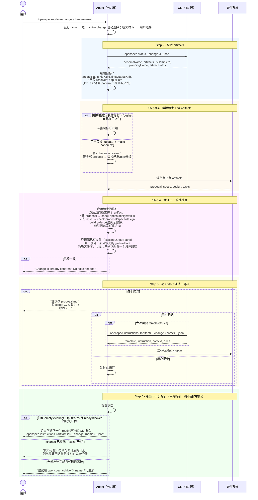

# Workflow · update

## 源文件

`src/core/templates/workflows/update-change.ts` → `getUpdateChangeSkillTemplate()` + `getOpsxUpdateCommandTemplate()`

> **调用方式**：技能 `openspec-update-change` [change-name]——Claude Code 等工具里 `/openspec-update-change` [change-name]，Codex 用 `$openspec-update-change` [change-name]。1.x 写作 `/opsx:update`；v2.0.0 起命令文件已移除，`/opsx:` 只用于历史解释。
> **agent 看到的名字**：`openspec-update-change`（skill）/ `OPSX: Update`（command）
> **独立 CLI 命令**：无（注意与刷新技能文件的 CLI 命令 `openspec update` 区分！`update-change.ts:41` 的技能描述专门写明：用户说 `"openspec update change"` 或要改计划时走本技能；若用户指的是刷新生成文件的 `openspec update` CLI 命令，则运行该命令而非本技能）。
> **profile**：**core**（位于 `src/core/profiles.ts` 的 `CORE_WORKFLOWS` 默认 6 技能集内，开箱即用）

## 一句话

update 是 **planning artifact 修订器**。它不改代码，只修订已有的 proposal/specs/design/tasks，并且保证修订后 artifact 之间保持一致。它填补了 "Explore 里做了决策 → 需要更新 artifacts" 和 "Apply 中发现 design 问题 → 需要回修 artifacts" 这两个场景的官方 workflow 空白。

## 和 continue / propose 的根本区别

| | propose | continue | update |
|---|---|---|---|
| 创建新 change？ | 会 | 不创建 | 不创建 |
| 创建新 artifact？ | 会（全部） | 会（一个） | **不会**——只修订已有（唯一例外见下方 build frontier 一节） |
| 修订已有 artifact？ | 不会 | 不会 | **会** |
| 会读 instructions？ | 每轮都读 | 创建前读 | 只有大改时才读 |
| 需要用户确认？ | 不需要 | 不需要 | **每次修改前必须确认** |

## CLI 命令调用序列

```text
1. [可选] 显式名称 → 对话推断 → 唯一 active change 自动选择；仅歧义时 `openspec list --json`
2. openspec status --change "<name>" --json  # 获取 artifactPaths + planningHome
3. [agent 读全部已有 artifacts]
4. [agent 做修订 + 检查一致性]
5. [可选] openspec instructions <artifact> --change "<name>" --json  # 仅大改时
6. [逐 artifact 展示修订 → 用户确认 → 写入]
```

注意：update **不使用** `openspec new change`。它操作的是已有 change 的已有文件。

## 时序图



## 关键 guardrail：只编已有文件，不推进 build frontier

update 最核心的约束是（`update-change.ts:127` 原文口径）：

```text
Do not advance the build frontier: if an artifact has empty existingOutputPaths
and status ready or blocked, create missing artifacts in a separate step. Leave skipped
artifacts untouched. The only new-file scope is a confirmed concrete path under
a glob artifact whose existingOutputPaths is non-empty.
```

即**不推进 build frontier**：`existingOutputPaths` 为空且状态 `ready`/`blocked` 的 artifact 留待独立步骤创建（模板通过 CLI 命令 `openspec instructions "<artifact-id>" --change "<name>" --json` 提示下一步，不假定用户一定安装了 `continue` 技能）；`skipped` 的不动。唯一的建新文件口子是：某个 glob artifact 已有部分文件、一致性检查发现确缺一个文件时，可以先起草 → 用户确认 → 在 `changeRoot` 内选一个不存在的具体路径创建（创建前刷新 status/instructions 复核，并用“目标已存在即失败”的创建操作防止覆盖，仍不得用 glob `resolvedOutputPath` 当目标）。**continue 推进 build frontier（创建新 artifact），update 只在已有 frontier 内修订**——外加这个狭窄的、需确认的补口。

### v1.14.2 起：例外写在两处（#2083）

这条 blanket 规则原本只在 step 4 里开例外，而 step 2 仍写着"只编辑 `existingOutputPaths` 里的具体文件"。step 4 要创建的那个文件**按定义**不在 `existingOutputPaths` 里，于是照字面执行 step 2 的 agent 会拒绝掉流程本身要求做的操作——一条规则把它自己推翻。

现在两处（step 2 与 guardrails）口径一致：

```text
Edit only the concrete files in `existingOutputPaths`, plus any confirmed
concrete path allowed under a partly populated glob artifact (step 4);
never write to a glob `resolvedOutputPath`.
```

创建那个文件时的路径校验也写死在 step 4 的第 2 步里：路径必须匹配 `artifactPaths.<id>.outputPath`、不得已存在、且**在解析 symlinked 父目录后**仍在 `changeRoot` 内。

## 和 `05_iterate-to-apply-ready` 的关系

我们 `_faq_on_digested/05_iterate-to-apply-ready/` 描述的迭代循环：

```text
Explore 审视 artifacts → 发现 gap → 修 gap → 再审
```

update workflow，就是这个循环中**"修 gap"**步骤的官方 workflow。它提供了：

- artifact 修订的正式操作协议（读→改→一致性检查→确认→写）
- "update vs start fresh" 判断（修改意图 vs 精炼细节）
- 和 continue/apply/archive 的衔接路径

## 区分两层 update：`openspec-update-change` 技能 vs `openspec update` CLI

务必区分名字相近但职责完全不同的两套机制：

- **`openspec-update-change`（本文，`src/core/templates/workflows/update-change.ts`）**：coding agent 消费的工作流技能，用来修订某个活跃 change 的既有规划文档（`proposal.md`、`specs/`、`design.md`、`tasks.md` 等）并保持产物间自洽。
- **`openspec update`（CLI 命令，`src/core/update.ts`）**：刷新项目级 `.agents/skills/`（或 `skillsScope: global` 下的本机 `~/.agents/skills/`）中的单份共享技能真身、对账各工具目录的技能链接/拷贝（`src/core/shared/skill-links.ts`），并按发布指纹库（`isReleasedGeneratedContent`）清理 1.x 遗留的旧命令文件（v2.0.0 起命令文件已不再生成；未改动的历史生成文件自动移除，用户改过的保留并列出）。未安装的 optional workflows（`new`、`continue`、`ff`、`bulk-archive`、`verify`、`onboard`）仍通过 `formatOptionalWorkflowsNote` 提示可用 `openspec config profile` 开启，刷新完成后通过 `src/core/shared/ide-restart.ts` 提示重启 IDE 以重载 skills。工具投递细节见 [`../mechanisms/02-tool-delivery.md`](../mechanisms/02-tool-delivery.md)。

## Guardrails

| Guardrail | 含义 |
|---|---|
| Planning artifacts only — NEVER edit code | 若修订后的计划需要改动业务代码，在改完规划产物后停止，并明确指出需要做哪些代码修改（`stop after revising the plan and identify any code changes it calls for`） |
| Use artifact ids from `openspec status`, never hardcode | schema-agnostic，不写死 `proposal.md` 等文件名 |
| Edit `existingOutputPaths` + step 4 允许的已确认具体路径，绝不用 `resolvedOutputPath` | glob artifact 的 `resolvedOutputPath` 仍是模式串；Step 2 与 Guardrail 两处规则口径一致 |
| Do not advance build frontier | `existingOutputPaths` 为空的 `ready`/`blocked` 产物留到独立步骤创建（Step 6 给出 `openspec instructions` CLI 命令），`skipped` 产物保持不动 |
| Confirm every edit with user before writing | Step 4 只在对话里起草，Step 5 逐项经用户确认后才写盘 |
| If request changes intent → recommend `openspec new change "<new-change-name>"` | 若需求改变了整个 change 的初衷而非精炼细节，询问一个新名字并建议用 CLI 新建 change（本技能自身绝不调用 `new change`） |

## 源码锚点

| 内容 | 行号范围（`update-change.ts`，全文 231 行） |
|---|---|
| CLI / 自然语言交接常量（`CONTINUE_*` / `APPLY_*` / `ARCHIVE_HANDOFF` / `INTENT_CHANGE_GUARDRAIL`） | L11-L37 |
| `getUpdateChangeSkillTemplate()`（技能正文） | L38-L134 |
| Step 1–6（skill 版） | L54 / L70 / L84 / L88 / L101 / L110 |
| 部分填充 glob 产物补缺文件的 5 步协议 | L93-L98 |
| Guardrails（6 条，glob 新文件例外在 L82 与 L126 两处一致） | L123-L129 |
| `getOpsxUpdateCommandTemplate()`（1.x 历史命令模板，**2.0 起不再生成**） | L136-L231 |

> **交接常量设计**：1.x 的 `optionalWorkflow()` 已随 `optional-workflow.ts` 在 v2.0.0 删除；`update-change.ts:11-37` 将所有后续衔接统一写成了不依赖特定 optional skill 是否安装的通用指引与 CLI 命令（如 `openspec instructions "<artifact-id>" --change "<name>" --json`、`openspec archive "<name>"`、`openspec new change "<new-change-name>"`）。

## 历史行为演进

- **draft-then-write（v1.13.1，`fede536c`）**：请求的修订统一在 Step 4 对话中起草，经用户确认后才在 Step 5 写入磁盘。
- **glob 例外双处对齐（v1.14.2，`#2083`）**：Step 2 与 Guardrail 同步声明「部分填充 glob 产物下经确认的具体新路径」例外，消除前后规则自相矛盾。
