# 答案：MD/TS 交替协作时序 — Archive-Ready 如何走到 Archived

## 一句话

Archive 是四个阶段里 TS 比重最高的。前三个阶段（Explore、Propose、Apply）都是 MD 主导、TS 提供状态和指令；archive 反了过来——TS 的 `ArchiveCommand.execute()` 程序化执行验证、合并、移动，MD（agent 或用户）只出现在决策点：选择 change、确认 warning、决定是否跳过 spec updates。

但还有第二条**完全独立**的路径：`openspec-archive-change` agent skill（Claude 等写作 `/openspec-archive-change`，Codex 写作 `$openspec-archive-change`）**绝不调用 `openspec archive` CLI**——它只用只读 CLI（`instructions archive`/`status`/`list`/`instructions specs`）查询状态与规则，在写任何主 spec 前先检查 `<planningHome.changesDir>/archive/<target-name>` 未冲突（v2.1.1 `#2277`），由 agent inline 同步主 specs 并校验，最后自己执行 `mkdir -p` + `mv`。

## 时序图（双路径）

```mermaid
sequenceDiagram
    actor User as 用户
    participant MD as MD<br/>智力层<br/>Agent/用户判断
    participant TS as TS<br/>机械层<br/>OpenSpec CLI
    participant FS as 文件系统<br/>specs/ changes/

    %% ===== Path A: CLI 直调 =====
    rect rgb(255, 255, 250)
        Note over User,FS: ══════ 路径 A · openspec archive（CLI 直调，TS 主导） ══════

        %% Phase 0
        rect rgb(240, 248, 255)
            Note over User,FS: Phase 0 · 选择 change
            alt 用户传了 change name
                User->>TS: openspec archive add-oauth-login
            else 未传 name
                TS->>FS: 扫描 openspec/changes/<br/>排除 archive/
                FS-->>TS: active change 列表
                TS-->>User: 交互选择（inquirer）
                User->>TS: 选择 change
            end
        end

        %% Phase 1
        rect rgb(255, 250, 240)
            Note over User,FS: Phase 1 · 目录验证
            TS->>FS: 检查 openspec/changes/ 存在
            FS-->>TS: ✓
            TS->>FS: 检查 openspec/changes/<change>/ 是目录
            FS-->>TS: ✓
        end

        %% Phase 2
        rect rgb(255, 240, 255)
            Note over User,FS: Phase 2 · validation pass
            opt proposal.md 存在
                TS->>FS: 读 proposal.md
                FS-->>TS: 内容
                TS->>TS: Validator.validateChange()<br/>不通过 → warning（不阻塞）
            end
            opt 存在 delta-formatted specs
                TS->>FS: 读 change/specs/*/spec.md
                FS-->>TS: delta spec 内容
                TS->>TS: Validator.validateChangeDeltaSpecs()<br/>解析 ADDED/MODIFIED/REMOVED/RENAMED<br/>有 ERROR → hard stop
            end
        end

        %% Phase 3
        rect rgb(255, 255, 240)
            Note over User,FS: Phase 3 · task progress check（schema-aware）
            TS->>FS: getTaskProgressForChange() 读 schema apply.tracks
            FS-->>TS: checkbox 内容
            TS->>TS: TASK_LINE_PATTERN 统计<br/>（仅 x/X 算完成，[~]/[-]/[] 均计未完）
            alt 有未完成 tasks
                TS-->>User: "Warning: N incomplete task(s).<br/>Continue?"
                User->>TS: y/N
            else 无跟踪任务文件或 0 任务
                TS->>TS: total=0, completed=0<br/>"No tasks"（不阻塞）
            end
        end

        %% Phase 4
        rect rgb(245, 255, 245)
            Note over User,FS: Phase 4 · 预检目标 + 预构建 + 确认 spec updates
            TS->>FS: assertArchiveDestinationAvailable()<br/>先确认 archive/YYYY-MM-DD-<name> 不存在
            alt 无 --skip-specs
                TS->>FS: findSpecUpdates()<br/>扫描 change/specs/<cap>/spec.md<br/>映射到 openspec/specs/<cap>/spec.md
                FS-->>TS: SpecUpdate[]{source, target, exists}
                alt 有 spec updates
                    TS->>TS: 对全部 updates 先内存预构建：<br/>buildUpdatedSpec()（RENAMED→REMOVED→MODIFIED→ADDED）<br/>收集丢弃内容/frontmatter 告警
                    TS-->>User: 展示告警 + "Specs to update ... Proceed?"
                    User->>TS: y/N（拒绝则跳过写 spec，仍继续移动 change）
                else 无 spec updates
                    TS->>TS: 跳过 spec 更新，仍可 archive
                end
            else --skip-specs
                TS->>TS: 完全跳过 spec update
            end
        end

        %% Phase 5
        rect rgb(248, 248, 255)
            Note over User,FS: Phase 5 · 全量校验 + 快照 + 写主 specs（纯 TS）
            alt 用户确认更新 specs
                TS->>TS: 复核输入 fingerprint 未在等待确认时变化
                TS->>TS: 对全部待写 rebuilt specs 执行<br/>Validator.validateSpecContent()<br/>（任一失败 → 全部不写、直接中止）
                TS->>FS: 复检并独占声明 archive 目标目录<br/>captureSpecSnapshots() 捕获主 spec 快照
                TS->>FS: writeUpdatedSpec() / 授权退役删除<br/>（若中途失败，restoreSpecSnapshots 回滚）
                FS-->>TS: 写入完成
                TS-->>User: "+ 2 added  ~ 1 modified<br/>  - 0 removed  -> 1 renamed"
            end
        end

        %% Phase 6
        rect rgb(255, 248, 248)
            Note over User,FS: Phase 6 · move change 目录
            TS->>FS: moveDirectory()（fs.rename 或带快照回滚的 copy+remove）<br/>→ openspec/changes/archive/YYYY-MM-DD-<name>/
            FS-->>TS: 移动完成
            TS-->>User: "Change 'add-oauth-login' archived<br/>Specs updated: 1"
        end
    end

    %% ===== Path B: openspec-archive-change skill =====
    rect rgb(250, 255, 250)
        Note over User,FS: ══════ 路径 B · openspec-archive-change（独立 agent skill，绝不调 openspec archive CLI） ══════

        User->>MD: /openspec-archive-change [change-name]
        MD->>MD: 读 archive skill 指令

        rect rgb(245, 245, 255)
            Note over User,FS: Step 1-3 · 上下文、工件与任务检查
            MD->>TS: openspec list --json（若需选 change）
            MD->>TS: openspec instructions archive --change "X" --json
            TS-->>MD: context + operationGuidance（可选）
            MD->>TS: openspec status --change "X" --json
            TS-->>MD: schemaName, planningHome, changeRoot, artifactPaths, artifacts
            MD->>TS: openspec list --json（读取 schema-aware 的 totalTasks / completedTasks）
            TS-->>MD: 匹配 change 的任务完成数（有未完任务时提示用户确认）
        end

        rect rgb(245, 255, 250)
            Note over User,FS: Step 4 · 先查归档目标冲突（#2277）→ sync 评估与执行
            MD->>FS: 先检查 <planningHome.changesDir>/archive/<target-name> 是否已存在<br/>（若已存在，写任何主 spec 前立即报错停止！）
            MD->>MD: 对比 artifactPaths.specs.existingOutputPaths 与<br/><planningHome.root>/openspec/specs/<cap>/spec.md
            MD-->>User: 展示组合 sync 摘要并询问（Sync now / Archive without syncing / Cancel）
            User->>MD: 选择 Sync now
            opt 执行 inline sync
                MD->>FS: 再次确认 archive/<target-name> 不存在
                MD->>TS: openspec instructions specs --change "X" --json（取 specs rules 快照）
                TS-->>MD: rules 快照
                MD->>FS: inline 同步执行 openspec-sync-specs（严禁委托后台）
                MD->>MD: 任一 stop/blocking → 立即停止归档，不移 changeRoot<br/>成功后全量核验主 spec 结构与变更内容（无 delta 段头残留等）
            end
        end

        rect rgb(255, 248, 248)
            Note over User,FS: Step 5-6 · 创建归档目录并直接 mv（不调 openspec archive）
            MD->>FS: mkdir -p "<planningHome.changesDir>/archive"
            MD->>FS: 移前最后复检 archive/<target-name> 不存在
            MD->>FS: mv "<changeRoot>" "<planningHome.changesDir>/archive/<target-name>"
            MD-->>User: 输出 Archive Complete 摘要
        end
    end
```



## archive 的 MD/TS 比重反转

前三个阶段的 MD/TS 交替规律在 archive 里被打破：

| 阶段 | MD 比重 | TS 比重 | 特征 |
|---|---|---|---|
| Explore | 极高 | 低 | MD 读代码、推理、合成问题地图；TS 只提供 `list` 和 `status` |
| Propose | 中高 | 中高 | 紧密交替：MD 调 TS 取操作包 → MD 写 artifact → MD 再调 TS 刷新 |
| Apply | 高 | 中 | MD 实施代码；TS 提供 gate 和进度追踪 |
| **Archive** | **低** | **极高** | TS 程序化执行 validate → merge → move；MD 只在决策点出现 |

这不是设计缺陷，而是 archive 的工程本质决定的：merge delta specs 到 main specs 是一个机械操作（RENAMED → REMOVED → MODIFIED → ADDED），不需要智力判断。真正需要智力的是 "merge 之前 delta 和 main 是否已经合理同步"——这个判断在 `/openspec-archive-change` 路径里由 MD 的 sync assessment 完成，在 CLI 直调路径里由用户承担。

## 关键交替模式

### 模式 1：TS 程序化验证 → MD(User) 确认

```text
TS: validateChangeDeltaSpecs() → ERROR
TS: "Validation failed. Please fix the errors before archiving."

MD(User): 修复 delta spec
MD(User): 重新运行 openspec archive
```

TS 的验证是 hard gate。不通过就不能继续。但修复 delta spec 的内容是 MD 的事。

### 模式 2：TS 统计进度 → MD(User) 决定

```text
TS: getTaskProgressForChange() → 3/7 complete
TS: "Warning: 4 incomplete task(s) found. Continue?"

MD(User): 判断是否接受 incomplete tasks 下 archive
  → y: 继续（warning gate，不是 hard gate）
  → n: 取消，回 apply 补 tasks
```

这和 apply 的 `state: "blocked"` 不同。Apply 阶段 tasks.md 缺失或无 checkbox 是 hard block；archive CLI 里只是 warning + confirmation。

### 模式 3：TS 合并算法（纯机械，零 MD）

```text
TS: buildUpdatedSpec()
  1. 解析 delta plan（ADDED/MODIFIED/REMOVED/RENAMED）
  2. 预验证（去重、冲突检查）
  3. 读 main spec baseline（或创建 skeleton）
  4. 按固定顺序应用操作：RENAMED → REMOVED → MODIFIED → ADDED
  5. 重建 spec.md（保持原序，新增追加末尾）
  6. 验证 rebuilt spec
  7. 写入

全程不需要 MD 参与。
```

操作顺序是语义保证，不是实现细节。RENAMED 先发生，后续 MODIFIED 才能引用新名字；REMOVED 先删掉不再存在的 requirement；MODIFIED 替换完整 block；ADDED 最后加入，避免和 rename target 冲突。

### 模式 4（`openspec-archive-change` skill 路径）：MD 主导全流程，不调 `openspec archive`

```text
MD: openspec instructions archive --change <name> --json → 读 context / operationGuidance
MD: openspec status --change <name> --json → 检查 artifacts 是否均 done 或 skipped
MD: openspec list --json → 读取该 change 的 totalTasks / completedTasks（schema-aware）
MD: 先检查 <planningHome.changesDir>/archive/<target-name> 是否已存在（#2277：写主 spec 前硬拦截！）
MD: 对比 delta specs 与 <planningHome.root>/openspec/specs/<cap>/spec.md，向用户展示评估并确认
User→MD: 选择 Sync now（或 Archive without syncing）
MD: （若选 Sync）拉取 instructions specs --json 规则快照 → inline 同步主 specs 并对全部 capability 核验
MD: mkdir -p "<planningHome.changesDir>/archive" + 复检目标不存在 + mv "<changeRoot>" "<planningHome.changesDir>/archive/<target-name>"
```

注意两条路径的分界：`openspec-archive-change` skill **从不调用 `openspec archive` CLI**——它的合并由 `openspec-sync-specs`（或 agent inline 合并）完成，移动由 `mkdir -p` + `mv` 完成；而 `openspec archive` CLI 是纯 TypeScript 的程序化合并与带快照回滚的移动。

v1.14.0（`0ff63dba`）与 v2.1.1（`#2277`）给 skill 路径补齐了硬护栏：先在写任何主 spec 之前预检归档目标目录未冲突（`#2277`）；sync 报告任何 stop/blocking 条件即视为失败并立即停止归档（不比对、不移 `changeRoot`）；sync 成功后还要对全部 capability 做结构与内容核验（无 delta header 残留、REMOVED 已删、被 retire 的 capability 主 spec 已删除而非留空）。sync 只能 inline 同步等待——委托后台会让 step 5 移走 `changeRoot`，留下"已归档但主 specs 没更新"的状态。

## guard 强度分层

archive 的 guard 不是二元 "通过/不通过"。它有明确分层：

| 强度 | 触发条件 | 行为 |
|---|---|---|
| **hard stop** | delta spec ERROR、buildUpdatedSpec 失败、rebuilt validation 失败、archive target 已存在 | 不写 specs，不移动 change |
| **warning + confirm** | proposal validation 不通过、tasks 未完成、spec updates 待确认、--no-validate | 用户确认后继续 |
| **skip option** | --skip-specs | 用户显式绕过 spec update |
| **no guard** | 无 tasks.md、无 delta specs | 静默继续 |

## 和 Apply 的对比

| | Apply | Archive |
|---|---|---|
| TS 核心动作 | 解析 checkbox → state + progress | 程序化 merge specs → move directory |
| MD 核心动作 | 读 context、写业务代码、勾 checkbox | 确认 warning、sync assessment（OPSX 路径） |
| 产物 | 修改后的业务代码 | 更新的 main specs + archived change 目录 |
| 可逆性 | 代码可 git revert | 无内置 unarchive |
| task 未完成的含义 | state: "blocked"（hard） | warning（soft，可继续） |

## 参考来源

源码引用以 [`../../_digested/README.md`](../../_digested/README.md) 声明的「当前源码基线」（`0c737dc1`）为准：

| 来源 | 用到的结论 |
|---|---|
| `src/core/archive.ts` | `ArchiveCommand.execute()` 主流程、validate、task warning、spec update、move |
| `src/core/specs-apply.ts` | `findSpecUpdates()`、`buildUpdatedSpec()`、operation ordering、skeleton、write |
| `src/core/validation/validator.ts` | proposal/delta/main spec validation 语义 |
| `src/core/parsers/requirement-blocks.ts` | delta spec parsing、requirement block 解析 |
| `src/core/parsers/spec-structure.ts` | main spec structure guard（delta header 混入检测） |
| `src/utils/task-progress.ts` | archive 阶段 task checkbox 统计 |
| `src/core/templates/workflows/archive-change.ts` | `/openspec-archive-change` 模板层行为 |
| `src/core/templates/workflows/sync-specs.ts` | agent-driven sync 模板 |
| [`answer-arc03.md`](answer-arc03.md) | CLI 主流程和 flags |
| [`answer-arc07.md`](answer-arc07.md) | delta merge 算法细节 |
| [`answer-arc-guards.md`](answer-arc-guards.md) | hard stop/warning/skip/risk 分层 |
