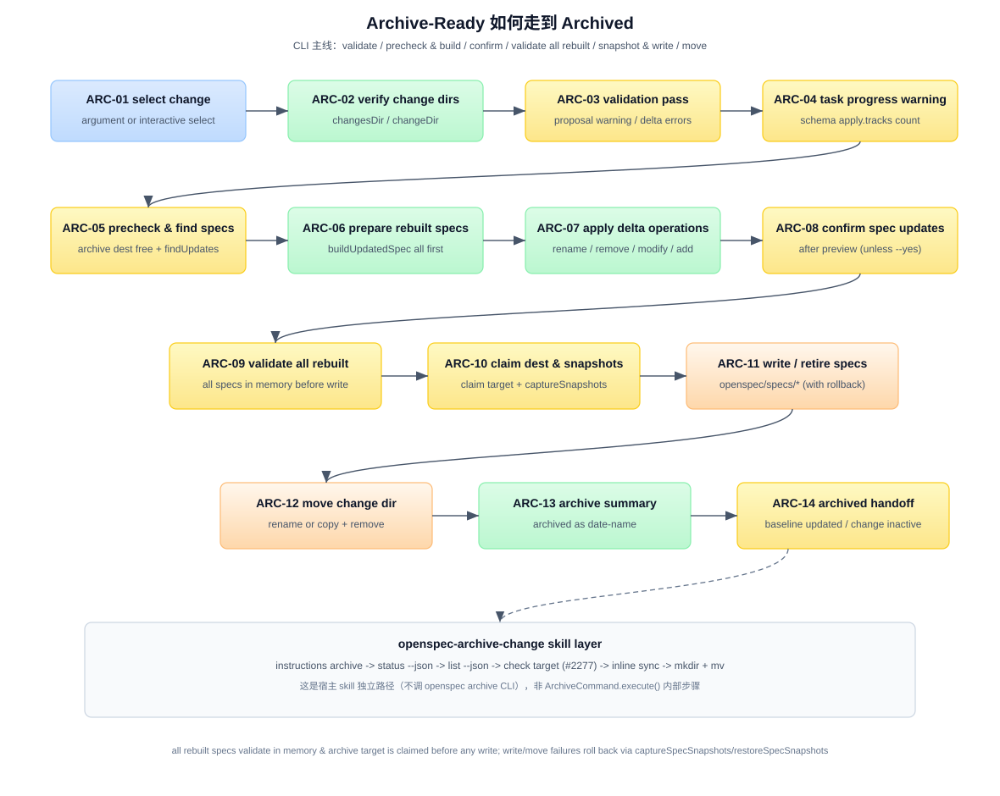

# 答案：Archive-Ready 如何走到 Archived

## 一句话

`openspec archive` 是 change 生命周期的收束动作。它不实施业务代码，而是把已经完成的 change 从“增量工作区”吸收到“正式 capability 基线”：

```text
选择 active change（解析 store-aware root）
  -> 验证 change 目录存在
  -> 验证 proposal / delta specs
  -> 按 schema apply.tracks 检查 tasks 进度并必要时确认
  -> 预检 archive 目标目录可用，查找 change/specs 下的 delta specs
  -> 在内存中预构建全部 rebuilt main specs（RENAMED → REMOVED → MODIFIED → ADDED）
  -> 展示预演告警并请求确认（除非 --yes）
  -> 在写任何文件前校验全部 rebuilt main specs
  -> 复检并独占声明 archive 目标目录，捕获 captureSpecSnapshots
  -> 写回或退役 openspec/specs/（失败走 restoreSpecSnapshots 回滚）
  -> 移动 change 到 openspec/changes/archive/YYYY-MM-DD-<name>/
```

主角是 CLI。`ArchiveCommand.execute()` 负责验证、合并和移动；agent 或用户负责选择 change、确认 warnings，并理解是否跳过了 spec updates。capability 支持嵌套相对路径（如 `identity/session`），根级 `changes/<change>/specs/spec.md` 会被 validate/archive 拒绝。宿主侧仅投递 skill（Claude 等写作 `/openspec-archive-change`，Codex 写作 `$openspec-archive-change`），归档工作流会先尝试读取 `openspec instructions archive --change <name> --json` 注入的 project `context` 与 `operations.archive.guidance`。



图中编号说明：

| 编号 | 名称 | 在流程里做什么 |
|---|---|---|
| ARC-01 | select change | 用户传入 change name，或 CLI 交互选择 active change。 |
| ARC-02 | verify change dirs | 检查 `<changesDir>` 和目标 change 目录存在。 |
| ARC-03 | validation pass | 验证 `proposal.md` 和 delta specs；delta spec ERROR 会阻塞 archive。 |
| ARC-04 | task progress warning | 通过 `getTaskProgressForChange` 按 schema `apply.tracks` 统计 checkbox；未完成 tasks 会 warning 并要求确认。 |
| ARC-05 | precheck & find specs | 先调用 `assertArchiveDestinationAvailable()` 预检归档目标目录未冲突，再扫描 `change/specs/<capability-path>/spec.md` 映射到主 `openspec/specs/<capability-path>/spec.md`。 |
| ARC-06 | prepare rebuilt specs | 在提问确认前对全部 delta specs 先调用 `buildUpdatedSpec()` 完成内存预构建与丢弃内容告警收集。 |
| ARC-07 | apply delta operations | 按 RENAMED → REMOVED → MODIFIED → ADDED 在内存中合并 requirement blocks。 |
| ARC-08 | confirm spec updates | 预演完成后（除 `--yes` 外）询问是否应用主 specs 更新；确认后复核输入 fingerprint 未变。 |
| ARC-09 | validate all rebuilt | 写任何文件前，遍历全部待写 rebuilt specs 调用 `validateSpecContent()`；任一失败全部不写。 |
| ARC-10 | claim dest & snapshots | 首次写主 spec 前再次 `assertArchiveDestinationAvailable()` + `claimArchiveDestination()`，并调 `captureSpecSnapshots()` 留快照。 |
| ARC-11 | write / retire specs | 把 rebuilt 内容写回 `openspec/specs/<capability-path>/spec.md` 或按授权退役删除；任一后续失败由 `restoreSpecSnapshots()` 回滚。 |
| ARC-12 | move change dir | 移动 active change 到归档目录；EPERM/EXDEV 时走复制回退（复制后删源），复制窗口内的写入中断由 fingerprint 检测并可用 snapshots 回滚。 |
| ARC-13 | archive summary | 输出 change 已归档和 spec update totals。 |
| ARC-14 | archived handoff | change 不再 active；主 specs 成为新的 formal baseline。 |

细节展开：

- [`answer-arc03.md`](answer-arc03.md) — `ArchiveCommand.execute()` 的主流程和 flags。
- [`answer-arc07.md`](answer-arc07.md) — delta spec merge 算法。
- [`answer-arc-opsx.md`](answer-arc-opsx.md) — `/openspec-archive-change` 与 CLI 的区别。
- [`answer-arc-guards.md`](answer-arc-guards.md) — 停止、warning、跳过和风险条件。

另外，从 MD/TS 交替协作的视角重新组织了整个流程，含双路径（CLI + OPSX）Mermaid 时序图：[`answer-sequence.md`](answer-sequence.md)。

## Step 1：选择 active change

CLI 可以直接接收 change name：

```bash
openspec archive add-oauth-login
```

如果没有传 name，`ArchiveCommand.execute()` 会进入交互选择：

```text
Select a change to archive
```

选择列表来自 `openspec/changes/` 下的目录，排除 `archive/`。这意味着 archived change 不会再作为 active change 被选中。

## Step 2：确认目录存在

CLI 首先确认：

```text
openspec/changes/             存在
openspec/changes/<change>/    是目录
```

如果没有 OpenSpec changes 目录，会报：

```text
Change '<name>' not found. Available changes: <ids>   （root 下没有任何 active change 时是 ... No active changes exist in this root.）
```

如果指定 change 不存在，会报：

```text
Change '<name>' not found.
```

这一层还没有合并 spec，也没有移动目录，只是确认 active change 容器存在。

## Step 3：验证 proposal 和 delta specs

默认 archive 会验证 change 内容，除非传：

```bash
openspec archive <name> --no-validate
```

验证分两类。

### proposal 验证

如果有 `proposal.md`，CLI 调 `Validator.validateChange()`。

proposal validation 是信息性的：不通过会打印 warning，但不会阻止 archive。

### delta spec 验证

如果 change 下存在 delta-formatted specs：

```text
openspec/changes/<change>/specs/<capability-path>/spec.md
```

并且内容里有：

```text
## ADDED Requirements
## MODIFIED Requirements
## REMOVED Requirements
## RENAMED Requirements
```

CLI 会调用 `Validator.validateChangeDeltaSpecs()`。这里如果有 ERROR，会停止 archive：

```text
Validation failed. Please fix the errors before archiving.
```

这很重要：archive 是把 delta spec 写进正式 baseline 的入口，所以 delta spec 的结构错误不能被静默吸收。v1.8.0 额外把 archive 会拒绝的两种问题前置到 `validate`：① MODIFIED requirement 省略了主 spec 仍有的 scenario（在 authoring 阶段就失败，信息指名要抄回的 scenarios）；② main spec 中存在重复 canonical requirement 名时 archive 直接拒绝，避免 reconciliation 压掉重复块之一。v1.9.0 起 ① 的计数认 requirement 下任何 `#### ` 子标题（不只是字面 `#### Scenario:`）。

## Step 4：检查 tasks 完成度

archive 会通过 `getTaskProgressForChange()`（`src/utils/task-progress.ts:171-177` `findTrackedTasksArtifact()`）按该 change 绑定的 schema `apply.tracks` 解析跟踪任务文件（默认 `openspec/changes/<change>/tasks.md`，也支持自定义文件名或 glob，并非硬编码 `tasks.md`），再用共享的 `TASK_LINE_PATTERN` 统计复选框进度：

```text
- [x] / - [X] 完成（支持 -/*/+ 与 1./1) 及缩进子任务）
- [ ] / - [~] / - [-] / - [] 等其他复选框标记均计为未完成
```

如果没有配置或没有找到对应的跟踪任务文件（或文件中无复选框），进度是 `No tasks`，不会阻止 archive。

如果还有未完成 tasks：

```text
Warning: N incomplete task(s) found. Continue?
```

用户确认后仍可继续。也就是说，task completion 在 CLI archive 中是 warning gate，不是绝对 hard gate。正常 workflow 下 apply 已经把 tasks 全部勾完；archive 这里是最后一道防误操作提示。

## Step 5：查找需要合并的 delta specs

如果没有 `--skip-specs`，CLI 调用：

```text
findSpecUpdates(changeDir, mainSpecsDir)
```

它扫描：

```text
openspec/changes/<change>/specs/<capability-path>/spec.md
```

并映射到：

```text
<planningHome.root>/openspec/specs/<capability-path>/spec.md
```

这里的 `planningHome.root` 来自 status/instructions JSON；CLI 自身也使用 resolved planning home。它可能是 repo-local root 或 store root，不能在 agent workflow 中硬编码 cwd 下的 `openspec/specs/`。

每个 `SpecUpdate` 记录：

```text
source  change delta spec
target  main baseline spec
exists  target 是否已存在
```

如果没有 change specs，archive 仍然可以完成，只是不会更新主 specs。v1.7.0 还允许 metadata 明确声明 `skip_specs: true` 来表达“没有 spec-level 行为变化”；它不得与非隐藏 delta spec 文件共存，不能拿来跳过真实行为变更。

## Step 6：确认是否更新主 specs

如果找到 spec updates，CLI 会显示：

```text
Specs to update:
  user-auth: update
  billing: create
```

没有 `--yes` 时会询问：

```text
Proceed with spec updates? (Y/n)
```

如果用户拒绝，CLI 会打印：

```text
Skipping spec updates. Proceeding with archive.
```

然后仍然移动 change 到 archive。这个行为要记清楚：**archived 不必然意味着主 specs 被更新**，如果用户拒绝或使用 `--skip-specs`，delta specs 只会保留在 archived change 里。

## Step 7：构建 rebuilt specs，先准备再写入

**顺序容易记反**：CLI 不是"问完再算"，而是**先算完再问**。在弹确认之前，它已经对所有 pending spec 调用了 `buildUpdatedSpec(update, changeName)`（源码注释：`Build the proposed updates before asking permission to apply them … so the confirmation must come after this preview`）——所以那些 "not carried into the main spec" 的告警是**先于**提问出现的。用户答 `n` 只是跳过写入，前面这一轮预演不会撤回。即：

```text
buildUpdatedSpec(update, changeName)
```

得到：

```text
rebuilt content
operation counts
```

只要其中任何一个 spec 在构建阶段失败，CLI 会输出：

```text
Aborted. No files were changed.
```

并且不会移动 change。

这一步提供了一个重要安全边界：多 spec change 中，如果第二个 spec 合并失败，第一个 spec 不会先被写入。

## Step 8：合并 delta operations

`buildUpdatedSpec()` 的核心语义是：

```text
读取 change delta spec
读取或创建 main spec baseline
解析 ADDED / MODIFIED / REMOVED / RENAMED
在内存里更新 requirement blocks
重建完整 spec.md
```

操作顺序固定：

```text
RENAMED -> REMOVED -> MODIFIED -> ADDED
```

这个顺序不是实现细节，而是语义保证：

- rename 先发生，后续 modify 才能引用新名字。
- remove 先删掉不再存在的 requirement。
- modify 替换保留的完整 requirement block。
- add 最后加入新 requirement，避免和 rename target 冲突。

注意：CLI 的 `MODIFIED` 是完整替换，不是智能 patch。delta spec 里必须放完整 requirement block，包括 scenarios。

## Step 9：验证 rebuilt spec

构建完所有 rebuilt specs 后，CLI 先遍历完整 prepared 列表，对每个需要写回的 rebuilt spec 调用：

```text
Validator.validateSpecContent(specName, rebuilt)
```

如果验证失败，CLI 会提示：

```text
Validation errors in rebuilt spec for <specName> (will not write changes)
Aborted. No files were changed.
```

这条提示对所有 rebuilt validation 都成立：validation 全部完成后才捕获 main-spec snapshots，并进入写入/退役和 change move。后续 I/O、retirement 或 move 失败时，CLI 会用 snapshots 恢复已尝试 mutation 的主 specs；若 change 已移动，也会尝试移回 active 目录。

这是尽力事务式回滚，不是数据库事务。若并发进程在 archive 期间改了同一目标，CLI 会拒绝覆盖不匹配的 fingerprint；若这同时阻止安全恢复，会显式报告 `Rollback also failed` 并保留现场供人工处理。

## Step 10：生成并独占声明 archive 目标（先于主 spec 写入！）

CLI 生成 archive 名（已有 `YYYY-MM-DD-` 前缀时不重复叠加）：

```text
YYYY-MM-DD-<changeName>
```

例如 `2026-06-14-add-oauth-login`，目标路径为 `<changesDir>/archive/YYYY-MM-DD-<changeName>/`。

注意执行时序：`ArchiveCommand.execute()` 在查找/合并 specs **之前**（`archive.ts:1677`）就先调用一次 `assertArchiveDestinationAvailable()`，并在全部 rebuilt specs 内存校验通过后、**写入任何主 spec 之前**（`archive.ts:1975-1977`）再次调用 `assertArchiveDestinationAvailable()` + `claimArchiveDestination()`，紧接着才执行 `captureSpecSnapshots()` 与主 spec 写入/退役。因此如果目标归档目录已存在，archive 会在**动任何主 spec 之前**直接中止：

```text
Archive 'YYYY-MM-DD-<changeName>' already exists.
```

绝不会留下“主 specs 已写、change 却因目标冲突没移走”的半截状态。

## Step 11：写回或退役主 specs

目标目录独占声明与快照捕获完成后，CLI 才遍历 prepared 列表写回：

```text
openspec/specs/<capability-path>/spec.md
```

并输出每个 capability 的统计：

```text
Applying changes to openspec/specs/user-auth/spec.md:
  + 2 added
  ~ 1 modified
  - 0 removed
  -> 1 renamed
```

多 capability change 会输出 totals。

这一步之后，`openspec/specs/` 代表新的 formal baseline。对新 capability，delta 中可读的 `## Purpose` 会随 archive 写入新 main spec（v2.1.1 `#2267` 起 `buildSpecSkeleton()` 在 `## Purpose` 标题后固定输出一个空行，与标准 Markdown 排版一致）；只有缺失或不可读时才回退 TBD placeholder，既有 main spec 的 Purpose 不会被 delta 覆盖。

**v1.11.0 起**：`openspec validate` 会检测这个 archive 写入的 placeholder（`TBD - created by archiving change ...`），默认给出 WARNING，`--strict` 下报 error。检测使用与 writer 相同的定义常量（`PURPOSE_PLACEHOLDER_PREFIX` + `PURPOSE_PLACEHOLDER_SUFFIX`），所以 spelling 不会漂移。fence 内的引用不计，`TBD`/`TODO` 在 Purpose 开头也匹配，在句子中间则视为有效 Purpose。后续 explore/propose 都应该以这里为当前 capability 基线。

> **v1.8.0 归档/同步边界。** 完全一致的 early-synced ADDED、MODIFIED、REMOVED、RENAMED 会作为幂等 no-op 被接受；近似命中（大小写、空白或不同内容）仍是错误。archive JSON 也可返回 warnings。已有日期前缀的 change 不会被再次叠加日期。
>
> **v1.8.0 追加。** ① 若 change 的 REMOVED 拿掉某 capability 最后一个 requirement，原本的 "Spec must have at least one requirement" 中止可在 `.openspec.yaml` 声明 `retire_capabilities: true`（与 `schema:` 并存）后变成**删除该 capability 的 main spec**；没有 marker 时行为不变，错误信息会指明这个出路。`--no-validate` 永不触发退役。② archive 在无法交互提问（agent 的 stdin closed）时，会给出需要哪个 flag 与携带原 flags 的可重跑命令（如 `openspec archive <name> --skip-specs --yes`）；不带 change 名时从旧版 exit 0 吞错改为 exit 1 请求 change 名。
>
> **v1.9.0 追加。** 非 TTY（stdout 或 stdin 不是终端）时 confirm 走纯文本、不写 ANSI；无 change 名时要求先传入名字，不画交互菜单。重建 spec 保留 `## Requirements` 周围空行，文件末尾恰好一个 LF。
>
> **v1.10.0 退役三分支（含 v2.1.1 `#2266` 精确判定）。** REMOVED 清空最后一个 requirement 时，不要把 “加 marker” 当万能修复：
>
> 1. **仅缺授权 marker**：main spec 除可理解的 Purpose/Requirements 外没有残留内容，错误才建议在 `.openspec.yaml` 加 `retire_capabilities: true`。
> 2. **存在 unaccounted content**：例如 `## Notes`、orphan text、真 HTML 块或残余 `###` heading（注：v2.1.1 `#2266` 起，requirement 正文或列表续行里以 `<` 开头的普通文本——如 `<50ms` 或 `<capability>` 占位符——只要 `mayBeRawHtml()` 判定不是 HTML 块起始或独立标签，均作为正常正文放行，不再误判为 unaccounted content 阻断退役）。archive 会列出真正无法归属的 blocking lines；必须先迁移、删除或归位这些内容。此时 marker 也无效，提示不会误导你去加 marker。
> 3. **marker 存在但不可 honor**：YAML 形状、boolean 类型或 schema resolution 无效时，archive 同时报告具体 reason；不会把无效 metadata 当删除授权。
>
> blocking content 输出会移除控制字符、每行最多展示 200 字符，只列前三行并报告剩余数量；marker reason 也会清理控制字符，避免终端注入。修好内容与 metadata 后再重跑，`--no-validate` 仍不会触发退役。

## Step 12：移动 change 目录

最后 CLI 创建 `archive/` 目录，并移动：

```text
openspec/changes/<change>/
  -> openspec/changes/archive/YYYY-MM-DD-<change>/
```

移动优先使用 `fs.rename()`。如果遇到 `EPERM` 或 `EXDEV`，会 fallback 到 copy directory 后删除源目录。

`.openspec.yaml`、`proposal.md`、`specs/`、`design.md`、`tasks.md` 都会随着整个 change 目录一起移动。

## Step 13：archived 的精确定义

archive 完成后，文件系统状态是：

```text
openspec/specs/<capability>/spec.md
  已成为新的正式 baseline

openspec/changes/<change>/
  不再存在

openspec/changes/archive/YYYY-MM-DD-<change>/
  保存原 change artifacts 和 metadata
```

如果用户跳过 spec updates，则第一条不成立：主 specs 没有被更新，但 change artifacts 仍被移到了 archive。

## Step 14：为什么 `/openspec-archive-change` 看起来不一样

Claude 的 `/openspec-archive-change`（Codex 写作 `$openspec-archive-change`）是宿主 skill 操作手册，**绝不调用 `openspec archive` CLI**，而是独立跑完一套 agent 驱动流程：

```text
1. 选择 change + openspec instructions archive --change "<name>" --json（读取 context / operationGuidance）
2. openspec status --change "<name>" --json（检查 artifact 完成度）
3. openspec list --json（读取 schema-aware 的 totalTasks / completedTasks 检查未完任务）
4. 先预检 <planningHome.changesDir>/archive/<target-name> 不存在（v2.1.1 #2277，写主 spec 前硬拦冲突！）
5. delta spec sync assessment → 用户确认后拉取 instructions specs 规则快照 → inline 同步主 specs 并全量校验
6. mkdir -p "<planningHome.changesDir>/archive" + 再次检查目标不存在 + mv "<changeRoot>" ...
```

它还可能调用 `openspec-sync-specs` 做 agent-driven sync。这个 sync 路径和 CLI 的 programmatic `buildUpdatedSpec()` 不同：agent 会读 delta spec 和 main spec，然后智能合并。

> **v1.6.0 变更**：OPSX archive template 有重要加固——① sync 必须 **inline** 执行（不等完成绝不 mv，防止 changeRoot 被移走后 sync 读不到文件）；② sync prompt 新增 **Cancel** 选项；③ sync 完成后必须对**全部 capability** 重新验证（ADDED 存在、MODIFIED 含变更且其他 scenario 完整、REMOVED 消失、RENAMED 用新名），任何 mismatch 都停止 archive。main spec 路径也改用 store-aware `planningHome.root`。
>
> **v1.14.0 追加（`0ff63dba`）**：阻塞语义收紧——sync 报告任何 stop/blocking 条件时**视为 sync 失败，立即停止归档**：不做 post-sync 内容比对、不移动 `changeRoot`，一切未动，用户修复后可直接重跑。sync 成功后还有结构验证：主 spec 不得残留 `## ADDED/MODIFIED/REMOVED/RENAMED Requirements`；REMOVED 的 requirement 必须已删；retire 掉的 capability（最后一个 requirement 被移除、`## Requirements` 变空）其主 spec 被删除而非留空。模板同时明确 inline sync 的时序约束：不得把 sync 委托后台——否则 step 5 移走 `changeRoot` 会留下"已归档但主 specs 没更新"的状态。

所以读源码时要分层：

| 路径 | 负责什么 |
|---|---|
| `openspec archive` CLI | 程序化 validate、merge、move。 |
| 宿主 archive 模板 | 指导 agent 做 archive instructions、status/sync assessment/user confirmation/move。 |
| `openspec-sync-specs` 模板 | agent-driven spec merge，可独立于 archive 调用。 |

本 FAQ 的主线是 CLI；OPSX 差异见 [`answer-arc-opsx.md`](answer-arc-opsx.md)。

## 三方分工

| 角色 | 在 archive 中负责什么 |
|---|---|
| OpenSpec CLI | 验证 change、统计 tasks、合并 delta specs、移动 change 目录。 |
| 用户 / Agent | 选择 change，确认 warnings，决定是否跳过 spec updates 或 validation。 |
| 文件系统 | 保存正式 `openspec/specs/` baseline 和 archived change 记录。 |

## 常见误区

### 误区 1：archive 会继续改业务代码

不会。业务代码应该在 apply 阶段完成。archive 只处理 OpenSpec 文件状态：主 specs 和 change 目录。

### 误区 2：tasks 没全完成，CLI 一定拒绝 archive

不会。CLI 会 warning 并要求确认。正常流程应先完成 tasks，但 CLI 允许用户显式继续。

### 误区 3：archived 一定代表 specs 已合并

不一定。`--skip-specs` 或用户拒绝 spec updates 时，change 仍会 archive，但主 `openspec/specs/` 不会吸收 delta。

### 误区 4：CLI archive 和 `/openspec-archive-change` 是同一个东西

不是。CLI 是程序执行路径；OPSX 是 agent 操作模板。它们目标相近，但内部步骤和合并方式不完全相同。

### 误区 5：archive 是可逆操作

没有内置 unarchive。archive 后 active change 消失，恢复需要手工移动目录或重建 change。

### 误区 6：空 capability 失败时加 marker 总能解决

不能。marker 只授权删除一个已经能被 merge/validator 完整解释的空 capability。若 `## Notes`、orphan 文本或残余 heading 会随文件一起丢失，archive 必须 hard stop 并列出 blocking lines；先处理内容，不能靠 marker 绕过。

## 参考来源

源码引用以 [`../../_digested/README.md`](../../_digested/README.md) 声明的「当前源码基线」为准：

| 来源 | 用到的结论 |
|---|---|
| `src/core/archive.ts` | `ArchiveCommand.execute()` 主流程、validation、task warning、spec updates、move directory |
| `src/core/specs-apply.ts` | `findSpecUpdates()`、`buildUpdatedSpec()`、`writeUpdatedSpec()` 和 delta merge 顺序 |
| `src/core/validation/validator.ts` | proposal/delta/main spec validation 语义 |
| `src/core/parsers/requirement-blocks.ts` | delta spec parsing、requirement block parsing、name normalization |
| `src/core/parsers/spec-structure.ts` | main spec 结构错误检查 |
| `src/utils/task-progress.ts` | archive 阶段 task checkbox 统计 |
| `src/utils/change-metadata.ts` | retirement marker 是否可 honor 及安全 reason |
| `test/core/archive.test.ts` | marker-only、blocked-content、invalid-marker 三分支与 bounded output |
| `src/cli/index.ts` | `archive [change-name]` command 和 flags |
| `src/core/templates/workflows/archive-change.ts` | `/openspec-archive-change` 模板层行为 |
| `src/core/templates/workflows/sync-specs.ts` | agent-driven sync 模板 |
| [`../../_digested/internal-spec-driven/04-archive-归档合并.md`](../../_digested/internal-spec-driven/04-archive-归档合并.md) | archive validate/merge/move 机制消化 |
| [`../06_apply-ready-to-archive-ready/answer.md`](../06_apply-ready-to-archive-ready/answer.md) | archive-ready 的前置状态 |


## v1.13.0–v1.13.1 补充：archive 正确性大修

如果曾遇到「validate 通过、archive 报成功、但 main spec 没变」的情况，大概率是 v1.13.0 修掉的 parser bug：`*`/`+` 列表标记的 REMOVED/RENAMED 被静默忽略、重复 delta section 只应用一份。升级后这些写法全部生效。同时 archive 现在会：拒绝仅大小写不同的 requirement 名（`767d63c9`）、拒绝 merge path 读不到的 delta 文件（`e01ed070`）、fence 内空行不再被重写（`aedf4d0c`）。完整修复表见 `_digested/workflows/09-archive.md`。

## v1.13.2–v1.14.0 补充：Windows 回退、CRLF 保持与 sync 阻塞语义

- **Windows EPERM/EXDEV 回退重写**（`ba0f5087`）：`archive.ts` 的 staging rename 遇 EPERM/EXDEV 时改走 `copyThenRemoveDirectory`（源 → dest 复制后再删源）；fingerprint 检测复制窗口内的写入中断；`captureSpecSnapshots`/`restoreSpecSnapshots` 支持回滚。非 EPERM/EXDEV 的 staging 失败仍保持源目录不动。
- **新建 spec 的回滚剪裁**（`f2812f6d`）：回滚只删本次自己创建的 capability 目录；已存在的空目录保留。
- **CRLF 保持**（`1d35e908`）：新模块 `src/utils/line-endings.ts`，specs-apply 写回时 `matchLineEnding(rebuilt, previous)`——已有文件保持其行尾，只有新文件才写 LF。Windows 仓库升级后 archive 不再产生全文件行尾 diff。
- **归档工作流的任务进度改 schema-aware**（`fb1b876`）：workflow 模板读 schema `apply.tracks` 的进度（含自定义任务文件/glob），不再误报"未完成"。
- **OPSX 模板的 sync 阻塞语义与 sync 后结构验证**（v1.14.0，`0ff63dba`）：见 Step 14 的 v1.14.0 追加——sync 失败立即停止归档、不移 `changeRoot`，可修复后重跑。

## v1.14.1–v1.14.3 补充：三类"归档看起来成功"的现实

### 1. 归档成功、清理失败（v1.14.1，#1792）

退役某 capability 之后要清理备份，这一步在**目录已移走之后**执行。它失败时以前报通用 `archive_error`，且文案说"每个列出的备份都被保留"——部分成功时这句话不成立。现在错误码是 `archive_retirement_cleanup_failed`，文案把两件事分开：

| 事实 | 含义 |
|---|---|
| The change **was** archived | changeRoot 已经移走，重跑 archive 不会回到从前 |
| retirement cleanup did not complete | 备份可能只删了一部分，要按诊断里列出的**所有** recovery path 逐个检查 |

所以看到这个错误码不要"再 archive 一次"，去 `openspec/changes/archive/` 确认结果，再按 recovery path 处理残留。

### 2. 文本被 delta 合并丢掉与顶部 YAML frontmatter（v1.14.2 `#2054`，v2.1.1 `#2273`）

`openspec archive` 的 programmatic merge 只搬 delta 段里的 requirement。三类文本永远进不了主 spec：第一个 `## ` 之前的正文、`## ADDED/MODIFIED Requirements` 里第一个 requirement 之前的散文、Purpose 与四类 delta 段之外的任何 `##` 段（`## Notes` 之类）。它们在 `validate` 中触发 WARNING（`--strict` 失败），在 `archive` 中打印丢弃告警。

**v2.1.1 `#2273` 例外**：位于 delta 文件第 1 行的顶部 **YAML frontmatter** 在 `openspec validate --strict` 下被豁免（不作为 `unappliedContent` 报错），方便团队在 delta 文件头挂自定义元数据；`openspec archive` 合入时仍不把 frontmatter 带入主 spec，仅输出一条明确提示（`<specName> - frontmatter (line 1) is not carried into the main spec. It stays with the change.`）。

**搬运结果没变**，只是丢失不再无声。真想让内容进主 spec：挪进 requirement（或新 capability 的 `## Purpose`）；只服务本次变更的说明则留在 proposal/design 或 frontmatter。

### 3. 归档时的 symlink 边界（v1.14.2，#2052）

`openspec/`、`changes/`、`specs/` **本身**可以是 symlink（典型：整个 `openspec/` 指向共享文档仓库——注意它**不要求**目标在项目内，只要求链接的父目录合法、且目标真实存在；悬空链接报错），但 `archive/` 不允许是链接——它必须真的在所在 changes 目录里，否则归档会写到项目外。单条 spec 文件也可以是项目内链接（v1.14.3 起由 `spec-path-containment.ts` 统一判定）。

配套修正：归档后校验 delta 时，相对路径基准从 changeDir 改为它的 canonical 形式——因为 `changes/` 自身可能是链接，旧算法会算出错误相对路径、报出"归档后内容比对失败"的假警报。

### 顺带一条口径修正

`archive` 的 spec 更新确认提示默认值是 **Yes**（`Proceed with spec updates? (Y/n)`，回车即继续；拒绝需显式输入 `n`）。v1.14.1 之前 spec 里写的是默认 No——那是 spec 落后于代码，不是行为变更。
