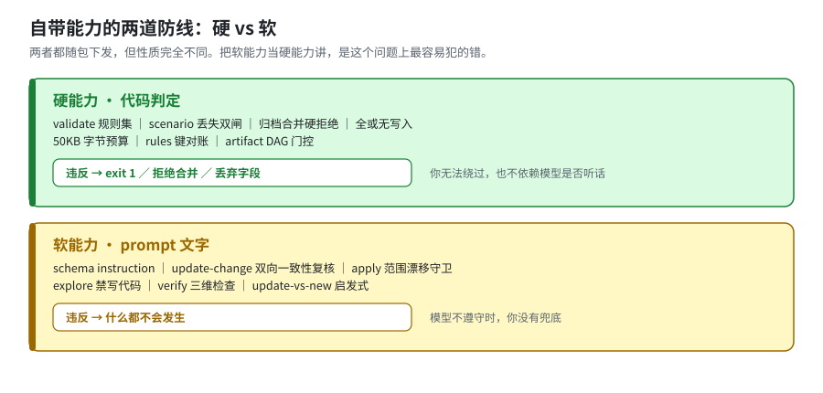

# 01 · 什么算「自带能力」，以及硬 vs 软

[← 返回索引](answer.md)

本篇只认一样东西：**装了 `@fission-ai/openspec` 就有的能力**。这条自我约束是整篇的地基——不加它，上游仓库里那些"看起来很像机制"的东西会一股脑混进来，结论就废了。

---

## 1.1 证据分级

正文里每条结论都带标签，你可以据此判断该信到什么程度：

| 标签 | 含义 | 你能怎么用 |
|---|---|---|
| **【实测】** | 我在本仓跑过该命令并看到输出，数字是抄的 | 可直接引用；§[05](05-verification.md) 有复跑命令 |
| **【代码】** | 读了 `src/` 的具体行，但**没有在运行时触发到那个分支** | 可信但未经运行验证；想确认请自己构造触发条件 |
| **【文档】** | 只存在于 prompt / docs 文字中 | 这是**软能力**，是建议而非保证 |

> **为什么要分这个**：本篇最核心的发现就是"硬 vs 软"的分界。如果我把【代码】和【文档】混着写成"机制"，读者会以为工具会拦住他——而实际上不会。**混淆这两者，比没有结论更糟。**

具体到本篇，有三条重要的结论是 **【代码】而非【实测】**，因为本仓库缺少触发条件：

- 跨仓 references 索引的 50 KB 二分截断（本仓 `context` 输出是 `No references declared`）
- `retire_capabilities` 的 capability 删除路径（我没有真跑一次删 spec 的归档）
- `skip_specs` 与 `specs/` 下文件的冲突报错（本仓没有这种 change）

它们都写在 §[02](02-context-rot.md) / §[03](03-direction-drift.md) 并被明确标注。

---

## 1.2 三条排除线

以下东西在上游仓库里**都真实存在**，但**都不是产品能力**，因此全部排除：

| 排除项 | 为什么不算 | 证据 |
|---|---|---|
| `openspec/work/**`<br>（goal / roadmap / slices / capstone / runbook） | 上游团队管理**自己项目**的产物，零 CLI 支持 | `openspec/work/` 在 `src/` 中引用数 **0**【实测】；`openspec/work/README.md` 自称 experimental，并明说 *"Current OpenSpec CLI validation, archive, and spec update behavior still centers on `openspec/changes/` and `openspec/specs/`."*【文档】 |
| `openspec/initiatives/**`<br>+ `.initiative.yaml` | 运行时实现**已被删除** | PR #1190 `a0decbe3 feat(stores)!: replace workspaces and initiatives with stores` 删掉 `src/commands/initiative.ts` 与 `src/core/collections/`【实测：`git log --diff-filter=D`】；`src/cli/index.ts:888` 现为 `new Option('--initiative <id>', 'No longer supported').hideHelp()`【代码】 |
| `openspec/explorations/**` | 纯目录约定，无工具链 | `src/` 里唯一一次提及是 `src/core/github-copilot/cloud-agent.ts:257-258`，标签为 `'legacy exploration directory'`【代码】 |
| `test/vocabulary-sweep.test.ts`<br>（词表守卫） | 守的是 **OpenSpec 自己的 `src/`**，跑在它的 CI 上；你装了 openspec **零收益** | `SWEEP_ROOTS = ['src','test','docs','scripts','.codex']`（该文件 `:16`），是它仓库自己的目录【代码】 |
| `openspec/changes/add-change-stacking-awareness/` | **已提案未落地** | `dependsOn`/`provides`/`requires`/`touches`/`parent` 在 `src/` **0 命中**【实测】；`openspec change graph` **不存在**（`change` 只有 `show\|list\|validate`）【实测】；该 change 卡在 3/4 artifacts【实测】 |

**一句话**：这些是"上游怎么管自己"，不是"你装上能得到什么"。前者可以学它的做法，但不能指望工具替你执行。

---

## 1.3 硬 vs 软：必须引入的第二维度



两条防线**都随包下发**，但性质完全不同：

```text
硬能力   代码判定
         违反 → exit 1 ／ 拒绝合并 ／ 丢弃字段
         你无法绕过，也不依赖模型是否听话

软能力   随包下发的 prompt 文字
         （schema instruction、workflow 模板）
         违反 → 什么都不会发生
```

**这条分界是本篇的核心。** 上游把大量"纪律"写成了 prompt：

- schema 里那句 `Do not invent a requirement just to satisfy validation`【文档】
- update 工作流的双向一致性复核【文档】
- apply 的范围漂移守卫（`do not absorb it silently`）【文档】
- explore 的"永不写代码"【文档】

它们确实会随包投递到你的项目（`openspec init` 生成 skills/commands），**性质是建议而非闸门**。模型听话时它们很有效——这也正是"写小的没问题、思路连贯没问题"的原因；模型不听话或上下文被压缩时，它们**不会报错、不会失败、不会提醒你**。

> 后面每一章都会标注它站在哪一侧。**线 A 的机制几乎全是硬的；线 B 的机制一半是软的**——这个不对称，就是"规格层有闸门护着、方向层没有"的技术根因。

---

## 1.4 本篇纠正过的三处错误

记录在此以免被后续笔记复用：

1. 曾把 `test/vocabulary-sweep.test.ts` 当作"防概念回流的机制"——它保护的是 **OpenSpec 自己的源码**，对用户项目无作用。
2. 曾把 `/opsx:verify` 当默认能力讲——它**不在 core profile**（见 §[04](04-usage.md)）。
3. 曾把 `work/`、`initiatives/`、`runbook.md`、`deletion-ledger.md` 混入"机制"清单——它们是**项目管理产物**，不是产品能力。
4. 曾断言"方向完全没有机器表示"——**这条在本次 review 中被推翻**：自定义 schema 可以把 `direction` 变成一等 artifact 并接入 DAG 门控，见 §[03.4](03-direction-drift.md)。准确说法是"**内置 schema 里没有方向概念**"。

---

[← 返回索引](answer.md) ｜ 下一篇：[02 · 线 A：上下文腐化 →](02-context-rot.md)
