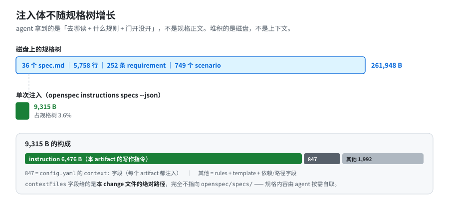
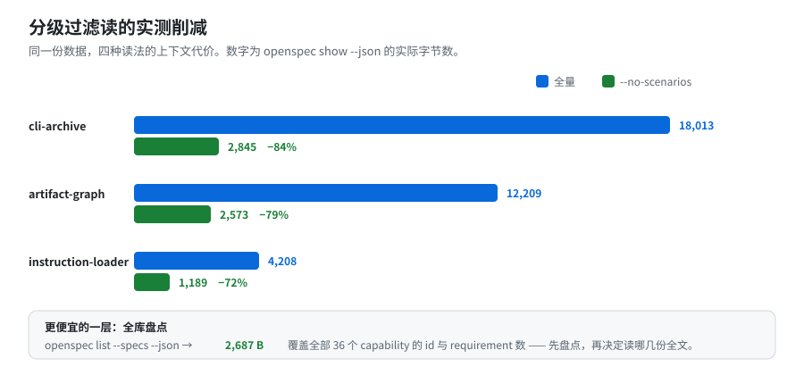

# 02 · 线 A：上下文腐化

[← 返回索引](answer.md) ｜ 上一篇：[01 · 什么算自带能力](01-scope-and-framework.md)

**结论：这条线在自带能力里有真实且设计良好的机制，且全部是硬能力。** 五项机制叠起来做到一件事——**注入体不随 specs 树增长**。

---

## A1 · 注入的是「导航简报」，不是规格正文 ★最关键



对 `add-amp-support` 实测 `openspec instructions specs --change add-amp-support --json`，载荷构成【实测】：

| 字段 | 内容 | 实测体量 |
|---|---|---|
| `instruction` | 该 artifact 的写作指令（来自 schema） | 6,476 B |
| `context` | `config.yaml` 的 `context:` 全文 | 847 B |
| `rules` | `config.yaml` 的 `rules.specs` | 5 条 |
| `template` | 模板 | 374 B |
| `contextFiles` | **本 change 的文件绝对路径**（非内容） | — |
| `dependencies` | 上游 artifact + `done` 标志 | — |
| `unlocks` | 本 artifact 解锁谁 | — |
| `existingOutputPaths` | 已存在产物（防重写） | — |
| `planningHome` | store 感知的正确根 | — |
| `state` / `missingPrerequisites` / `progress` | 门控状态 | — |
| `tasks[].done` + `sourcePath` + `line` | 逐任务状态与**精确行号** | — |

**全 JSON 合计 9,315 B**【实测】。`instructions apply` 是 3,930 B【实测】。

决定性的一点【实测】：

```text
contextFiles = {
  "proposal": ["…/add-amp-support/proposal.md"],
  "specs":    ["…/add-amp-support/specs/ai-tool-paths/spec.md"],
  "tasks":    ["…/add-amp-support/tasks.md"]
}
```

**只指本 change 的文件，完全不指 `openspec/specs/`。** 对比规模【实测】：

```text
本仓 specs 树   36 个 spec.md │ 5,758 行 │ 261,948 B
                252 条 requirement │ 749 个 scenario
最大单文件      cli-completion/spec.md = 432 行 / 19,949 B / 11 条
──────────────────────────────────────────────────────────
单次注入        9,315 B（占规格树 3.6%）
```

> **机理上，注入体不随规格树增长。** agent 拿到的是"去哪读、什么规则、门开没开"，规格内容靠它自己按需取。这是防腐的结构性前提——**堆积的是磁盘，不是上下文**。

---

## A2 · 四级分级过滤读



| 层级 | 命令 | 实测 |
|---|---|---|
| 全库盘点 | `openspec list --specs --json` | **2,687 B** 覆盖 36 个 capability 的 id + requirement 数【实测】 |
| 过滤读 | `show <id> --type spec --json --no-scenarios` | cli-archive **18,013 → 2,845（−84%）**；artifact-graph 12,209 → 2,573（−79%）；instruction-loader 4,208 → 1,189（−72%）【实测】 |
| 单条直取 | `show <id> --type spec --json -r <n>` | "Show specific requirement by ID (1-based)"【实测：读 `show --help`】 |
| 全文 | `show <id> --type spec` | 全量 |

`show` 的完整过滤面【实测：读 `show --help`】：`--json`、`--type change|spec`、`--deltas-only`、`--requirements-only`（deprecated 别名）、`--diff`、`--requirements`、`--no-scenarios`、`-r/--requirement <id>`、`--no-interactive`、`--store <id>`。

而且 schema 里写明了**两级读的纪律**【文档】（`schemas/spec-driven/schema.yaml:22-31`）：

```text
"…that returns a capability's purpose and requirement texts without pulling
 whole spec files into context. … Reuse an existing capability's exact path
 instead of introducing a near-duplicate name.
 The filtered read is only an overview. Before deciding what is already covered
 or what should change, read each relevant spec in full, including scenarios…"
```

——它防的正是"只看了摘要就动手改"这种漂移。**但这是 prompt 文字，是软能力。**

---

## A3 · 50 KB 硬预算 ★唯一的字节闸门

`src/core/project-config.ts:248`【代码】：

```ts
export const MAX_CONTEXT_SIZE = 50 * 1024; // 50KB hard limit, shared with the references index
```

两处执行，行为**不同**：

```text
config.yaml 的 context: 超限
  → 警告 + 【整个字段丢弃】（不是截断）        project-config.ts:350-353  【代码】

跨仓 references 索引超限
  → 二分查找截断 + 诊断码 reference_index_truncated
  → 并告知补救命令                            references.ts:510-517     【代码】
```

截断时的原话【代码】：

```text
"Referenced store '<id>' index truncated at the 50KB budget (<n> of <total> specs
 listed). List the rest directly: openspec list --specs --store <id>"
```

> ⚠️ **这条是【代码】不是【实测】**：本仓 `openspec context` 输出为 `No references declared`【实测】，所以 50 KB 截断分支没有被运行到。想亲手验证需要先注册一个 store 并配 `references:`，再堆够 50 KB 的 spec 索引。

配套使用纪律【文档】（`docs/troubleshooting.md:153-155`）：*"capped at 50KB, **on purpose, because it's injected into every request**… Lean context also produces better, faster results."*

---

## A4 · `rules:` 按 artifact 分流注入

实测同一个 change、不同 artifact 拿到的 `rules`【实测】：

| artifact | 注入的 rules | 条数 |
|---|---|---|
| `proposal` | `undefined`（config 未配） | 0 |
| `specs` | Windows 路径 scenario、跨平台行为、面向用户行为优先… | 5 |
| `design` | 用 Node path 模块、别自创检测机制、显式查表优先… | 5 |
| `tasks` | Windows CI 验证、跨平台测试考虑 | 2 |

`context`（847 B）**每个 artifact 都注入**；`rules` 只注入相关的。

**`rules:` 的键就是 artifact id**。用内置 `spec-driven` 时只有四个合法值：`proposal` / `specs` / `design` / `tasks`——**够用了，不需要为了配规则去 fork schema**。【实测】自定义 schema 里的 artifact id 同样能挂，但那意味着你得自己维护 schema（见 §[06](06-remedies-within-budget.md) 开头的取舍）。

> ⚠️ **一个容易踩的坑**：`rules:` 是 YAML **列表**，单条写错会让**该 artifact 的整组规则失效**。最常见的诱因是行首的 `##` 被 YAML 当注释、整条变 `null`。规则里出现 `##` 或 `": "` 时，**整条加引号**【实测】。

还有防"配错静默失效"的校验【代码】（`validateConfigRules`，`src/core/project-config.ts:469-486`）：规则键拿去跟**所有可用 schema 的 artifact id** 对账，对不上则 **warning 并列出合法 id**。

> ⚠️ **但这道校验很弱，本节初稿低估了它的边界**（本次复核修正）：`validateConfigRules` 的唯一调用点是 `src/core/artifact-graph/instruction-loader.ts:385`，所以——
>
> ```text
> ✓ warning 会出现在 `openspec instructions` 的 stderr
> ✗ 不进 stdout（--json 里没有）
> ✗ `openspec validate --all` 完全不报【实测】
> ```
>
> **只跑 `validate --all` 的 CI 永远发现不了 `rules:` 写错**，规则会静默失效。这是"分层注入"最实际的坑。

> 这解决了一个很实际的问题：项目约束沉淀进 `config.yaml` 后**按需下发**，而不是每次在 chat 里重讲、也不是一股脑灌进每个请求。但请注意：**`rules` 全部是软能力**，违反什么都不发生。

---

## A5 · artifact DAG 门控

`openspec status --change <id> --json` 给出【实测】：`requires`（直接依赖）、`unlocks`（解锁谁）、`status`（`done`/`skipped`/`ready`/`blocked`）、`missingDeps`（仅 blocked 时）、`nextSteps`、以及 `actionContext.allowedEditRoots`（哪些仓库可写）。

**依赖是 DAG 不是链**【代码：`schemas/spec-driven/schema.yaml`】：

```text
proposal  requires: []                    ← 起点
specs     requires: [proposal]            ┐ 可并行
design    requires: [proposal]            ┘
tasks     requires: [specs, design]
apply     requires: [tasks]   tracks: tasks.md
```

所以 specs 与 design 可并行，**改一个 artifact 不会连锁重锁另一个**——这正是方向反复时"重入成本低"的来源。

---

## A6 · 线 A 的缺口

| 缺口 | 证据 |
|---|---|
| **除 50 KB 外无任何 token 预算/截断/溢出处理** | 全库 grep token/budget/truncat/byteLength，除 A3 两处外无命中【实测】 |
| **无「新鲜度」失效机制** | `status` 是**文件存在性**不是新旧。`src/core/templates/workflows/propose.ts:149` 原话：*"`status` is file-existence only, so an `applyRequires` artifact reading `done` does NOT mean its dependencies exist - writing `tasks.md` early marks `tasks` done while `specs` was never written. Use each artifact's `requires` edges, not its `status`"*【文档】；同见 `docs/agent-contract.md:61`【文档】 |
| **glob artifact 假 done** | `specs/**/*.md` 只要匹配到一个文件就 `done`，中断后仍读 `done` 而文件不全【文档：`continue-change.ts` 的 `PARTIAL_ARTIFACT_CHECK`，issue #2034】 |
| **改了上游 artifact 不会让下游失效** | 无任何机制把 `tasks.md` 标记为"因 `proposal.md` 变更而陈旧"【代码：不存在】 |
| **specs 无陈旧信号** | `src/core/list.ts:275-285`：specs 模式完全忽略 mtime；changes 模式的 `lastModified` 见 `:63-96`【代码】。另实测：把 `direction.md` 的 mtime 回退到 2020 年，`openspec list --changes` 仍显示 `just now`、`status` 仍显示下游 `[x]`【实测】——**连 change 级的 mtime 也不用于陈旧判定** |
| `archive --no-validate` 跳过重建校验 | `src/core/archive.ts:1454-1457` —— 校验整个不跑，空 `## Requirements` 也能写进去【代码】 |
| `rules:` 写错静默失效 | 错键 warning 只走 stderr 且只由 `instructions` 触发；`validate --all` 不报（见 §A4）【实测】 |

> **实操含义**：`status` 告诉你"文件在不在"，**不告诉你"还算不算数"**。方向变了之后，你必须自己判断哪些下游 artifact 已陈旧——工具不会提醒你。

---

[← 返回索引](answer.md) ｜ 下一篇：[03 · 线 B：方向漂移 →](03-direction-drift.md)
