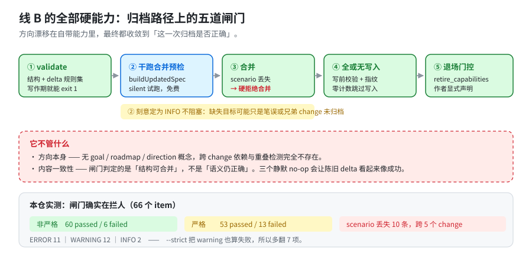
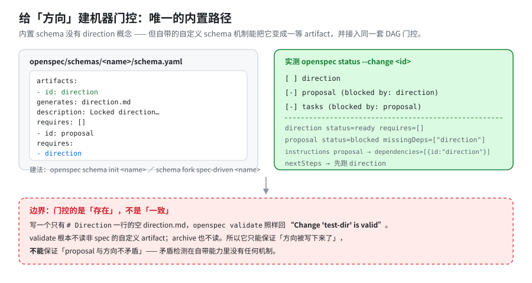

# 03 · 线 B：方向漂移

[← 返回索引](answer.md) ｜ 上一篇：[02 · 线 A](02-context-rot.md)

**结论：自带能力对"方向漂移"的覆盖是残缺的，但比"完全没有"要好——而且本次 review 发现了一条此前漏掉的内置杠杆（§B4）。**

准确的说法是：

```text
✗ 内置 schema 里没有「方向」这个概念
✓ 但自带的自定义 schema 机制，可以把方向变成一等 artifact 并接入同一套 DAG 门控
✗ 跨 change 的依赖 / 重叠检测，确实完全没有（且已有提案未落地）
```

---

## B0 · 全景：全部硬能力都收敛在「归档那一刻」



```text
                   方向变了
                       │
        ┌──────────────┴───────────────┐
        │                              │
   还在这条 change 里              要换一条 change
        │                              │
        ├─ B2 /opsx:update〔软〕       ├─ 启发式判定〔软〕
        │  双向一致性复核               │  同意图？>50% 重叠？能独立完成？
        │                              │
        └──────────────┬───────────────┘
                       │
                   归档那一刻
                       │
              B1 【硬】五道闸门
```

---

## B1 · 五道机器闸门【硬能力】

### ① `openspec validate` 规则集

`--strict` 的语义【代码：`src/core/validation/validator.ts:1020-1022`】：

```ts
const valid = this.strictMode
  ? errors === 0 && warnings === 0
  : errors === 0;
```

**ERROR（默认就失败）**：requirement 名在同一文件内重复；主 spec 里出现 delta 头；requirement 落在 `## Requirements` 之外；requirement 无正文；**零 scenario**；**MODIFIED 丢了主 spec 仍有的 scenario**；跨节声明冲突（MODIFIED+REMOVED / MODIFIED+ADDED / ADDED+REMOVED）；FROM/TO 不配对；`specs/` 根下放 delta `spec.md`；非 `spec.md` 里写 delta 节；`skip_specs` marker 与 `specs/` 下文件冲突；零 delta（除非 `skip_specs`）。

**WARNING（只有 `--strict` 才失败）**：requirement 正文 >500 字符；正文缺 SHALL/MUST；Purpose 是占位符；Purpose <50 字符；未知元数据键。

`validate` 的完整旗标【实测：读 help】：`--all`、`--changes`、`--specs`、`--archived`、`--report full|findings`、`--type`、`--strict`、`--json`、`--concurrency <n>`、`--no-interactive`、`--store`。

### ② scenario 丢失 = 写作期 ERROR + 归档期硬拒绝 ★全库最硬的防腐保证

`MODIFIED` requirement 是**整块替换**。漏抄主 spec 里的 scenario，它就永久消失。所以设了两道：

```text
写作期  openspec validate
        → level: ERROR（validator.ts:779-786）【代码】，直接 exit 1
        → "MODIFIED \"X\" omits scenario(s) the current spec still has: \"…\".
           … Copy the omitted scenarios into the MODIFIED block
           (a MODIFIED requirement replaces the whole block,
            so archive refuses to drop them)."

归档期  openspec archive
        → 硬抛错拒绝合并（specs-apply.ts:549-554）【代码】
        → "… current spec contains scenario(s) not present in the modified block:
           \"…\". … Refresh the change spec before archiving to avoid dropping
           scenarios."
```

两侧共用同一个函数，**所以不可能给出不一致的判定**【代码】：`src/core/parsers/requirement-blocks.ts:644-655` 注释明说 *"which archive (refusing to apply the block) and validate (reporting the same loss at authoring time) both go through, so the two cannot disagree"*。

而且是**多重集感知**的【代码：`diffScenarioNames`，`requirement-blocks.ts:610-640`】：同名 scenario 出现 N 次 vs M 次，会算 `max(0, N−M)`，不会因为"名字出现过"就误判为已覆盖。

> **这一条直接命中"隔一阵子换方向"的场景**：主 spec 已经往前走了，你手里陈旧的 change 想合并——**工具不让你静默覆盖，它让你先 refresh**。
> **本仓实测**：scenario 丢失共 **10 条**，跨 **5 个 change**（`add-devin-desktop-support`、`add-global-install-scope`、`add-skill-cli-auto-approval`、`fix-opencode-commands-directory`、`make-codex-skills-only`）【实测】。

### ③ 归档合并干跑预检（免费，INFO）

`findArchiveBlockers`【代码：`src/core/validation/validator.ts:958-1013`】对每个 delta **真的调一次** `buildUpdatedSpec(update, changeName, {silent:true})`，合并若抛错则报【实测】：

```text
INFO  Archive would refuse this delta: cli-init MODIFIED failed for header
      "### Requirement: Skill generation per tool (…)" - not found
```

级别是 **INFO，不阻塞**——代码注释解释了理由【代码：`validator.ts:951-957`】：

```text
"INFO leaves the verdict unchanged: a missing target can be a typo or a
 requirement introduced by a sibling change that has not archived yet."
```

这是"我离开一阵子，主 spec 被别的 change 改了"的**免费探测器**。本仓实测打出 **2 条**【实测】。

### ④ 全或无写入 + 写前校验

`archive` 合并期【代码】：每个重建的 spec 在**任何文件被写之前**先过校验（`archive.ts:1872-1968`）；零计数的合并**跳过写入**（`archive.ts:2017-2021`，注释 *"Every operation was already synced: rewriting the file would only churn normalization differences into it."*）；输入做指纹（`1724-1736`）。**不可能半应用或覆盖并发编辑。**

> ⚠️ 注意：归档用的是**非严格**校验器（`archive.ts:73`、`1458`、`1879` 均为 `new Validator()`）【代码】，**所以 WARNING 永远不挡归档**。500 字符那条 WARNING 会一路穿过归档。

### ⑤ `retire_capabilities` 退场门控

capability 的**唯一退场通道**。当 delta 的 REMOVED 拿走某 capability 最后一条 requirement 时，归档**删除该 capability 的主 spec**——但前提是作者显式声明【代码：`src/core/change-metadata/schema.ts:55-61`】：

```yaml
# .openspec.yaml
retire_capabilities: true
```

理由是 *"the deletion is not recoverable from the working tree - only from git - so it is the author's call, not an inference from the shape of a delta."*【代码】

还需通过校验器 oracle（唯一 error 必须是 `Spec must have at least one requirement`）+ 全文件 `unaccountedContent` 否决【代码：`archive.ts:118-170`】。

> ⚠️ **【代码】非【实测】**：我没有真跑一次删除 spec 的归档。

---

## B2 · `update-change` 一致性复核【软能力，但在 core profile】

`src/core/templates/workflows/update-change.ts:79` 的定义就是"方向改了"【文档】：

```text
"Update an OpenSpec change by revising its existing planning artifacts and
 keeping them coherent with one another. Use when the user wants to revise a
 change's plan, fold new decisions into it, or reconcile its artifacts after an
 edit. … Never edits code."
```

两个决定性细节：

- **`:124`** —— 只说 "update" 就跑**自洽复核**：*"read the existing artifacts and check them against each other for **contradictions, gaps, and duplication**."*
- **`:128`** —— 复核是**双向**的：

```text
"check every other existing artifact against the drafted edit - in ANY direction:
 an edit to a later artifact may require revising an earlier one, not only the
 other way around. Build order is a useful reading order, not a constraint on
 which artifacts may be revised."
```

即"改了 tasks 可能得回头改 proposal"。配套的防抖与安全边界：`:137`"若已自洽则不提修订"；`:139-142`"本步骤执行全部写入，更早步骤不写任何 artifact"；用户拒绝的修订不写入；`:164-166`"不推进 frontier"。

**但它不强制**：它是一段 prompt，靠模型执行；且不检测陈旧（见 §[02 A6](02-context-rot.md)）。

---

## B3 · `/opsx:verify`【软能力，且不在 core profile】

三维检查：Completeness（含 REMOVED 反向检查、RENAMED 检查）、Correctness、Coherence。输出 CRITICAL/WARNING/SUGGESTION。**明确 advisory**【文档：`verify-change.ts:66` "Verification is advisory"】，**不阻塞归档**。

默认 profile 里**没有**它，要用先开 expanded（见 §[04](04-usage.md)）。

---

## B4 · 给「方向」建机器门控：唯一的内置路径 ★本次 review 的新发现



**这是本篇推翻旧结论的地方。** 内置 schema 没有 direction 概念，**但自带的自定义 schema 机制能让它变成一等 artifact，并接入同一套 DAG 门控**。

做法【实测】：

```bash
openspec schema init my-flow            # 或 openspec schema fork spec-driven my-flow
# 编辑 openspec/schemas/my-flow/schema.yaml，加一个 direction artifact
```

```yaml
artifacts:
  - id: direction
    generates: direction.md
    description: Locked direction this change must stay consistent with
    requires: []                          # ← 起点，先于一切
  - id: proposal
    generates: proposal.md
    requires:
      - direction                         # ← 方向成为 proposal 的硬前置
```

**实测结果**【实测】：

```text
$ openspec status --change test-dir
[ ] direction
[-] proposal (blocked by: direction)
[-] tasks    (blocked by: proposal)

$ openspec status --change test-dir --json
direction  status=ready    requires=[]
proposal   status=blocked  missingDeps=["direction"]

$ openspec instructions proposal --change test-dir --json
dependencies: [{"id":"direction","done":false,"path":"direction.md", …}]
unlocks: ["tasks"]
```

也就是说，**门控、依赖注入、`nextSteps` 引导、`instructions` 指令注入全部生效**，而且全生命周期走得通（`new change --schema my-flow` → `status` → `archive`，实测归档成功为 `2026-10-18-test-dir`）【实测】。

配套命令【实测】：`schema init`、`schema fork`（可从内置 `spec-driven` 复制）、`schema which`（显示解析来源 project/package）、`schema validate`（校验 schema 结构）。schema 落在 `openspec/schemas/<name>/`，**是项目级的，随 git 提交、团队共享**。

顺带证实一个契约细节【实测】：当 schema 里**没有** `specs` artifact 时，`new change` 会自动写入 `skip_specs: true` —— 印证了 `change-metadata/schema.ts:49-54` 的注释 *"that path prefix, not the artifact id, is the contract custom schemas inherit"*。

### ⚠️ 边界：门控的是「存在」，不是「一致」

这是必须说清的**关键限制**：

```text
写一个只有 "# Direction" 一行的空 direction.md：
  $ openspec validate test-dir --type change
  Change 'test-dir' is valid          ← 照样通过！
```

`validate` **根本不读非 spec 的自定义 artifact**；`archive` 也不读【实测】。

所以这条杠杆能保证的是：

```text
✓ 方向被写下来了（存在性）
✓ 顺序被强制了（proposal 在 direction 之前写不出来）
✗ 不能保证 proposal 与方向不矛盾
✗ 不能保证 direction 的内容随时间更新
✗ 不能跨 change
```

**矛盾检测在自带能力里没有任何机制。** 你能买到的是"**强制你先写下方向，再写提案**"——这在敏捷迭代里其实已经很有价值（它把"想清楚"变成了流程上的硬前置），但它不是一致性校验。

> 另注：`schema` 系列命令自带 `Note: Schema commands are experimental and may change.`【实测】。

---

## B5 · 跨 change：确实完全没有（且缺口是真的）

### 已有提案，但未落地

`openspec/changes/add-change-stacking-awareness/proposal.md` 提出的正是这块：`dependsOn`/`provides`/`requires`/`touches`/`parent` 元数据 + `openspec change graph`。

**实测确认它没落地**【实测】：

```text
dependsOn / provides / requires / touches / parent 在 src/ 中 0 命中
openspec change --help → 只有 show / list / validate，无 graph
该 change 自身卡在 3/4 artifacts（缺 design）
```

### 本仓实测：29 个活跃 change 抢 34 个 capability

```text
cli-init           被 8 个 change 同时改   ← 8 路争用
cli-update         被 6 个
ai-tool-paths      被 6 个
command-generation 被 5 个
cli-validate       被 4 个
cli-archive        被 4 个
────────────────────────────────────────────
34 个目标里 20 个是【已存在的主 spec】→ 走 MODIFIED → 漂移风险区
```

而 `openspec validate --all --json` 的 issues 里，**命中 `overlap|conflict|stack|depend` 的条数是 0**【实测】。

### 冲突什么时候才会浮现

`docs/team-workflow.md:64` 承认了【文档】：

```text
"If two changes both modify the *same* requirement, archiving the second one
 will conflict in openspec/specs/…/spec.md — resolve it like any merge conflict…
 it's git telling you two changes disagreed about how the system should behave."
```

**即：重叠冲突在 archive 时才以 git conflict 的形式浮现。** 不早于此。

---

## B6 · 其余缺口清单

| 缺口 | 证据 |
|---|---|
| **近似重复 capability 零检测** | 所有重复检查都**只在一个文件内**。**ADDED-only 的 delta 写错 capability 路径 → 静默新建一个 capability**，连 "did you mean" 都没有（只有 MODIFIED/RENAMED 指向不存在路径才 abort，`specs-apply.ts:394-398`）【代码】 |
| **三个静默 no-op** | ① REMOVED 一个不存在的名字 → 仅 warning，exit 0；② RENAMED 已同步（FROM 没了、TO 在）→ **无任何警告**；③ ADDED 与现有块完全相同 → 无警告。**陈旧的 delta 看起来跟成功一样**【代码】 |
| **无陈旧/废弃/TTL/墓碑** | `SpecSchema` 只有 name/overview/requirements/metadata；无 `deprecated:`/`status:`/`superseded_by`/TTL。`git log --diff-filter=D -- openspec/specs` 显示 **5 个 spec.md 被删过**（cli-diff + 4 个 workspace-*），而 `openspec/specs/` 里**没有任何记录**说明它们存在过【实测】 |
| **无 spec↔code 漂移检测** | `verify` 是 advisory prompt；`openspec doctor` 的 "drift" 是 store 检出物的 **git upstream 落后**（`src/core/relationship-health.ts:122-136`），不是规格漂移【代码】 |
| **REMOVED 不保全** | 它是唯一破坏性操作，整块删除（statement + 全部 scenario + Reason/Migration）。`schemas/spec-driven/schema.yaml:99` **要求** `**Reason**`/`**Migration**`，但**全库无校验**，且解析出的 `removedBlocks` **只用于 `change show` 展示**，从不进入合并【代码】 |
| **跨文件重名无人管** | 本仓实测 **7 个 requirement 名**跨 capability 重复（`Error Handling` 出现 3 次…），完全合法、完全不可见【实测】 |
| **无规模上限** | requirements / 文件数 / spec 字节数**都无上限**。有上限的只有：500 字符（WARNING）、10 deltas（硬，但只在 `ChangeSchema` 路径——`validate <change>` 与 archive 走的 `validateChangeDeltaSpecs` **不套用 ChangeSchema**）、why 1000 字符、context 50 KB【代码】 |
| **无"放弃 change"流程** | 无 delete-change 命令；文档也没有指引。"start fresh" 只是新建，旧 change 原地留着【实测：help + docs grep】 |

---

[← 返回索引](answer.md) ｜ 下一篇：[04 · 使用要点 →](04-usage.md)
