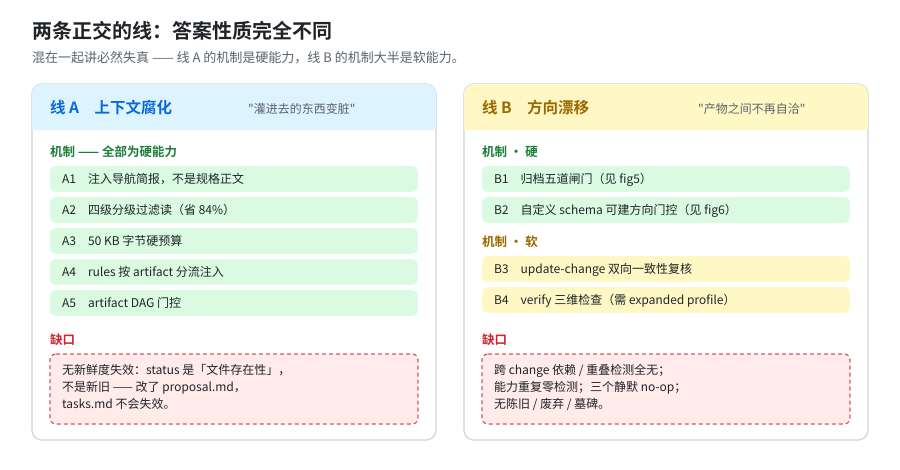

# 答案索引：Specs 堆积与方向漂移下，OpenSpec 自带能力的覆盖边界

[问题与背景 →](question.md)

> 源码基线：OpenSpec `v1.14.3`（`c794978f`）。本篇所有源码锚点在该版本核对；本工作树 `3bb9061c` 的 `src/` 与该版本**逐字节一致**（`git diff --stat upstream/main..ethan -- src/` → 0 文件）。
> 命令输出、字节数、通过/失败数均为实测；复跑命令见 [05 · 可复跑验证](05-verification.md)。

---

## 一句话

**「上下文腐化」在自带能力里有真实且设计良好的机制**——注入的是**导航简报而非规格正文**，配分级过滤读、50 KB 硬预算、按 artifact 分流的规则注入、artifact DAG 门控。**注入体不随 specs 树增长**：本仓 262 KB 规格树，单次注入 9,315 B（3.6%）。

**「方向漂移」在自带能力里只有围绕「单次归档正确性」的闸门**——scenario 丢失双闸、归档合并干跑预检、`retire_capabilities` 退场门控、`skip_specs` 诚实豁免；外加**两条软能力**（`update-change` 双向复核、`verify` 三维检查）。**跨 change 的依赖与重叠检测确实完全没有。**

---

## 两条线一览



| | 线 A 上下文腐化 | 线 B 方向漂移 |
|---|---|---|
| **性质** | "灌进去的东西变脏" | "产物之间不再自洽" |
| **机制** | 5 项，**全部硬能力** | 归档五道闸门（硬）+ 2 项 prompt 复核（软）+ 自定义 schema 门控（硬） |
| **核心数字** | 262 KB 磁盘 → 9,315 B 注入；过滤读省 84% | scenario 丢失 10 条正在拦人（跨 5 个 change） |
| **关键缺口** | 无新鲜度失效：`status` 是文件存在性，不是新旧 | 跨 change 检测为 0；能力重复零检测；三个静默 no-op |
| **详见** | [02 · 线 A](02-context-rot.md) | [03 · 线 B](03-direction-drift.md) |

---

## 本次 review 的实质修正

第一版答案曾断言"**方向没有任何机器表示**"。**这条被推翻。**

自查时实测发现：自带的自定义 schema 机制可以把 `direction` 变成一等 artifact，并**完整接入 DAG 门控**——

```text
$ openspec status --change test-dir
[ ] direction
[-] proposal (blocked by: direction)      ← 方向成为 proposal 的硬前置
[-] tasks    (blocked by: proposal)

$ openspec instructions proposal --change test-dir --json
dependencies: [{"id":"direction","done":false,"path":"direction.md", …}]
```

准确说法是：**内置 schema 里没有方向概念，但自带能力里有路给它建机器门控。**
边界是**门控「存在」，不是「一致」**——空的 `direction.md` 照样让 `validate` 通过。

细节与实测见 [03 · §B4](03-direction-drift.md)。完整修正清单见 [01 · §1.4](01-scope-and-framework.md)。

**另外两处数字在 review 中被改正**：scenario 丢失是 **10 条**（原写 7 处）；校验失败数是**非严格 6 / 严格 13**（原引 13 但未区分口径）。

### 第二轮复核（数字全量复跑 + 配置面补漏）

前五章的所有数字已在本工作树**逐条复跑**，全部复现（`05` 里每条命令现在跑仍是原值）。本轮新增/修正四处：

1. **`operations:` 配置面此前全文未提**。它是**唯一**能进入 apply/archive 运行时的配置字段【实测】。补入 [04·9b](04-usage.md) 与 [附录 A.3](appendix-a-cli-surface.md)。
2. **`rules:` 的键支持自定义 schema 的 artifact id**【实测】——方向 artifact 也能挂约束。补入 [02·A4](02-context-rot.md)。
3. **`rules:` 写错并不"总会 warning"**：只走 stderr、只由 `instructions` 触发，**`validate --all` 不报**【实测】。原句"不会静默失效"过强，已改。
4. **活跃 change 是 30 个，不是 29 个**（`ls` 与 `openspec list --changes` 一致）；争用数字（34 目标 / 20 已存在 / 8 路抢 `cli-init`）不变。

新增 [06](06-remedies-within-budget.md) 回答"自带能力补不上的缺口怎么办"，且**限定只用内置 schema、不 fork**（自定义 schema 要自己跟着 OpenSpec 升级维护，代价太高）：**方向不需要新 artifact——它就在 `proposal.md` 的 `## Why`/`## What Changes` 里，而内置能力对它零检查**；`config.yaml` 三个面全部是软能力；方向内容 + 新鲜度可以靠消费 `status --json` 的脚本补成硬闸门（实测四种状态可跑，不依赖任何自定义 schema）。

---

## 先读这个：什么算「自带能力」

本篇只认「装了 `@fission-ai/openspec` 就有」的东西。据此排除了五类"看起来像机制、其实不是"的内容——上游仓库自身的项目管理约定（`work/`、`runbook.md`、`deletion-ledger.md`）、已删除的 initiative 运行时、未落地提案、以及 OpenSpec 维护自己源码的内部测试。

同时引入 **硬能力 vs 软能力** 的分界，并给每条结论标注证据级别（实测 / 代码 / 文档）。

→ [01 · 什么算自带能力，以及硬 vs 软](01-scope-and-framework.md)

---

## 目录

| 章节 | 内容 |
|---|---|
| [01 · 什么算自带能力，以及硬 vs 软](01-scope-and-framework.md) | 三条排除线、证据分级、硬/软分界、本次修正清单 |
| [02 · 线 A：上下文腐化](02-context-rot.md) | 简报式注入、四级过滤读、50 KB 预算、rules 分流、DAG 门控 + 6 项缺口 |
| [03 · 线 B：方向漂移](03-direction-drift.md) | 归档五道闸门、update-change、verify、**自定义 schema 门控**、跨 change 缺口 + 本仓实测争用 |
| [04 · 使用要点](04-usage.md) | profile 到手面 + 12 条可操作要点（每条标注硬/软） |
| [05 · 可复跑验证](05-verification.md) | 每条结论对应的命令与实际输出 |
| **[06 · 自带能力之外的补法](06-remedies-within-budget.md)** | **只用内置 schema（不 fork）：方向就在 `proposal.md` 里、`config.yaml` 三面全软、内置 DAG 的绕过路径、方向 + 新鲜度闸门脚本、外部参照系** |
| [附录 A · CLI 命令面](appendix-a-cli-surface.md) | 完整命令 dump、配置面、排除清单 |

图源在 [`figures/`](figures/)（手写 SVG，无构建依赖）。

---

## 三句话版本

1. **线 A 是硬的，而且做得好**：堆的是磁盘不是上下文；想读什么自己按需取；`context:` 有 50 KB 真上限。
2. **线 B 是残的**：所有硬闸门都收敛在"归档那一刻"，且只判"结构可合并"；方向本身要靠自定义 schema 自己搭（能搭，但只门控存在性）。
3. **"写小的没问题、项目一直在左晃右晃"这个感受是准确的**——规格层有闸门护着，方向层没有；根因就在这个不对称里。

**补一句（第 6 章）**：想补成硬的，`config.yaml` 一个都帮不上——它是投递面不是闸门面。唯一的低成本硬补丁是**消费 `status --json` 的脚本**，把「存在性」升级成「存在性 + 新鲜度」。详见 [06](06-remedies-within-budget.md)。
