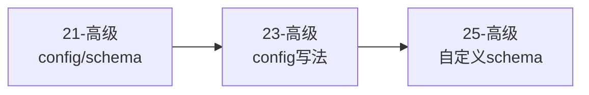
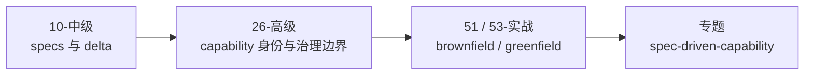
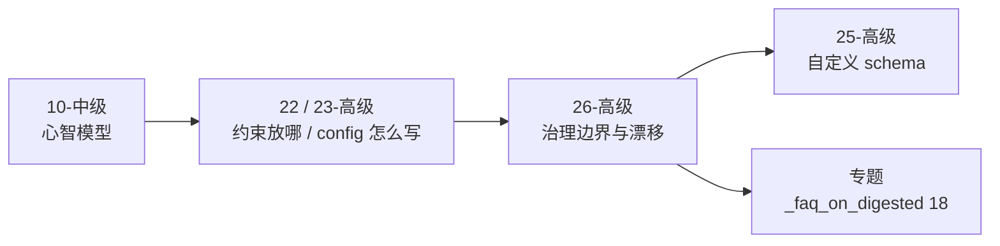

# OpenSpec 手册 · 新版总导读

> 核心原则只有两条：**先会用，再懂概念，最后看机制**；**先讲人用的，再讲机器怎么跑**。
>
> 各篇定位、结构、风格的硬约束见文末 [《内容宪章》](#内容宪章写作规范)——写新篇/改篇前先读。

---

## 版本与维护

| 项 | 值 |
|----|----|
| **手册版本** | **v1.16** |
| **对齐 OpenSpec** | 2.1.1 |
| **本版日期** | 2026-11 |

**两个版本维度（别混）**：

- **手册版本**（v1.16）：本手册自身的版次。理解加深、内容大修时升版。
- **对齐 OpenSpec**（2.1.1）：本手册当前对应的 OpenSpec 上游版本。

**freshness 约定**：

- **版本敏感页**（如 store 篇等与特定版本特性深度绑定的页面）在内容中注明适用版本，不要求在文件名标版本号。
- **概念页**（01、10、11、20–23、25、26 等）通用、不标版本；随对齐 OpenSpec 升级时复审。
- 每次大修 / 对齐新版本，在下面 changelog 记一行。

**变更记录**：

| 手册版本 | 日期 | 对齐 OpenSpec | 主要变更 |
|---------|------|--------------|---------|
| v1.0 | 2026-06 | 1.4.1 | 首版编号化；新增 `26-高级-治理边界与漂移维护`（spec-driven 是 driver + capability=相对 path 身份 + 两层 name-as-identity + 漂移维护）；`10`/`21`/`99` 补 capability 身份与 RENAMED 前向指针。 |
| v1.1 | 2026-06 | 1.4.1 | `explore` 地位补全（贯穿 10/20/51/53）：10 状态机补 explore 两处、20 新增 explore 深层机制（反复打磨 proposal / 对抗 LLM 幻觉 / change 作围栏）+ 生命周期补全四动词 `explore→propose→apply→archive`、51/53 实战织入 explore（change 出来后反复打磨保质量）；宪章「三层递进梯度」原则微调（高级可作精炼对照锚点）。 |
| v1.2 | 2026-07 | 1.5.0 | 24 章重写：workspace → store 模型（跨仓库上下文引用）；00-index 版本/术语/命令表/阅读路径更新；workspace/initiative/context-store 概念全部删除。 |
| v1.3 | 2026-07 | 1.7.0 | 对齐 v1.7：nested capability path 完整生命周期、`skip_specs`、Apply/Archive operation guidance、工具投递与 Codex skills-only、store/default 与 archive/sync 可靠性更新。 |
| v1.4 | 2026-07 | 1.7.0 | 将 capability 专题正式纳入手册主线：按行为合同切分、浅 taxonomy、path identity、catalog discovery、同路径 delta/archive、rebaseline 与并发治理；不再只把 nested path 当目录技巧。 |
| v1.5 | 2026-07 | 1.7.0 | 系统性勘误与打磨：修正 Pi/Kiro 版本归属（v1.2.0）、core/custom profile 命令数（6/12）、`apply.tracks` 约束措辞（从硬编码改强烈推荐）；CLI 命令表补全（status/instructions/view/schema/store setup 等）；`.openspec.yaml` 补完整字段表；schema 约束表补 `description`；FAQ 工具列表更新到 v1.7.0；`validate` 描述准确化；删各章尾部 `## 下一步` 跳转；宪章润色。 |
| v1.6 | 2026-08 | 1.8.0 | 对齐 v1.8：工具投递新增 vendor-neutral `agents` 目标（`.agents/skills/`，与 Codex 共享根、ownership marker）；GitHub Copilot 一等支持（本地 skill + opt-in cloud coding-agent 文件）；Codex skills 迁到 `.agents`；archive 新增 `retire_capabilities`（删除已空 capability 的 main spec）、重复 canonical 名拒绝、note-loss 提示与无法交互时的可重跑命令；`status` 新增 `isPlanningComplete`；validate 的 SHALL/MUST 在 normal 模式降为 guidance、前置检测 MODIFIED scenario-loss；telemetry.enabled 全局配置。 |
| v1.7 | 2026-08 | 1.9.0 | 对齐 v1.9：Command Code（`.commandcode/skills/` + `/opsx-*` commands）；`validate --archived`（CI 检查 archive 未勾完 tasks）；bulk `list`/`validate --all`/`schemas` 在项目外非零退出；scenario-loss 认所有 `####` 子标题；apply 超出 spec 必须停下来报；archive 非 TTY 无 ANSI、重建 spec 保留空白行；`schema fork` 保 YAML 格式；遗留 Codex 升级不抢 `.agents`。 |
| v1.8 | 2026-08 | 1.10.0 | 对齐 v1.10：`init --language` 与多语言边界；Zed Agent、Codex/Zed/agents 三方共享 `.agents`，OpenCode command 传入 `$ARGUMENTS`；store 场景的 specs instruction 使用 `planningHome.root`；每条 task 自带 verification；no-spec schema 自动 `skip_specs`；capability 退役拒绝删除未归属内容；custom archive/bulk-archive 自动补 sync；移除 npm postinstall，首次交互 CLI 在 stderr 提示 completion；telemetry 提示走 stderr；update 仅在实际更新 IDE 驻留入口时提示重启；feedback 长消息完整保留在 body。 |
| v1.9 | 2026-08 | 1.11.0 | 对齐 v1.11：`show --diff`（彩色 unified diff per requirement）；`status --all`（单进程全部 active change，故障不阻塞）；Explore 写入前确认（命名 artifacts、ask yes/no、单独等待）；Antigravity `.agent → .agents` 迁移，`resolveSharedSkillWriters()` 通用共享根仲裁；`validate` Purpose 占位符 warning（archive 遗留 TBD）；archive rename 保序（不移到 spec 尾部）；`schema init --default` 写入正确键、失败回滚；Fish completion 不再回退文件名；Explore 图例纯 ASCII。 |
| v1.10 | 2026-08 | 1.13.1 | 对齐 v1.13：`validate --report findings` 与 archive 拒收预报；SourceCraft（codeassistant）；v1.13.0 delta parser 大修（CommonMark 全标记、多 section 全应用、fence 内空行保留、大小写冲突拒绝）；propose context-first + code-grounded；explore spec inventory、capture 即确认；`/opsx:update` 先起草确认后写入；`status` 给 `Next:` 行；安全加固（指令注入/挂起/`.npmrc` 劫持）；pnpm@10 升级。 |
| v1.11 | 2026-09 | 1.14.0 | 对齐 v1.13.2/v1.14.0：10 个新 `--tools` 目标（dsh/codestudio/gigacode/atomcode/easycode/gsd/amp/grok/warp/veai），`.agents` 共享根扩为 Codex/Zed/Antigravity/Amp/GSD + vendor-neutral，IBM Bob 更名；`list --archived/--all`、`openspec version`、view 的 workflow status 与归档分区；`show --json` requirement/scenario 带 `name`；`status --json` `allowedEditRoots` 纳入声明 store 的当前项目；archive 阻塞语义（sync 失败不归档、sync 后结构验证、retired capability 主 spec 删除）；写回文件行尾保持（CRLF 不再整文件 diff）；`.openspec.yaml` 未知键告警；store-only 仓库可在 root 跑 `init` 装集成。 |
| v1.12 | 2026-10 | 1.14.3 | 对齐 v1.14.1–v1.14.3：artifact 创建前先定并校验输出路径（glob 工件必须落在 change 目录内，propose/ff/continue/explore 统一）；glob 工件「done 但文件不全」的补完协议；`all_done` 只报跟踪任务完成、归档前需复核/验证；verify 改按输出路径发现工件，REMOVED requirement 必须先读主 spec 基线；archive 的退役清理失败有独立错误码 `archive_retirement_cleanup_failed`；`openspec/`、`changes/`、`specs/` 与 spec 文件可以是项目内 symlink（`archive/` 不行）；delta 里「归档不会带走」的文本与超长 requirement 升为 WARNING；`.openspec.yaml` 顶层 `x-` 扩展键；glob 引擎由 fast-glob 换到 tinyglobby（brace 嵌套 ≤16、展开 ≤1024）；CLI 按需加载与 Tab 补全跳过遥测；零宽 TTY 不再挂死；view 移除归档分区。 |
| v1.13 | 2026-10 | 1.14.3 | **两件事：① 26 章扩写改名 ② 全手册重编号。** ① 原 `09-高级-能力身份与specs漂移维护` 扩写并改名为 `26-高级-治理边界与漂移维护`，新增全手册分析轴「**硬能力 vs 软能力**」（代码判定 vs prompt 文字，违反后果不同）；agent 上下文的字段级事实（`instructions` 注入哪些字段、`contextFiles` 只给路径不给正文、注入体不随 specs 规模增长）；三级过滤读与 50 KB `context` 预算（超限整段丢弃）、`rules` 按 artifact id 分流、artifact DAG 门控与「`status` 是文件存在性不是新鲜度」；归档五道机器闸门（validate 规则集分级 / scenario 丢失双闸 / 干跑合并预检 / 全或无写入 / `retire_capabilities`）；跨 change 缺口（依赖与重叠零检测、近似重复 capability 零检测、三个静默 no-op、无陈旧废弃墓碑）；用自定义 schema 给「方向」建硬前置及其边界（门控**存在**而非**一致**）；新增「判断锚点三问」。保留原 capability 身份、两层 name-as-identity、catalog discovery、rebaseline 与维护节奏主体。素材来源：`_faq_on_digested/18_context-rot-and-direction-drift/`。② **全手册按难度层级重编号**：初级 `0N`、中级 `1N`、高级 `2N`、实战 `5N`（`00`/`90`/`99` 不变）。映射 `02→10`；`03→20`、`04→21`、`05→22`、`06→23`、`07→24`、`08→25`、`09→26`；`10→50`、`11→51`、`12→52`、`13→53`、`14→54`、`15→55`。三套文档（`_digested`/`_faq_on_digested`/`_openspec_handbook`）的章节引用、链接与锚点同步更新；宪章区间改为 `00–09 / 10–19 / 20–29 / 50–59 / 90 / 99`；本表历史行一并改用新号，不保留旧号换算。③ **中级段由 1 篇拆为 2 篇**：`10` 承载三层模型（补上原先缺失的 `config.yaml` 概念层）、artifact 与 delta spec；新增 `11-中级-定位节奏与边界` 承载 brownfield-first、Actions-not-phases、四组边界，以及「change 多起来、方向晃过之后」的整体姿势（**收敛 → 打扫 → 治理** + 在途 change 的四种处置）；原 10 章里自述"跟项目模型无关"的 `completion`/`feedback` 段移入 01 初级。 |
| v1.14 | 2026-10 | 1.15.0 | 对齐 v1.15.0：standalone 单文件安装（8 平台、无需 Node.js）与 `openspec install` 切换；`openspec update --dry-run/--json`（预演与真实更新共用同一条写入路径）；verify 的 REMOVED 基线改为精确规范化名称；`new change` 进度行显示实际 schema；`feedback` 对齐 bug 表单；`--json` 命令不加载 `ora`；99 新增 Q27f（不装 Node.js 能用吗）。依据见 [`0013`](../_digested/_change_log/0013-v1.14.3-to-v1.15.0.md)。 |
| v1.15 | 2026-11 | 1.17.0 | 对齐 v1.16.0/1.16.1/1.17.0：npm 门槛抬到 **Node 22.12.0**（Node 20 EOL；standalone 不受影响）与 release 改 `.tar.gz`/`.zip` 归档；`update` 能从 0.12 起**任意版本一次升级**、不再需要 `--force`（靠历史产物指纹库，只删没人编辑过的旧文件，永不跨链接）；切 skills-only 不再删用户编辑过的命令文件；**命令文件已标记弃用**（2.0 移除，本版仍生成，`/opsx:*` 仍可用）；`validate` 三条收紧（scenario 缺 WHEN/THEN＝WARNING、未识别 `## ... Requirements` 段＝ERROR 且 archive 拒绝、坏 `config.yaml`＝退出 1）；解析器认闭合 `#` run 与行内三反引号；`version --check` 显式调用不再受遥测/CI 影响、只提示真能装的版本；zsh 补全写 `$ZDOTDIR/.zshrc`；store 提示按 origin 仓库名点名。依据见 [`0014`](../_digested/_change_log/0014-v1.15.0-to-v1.17.0.md)。 |
| v1.16 | 2026-11 | 2.1.1 | 对齐 v2.0.0/2.1.0/2.1.1：**OpenSpec 2.0 只装 skills，命令文件（`/opsx:*`）已移除，统一用 `/openspec-*` / `$openspec-*` 技能**；项目内 skills 收成 `.agents/skills/` 单份真身 + 各工具链接（无法建链接时退化为拷贝），`delivery` 退役，Amazon Q Developer 退役（不支持 skills，转向 Kiro，`init --tools amazon-q` 报错指路）；命令生成能力删除，旧命令适配器仅保留用于识别与清理历史文件路径；安装层改由运行时依赖 `skills@1.8.1` 驱动，支持 87 个工具；**2.1 新增 `global`（新项目 `init` 默认，写 `~/.agents/skills/` 及工具全局目录）与 `project`（`--scope project` 或 `openspec/config.yaml` 中 `skillsScope: project`）两种作用域**及 `known-projects` 本机项目清单；**2.1.1 九项修复**：① `#2267` `archive` 新建主 spec 时在 `## Purpose` 后补空行；② `#2277` `openspec-archive-change` 在写任何主 spec 前先找好既有归档目录；③ `#2264` `version --check` 与 `update` 区分 Homebrew（`brew upgrade openspec`）与 Nix，不再误推 `npm install -g`；④ `#2274` `openspec-continue-change` 在规划完成后重新提示进入 apply；⑤ `#2273` `validate --strict` 不再因 delta spec 顶部 YAML frontmatter 失败；⑥ `#2283` `init`/`update` 直接从已安装 npm 包离线装 skills（无需 Git/联网）；⑦ `#2266` capability 退役不再误拒以 `<` 开头并接正文的折行文本；⑧ `#2269` `update` 能发现并刷新 `npx skills add` 装入项目的 skills；⑨ `#2265` MODIFIED requirement 正文超过 500 字符且比主 spec 基线更长时发 WARNING。npm 的 Node 门槛抬到 **`>=22.20.0`**；Windows 检出已提交链接需 `core.symlinks` 与开发者模式。依据见 [`0015`](../_digested/_change_log/0015-v1.17.0-to-v2.1.1.md)。 |

---

## OpenSpec 核心哲学：为什么这样设计

在开始学习前，先理解 OpenSpec 的 5 条设计哲学。这些不是口号，而是每个设计决策背后的真实动机：

| 哲学 | 表面意思 | 背后的真实痛点 | OpenSpec 的解法 |
|------|---------|--------------|--------------|
| **fluid not rigid** | 流动不僵化 | 传统 spec 流程有"阶段锁"，需求变了也不能回头改 | 任何 artifact 随时可改，没有阶段门 |
| **iterative not waterfall** | 迭代不瀑布 | 瀑布式要求"先把所有需求想清楚"，但现实中需求是边做边清晰的 | 每个 change 是一个小迭代，允许不完整 |
| **easy not complex** | 简单不复杂 | 重型 spec 工具（如 Spec Kit）需要大量仪式感，团队不愿用 | 最小化摩擦，3 个命令就能完成一个 change |
| **brownfield not just greenfield** | 棕地优先 | 大多数真实项目都是"接手老代码"，不是从零开始 | `specs/` 是对现有系统的描述，change 是增量修改 |
| **scalable** | 可扩展 | 个人项目和企业项目的需求差异巨大 | profile 机制允许选择工作流复杂度 |

**一句话理解**：OpenSpec 不是为"完美的新项目"设计的，而是为"真实世界里的增量改代码"设计的。

### OpenSpec 不是什么

看源码或讨论时容易产生的误解，这里先澄清：

| 容易误解成 | 实际边界 |
|-----------|---------|
| IDE 插件 | CLI + 文件状态 + agent 指令投递，IDE/agent 是调用方 |
| LLM wrapper | 不做创造性推理——推理由宿主 coding agent 完成 |
| 固定流程引擎 | schema 定义 artifact DAG，workflow 是围绕 DAG 的动作入口 |
| 又一个 prompt 模板工具 | 模板只是输出骨架；schema 定义产物依赖图，CLI 解释运行时状态 |
| skill 是核心 | skill 是投递产物（1.x 还曾生成斜杠命令文件），核心资产是 `openspec/` 目录、schema 和模板 |

---

## 先把 OpenSpec、Skills 与 1.x OPSX 的关系说清楚

手册与旧资料里会出现 `openspec`、`/openspec-*`、`$openspec-*` 乃至历史上的 `/opsx:*`，它们不是并列产品。

```text
OpenSpec = 整套机制
  ├── openspec/        项目里的文件事实层
  ├── openspec CLI     终端里的运行时 API
  └── workflow skills  投递到 agent 工具里的技能入口（1.x 曾并存 /opsx:* 命令文件，2.0 已移除）
```

- `openspec` 是终端 CLI，比如 `openspec init`、`openspec status --change <name> --json`、`openspec archive <name>`。
- `/openspec-*` 是 Claude Code、Cursor、Zed 等宿主里**调用技能的写法**（如 `/openspec-propose`、`/openspec-apply-change`）；Codex 使用 `$openspec-*`，部分工具（如 GSD、Rovo Dev CLI）或日常对话也可直接用自然语言唤起。1.x 时代的 `/opsx:propose`、`/opsx:apply` 命令文件已在 OpenSpec 2.0 移除。
- OpenSpec 2.x 统一采用 **skills-only** 架构（底层由 `skills@1.8.1` 安装器驱动，共支持 87 个编码工具）：新项目跑 `openspec init` 默认采用 `global` 作用域（写入 `~/.agents/skills/` 及各工具全局技能目录，机器级一次安装、跨项目共享）；若传 `--scope project`（或在 `openspec/config.yaml` 记录 `skillsScope: project`），则**全部 87 个工具**共用仓库内的 `.agents/skills/` 作为唯一真身，其中 33 个 universal 工具（含 `codex`、`cursor`、`gemini`、`github-copilot`、`cline`、`opencode`、`antigravity`、`zed`、`warp`、`amp`、`gsd`、`dsh`、`veai` 等）直接读取 `.agents/skills/`，其余 54 个工具（如 `claude`、`command-code`、`kiro`、`devin` 等）在各自工具目录建立指向真身的链接（无法建链接时退化为拷贝）。`command-code` 不再生成 `/opsx-*` 命令文件；DeepSeek Harness（`dsh`）同样映射到 universal `.agents/skills/`，从不写 `.dsh/skills/`。
- `opsx` 只是 1.x 时代部分工具命令文件的命名空间前缀，不是另一套独立系统。
- 不要把 `/openspec-propose` 硬翻译成 `openspec propose`。CLI 里没有与之完全对应的单一命令；技能内部是由 agent 按需串联多步 `openspec ...` 调用并落盘 artifacts。

所以更准确的说法是：**workflow 统一以 skill 投递，调用拼法由宿主决定（`/openspec-*`、`$openspec-*` 或自然语言），`openspec` CLI 才是这些技能读取状态和获取指令的运行时。**

---

## 这套手册怎么读

这套目录分成三块：

### A. 面向人的理解主线

按认知层级来排：

1. **初级**：先把 OpenSpec 用起来，知道日常怎么走
2. **中级**：把 `specs`、`changes`、artifact、delta spec 这些概念真正连起来
3. **高级**：理解生命周期思想、config/schema、全局约束、store 跨仓库协同、自定义 schema，以及 capability 的切分、发现、身份与治理

### B. 面向落地的实战场景

这部分把前面的概念放进真实使用场景：

- Claude Code 里 `openspec/` 和 `.claude/` 怎么分层
- brownfield change 怎么走完整条主线
- artifacts 应该怎么改、怎么验证
- greenfield 复杂系统怎么建立第一版基线
- 部署、验证和回滚怎么纳入 change 闭环
- 多人 Git 协作怎么配合 OpenSpec

### C. 面向机器的附录

这部分讲：

- skill 与 workflow 的关系（以及 1.x 命令文件为何退役）
- agent 为什么会去调用 `openspec status` / `openspec instructions`
- OpenSpec CLI 如何给宿主 agent 提供结构化上下文

这部分重要，但**不应该先读**。

---

## 推荐阅读顺序

### 路径 1：我只是想先会用


### 路径 2：我已经能用了，想真正理解它


### 路径 3：我要看实战落地


### 路径 4：我要研究它背后的机制

在路径 2 或路径 3 的基础上，最后加：


### 路径 5：我明确需要引用另一个已 checkout 仓库的 specs（store，可选）


先确认问题不是“本地 specs 太大、不知道该读哪份”；后者应走路径 7 的 capability catalog/discovery，而不是引入 store。

### 路径 6：我要自定义工作流（创建自己的 schema）



### 路径 7：我的 main specs 已经很多，怎么仍然选对要改的合同？



先在 26 建立“行为合同切片、稳定 path、catalog 只导航、**机器挡什么与不挡什么**”的判断，再按需要深入 [`_digested/spec-driven-capability/`](../_digested/spec-driven-capability/README.md) 与 [`_faq_on_digested/18_context-rot-and-direction-drift/`](../_faq_on_digested/18_context-rot-and-direction-drift/answer.md)。嵌套目录会被完整处理，但它不会替 agent 自动挑选相关 specs。

### 路径 8：我想知道它到底强制什么、agent 每次又看到多少



这条路径回答的是一个常被默认错的问题：**"我写错了，工具会拦住我吗？"** 26 把能力分成**硬**（代码判定：`validate` 规则集、scenario 丢失双闸、合并硬拒绝、50 KB 预算、DAG 门控）与**软**（prompt 文字：instruction、workflow 模板）两层，并给出 agent 上下文的字段级事实——注入的是导航简报而非 spec 正文，main specs 靠 `list --specs` → `--no-scenarios` → 全文三级按需读。读完能自己判断"哪些纪律要另加外部检查"。机制级细节见 [`_faq_on_digested/18_context-rot-and-direction-drift/`](../_faq_on_digested/18_context-rot-and-direction-drift/answer.md)。

---

## 核心术语速查

| 术语 | 一句话定义 | 具体例子 |
|------|-----------|---------|
| **change** | 一次完整的增量变更工作包 | `openspec/changes/add-dark-mode/` |
| **artifact** | change 内部的文档产物类型 | proposal.md、specs/*.md、design.md、tasks.md |
| **delta spec** | 描述"这次改了哪里"的增量 spec | `## ADDED Requirements` / `## MODIFIED Requirements` |
| **specs/** | 项目当前正式 spec 基线 | `openspec/specs/auth/spec.md` |
| **capability / 能力** | 可独立解释、独立改变、独立验证的行为合同切片；身份 = `specs/` 下的相对路径 | `auth`、`identity/session`；domain 只用于导航，不是父合同（详见 [26](26-高级-治理边界与漂移维护.md)） |
| **archive** | 把 change 的 delta spec 合并回 specs/，并归档 change | `/openspec-archive-change add-dark-mode` |
| **schema** | 定义 change 结构骨架的工作流定义 | artifact 种类、依赖关系 |
| **profile** | 选择安装哪些工作流技能 | core（默认 6 个技能）vs custom（从全部 12 个技能中自选） |
| **store** | 全局注册的仓库 checkout；通过 `references:` 声明跨仓库依赖 | `openspec store register` → `config.yaml` 加 `references:` → `openspec context` 查看 |
| **brownfield** | 已有代码库，在上面继续改 | 接手一个跑了 3 年的系统 |
| **greenfield** | 从零开始的新项目 | 白纸一张，全新设计 |

---

## 命令速查

这里的 `openspec-*` 都是 **skill**（技能），属于 OpenSpec 工作流，不是终端 CLI 命令。在 agent 工具里按工具支持的拼法调用：Claude Code、Cursor、Zed 等用 `/openspec-<name>`，Codex 用 `$openspec-<name>`；也可以直接用自然语言描述任务，由 agent 按技能描述自己选。

> **1.x 迁移注记**：1.x 的 `/opsx:*` 命令文件形态已在 v2.0.0 移除；下表列出当前全部 12 个技能名（core 6 个 + custom 扩展 6 个）。

### 日常最常用（core profile，默认 6 个技能）

| 技能 | 作用 | 典型场景 |
|------|------|---------|
| `openspec-propose` <name> | 发起一个 change，生成 artifacts | 开始一个新功能或修复 |
| `openspec-explore` | 探索/调研模式；默认不写文件，明确要求 capture 时经确认创建 change | 了解现有代码、调研技术方案；change 出来后反复打磨 proposal |
| `openspec-apply-change` [name] | 按 tasks 执行实现；也可用于 Markdown/skill 等非代码产物 | 开始实施 change |
| `openspec-update-change` | 更新现有 artifact 并复核其余 artifacts 一致性 | 修改 proposal/specs/design/tasks 中的任意一个 |
| `openspec-sync-specs` | 同步 delta spec 到主 spec | 多人协作时提前合并 spec 变更 |
| `openspec-archive-change` [name] | 收尾，合并 delta spec 回基线 | 功能完成后归档 |

### 扩展工作流（custom profile）

通过 `openspec config profile` 切换到 custom profile 后，可以启用更多技能：

| 技能 | 作用 |
|------|------|
| `openspec-new-change` <name> | 创建新 change（更细粒度） |
| `openspec-continue-change` | 继续当前 change |
| `openspec-ff-change` | 快进到下一个 artifact |
| `openspec-verify-change` | 验证实现与 specs 一致性 |
| `openspec-bulk-archive-change` | 批量归档多个 changes |
| `openspec-onboard` | 新成员快速了解项目 |

### CLI 命令（终端直接运行）

| 命令 | 作用 |
|------|------|
| `openspec init [path] [--tools <ids>] [--scope <global\|project>] [--language <lang>] [--profile <core\|custom>] [--force] [--copilot-cloud\|--no-copilot-cloud] [--no-animation]` | 初始化项目并安装工作流 skills；新项目默认装到 `global` 作用域（传 `--scope project` 留在仓库内）；`--language` 只在创建新 config 时写入语言 `context`，不覆盖已有配置 |
| `openspec new change <name> [--description <text>] [--goal <text>] [--schema <name>] [--store <id>] [--json]` | 新建一个 change 目录（脚手架；`openspec-new-change` 技能的 CLI 形态） |
| `openspec list [--specs\|--changes] [--archived\|--all] [--sort <recent\|name>] [--store <id>] [--json]` | 列出所有 changes；`--archived` 只看归档、`--all` 两者都看（读 `changes/archive/` 子目录），`--specs` 模式下这两个 flag 直接报错 |
| `openspec list --specs --json` | 列出 main-spec capability path，作为 discovery 的起点，不会自动读取全文 |
| `openspec show [name] [--type <change\|spec>] [--diff] [--deltas-only] [--store <id>] [--json]` | 查看某个 change 或 spec 详情 |
| `openspec show <capability> --type spec --json --requirements` | 查看某个 capability 的 requirement 标题（另有 `--no-scenarios`、`-r <id>`）；确实要改时再读取完整 block/scenarios |
| `openspec validate [item] [--all\|--changes\|--specs\|--archived] [--strict] [--report <full\|findings>] [--type <change\|spec>] [--store <id>] [--json]` | 验证 artifacts 与 specs 结构、格式和最低门槛（`SHALL`/`MUST` 与 `WHEN`/`THEN` 缺失在普通模式为 WARNING、`--strict` 才失败；未识别 `## ... Requirements` 段、MODIFIED scenario 丢失及不可读/坏 YAML `config.yaml` 直接 ERROR 失败；`--archived` 检查已归档未勾完的 tasks；批量 scope 在项目外非零退出）。不验证需求合理性或设计质量 |
| `openspec status [--change <id>\|--all] [--schema <name>] [--store <id>] [--json]` | 查看单个或全部活跃 change 的进展（artifact 完成状态、进度计数与 `Next:` 提示） |
| `openspec instructions [artifact\|apply\|archive] --change <name> [--schema <name>] [--store <id>] [--json]` | 输出指定 artifact 或 `apply` / `archive` 操作的生成与执行指令（支持 agent 可消费的 `--json` 格式） |
| `openspec archive [name] [-y] [--skip-specs] [--no-validate] [--store <id>] [--json]` | 归档已完成 change 并更新主 `specs/` |
| `openspec config <profile\|path\|list\|get\|set\|unset\|reset --all\|edit> [--scope global]` | 查看与修改全局配置（`profile [preset]` 切换 `core`/`custom` 工作流技能集；`list [--json]`、`get`、`set`、`unset`、`reset --all [-y]`、`edit` 管理配置项） |
| `openspec update [path] [--force] [--dry-run [--json]]` | 刷新已安装的工作流 skills 并按内容指纹清理未改动的历史旧文件；`--dry-run`（可配 `--json`）预演计划不落盘 |
| `openspec install [version]` | 安装/切换 standalone 单文件可执行程序（无需 Node.js）；不自动删除旧包管理器副本 |
| `openspec store register [path] [--id <id>] [--yes] [--json]` | 注册已有本地仓库 checkout 为本机 store |
| `openspec store setup [id] [--path <path>] [--init-git\|--no-init-git] [--remote <url>] [--json]` | 从零创建并注册本机 store（不同于 `register` 只指向已有目录；`--remote` 仅写入 `.openspec-store/store.yaml`） |
| `openspec store list [--json]` | 列出本机已注册的 store（别名 `ls`） |
| `openspec store unregister <id> [--json]` | 取消注册（只删注册表项，保留本地文件） |
| `openspec store remove <id> [--yes] [--json]` | 取消注册并删除本地文件夹（含嵌套已注册 store 时拒绝） |
| `openspec store doctor [id] [--json]` | 从注册表视角检查已注册 store 的元数据、目录与 Git 状态 |
| `openspec context [--code-workspace <file>] [--store <id>] [--json]` | 查看 working set（当前 root、`references:` 声明的 store 本地路径与按需 `show --store` 入口；显式传 `--code-workspace` 才写文件） |
| `openspec view [--store <id>]` | 在终端交互面板浏览指定 root 的 specs 与 changes |
| `openspec workset <create\|open\|list\|remove>` | 创建/打开/列出/移除个人本地多目录视图；不从 `references:` 推导（`open` 不支持 `--json`） |
| `openspec doctor [--store <id>] [--json]` | 从当前 root 视角检查 root 与 `references:` 跨仓引用健康状态 |
| `openspec schema <fork\|init\|validate\|which>` | 自定义工作流 schema（详见 [25](25-高级-自定义-schema-创建自己的工作流.md)） |
| `openspec schemas [--store <id>] [--json]` | 列出可用 schema 及来源（`project` / `user` / `package`） |
| `openspec templates [--schema <name>] [--json]` | 列出当前 schema 下各 artifact 解析后的模板路径 |
| `openspec completion <generate\|install\|uninstall> [shell]` | 生成/安装/卸载 shell 自动补全（zsh / bash / fish / powershell） |
| `openspec version [--json] [--check]` | 报告安装版本与通道（`standalone` / `homebrew` / `nix` / 包管理器）；`--check` 查新版本，`--json` 输出 `{ schemaVersion, version, install, update? }` |
| `openspec feedback <message> [--body <text>]` | 提交结构化 GitHub issue 反馈（无 `gh` 或未登录时给出预填 bug 表单链接） |

### 工具与环境速查

| 项 | 当前行为 |
|---|---|
| `--scope <global\|project>` 与 `OPENSPEC_SKILLS_SCOPE` | 新项目 `openspec init` 默认 `global`（装入 `~/.agents/skills/` 及各工具全局目录，本机所有项目共享）；传 `--scope project`（或设 `OPENSPEC_SKILLS_SCOPE=project`，或在已有项目技能的仓库运行 `openspec update` 选保留并把 `skillsScope: project` 写入 `openspec/config.yaml`）则留在仓库内。`eve` 与 `promptscript` 仅支持 `project` 作用域 |
| 87 个支持工具（`skills@1.8.1`） | 底层使用 `skills@1.8.1` 从已安装 npm 包直接离线安装 skills（无需联网或 Git clone），不再生成任何 `/opsx:*` 命令文件；完整 `--tools` ID 列表见 `openspec init --help` |
| `.agents/skills/` 单份真身（33 直读 + 54 链接） | 项目作用域下全部 87 个工具共用 `.agents/skills/openspec-*/SKILL.md` 一份真身：**33 个 universal 工具**（含 `codex`、`cursor`、`gemini`、`github-copilot`、`cline`、`opencode`、`antigravity`、`zed`、`warp`、`amp`、`gsd`、`dsh`、`veai`、`agents` 等）直接读取 `.agents/skills/`（`dsh` 不写 `.dsh/skills/`）；**54 个独立目录工具**（如 `claude`、`command-code`、`kiro`、`devin`、`continue`、`qwen`、`trae` 等）在各自 `skills/` 目录建立指向真身的相对链接（Windows 项目安装或无法建链接时退化为拷贝；Windows 检出已提交链接需 `git config --global core.symlinks true` 并开启开发者模式） |
| `.agents/skills/.openspec-target` | 项目作用域的多工具清单（每行 `<tool>` 或 `<tool> own-files`），供 `openspec update` 识别已启用工具与受管链接；删掉某工具自有的链接目录再跑 `update` 会自动移除该工具；`npx skills add` 装入项目的 OpenSpec 技能也可通过 `skills-lock.json` 被识别刷新 |
| `--tools agents`（通用兜底目标） | 交互选择器显示为 `"Other / Universal (shared .agents skills)"`（搜 `universal`/`other`/`generic`/`vendor-neutral` 可命中），只管理 `openspec-*` 目录与 `.openspec-target`，绝不生成或改写根 `AGENTS.md` |
| 工具退役与别名（`amazon-q` / `windsurf`） | `amazon-q`（Amazon Q Developer）因无法加载 skills 已退役，`init --tools amazon-q` 直接报错并指引改用 `openspec init --tools kiro`（旧 `.amazonq/` 未改动文件由 `update` 自动清理）；`--tools windsurf` 作为兼容别名自动映射到更名后的 `devin`（Devin Desktop，`.devin/`） |
| `OPENSPEC_ENABLE_CLI_AGENT_OPENERS=1` | `openspec workset open` 默认仅开启 IDE 类（`workspace-file`：`code`、`cursor`）opener；`claude`、`codex` 这类 `attach-dirs` CLI opener 默认关闭，需设 `OPENSPEC_ENABLE_CLI_AGENT_OPENERS=1` 才启用 |
| Node `>=22.20.0` / standalone / Homebrew | npm 安装要求 **Node.js `>=22.20.0`**；`openspec install`（或 `https://openspec.dev/cli/install.sh` / `install.ps1`）安装 standalone 单文件，无需 Node.js；`brew install openspec` 自管 Node 依赖，升级提示按通道区分（Homebrew 提示 `brew upgrade openspec`，Nix 不提示 npm 命令） |
| `OPENSPEC_NO_COMPLETIONS=1` | 抑制首次交互 CLI 在 `stderr` 显示的 shell completion 安装提示 |

---

## 文件地图

| 文件 | 角色 | 适合谁 |
|------|------|--------|
| [01-初级-先把-openspec-用起来.md](01-初级-先把-openspec-用起来.md) | 先会用 | 第一次接触 OpenSpec 的人 |
| [10-中级-把核心概念真正串起来.md](10-中级-把核心概念真正串起来.md) | 三层模型（`config.yaml` / `specs/` / `changes/`）、artifact、delta spec | 已经知道命令，但理解还发散的人 |
| [11-中级-定位节奏与边界.md](11-中级-定位节奏与边界.md) | brownfield-first 定位、Actions-not-phases 节奏、四组边界、change 多起来后的收敛/打扫/治理姿势 | 想弄清"它为什么这样设计、我能改到什么程度、乱了怎么收"的人 |
| [20-高级-openspec-的软件开发生命周期思想.md](20-高级-openspec-的软件开发生命周期思想.md) | 理解 OpenSpec 怎样看待软件开发生命周期 | 想真正吃透这套方法论的人 |
| [21-高级-config-schema-与项目边界.md](21-高级-config-schema-与项目边界.md) | 看清配置和结构边界 | 想定制或深入理解的人 |
| [22-高级-项目级全局约束到底放哪.md](22-高级-项目级全局约束到底放哪.md) | 判断目录/TDD/style/regression 等全局约束该落在哪层 | 想把项目级原则和 capability spec 彻底分开的人 |
| [23-高级-config-yaml-怎么写到真正好用.md](23-高级-config-yaml-怎么写到真正好用.md) | 讲 `config.yaml` 怎样从空配置写成强配置 | 想把项目级配置写出真实约束力的人 |
| [24-高级-store-跨仓库协同.md](24-高级-store-跨仓库协同.md) | 可选的跨仓库 OpenSpec 引用与按需读取 | 当前 change 需查看已 checkout 的其他仓库 specs 的人 |
| [25-高级-自定义-schema-创建自己的工作流.md](25-高级-自定义-schema-创建自己的工作流.md) | 自定义 schema——从 fork 到完全自定义 DAG | config.yaml 不够用、想创建自己工作流的人 |
| [26-高级-治理边界与漂移维护.md](26-高级-治理边界与漂移维护.md) | **治理边界**（机器强制什么、只是建议什么）+ agent 上下文注入与预算 + capability 身份与 path identity + 归档五道闸门 + specs/方向漂移维护 | 想搞懂「它到底管不管」、specs 怎么切、为什么会漂、怎么守的人 |
| [50-实战-claude-code-里的-openspec-到底怎么落地.md](50-实战-claude-code-里的-openspec-到底怎么落地.md) | 看 Claude Code 落地 | 想把 OpenSpec 放进 Claude Code 工作流的人 |
| [51-实战-从一个真实-change-走完整条主线.md](51-实战-从一个真实-change-走完整条主线.md) | 用一个完整案例把整条主线走通 | 想把抽象概念全部落地的人 |
| [52-实战-如何正确修改-artifacts.md](52-实战-如何正确修改-artifacts.md) | artifact 修改指南 | 想知道 artifacts 该怎么改、怎么验证的人 |
| [53-实战-从零开始设计一个较复杂系统.md](53-实战-从零开始设计一个较复杂系统.md) | 看 greenfield 复杂系统怎样建立第一版正式基线 | 想理解从零构建时 OpenSpec 怎么切系统的人 |
| [54-实战-用-openspec-管理-devops-部署与验证.md](54-实战-用-openspec-管理-devops-部署与验证.md) | 把部署、验证、回滚纳入 change 闭环 | 想让 OpenSpec 和 CI/CD、监控、发布流程配合的人 |
| [55-实战-多人协作与Git工作流.md](55-实战-多人协作与Git工作流.md) | 多人团队使用 OpenSpec + Git 的最佳实践 | 团队协作、并行开发、冲突处理 |
| [90-附录-给机器看的-agent-协议.md](90-附录-给机器看的-agent-协议.md) | 看机器执行机制 | 想研究底层 protocol 的人 |
| [99-FAQ-常见问题.md](99-FAQ-常见问题.md) | 新手常见问题速查（按主题分类） | 遇到具体疑问时翻一翻 |

---

## 内容宪章（写作规范）

> 本手册是**一篇一篇增量补出来的**。为保证各篇定位与风格统一、不"各写各的"，新写/改写都遵循下面约束。下方「这一版的组织原则」一节规定了**叙事顺序**（先用→再懂→最后机制）；本节是**体裁与风格的硬约束**，二者配合。

### ① 定位：每层只回答一件事

| 层 | 篇 | 只回答 | 海拔上限 |
|---|---|---|---|
| 初级 | 01 | "怎么用"——5 分钟跑通主流程 | 不展开机制 / 字段；宿主入口差异只作最小提示 |
| 中级 | 10–11 | "在管什么"——建立心智模型 | 讲机制但停在用户视角 |
| 高级 | 20–29 | "为什么这么设计 + 字段级怎么运作" | 必须观点化、讲设计动机 |
| 实战 | 50–59 | "下一步敲哪条命令、改哪个文件、踩哪个坑" | 必须案例驱动、重可复制样例 |
| 附录 | 90 | "机器怎么消费 OpenSpec"（给集成开发者） | 不该先读；运行时命令 + JSON 字段 |
| FAQ | 99 | "新手速查" | 一问一答，简洁明确 |

### ② 结构（脚手架）

**全篇通用 4 条硬约定：**

1. H1 下第一行必有 `>` 定位句（"这一篇解决的不是 X，而是 Y" / "默认你已理解 X"）。
2. 正文前 1–2 节内，用**加粗主轴句**钉死一句论点。
3. 以“压缩结论”“最该带走的 N 句话”或案例的自然收束结束；**普通主题章不设** `## 下一步` / `## 继续读`，避免每篇各自维护一张会漂移的跳转图。README、`00-index`，以及被明确定位为专题入口、案例入口或索引的 Markdown，可以像 README 一样提供其负责范围内的阅读入口。
4. 正文交叉引用优先解释术语、命令或机制依赖，而不是承担“下一篇该读什么”的导航。入口型 Markdown 的路线必须声明范围并回链全局路线，不能复制或另立整套全局跳转规则。

**各层骨架：**

- **初级**：工作流图 + 3 命令分节 + 一个贯穿全章的最小例子 + 误区表 + "先别纠结什么"。
- **中级**：关系图 + "新手最常问…"节奏锚点 + artifact 四件套 + delta 正反对照 + N 组边界。v1.13 起分两篇承载：`10` 讲模型与对象（三层 + artifact + delta spec），`11` 讲定位、节奏与边界。
- **高级（六件套，缺则补）**：主轴句 → 关系/状态图 → 对比表 → **反例/后果先行** → 字段级方案（yaml/命令/字段表）→ **判断锚点**（问答 H3 / 决策树 / 分级递进 三选一）→ **压缩结论**。
- **实战**：开篇点明场景 + 真实问题 → "先把边界/误区说透" → 案例叙事型用编号步骤 + "踩坑表" + "带走 N 句话"。
- **附录 90**：每个结构化示例（JSON）后跟"字段说明"；结尾给一段"给人的三句话翻译"。
- **FAQ 99**：短答；涉及深度话题**必须回链主题篇**。

### ③ 轻量型高级章（特例）

当某主题在 `_digested/` 已有源码级专题时，handbook 对应章可做轻——只守上面 4 条硬约定 + 六件套任选 ≥3 件（**必含「字段级方案」或「判断锚点」之一**）+ 不与专题重复、只给判断锚点与最低守住动作；目标 ~150–180 行。

> **26 在 v1.13 前是这类样板，v1.13 起不再是。** 它现在承载了「治理边界」这条全手册分析轴与 agent 上下文的字段级内容，篇幅按常规高级章处理。需要轻量写法时，按本节规则自行控制篇幅，不要再以 26 作参照。

### ④ 风格（信息基调）

- 第二人称"你"（初/中级最浓，高级/附录渐弱）；**先讲痛点/反例/后果，再讲解法**；**观点化**——每篇明确表态"OpenSpec 怎么看这件事"。
- **代码块语言分工固定**：`text`=目录树/命令示意/ASCII 图、`yaml`=真实配置、`bash`=CLI、`mermaid`=关系/状态/时序图、`markdown`=artifact 样例。
- **图种**：主力 `graph`/`sequenceDiagram`，按场景灵活选择 `gantt`（时间线/阶段对比）、`mindmap`（概念全景/脑图）、`gitGraph`（Git 分支流程）；除 `00-index` 路线导览外，同篇同种 ≤3 张、勿与文字流程列表重复；**选图种的第一原则是"这个场景用它最直观"，不是"别的篇没用过所以不能用"**。
- **emoji 克制**：**禁用风险灯**（🟢🟡🔴 这类孤例符号）；`✅`/`❌` 仅用于判断表/对错示例，**同篇 ≤10 处、不得与风险灯同框**。
- **版本耦合写进开篇定位句**（`(v1.4.0)` / `适用 openspec ≥ 1.4`），不散落正文；不把版本编码进文件名。
- **收尾速查统一命名**："压缩结论"或"最该带走的 N 句话"，**不另造**"黄金法则 / 速查卡"等同义词。
- **术语铁律：OpenSpec 核心概念在中文行文中必须保持英文原词**——`spec`/`specs`（非"规格"）、`change`（非"变更"，当指 OpenSpec 的 change 对象时）、`artifact`（非"工件"）、`capability`（非"能力"，当指 `specs/<capability>/` 组织单位时）、`requirement`（非"要求"，当指 `### Requirement:` 标题时）、`scenario`（非"场景"，当指 `#### Scenario:` 时）、`delta spec`（非"增量规格"）。**判断标准**：问自己"这个中文词在这里是不是某个 OpenSpec 术语的替身"——是，则用英文；只是中文叙述中的一般描述，可保留中文。**架构概念标签**（如"项目事实层""入口层"）和**方法论概念**（如"弱约束""行为合同"）在首次定义时标注英文对应，形成 `中文（English）` 双语模式，确保读者跨语言查阅时能准确对应。
- **三层递进梯度**：装修这类生活比喻是帮没概念的读者建立直觉的"拐杖"，随读者爬升平滑淡出，不一直赖着——**初级浓**（生活类比建立直觉、概念最少、图多）、**中级淡**（仅在核心概念处短锚点呼应、不大段铺陈；概念精选讲透、不面面俱到吓走读者；图多）、**高级不铺垫装修**（读者已建立软件开发心智模型，用纯概念/设计动机论述；但允许装修作**精炼对照锚点**，如 20 用"勘测/方案/施工/验收"对照串四动词 `explore→propose→apply→archive`），按需用 graph/gantt/架构图。各篇装修浓度据此定位，不各写各的。
- **例子空间统一**：跨篇、长篇案例统一使用建筑/装修/工程项目管理系统 BuildFlow，让读者沿同一条线理解 OpenSpec；同一案例不得混入订单、支付等无关业务域。短命令或结构示例可用中性的 `add-dark-mode`、`<name>`，无需硬套业务故事。长篇例子用 `>` blockquote 包裹，开头优先用"以 BuildFlow 为例——"或"以建筑工程管理系统为例——"；与观点引用通过开头句式区分。推荐渲染时给例子 blockquote 加浅蓝（`#e3f2fd`）左边框作为视觉锚点。

### ⑤ 元信息卫生

- **单一事实源 = `00-index.md`**：版本、目录、术语、命令与详细文件地图以它为准；`README.md` 是默认外部入口，维护高层阅读路线并链接回本页。其他明确承担入口职责的 Markdown 也可维护其专题范围内的路线，但不复制可执行命令、详细文件地图或整套全局跳转规则。
- **不硬编码会过时的数字**（如"36 问"）。
- **freshness 二分必须可判定**：版本敏感页在开篇定位句标明适用版本，概念页不标；概念页 = 01、10、11、20–23、25、26。概念页只在不写会误导操作的边界处作一次简短版本说明。
- **新增篇章落入既有编号区间**（00–09 / 10–19 / 20–29 / 50–59 / 90 / 99），不新增混合层级；文件名含难度层级词。

---

## 这一版的组织原则

### 1. 先回答"我怎么用"

所以最前面先讲：

- OpenSpec 解决什么问题
- 平时只需要记哪几个命令
- 一个 change 是怎么从开始到结束的

### 2. 再回答"它到底在管理什么"

所以第二层才讲：

- `openspec/specs/` 是什么
- `openspec/changes/` 是什么
- artifact 和 delta spec 在整个系统里扮演什么角色

### 3. 最后才讲"为什么会这样设计"

所以生命周期思想、`schema`、`config.yaml`、store 跨仓库协同、Claude Code 集成、agent protocol，都被压到后面。

这是故意的，不是遗漏。
