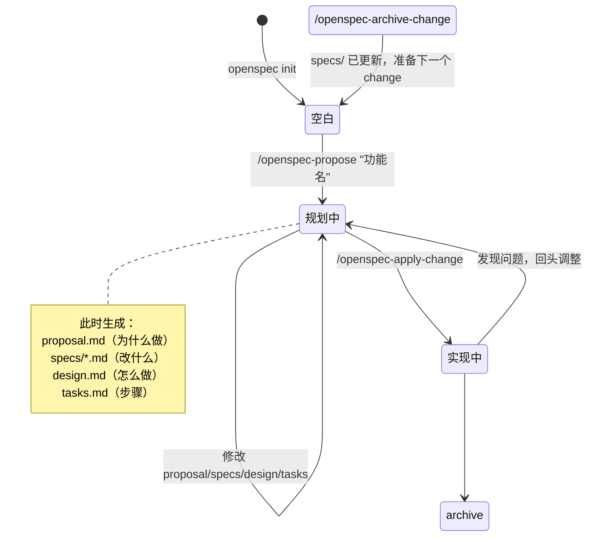

# 01 · 初级：先把 OpenSpec 用起来

> 目标不是研究源码，而是先把它当工具用顺手。如果第一反应是"改个功能干嘛这么折腾"——很正常，这一篇先帮你把这股别扭解开。

> **宿主入口提示。** OpenSpec 统一通过 **skills**（技能）向各 AI 工具投递工作流（1.x 的 `/opsx:*` 命令文件已在 2.0 移除）。本章用 `/openspec-*` 作为 Claude Code、Cursor、Zed、DeepSeek Harness（`dsh`）等工具的示例写法；Codex 使用 `$openspec-*`，也可以直接用自然语言唤起。新项目运行 `openspec init` 默认把 skills 装到本机全局目录（`~/.agents/skills/` 及各工具全局目录）；若传 `--scope project` 留在仓库内，所有工具共享同一份 `.agents/skills/` 真身（`dsh` 等通用工具直读 `.agents/skills/`，不写 `.dsh/skills/`）。所有宿主背后都在驱动同一套 `openspec` CLI 与文件状态。

---

## 先别急着写代码——想想装修

你大概头一回听说 OpenSpec。第一反应很可能是："我就改个功能，让 AI 直接写代码不就行了？干嘛要搞这么多文件、这么多步骤？"

这个别扭很正常。先放下命令，看一个生活里的类比。

想想装修。你不会让装修队一进门就抡起锤子砸墙——

- 先得有**方案**：哪堵墙拆、隔成几间、水电走哪儿
- 再排**施工单**：先水电、后泥瓦、最后刷漆，一步步来
- 干完**验收结案**，把新房的样子记进档案

少了任何一环都会出乱子：没方案就砸墙，砸完才发现承重墙动不得；没施工单，泥瓦工和水电工撞到一起；验收没记录，过两年漏水都说不清当初怎么做的。

**改代码是一模一样的事。** 直接让 AI 动手，你迟早会撞上这几种疼：

| 直接让 AI 写 | 会怎样 |
|---|---|
| 你说"加个按钮" | 越做越多，AI 顺手重构了半个系统，刹不住车 |
| 做完之后 | 说不清这次到底改了什么、系统现在该是什么样 |
| 过几个月回头看 | 忘了当初为什么这么改，对着代码发呆 |
| 多人一起改 | 各改各的，一合并就打架 |

OpenSpec 做的事，就是给"改代码"也加上装修那套**"先想清楚，再动手"**的节奏：花两三分钟把"这次到底改什么"说清楚，省掉后面反复返工和扯皮。它不让你写更多代码，只是让每次改动都带一份简短的"施工说明"。

带着这个感觉往下看，那些命令和文件就不是"麻烦"，而是装修该有的那几步。

---

## 一张图看整体

在记任何命令之前，先用一张图把"直接让 AI 写"和"用 OpenSpec"的差别看个大概：

```text
  直接让 AI 写                        用 OpenSpec
  ──────────                          ─────────
  一句话需求                          发起一个 change
    → AI 直接开写                       → 先写清楚：改什么/怎么做
    → 越写越多，刹不住车                 → 照着干，逐项推进
    → 做完说不清改了什么                 → 验收归档，更新系统底账
```

右边这条路多出来的，不是"工作量"，而是"让 AI 别跑偏、让改动留得下痕迹"的几道关卡。下面讲的三个命令，就是右边这条路上的三个关键动作。

---

## 先记一句话

**OpenSpec 是一个"先把 change 讲清楚，再去写代码"的协作层。**

它不是模型，不替你思考；它做的事是把一次改动拆成几份能讨论、能验证、能 archive 的文件。

如果你是第一次接触它，先不用记 `schema`、skill、adapter。
先记这三步就够了：

```text
/openspec-propose  →  /openspec-apply-change  →  /openspec-archive-change
```

这里的 `/openspec-*` 不是另一套叫 OPSX 的工具，而是 Claude 等宿主里**技能**的调用写法（1.x 的 `/opsx:*` command 入口已被 2.0 移除）。你在终端里直接运行的是 `openspec ...` CLI；在 agent 对话里触发工作流要使用宿主安装的入口（Codex 为 `$openspec-*` skills）。

> **1.x 升级提示**：1.x 时代的 `/opsx:*` **命令文件**已在 OpenSpec 2.0 移除，不再生成；同一份工作流现在**唯一形态是 skill**（如 `openspec-propose`）：Claude Code、Cursor、Zed 等工具里按 `/openspec-propose` 调用，Codex 用 `$openspec-propose`，也可以直接用自然语言让 agent 自己选。CLI 本身（`openspec validate` / `archive` / `update` …）一个子命令都没少。详见 [99 FAQ（Q27h）](99-FAQ-常见问题.md)。

---

## 你日常最常用的 3 个动作

用一张图理解整个工作流：



### 1. `/openspec-propose`

用来**发起一个 change**，并把规划类文件先搭起来。

你可以把它理解成：

- 给这次改动起名字
- 让 AI 帮你先把"为什么改、改什么、怎么做、做哪些任务"写出来

典型例子：

```text
/openspec-propose add-dark-mode
```

通常会得到这样一组文件：

```text
openspec/changes/add-dark-mode/
├── proposal.md
├── design.md
├── tasks.md
└── specs/
    └── ui/
        └── spec.md
```

### 2. `/openspec-apply-change`

用来**按 `tasks.md` 真正实现代码**。

它会围绕任务清单逐项推进，做完的任务会被打勾。

任务全部勾完时它会告诉你 **"All tracked tasks are complete. Review or verify the change as appropriate before archiving."**——注意这是"跟踪的任务做完了"，不是"可以归档了"。归档前值得花两分钟看一眼 diff 或跑一次 verify。

顺带一个写 `tasks.md` 的小习惯：**只有归档之后才能做的事**（部署验证、清理临时开关、回填指标之类）不要写成 checkbox，把它们列在 `tasks.md` 末尾的 `## Workflow follow-up` 段里，写成**不带 checkbox 的普通项目符号**——`parseTaskLines()`（`task-progress.ts:74-80`）是逐行扫 checkbox 的，不认标题、不认段落边界，所以真正豁免的是"没有 `- [ ]`"，而**不是**"在 `## Workflow follow-up` 标题下"。写成了 `- [ ]` 照样计入进度，"任务全完成"就永远差一步。

你可以把它理解成：

- 现在不是"讨论要做什么"
- 而是"拿着已经形成的 change 文件，开始干活"

### 3. `/openspec-archive-change`

用来**收尾**。

它做两件很关键的事：

1. 把这次 change 里的 delta spec 合并回主 `specs/`
2. 把这次 change 挪到 `changes/archive/`，保留历史

所以 archive 不是"删掉"，而是"结案归档"。

两个新手常困惑的点：

- **它会问你 `Proceed with spec updates? (Y/n)`，默认是 Yes**——直接回车就继续。不想更新 specs（比如只是归档一个纯探索的 change）就显式输入 `n`，或用 `--skip-specs`。
- **delta spec 里的散文不会进主 spec**。你写在 `## Notes` 之类段落里的说明，archive 是不会搬过去的；现在它会 WARNING 提醒你（`... is not carried into the main spec by archive`）。看到这条，把该保留的内容挪进 requirement，或挪进 proposal/design。

### 别把三个动作误解成三条终端命令

`propose / apply / archive` 是宿主 agent 的工作流动作。Claude 可能把它们显示为 `/openspec-*`，Codex 则显示为 `$openspec-*` skill；它们会按步骤读取和写入文件。终端 CLI 是你随时可以拿来核对状态的确定性工具。

| 你想确认什么 | 先用什么 | 它不会替你做什么 |
|---|---|---|
| 这次 change 还缺哪些 artifacts | `openspec status --change <name> --json` | 不会替 agent 写内容 |
| 某个 capability 现在承诺了什么 | `openspec show <path> --type spec --json --requirements` | 不会猜本次到底该改哪一个 path |
| archive 前结构是否有效 | `openspec validate <name> --type change --strict` | 不会证明实现和需求语义已经完全一致 |
| 真正推进 proposal / 实现 / 收尾 | 宿主 workflow | 不同宿主的调用名不相同 |

这层区别很实用：workflow 帮你把多步工作跑顺，CLI 帮你检查“现在磁盘上究竟是什么”。遇到 agent 输出不对、多人并行或 archive 前心里没底时，先看 `status` / `show` / `validate`，而不是再让 agent 凭记忆继续写。

---

## 先看目录，别先看机制

一个最典型的项目，大概长这样：

```text
my-project/
├── src/
├── tests/
└── openspec/
    ├── specs/
    ├── changes/
    └── config.yaml
```

这一层先只要这样理解：

- `openspec/specs/`：记录项目当前已经成立的 spec（行为基线）
- `openspec/changes/`：记录你现在正在做的变更
- `openspec/config.yaml`：补一些项目级背景和默认设置

到这里就够了。

### 但在 propose 前，要先判断“这次碰的是哪份行为合同”

不要从代码目录或页面名字直接猜 spec 文件。一个 **capability** 是能独立解释、独立修改、独立验证的行为合同；它往往跨 UI、服务和存储，并支持放在嵌套 path 下：

```text
openspec/specs/
├── identity/login/spec.md        ← capability = identity/login
├── identity/session/spec.md      ← capability = identity/session
└── data-export/spec.md           ← capability = data-export
```

`identity` 在这里仅是帮助导航的 domain，并不是会自动包含、继承或加载两个子 spec 的“父能力”。开始一个 change 前，只要做三个判断：

1. 新需求能否自然落在已有 capability 的 requirement 上？能，就修改它。
2. 它是否有独立的用户/调用方行为、场景和演进节奏？有，才考虑新建 capability。
3. 它只是重构、换库、改文档等没有可观察行为变化吗？是，就在 change 的 `.openspec.yaml` 写 `skip_specs: true`，不要虚构 delta spec。

第三种写法是正式的“没有 spec-level 行为变化”声明：

```yaml
schema: spec-driven
skip_specs: true
```

它不能和任何非隐藏的 `specs/` delta 文件共存。拿不准时先 explore，别用 `skip_specs` 跳过“行为到底有没有变”的判断。

### 新手最常问：openspec init 之后会发生什么？

运行 `openspec init` 后，仓库内会搭好 `openspec/` 骨架，同时默认把工作流 skills 装到你这台机器的**全局目录**（`~/.agents/skills/` 及所选工具的全局技能目录，以后本机其他项目可以直接共用；如果团队希望把技能一起提交进当前仓库，初始化时加 `--scope project` 即可）：

```text
my-project/
└── openspec/
    ├── specs/          ← 空的，等第一个 change archive 后才有内容
    ├── changes/        ← 空的，等你 propose 第一个 change
    └── config.yaml     ← 有一个最基础的配置
```

**重点**：
- `specs/` 一开始是空的，这是正常的！
- 第一个 change archive 后，specs/ 才会有内容
- 不需要手动写 specs/，它是 archive 自动生成的

### 新项目想让 artifacts 使用中文或其他语言

新项目可在第一次初始化时同时指定工具和 artifact 语言：

```bash
openspec init --tools zed --language "简体中文"
```

这会创建类似下面的合法 `openspec/config.yaml`：

```yaml
schema: spec-driven
context: |
  Language: 简体中文
  All artifacts must be written in 简体中文.
  Keep OpenSpec structural headings and SHALL/MUST keywords in English.
```

这里本地化的是 proposal、design、task 描述和 requirement prose；`## ADDED Requirements`、`### Requirement:`、`#### Scenario:` 等结构 heading，以及规范关键词 `SHALL` / `MUST` 保持英文，否则 parser/validator 可能无法按预期识别。

`--language` 是**新 config 的种子**，不是覆盖命令。如果项目已有 `openspec/config.yaml`，CLI 会失败并保持原文件不变：

```text
--language does not overwrite an existing OpenSpec config.
Add the language instruction to its context field instead.
```

此时手工把同样三行加入现有 `context: |`，保留项目已有技术栈和规则。空字符串、多行值、控制字符/不可见格式字符或超出 context 大小限制的值也会被拒绝。完整判断与 YAML 写法只在 [23](23-高级-config-yaml-怎么写到真正好用.md) 展开。

无论 `--tools` 传 `claude`、`cursor`、`zed` 还是 `dsh`（DeepSeek Harness），OpenSpec 安装的都是同一套 **skills**，没有单独的命令文件分流：默认装到本机全局技能目录；加 `--scope project` 留在仓库内时，所有工具统一共享 `.agents/skills/openspec-*/SKILL.md` 一份真身（`zed`、`dsh`、`cursor`、`codex` 等直接读取 `.agents/skills/`，不会生成 `.dsh/skills/`；`claude` 等独立目录工具自动建好链接）。Zed Agent 需 Zed ≥ 1.4.2 并先信任当前工作树，用 `/openspec-propose` 调用。完整的支持工具列表可在终端运行 `openspec init --help` 或打开交互选择器查看。

### 新手最常问：为什么要有这么多文件？

很多人第一次看到 proposal/specs/design/tasks 会觉得"太复杂了"。

还记得前面装修的比方吗？这四份文件，就是装修里的那几样东西——方案、验收标准、施工方案、施工单，各管一摊，少一样都会乱。对应一下：

| 文件 | 装修里的对应物 | 解决什么问题 | 如果没有它会怎样 |
|------|---------------|-------------|----------------|
| **proposal.md** | 装修方案（改成什么样） | 防止 scope 失控 | AI 会不断加功能，永远做不完 |
| **specs/*.md** | 验收标准（怎样算合格） | 防止行为不清晰 | 做完了也不知道系统承诺了什么 |
| **design.md** | 施工方案（水电墙怎么走） | 防止技术选型随意 | 后人不知道为什么这样做 |
| **tasks.md** | 施工单（先干哪步） | 防止实现无序 | AI 不知道从哪开始，容易乱改。有了 tasks.md，可以逐项推进，还能追踪进度 |

**一句话**：这些文件不是为了"仪式感"，而是为了"让 AI 和人都能对齐"。

---

## 一次最小工作流

假设你要给系统加深色模式。

### 第一步：发起 change

```text
/openspec-propose add-dark-mode
```

这时 AI 会围绕这次 change 生成几类文件：

- `proposal.md`：为什么做
- `specs/.../spec.md`：行为上要改什么
- `design.md`：技术上怎么做
- `tasks.md`：具体任务拆解

**生成的 proposal.md 大概长这样：**

```markdown
# Proposal: Add Dark Mode

## Why
用户反馈在夜间使用时界面太亮，影响体验。

## What Changes
- 新增主题切换按钮（右上角）
- 支持 light / dark 两种主题
- 用户偏好持久化到 localStorage

## Out of Scope
- 系统级主题跟随（留给下一个 change）
- 自定义颜色（不在本次范围内）
```

### 第二步：实现

```text
/openspec-apply-change add-dark-mode
```

这一步才开始真正改代码。

### 第三步：archive

```text
/openspec-archive-change add-dark-mode
```

这一步结束后，这次 change 的结果会变成项目正式 spec 的一部分。

---

## 第一次用 OpenSpec 的常见误区

| 误区 | 实际情况 |
|------|---------|
| "要先把整个系统的 spec 都写完才能开始" | 不需要。第一个 change 只需要描述"这次要改的那一块" |
| "proposal 写完了就不能改了" | 随时可以改。Actions, not phases |
| "archive 是删除 change" | 不是。是把 delta spec 合并回 specs/，并把 change 移到 archive/ 保留历史 |
| "specs/ 是我手动维护的文档" | 不是。它是 archive 后自动更新的正式基线 |
| "不用 archive 也没关系" | 不 archive 的话，specs/ 基线不会更新，下一个 change 就没有正确的基线可以参考。**后果**：你会不知道系统现在到底是什么样的，多人协作时会乱套 |
| "目录层级会自动帮 agent 找相关 specs" | 不会。nested path 让合同可分片、可寻址；仍要由人或项目约定先列候选，再按需读取 |
| "没有写 delta 就说明不需要 specs" | 只有确认没有 spec-level 行为变化时才可用 `skip_specs: true`；漏写不是合法理由 |

---

## 初级阶段最重要的 5 个认知

### 1. OpenSpec 管的是 change，不是纯聊天

它不是让 AI 随便聊聊需求，而是把一次改动沉淀成文件。

### 2. 你不用一开始就理解全部内部结构

先会用 `propose / apply / archive`，已经能完成大部分日常场景。

### 3. `changes/` 是工作区，不是垃圾堆

每个 change 都是一个完整工作单元，有自己的规划、spec、任务和历史。

### 4. `specs/` 很重要，但初学时不用一次想透

你只要先知道：archive 以后，change 会沉淀回正式 spec。

### 5. 不要一开始就被 Claude Code、skills 吓住

那些是"宿主工具怎么接 OpenSpec"的问题，不是"你怎么用 OpenSpec"的第一步问题。

---

## 两个提效命令，知道就行

这两个命令跟 change 生命周期无关，但能减少你日常敲命令的摩擦。先用起来，知道有它们就行。

### `openspec completion`：让 shell 帮你补全

```bash
openspec completion install          # 自动检测 shell 并安装补全
openspec completion generate         # 只生成脚本，输出到 stdout
openspec completion uninstall        # 移除补全
```

安装后，在终端里敲 `openspec ` 然后按 Tab，shell 会自动补全：

- **子命令**——`init`、`list`、`show`、`validate`、`archive`……
- **change 名**——所有活跃 change 的 ID
- **spec 名**——所有 capability path
- **schema 名**——所有可用 schema

支持 zsh、bash、fish、powershell。为什么值得装？OpenSpec 的命令行参数经常要填 change 名或 spec 路径，靠记忆或 `ls` 去找远不如敲两三个字母按 Tab 快。

首次在终端交互运行 `openspec` 命令时，CLI 会在 `stderr` 一次性提示你安装补全（`Tip: Run 'openspec completion install' for shell completions`）以及匿名遥测说明；`--json` 或管道调用时会自动延后显示，不会污染命令的标准输出。若不想看到补全提示，设置环境变量 `OPENSPEC_NO_COMPLETIONS=1` 即可。

### `openspec feedback`：从终端直接反馈

```bash
openspec feedback "archive 报了一个看不懂的错" --body "在 archive add-dark-mode 时出现的，日志如下：..."
```

这条命令会用 `gh` CLI 把反馈作为 GitHub issue 提交到 `Fission-AI/OpenSpec` 仓库。如果没装 `gh` 或没登录，它会给你一个指向 bug 表单（`template=bug_report.yml`）并预填好字段的 GitHub issue URL，复制到浏览器里就能提交。

长消息会把折叠空白后的摘要截成最多 72 个字符的 issue 标题（加 `Feedback: ` 前缀），同时把原始完整消息保留在正文的 `### What happened` 下；可选 `--body` 完整放入 `### Details`，并附上 `### Minimal steps to reproduce` 复现步骤提示。所以标题变短不代表反馈正文丢失。

它自动在 issue body 末尾附带元数据：

```text
---
Submitted via OpenSpec CLI
- Version: 2.1.1
- Platform: darwin
- Timestamp: 2026-11-21T...
```

为什么要用它而不是手动开 issue？**结构化反馈附带版本和环境信息**，维护者不用来回追问"你用的哪个版本"——这对开源工具的迭代速度很重要。而且不用离开终端，不会打断工作流。

---

## 初级阶段先别纠结什么

先别急着纠结这些词：

- `schema`
- `.openspec.yaml`
- `workflow profile`
- `skillsScope`
- `instructions JSON`

它们都是真的，也都重要。

但如果你在还没把主流程走通前就钻进去，很容易越看越乱。

---

## 最该带走的 5 句话

1. **先把改动讲清楚再动手**：OpenSpec 管的是一个个增量 `change`，不是让 AI 在聊天框里盲目改代码。
2. **日常先抓牢 3 个动作**：发起规划（`propose`）→ 按任务实现（`apply`）→ 合并基线归档（`archive`）。
3. **两个目录各司其职**：`openspec/changes/` 是当前施工区，`openspec/specs/` 是每次 `archive` 后沉淀下来的正式行为底账。
4. **`specs/` 一开始为空很正常**：不需要先把老系统全写成 spec，每做完并归档一个 change，基线就自然长出一块。
5. **拿不准状态就查终端 CLI**：agent 对话里的技能负责推进工作流，`openspec status` / `show` / `validate` 随时帮你核对磁盘上的真实状态。
