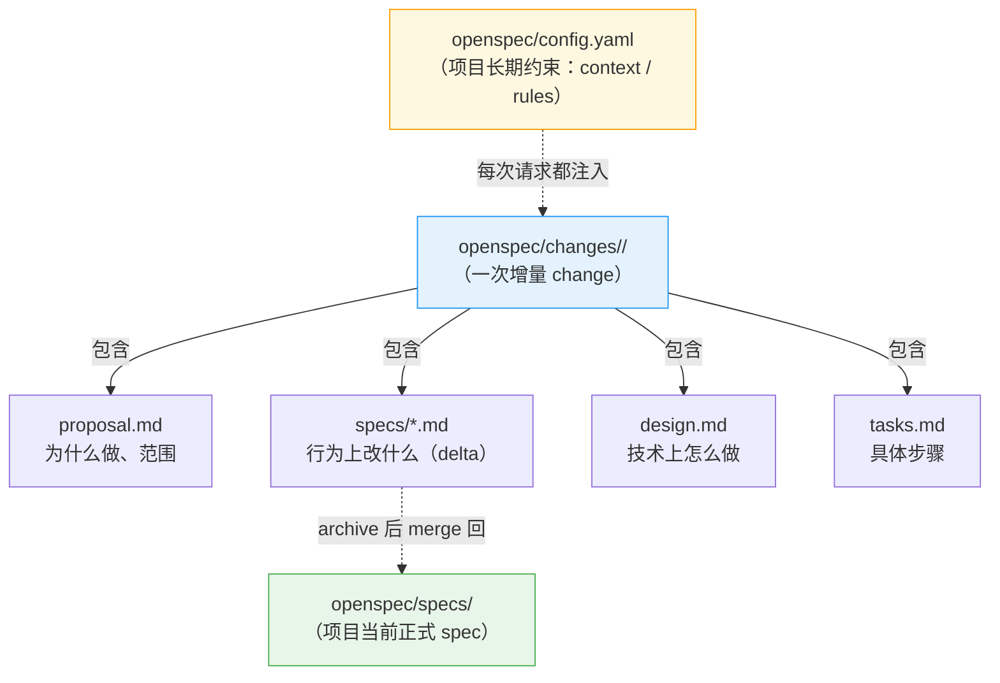

# 10 · 中级：把核心概念真正串起来

> 这一篇解决的不是"怎么按命令用"，而是"OpenSpec 到底在管理什么"。答案是一条三层线：**`config.yaml` 管"项目怎么做"、`specs/` 管"系统现在会什么"、`changes/` 管"这次怎么改"**。

> **当前模型。** capability ID 仍是 `openspec/specs/` 下的相对 path（行为基线以 [`_digested/README.md`](../_digested/README.md) 的「当前源码基线」为准）。Codex、Zed Agent、Antigravity、Amp、GSD 与 vendor-neutral `agents` 目标共享 `.agents/skills/`；Zed 是 skills-only，不使用 `/opsx:*` command。

---

## 先抓住主轴

很多人读 OpenSpec 会乱，不是因为文档不够多，而是因为主轴抓晚了。

最该先抓住的不是 `schema`，也不是 skill，而是这条线：



换句话说：

> **OpenSpec 的核心不是"生成几份文档"，而是"围绕项目当前 spec，管理一次次增量 change"。**

---

## OpenSpec 管的是三层，不是两层

主轴那条线其实还缺一层。完整的是三层：

| 层 | 位置 | 管什么 | 一句话 |
|---|---|---|---|
| 第一层 | `openspec/config.yaml` | 项目长期工程约束 | **项目怎么做** |
| 第二层 | `openspec/specs/` | 系统正式能力基线 | **系统现在会什么** |
| 第三层 | `openspec/changes/` | 单次 change 的工作包 | **这次怎么改** |

一条信息该放哪层，判断标准是它的**有效期**：跨所有 change 都成立（技术栈、目录约束、测试策略）→ 第一层；描述系统当前承诺的行为 → 第二层；只是这次要改的东西 → 第三层。

**放错层不会报错，但会持续付代价**：把长期约束写进某个 change 的 proposal，它就只在那一次生效；把本次改动写进 `config.yaml`，它会在**每一次**请求里重复注入。完整的归位判断表见 [22](22-高级-项目级全局约束到底放哪.md)。

---

## `config.yaml`：项目长期约束放在哪

三层里最容易被忽略的是第一层。很多人用了很久 OpenSpec，从没打开过 `openspec/config.yaml`——它由 `openspec init` 生成，不改也能跑。

但它是三层里**唯一"主动影响 agent 每一次判断"**的一层，所以值得在中级阶段就建立正确认识。

### 两个最该先认识的字段

```yaml
schema: spec-driven

context: |
  Project: BuildFlow
  Domain: 工程项目报验与审批
  Stack: TypeScript, React, Node.js, PostgreSQL
  Quality priorities:
  - 审批决策的正确性
  - 关键操作可审计

rules:
  specs:
    - 涉及路径的 requirement 必须写跨平台行为
  tasks:
    - 涉及文件路径的 change 必须包含 Windows CI 验证任务
```

| 字段 | 是什么 | 怎么生效 |
|---|---|---|
| `context` | 稳定的**项目背景**：技术栈、领域、质量优先级 | **每个 artifact 的请求都注入** |
| `rules` | 按 artifact 分的**长期工程纪律** | **只注入对应的那个 artifact** |

两者都是"写给 agent 的长期约束"，区别在作用范围：`context` 全局，`rules` 分槽。`rules` 的键就是 artifact id（`proposal` / `specs` / `design` / `tasks`）——proposal 拿不到 specs 的规则，反之亦然。这样项目纪律能沉淀进配置，而不必每次在对话里重讲。

### 一条必须知道的边界：注入是有代价的

`context` 和 `rules` 里的每个字都会进入 agent 的上下文，所以**"写得越全"不等于"效果越好"**：

- `context` 有 50 KB 上限，**超限是整段丢弃，不是截断**——你会以为注入成功，实际什么都没注入。
- 判断标准是**高杠杆、可判断、长期稳定**：一条影响很多 change、有明确对象、不是一次性的，才值得放进项目层。

所以这一层的正确处理是：**只放跨所有 change 都成立的短原则**，而不是把项目文档搬进来。字段级写法和完整范例见 [23](23-高级-config-yaml-怎么写到真正好用.md)。

> **和 `schema` 的分工**：`config.yaml` 管"提示层"（告诉 agent 该怎么做），`schema` 管"结构层"（定义 artifact 骨架和依赖）。想改结构就别继续堆 `rules`——那属于 [21](21-高级-config-schema-与项目边界.md) 和 [25](25-高级-自定义-schema-创建自己的工作流.md)。

---

## `specs/` 和 `changes/` 到底是什么关系

### `openspec/specs/`

这是**当前正式 spec（正式基线）**。

它表达的是：

- 这个项目现在承诺了什么行为
- 当前系统的能力边界是什么
- 后续所有 change 该以什么为基线继续修改

所以它更像：

- 当前 capability 合同
- 项目行为基线
- source of truth

### capability 不是代码目录，也不是“装文档的桶”

把 main specs 切好，决定了以后每一次 change 要读多少、改哪里、能否安全并行。一个 capability 应是**可独立解释用途、独立承受变化、独立用 scenarios 验证**的行为合同切片；不要按 UI 页面、数据库表、源码文件夹或团队组织图机械切分。

```text
openspec/specs/
├── identity/
│   ├── login/spec.md             ← identity/login
│   └── session/spec.md           ← identity/session
├── billing/invoices/spec.md      ← billing/invoices
└── data-export/spec.md           ← data-export
```

`identity` 是帮助人和 agent 缩小查找范围的 **domain**，不是父 capability：它不继承 requirement、不聚合子 spec，也不会让 OpenSpec 自动读取 `identity/` 下所有文件。只有当第三层也长期稳定且确有导航价值时才继续加深；别照搬代码路径、URL 或临时项目名。

选择时问三件事即可：

| 信号 | 应该怎样决定 |
|---|---|
| 新行为能被现有 requirement 自然表达 | 修改已有 capability，别建近义 path |
| 有独立用户/调用方合同、场景和演进节奏 | 新建 capability，并写清 `## Purpose` |
| 两组 requirement 总是同改、同测、读者也无法分开理解 | 不要为了树好看而拆分 |

这不是排版问题。完整 path 就是 v1.8.0（v1.7.0 起）的 capability ID；proposal、delta、`show`、`validate`、sync 与 archive 都靠它定位。更系统的切分和维护规则见 [26](26-高级-治理边界与漂移维护.md)。

### 新手最常问：specs/ 一开始是空的吗？要手动写吗？

**答案：一开始是空的，不需要手动写。**

很多人误以为要先手动写一份完整的系统 spec，其实不是：

1. `openspec init` 后，specs/ 是空的
2. 你做第一个 change（比如 `/opsx:propose add-site-inspection`）
3. change 里会生成 delta spec（描述这次加了什么）
4. `/opsx:archive` 后，delta spec 自动 merge 到 specs/
5. 这时 specs/ 才有了第一份内容

**关键**：specs/ 是"长出来的"，不是"一开始写完的"。

### 新手最常问：`.openspec.yaml` 是什么？

你可能在"先别纠结"列表里看到过这个文件名。简单说：

**`.openspec.yaml` 是 change 目录里的配置文件**，记录这次 change 用哪套 schema。

大多数情况下：
- 它会自动生成
- 你不需要手动改它
- 它的内容通常就是 `schema: spec-driven`

**什么时候需要关心它**：
- 当你想让某个 change 用不同的 schema 时
- 当你在研究高级定制时
- 当你确认这次没有任何 spec-level 行为变化，需要显式写 `skip_specs: true` 时

若这次只是内部重构、换实现、工具或文档工作，且没有改变用户或调用方可观察的合同，可以这样声明：

```yaml
schema: spec-driven
skip_specs: true
```

这会让 status 中的 specs 显示为 `skipped`，而不是“漏了一份 spec”。但它不能与任何非隐藏 delta spec 文件共存；有可观察行为变化时仍必须写 delta。**现在不用纠结其他 metadata**——只要先知道：`spec-driven` 是 OpenSpec 默认的 schema，也是**背后的 driver**（每个 change 的 artifact 骨架、delta 操作、capability 契约都由它定义）。想真正吃透它，看 [`26-高级-治理边界与漂移维护`](26-高级-治理边界与漂移维护.md) 的开头，以及项目根 `_digested/schema/02-内置-spec-driven-详解.md`。

### `openspec/changes/`

这是**change 工作区**。

每一个 change 文件夹，都是"针对当前正式 spec 的一次增量改动"。

所以它更像：

- 一次完整改动的工作包
- 一次迭代的文档容器
- 正式 spec 的 patch 工作区

### 它们的关系

```text
specs/    = 现在系统是什么
changes/  = 这次准备把它改成什么样
```

archive 之后：

```text
                          ┌── archive 合并 ──>  openspec/specs/（正式基线更新）
changes/add-progress-dashboard/    │
       specs/（delta）    └── 挪入 ──>  changes/archive/（历史留档）
```

archive 把 delta 合并进正式 specs，change 自身挪进 `changes/archive/` 留档。

合并是**按 relative path 寻址**的：delta 在 `changes/<name>/specs/<capability-path>/spec.md`，合并到主 spec 中同一路径的 `openspec/specs/<capability-path>/spec.md`。所以 capability 的“地址”是完整相对 path（可嵌套）——它仍是稳定契约，不能随意搬改（详见 [`26`](26-高级-治理边界与漂移维护.md)）。

### 新手最常问：archive 的 merge 是自动的还是手动的？

**答案：自动的。**

当你运行宿主 archive workflow（Claude 示例 `/opsx:archive add-progress-dashboard`）时：

1. OpenSpec CLI 自动读取 `changes/add-progress-dashboard/specs/` 里的 delta spec
2. 自动解析 ADDED/MODIFIED/REMOVED 标记
3. 自动更新 `openspec/specs/` 里对应的文件
4. 自动把 change 移到 `changes/archive/`

**你不需要**：
- 手动复制粘贴
- 手动更新 specs/

**你只需要**：
- 确保 delta spec 写对了（ADDED/MODIFIED/REMOVED 标记正确）
- 运行 archive 命令

### 新手最常问：如果 archive 时同一个 capability 已经被别人改过，怎么办？

两个 change 都基于旧 main spec 修改同一个 requirement 时，后 archive 的 delta 可能找不到原标题，或其 `MODIFIED` block 不再能精确应用。OpenSpec 会停止 archive，避免把半套结果写进基线；它不会替你写 Git 风格的冲突标记、也不会猜两个行为版本如何合并。

正确处理是：

1. 先保留已经 archive 的 main spec，重新读取它的完整 requirement 与 scenarios。
2. 判断后一个 change 仍应修改什么，重写它的 delta，使其以最新 main spec 为基线。
3. 如果两个 change 本来是一个不可分割的行为决定，合并或重新规划它们，而不是硬凑两份 delta。
4. 再执行 `openspec validate <change> --type change --strict`，通过后 archive。

最省成本的预防是：同一 capability path 上的行为 change 串行化；前一个 archive 后，马上让后一个 change rebaseline。不同文件不必然独立，真正的隔离单位是完整 capability path 和其中被改的 requirement。

---

## artifact 到底是什么

artifact 不是"附件"，而是一次 change 内部的几类产物。

默认最常见的 4 个是：

| artifact | 作用 | 你可以把它理解成 |
|----------|------|------------------|
| `proposal` | 为什么做、范围是什么 | change 立项说明 |
| `specs` | 行为上改什么 | 需求/行为变更合同 |
| `design` | 技术上怎么做 | 技术方案 |
| `tasks` | 具体怎么一步步落地 | 施工清单 |

它们之间的依赖**不是一个线性的链，而是一个 DAG**（`schemas/spec-driven/schema.yaml`）：

```text
proposal（为什么改）
   ├──> specs（行为改什么）
   └──> design（技术上怎么做）
             │
    specs ───┴──> tasks（先干哪步）───> apply（照着干）
```

关键点：**`design` 只依赖 `proposal`，不依赖 `specs`**（`design.requires: [proposal]`），所以它是 `specs` 的兄弟而不是下游；两者都齐了才解锁 `tasks`（`tasks.requires: [specs, design]`）。`design` 也不在 apply 门槛里——`apply.requires` 只有 `[tasks]`。

简单说：

- `proposal` 回答"为什么改"
- `specs` 回答"行为上改什么"
- `design` 回答"技术上怎么实现"
- `tasks` 回答"具体先做哪几步"

再往深看一步：为什么拆成四份独立文件、而不是揉成一份？因为它们关注的事不一样——`proposal` 管"该不该做、做到哪算完"，`specs` 管"系统该变成什么样"，`design` 管"怎么实现"，`tasks` 管"先干哪步"。揉成一份，改一处就得重读整份；拆开，你能在 specs 和 design 之间反复对照、各改各的。这也是为什么 OpenSpec 让它们各自成文件：分开，才能分开 review、分开改。

---

## delta spec 为什么是 OpenSpec 的关键

如果没有 delta spec，OpenSpec 只是一套"AI 帮你写 planning 文档"的工具。

真正让它变得有意思的，是它不是每次重写整份 spec，而是写"增量修改"。

还是装修的比方——但这次往深一层。装修到一半，你想把厨房的墙往里挪 30cm。你不会把整套房子图纸重新测绘一遍，只会出一份"本次施工变更单"：就改这一处。

delta spec 就是这份"变更单"。它不重写整个系统的 spec，只精确描述"这次改了哪里"。

```text
  整份重写                         delta 增量
  ─────────                        ─────────
  重画整套图纸                     只写本次变更单
    → 审查者要逐行找你改了什么       → 一眼看出改了哪几处
    → 多人同时改，必然打架           → 各改各的文件，互不冲突
```

这张图就是 delta 和"整份重写"的本质区别。下面看它在文件里到底长什么样。

### delta spec 的意思

change 里的 `specs/**/*.md`，不是一份全新的正式 spec。

它表达的是：

- 新增什么要求
- 修改什么要求
- 删除什么要求
- 必要时重命名什么要求

通常你会看到这样的分段：

```markdown
## ADDED Requirements
## MODIFIED Requirements
## REMOVED Requirements
## RENAMED Requirements   ← 改名用 FROM/TO；注意：只有 requirement 有 rename 操作，capability 没有
```

这背后的思想非常重要：

> **OpenSpec 不是让你每次重新描述整个系统，而是让你精确描述"这次改了哪里"。**

这就特别适合老项目、增量迭代、多人并行修改。

### 反面例子：不用 delta spec 会怎样

假设你要给一个已有的工程项目管理系统新增"导出施工日志（CSV）"功能。

**不用 delta spec（传统方式）**：
```markdown
# 系统规格.md（整份重写）

## 功能 1：项目立项
...（200 行）

## 功能 2：材料管理
...（150 行）

...（中间 18 个功能）

## 功能 20：施工日志导出
支持 PDF、CSV 两种格式  ← 这里改了，但审查者要自己找
```

问题：
- 审查者要对比整份文档才知道你改了什么
- 并行开发时容易冲突（两个人都重写了整份文档）
- 历史记录里看不出"这次 change 的边界"

**用 delta spec（OpenSpec 方式）**：
```markdown
# changes/add-diary-export/specs/export.md

## MODIFIED Requirements

### REQ-EXPORT-001: 支持的导出格式
- **原来**：支持 PDF、Excel 两种格式
- **现在**：支持 PDF、Excel、CSV 三种格式
- **原因**：甲方要求施工日志以 CSV 格式提交审阅

## ADDED Requirements

### REQ-EXPORT-004: CSV 导出格式规范
- 第一行为列标题
- 使用 UTF-8 编码
- 日期格式为 YYYY-MM-DD
```

优势：
- 审查者一眼看出改了什么
- 并行开发不冲突（不同 change 改不同文件）
- 历史清晰（archive 后能看到每次 change 的边界）

## 读到这里，先不要急着钻机器层

现在还不急着问：

- skill 怎么发现
- command 怎么生成
- `openspec instructions --json` 怎么喂给 agent

这些属于"机器怎么跑"——边界见 [26](26-高级-治理边界与漂移维护.md)，JSON 形状见 [90](90-附录-给机器看的-agent-协议.md)。

对人来说，中级阶段最重要的是先把这句话真正吃透：

> **OpenSpec 用 `config.yaml` 管项目怎么做、用 `specs/` 管系统现在会什么、用 `changes/` 管这次怎么改。**

三层分清了，接着看 [11](11-中级-定位节奏与边界.md)：它讲这个产品的定位（brownfield-first）、你被允许怎么动（Actions, not phases），以及最容易混的四组边界。

---