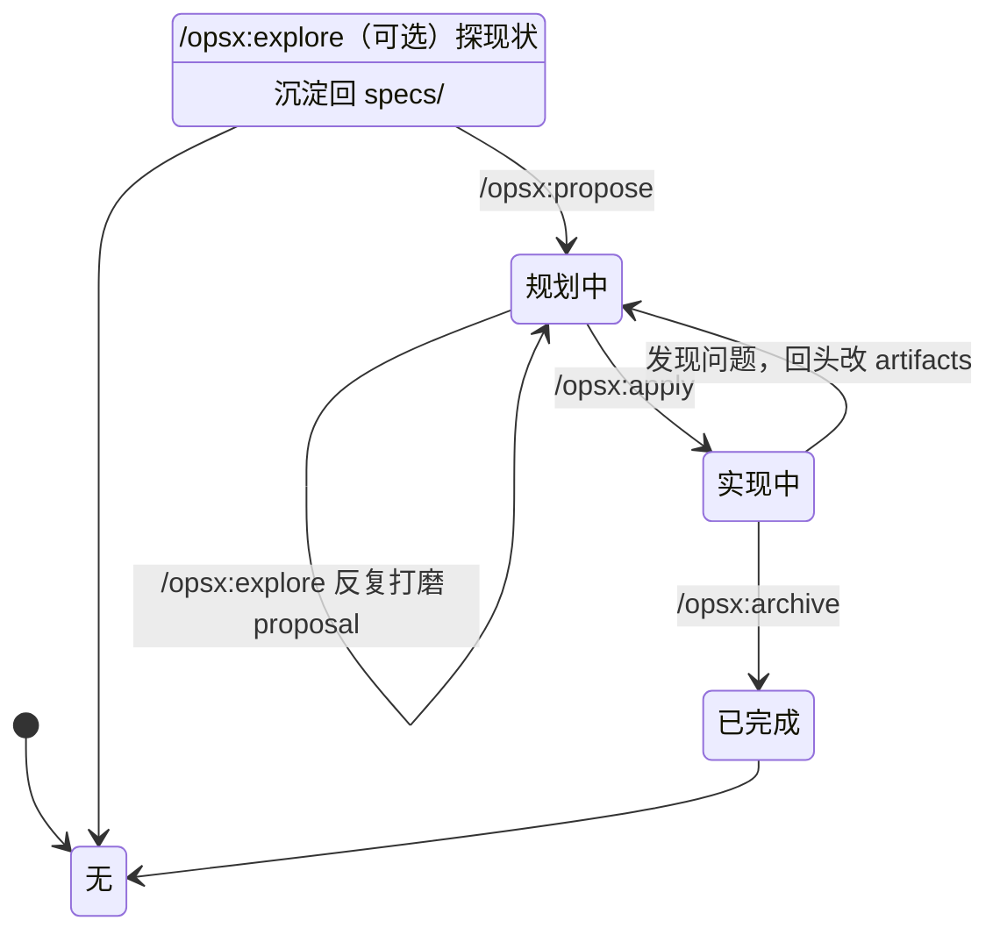

# 11 · 中级：定位、节奏与边界

> 这一篇接着 [10](10-中级-把核心概念真正串起来.md) 讲完"OpenSpec 在管什么"之后，回答三件事：**它为什么这样定位**（brownfield-first）、**你被允许怎么动**（Actions, not phases）、**最容易混的是什么**（四组边界）。
>
> 这一篇不引入新机制，只把 10 建立起来的心智模型钉到"你实际怎么用它"上。

---

## 为什么说它是 brownfield-first

官方一直强调 `brownfield-first`，这不只是一句口号。

### 什么是 brownfield？什么是 greenfield？

```text
greenfield（绿地）= 从零开始的新项目，白纸一张
brownfield（棕地）= 已有代码库，有历史包袱，需要在上面继续改
```

**现实是：90% 的软件工作都是 brownfield。**

以 BuildFlow 为例——你接手了一个跑了 3 年的工程项目管理系统，要加一个"质量巡检"功能。这就是典型的 brownfield 场景：

- 已有项目管理、材料管理、审批流程
- 已有一堆历史决策和技术债
- 你不能推倒重来，只能在上面加

OpenSpec 的真正对象，不是空白世界，而是：

- 已有代码库
- 已有行为
- 已有能力边界
- 已有一堆历史包袱

delta spec 恰好就是为这种现实工作方式设计的。

换个比方：你面对的是一套住了 3 年的老房子（brownfield），不是毛坯房（greenfield）。毛坯房可以先把整套图纸画完再动手；老房子你不可能把每面墙、每根管子都重新测绘一遍——那正是 greenfield 工具让人劝退的原因。老房子只在"这次要动的那面墙"上动手，这正是 delta spec 的用武之地。

### 反面例子：greenfield 工具用在 brownfield 场景

很多 spec 工具假设你从零开始，让你先写一份完整的系统 spec。

但如果你接手的是一个老项目：

- 你要先把现有系统的所有行为都写成 spec（可能要几周）
- 然后才能开始描述"这次要改什么"
- 这个门槛太高，大多数团队直接放弃

OpenSpec 的做法：

- 先用 `openspec init` 建立一个空的 `specs/` 基线
- 第一个 change 可以只描述"这次要改的那一块"
- 随着时间推移，`specs/` 会逐渐丰富
- 不需要一开始就把整个系统都写完

**这就是"specs 是长出来的"的另一面**：[10](10-中级-把核心概念真正串起来.md) 讲的是机制（delta 怎么 merge 回基线），这里讲的是定位（为什么整个产品要围着"在已有系统上动一小块"来设计）。

---

## "Actions, not phases" 到底是什么意思

OpenSpec 还有一句特别重要的话：

> **Actions, not phases**

意思是：

- `propose`、`apply`、`archive` 是动作
- 不是把你永远锁死的阶段

### 用状态机理解 OpenSpec 工作流



图里 `explore` 出现了两次：propose 之前先探现状（无 change 时）、change 出来后反复打磨 proposal（规划中时）。（为什么反复打磨能探得更准，[20](20-高级-openspec-的软件开发生命周期思想.md) 会讲透。）

状态随时能来回走——这就是"Actions, not phases"和传统"阶段锁"的本质区别（下面以最常见的"回头修正"为例）：

- 你可以先生成 proposal，再回头补 specs
- 你可以在实现过程中发现 design 不对，再回头修改 design
- 你可以边做边修正，而不是一旦进入 implementation 就再也不能改 planning

**一个常被误读的点**：状态能来回走，不等于"artifact 可以不过脑子地反复重写"。真正的成本不在"能不能改"，而在"改完之后其他 artifact 还自洽吗"——那属于治理问题，见 [26](26-高级-治理边界与漂移维护.md)。

---

## 中级阶段最该分清的 4 组边界

### 1. `specs` vs change 里的 `specs`

- 前者是正式基线
- 后者是这次 change 的 delta

两者路径相同、角色完全不同：`openspec/specs/<capability-path>/spec.md` 是真相，`openspec/changes/<name>/specs/<capability-path>/spec.md` 是这次要施加的改动。

### 2. artifact vs workflow

- artifact 是文件产物类型（proposal / specs / design / tasks）
- workflow 是你在工具里触发的动作（propose / apply / archive / update）

一个是"产出什么"，一个是"什么时候产出"。同一个 artifact 可以被不同 workflow 写。

### 3. change vs task

- change 是一次完整工作（有 proposal、specs、design、tasks 一整套）
- task 只是 change 里的实施步骤（`tasks.md` 里的勾选项）

### 4. 项目事实 vs 工具入口

- `openspec/` 里大多是**项目事实层**（specs、changes、config.yaml）
- `.claude/`、`.agents/`（Codex、Zed、Antigravity、Amp、GSD 与 vendor-neutral `agents` 多方共享）、`.cursor/` 这类更多是**工具入口层**

这条边界解释了一个常见困惑：为什么 `openspec/` 要提交进 git，而 `.claude/` 之类往往不提交——前者是项目的事实，后者是某个工具怎么调用 OpenSpec。

---

## 新手最常问：做了一半发现方向变了，怎么办？

这是中级阶段最常撞上的判断题。先分清两种"变了"：

| 变的是什么 | 该怎么做 |
|---|---|
| **同一件事的细化**——范围收窄、方案调整、边做边学 | 改现有 change |
| **意图根本变了**——原来的问题不再是问题，或范围炸成另一件事 | 另开一条新 change |

判断可以用三个问题：

1. **还是同一件事吗？** 原始意图没变 → 改现有的。
2. **重叠超过一半吗？** 大部分 artifact 还能复用 → 改现有的。
3. **旧的能不能独立"做完"？** 能（哪怕只是做完一部分）→ 归档它，另开新的。

为什么这个判断值得认真做：**改现有 change 累积历史，另开新 change 换来清晰**，两者不可兼得。把彻底变了方向的东西硬塞进原 change，会让那套 artifact 前后自相矛盾——而 [26](26-高级-治理边界与漂移维护.md) 会告诉你，**机器不会替你发现这种矛盾**。

> 一条实用纪律：改完现有 change 之后，把其他 artifact 也过一遍，确认它们仍互相自洽。OpenSpec 管这个叫一致性复核，`update` 动作会带你走。

---

## change 多起来、方向晃过之后：三种姿势

只跟一条 change 时，不需要治理。**change 一旦同时挂着好几条、方向又来回晃过**，就会开始欠账——而且这些账不会自己消失。

### 先认清你会欠下哪四笔账

| 现象 | 欠的是什么 | 不管会怎样 |
|---|---|---|
| 一堆 change 挂在 active，谁也没在动 | **没收敛** | agent 以为有一堆"进行中的方向"，被假信号带偏 |
| `specs/` 里有些 capability 早没人用了 | **没打扫** | 噪音进上下文；review 和搜索都要绕开它 |
| 同一个 capability 被好几条 change 各改各的 | **没治理** | 后归档的那条撞上前一条改过的正文，archive 直接失败 |
| 反复跟 agent 解释"那个已经不算数了" | **没对齐** | 每次都要把项目现状重讲一遍 |

先记住一个事实：**这四笔账，机器一笔都不会主动提醒你。** [26](26-高级-治理边界与漂移维护.md) 会解释为什么——它只保证"这一次归档对不对"，不保证"你的方向还成不成立"。

### 姿势一：收敛——先把在途的收干净

**什么时候用**：active 列表长到你自己都不想看。

**做什么**：

1. `openspec list` 看清到底挂着几条。
2. 每条问一句：**还在做吗？**
3. 在做 → 继续推进；不做了 → 归档；说不清 → 先明确"它做到什么算完"。

**关键**：不要留着"半死不活"的 change。一条 change 要么在推进，要么已归档；长期挂在 active 却不推进，就是欠账本身。

### 姿势二：打扫——处理掉不再成立的

**什么时候用**：`specs/` 里出现了没人用的 capability，或者某条 change 的方向已被别的东西取代。

**做什么**：

- **归档方向已废的 change**：`archive` 把它移进 `changes/archive/` 留档——历史还在，只是不再假装进行中。
- **退役真正不再成立的 capability**：走 **`retire_capabilities`**（在 change 的 `.openspec.yaml` 里显式声明）。这是删除一个 capability 的**唯一正规通道**——因为删除无法从工作树恢复、只能从 git 恢复，所以 OpenSpec 要求这是作者的显式判断，而不是从 delta 形状推断出来的。
- **纯重构/工具/文档类 change**：确实没有行为变化时，用 `skip_specs: true` 诚实标注。**不要为了通过校验硬编一条 requirement**。

> **打扫和"假装打扫"的区别**：`archive` 是留档（历史保留，状态诚实）；而一个已被取代的 capability 如果不走 `retire_capabilities`，它会一直留在 `specs/` 里，被 agent 当成**现状**读——这才是真正的代价。

### 姿势三：治理——立规矩，让下次不再乱

**什么时候用**：同样的乱已经出现第二次。

**做什么**：

- **把反复讲的话沉淀进 `config.yaml`**：你每次都要跟 agent 解释的项目约束，写进 `context`（全局注入）或 `rules`（按 artifact 注入）——见 [10](10-中级-把核心概念真正串起来.md)。
- **把"方向"变成硬前置**：如果"方向漂"是反复问题，可以用自定义 schema 加一个 `direction` artifact，让 proposal 在它存在之前**根本写不出来**。机制见 [25](25-高级-自定义-schema-创建自己的工作流.md) 与 [26](26-高级-治理边界与漂移维护.md)。
- **改完一个 artifact，过一遍其余的**：这件事叫一致性复核，`update` 动作会带你做（宿主里的 `/opsx:update`，**不是** `openspec update` 命令——那个是重新生成工具文件）。

### 方向晃过之后，在途那批怎么处置

方向变了，在途的 change 不会自动跟着变。逐个明确四种处置之一：

| 处置 | 什么时候 |
|---|---|
| **继续** | 这条 change 的方向没受新方向影响 |
| **改** | 同一件事，但要按新方向调整 → 走 `update` 动作 |
| **归档** | 它已独立完成，或它的方向已被取代 |
| **重开** | 意图根本变了 → 归档旧的、另开新的（判断法见上一节） |

**不要留第五种**：既不改也不归档，让它挂着。那正是"方向晃来晃去"最典型的欠账形态。

> **中级阶段要建立的就一句**：change 多了、方向晃过之后，正确的姿势不是"再开一条 change 把事情盖过去"，而是**先收敛 → 再打扫 → 最后治理**。顺序不要反——在途的一堆还没收拾干净时立规矩，规矩也落不了地。

---

## 压缩结论

1. **它是 brownfield-first 的**：默认你有历史包袱，所以只要求你描述"这次要动的那面墙"，不要求先测绘整套房子。
2. **`specs/` 是长出来的**：`init` 之后它是空的，第一个 change archive 之后才有第一份内容。
3. **动作可以来回走**：`propose` / `apply` / `archive` 是动作不是阶段锁；随时可以回头改 planning。
4. **四组边界值得背下来**：`specs` 基线 vs change 的 delta；artifact vs workflow；change vs task；项目事实层 vs 工具入口层。
5. **方向变了先判断"是不是同一件事"**：是就改现有 change，不是就归档旧的、另开新的；改完记得让 artifacts 重新自洽。
6. **change 多了、方向晃过之后，姿势是收敛 → 打扫 → 治理**：先把在途的收干净（`list` + 归档），再处理不再成立的（`retire_capabilities` / `skip_specs`），最后才立规矩（沉淀到 `config.yaml`、把方向做成硬前置）。这四笔账机器一笔都不会主动提醒你。
7. **下一篇去哪**：想理解"为什么这么设计"，进高级篇（[20](20-高级-openspec-的软件开发生命周期思想.md)）；想把概念落到自己项目上，看 [22](22-高级-项目级全局约束到底放哪.md) / [23](23-高级-config-yaml-怎么写到真正好用.md)。
