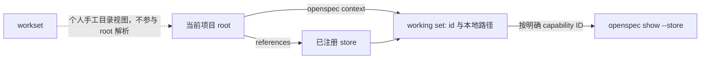

# 24 · 高级：Store（可选的跨仓库 OpenSpec 引用）

> **Store 是可选的跨仓库 OpenSpec 引用机制（适用 openspec ≥ 1.5，当前对齐 2.1.1）：声明哪些已 checkout 的 OpenSpec root 与当前项目相关，并给人或 agent 一个按需读取它们的入口。** 它不是多仓库协调层，也不是本地 main specs 变大后的默认解法；单仓库项目通常不需要它。
>
> **Root 解析总纲。** `defaultStore` 只是机器级低优先级兜底，不会覆盖已解析的本地 root，也不会让 referenced specs 自动内联或同步；specs artifact 指令显式返回 `planningHome.root`，agent 必须以它定位 main spec。

---

## 一、为什么需要 store

先做一个反向判断：下面这些情况**不该**先来本章。

| 你遇到的问题 | 先用什么 | 为什么不是 store |
|---|---|---|
| 一个仓库的 main specs 太多，agent 不知道该读哪份 | [26](26-高级-治理边界与漂移维护.md) 的 taxonomy、薄 catalog、候选 path discovery | store 不会替你挑本仓库相关 capability，也不自动注入正文 |
| 一个 change 跨身份、权限、事件等多个本地 domain | proposal/design 的 impact matrix | 这是一个 repo-local change 的范围判断，不是跨仓库规划 home |
| 想让一条 change 同时修改多个 repo | 各 repo 保持自己的 change，并用明确的跨 repo 协作/PR 纪律 | store 不创建跨 repo change，不管理依赖顺序或 archive |

只有当当前 repo 的 change 确实需要**发现另一个已 checkout repo 的正式 specs**，且人/agent 需要一个工作集与按需读取入口来找到它们时，store 才有价值。



这张图也划清了边界：`references:` 只声明已知 root，`context` 只报告工作集；真正读取哪份行为合同仍由人或 agent 根据当前 change 的 scope 决定。

产品需求同时砸在 API、Web、Mobile 三个 repo 上——每个 repo 各自的 spec-driven 流程管好自己的代码没问题，但 agent 在做 API 的 change 时，如果能看一眼 Web 和 Mobile 的 specs，方案会考虑得更周全。

在没有引入 store 时，OpenSpec 的所有操作都是 repo-local 的：

```text
my-project/
  openspec/
    specs/        ← 这个 repo 的正式规范
    changes/      ← 这个 repo 的进行中变更
    config.yaml   ← 这个 repo 的项目约束
```

store 模型给这套体系加了一层可选的能力：**让当前项目的 agent 知道还有哪些仓库的 specs 可以引用。**

## 二、store 不是什么

- **不是 monorepo** — store 不合并代码、不统一构建
- **不是 workspace 协调视图** — store 不创建新的规划 home，不管理 initiative
- **不是自动同步** — store 不 clone、不 pull、不自动更新 checkout
- **不是写操作** — store reference 只读，不会往 referenced repo 写任何东西

## 三、store 的物理结构

```text
<OpenSpec 全局数据目录>/stores/
  registry.yaml                 ← 全局 store 注册表

<store-checkout>/
  .openspec-store/
    store.yaml                  ← store 身份（id, remote）
  openspec/
    specs/                      ← store 自身的 specs（供其他项目 reference）

<OpenSpec 全局数据目录>/worksets/
  worksets.yaml                 ← 个人保存的多仓库打开视图
```

全局数据目录遵从 `XDG_DATA_HOME/openspec`；没有设置时，macOS/Linux 默认为 `~/.local/share/openspec`。它与机器级配置目录不是同一个位置，因此不应手工假定为 `~/.openspec/`。

项目通过 `openspec/config.yaml` 声明依赖：

```yaml
# openspec/config.yaml
references:
  - platform-api
  - shared-schemas
```

`openspec context` 输出当前 root 与引用 store 的工作集：已可用的本地路径、不可用引用的 clone 修复建议，以及可用 store 的按需读取命令。它**不列出或内联每份 spec，也不做相关性检索**；决定了目标 capability 后，使用输出中的 `openspec show <spec-id> --type spec --store <id>` 读取它。

## 四、核心命令

### store：注册与创建仓库

```bash
openspec store register /path/to/checkout --id platform-api          # 注册已有 checkout
openspec store setup platform-api --path /path/to/new                # 从零创建并注册（默认 git init + 首提）
openspec store setup platform-api --remote git@github.com:org/s.git  # 记录克隆源到 store.yaml
openspec store setup platform-api --no-init-git                      # 在已有 Git 仓库（如 dotfiles）内创建
openspec store list
openspec store unregister platform-api                               # 取消注册，保留本地文件
openspec store remove platform-api --yes                             # 取消注册并删除本地文件夹
```

几条关键边界：

- `register` 指向已有目录，不 clone、不 init；`setup` 创建新目录并同时注册。
- `setup --remote <url>` **只把克隆地址写入 `.openspec-store/store.yaml`**（供引用方在 `openspec context` / `doctor` 缺失提示里展示 clone 命令），**绝不会运行 `git remote add origin`**。如果目标目录已有 `.openspec-store/store.yaml`，传 `--remote` 会以 `store_remote_requires_hand_edit` 拒绝覆盖，要求手动编辑 `store.yaml` 并提交。
- `setup` 默认初始化 Git 仓库并生成首提，因此拒绝嵌套在已有 Git 仓库内；确实要在 dotfiles 等现有仓库里放 store 时显式传 `--no-init-git`。
- `unregister` 只忘掉注册表项，`remove` 连本地目录一起删除；但若目标目录下嵌套了其他已注册的 store，`store remove` 会直接拒绝并点名需要先 `openspec store unregister` 的子 store。
- 命名边界：即使把 store 放在推荐路径 `~/openspec/specs` 或 `~/openspec/changes`（即 store ID 叫 `specs` 或 `changes`），只要里面带有 `.openspec-store/store.yaml`，父目录判别器就不会把它误当成 `$HOME/openspec/` 的本地规划子目录。

### context：查看工作上下文

```bash
openspec context              # human
openspec context --json       # JSON
openspec context --code-workspace ./related-specs.code-workspace  # 写出 VS Code 多根文件
```

不带 `--code-workspace` 时，输出只是 working set：当前 root、`references:` 中声明的 store、本地路径和按需读取入口；它不列出 spec 索引，也不写文件。带该 flag 时会显式写出指定的 workspace 文件。

### workset：个人工作视图与护栏

```bash
openspec workset create my-session \
  --member app=. \
  --member platform-api=/path/to/platform-api \
  --tool code
openspec workset open my-session
openspec workset list
openspec workset remove my-session --yes
```

workset 是你手工选择的任意目录视图，不从 `references:` 推导，也不要求成员都是 store；第一个 `--member` 是主目录。它纯本地、不共享、不提交；状态保存在全局数据目录的 `worksets/worksets.yaml`。

两条安全护栏必须清楚：

- **CLI agent opener 默认关闭**：内置 opener 分 IDE 类 `workspace-file`（`code`、`cursor`，打开生成的 `.code-workspace`）和终端类 `attach-dirs`（`claude`、`codex`，以 `--add-dir` 挂载各目录）。因 CLI agent 在单一主目录启动时容易混淆变更落点，`claude` 与 `codex` opener **默认禁用**（报 `workset_cli_opener_disabled`），仅在设置环境变量 `OPENSPEC_ENABLE_CLI_AGENT_OPENERS=1` 时才启用。
- **`workset open` 不支持 `--json`**：`open` 会接管当前终端或拉起外部 IDE，传入 `openspec workset open <name> --json` 会直接返回 `workset_open_json_unsupported` 诊断并以非零退出。

### `openspec doctor` vs `openspec store doctor`

两条体检命令视角不同，都是纯只读检查（从不自动 clone、同步或改写文件）：

```bash
openspec doctor [--store <id>] [--json]
openspec store doctor [id] [--json]
```

| 命令 | 检查视角 | 具体查什么 |
|---|---|---|
| `openspec doctor` | **当前工作 root 的关系健康度** | 当前解析出的 root 是否完整、是否存在指针误配（如本地已有 `specs/`/`changes/` 却写了被忽略的 `store:`，或在 pointer 配置里写了不会生效的 `references:`），以及 `references:` 声明的各个上游 store 在本机是否可用、Git 远端是否漂移 |
| `openspec store doctor [id]` | **本机 store 注册表与仓库本体** | 遍历全部（或指定 `id`）已注册 store，核对注册表项、`.openspec-store/store.yaml` 身份一致性、`openspec/` 目录完整性，以及 Git 仓库是否有提交、未提交改动与 `origin` |

### Root 解析的完整 5 步优先级

`new change`、`status`、`instructions`、`list`、`show`、`validate`、`view`、`archive` 等常规命令统一按以下 **5 步顺序**解析唯一生效的 OpenSpec root（传已废弃的 `--store-path` 会直接报 `store_path_not_supported`）：

1. **显式 `--store <id>`**（`source: "store"`）：直接选中该已注册 store 的 root，优先级最高。
2. **最近祖先中的合格 `openspec/` 目录**：
   - 若含有真实的 `specs/` 或 `changes/` 规划目录，本地 root 直接胜出（`source: "nearest"`）；即使该目录的 `config.yaml` 同时写了 `store:`，也会被忽略并在 `stderr` 打警告。
   - 若只是不含 `specs/`、`changes/` 的 config-only 指针目录且声明了合法 `store: <id>`，则解析到该已注册 store（`source: "declared"`）。
3. **机器级全局 `defaultStore`**（`source: "global_default"`）：仅当前两步均未命中时，作为本机低优先级兜底查询全局配置中的 `defaultStore`。
4. **已注册 store 候选提示（报错不自动选）**：无本地 root 且无 `defaultStore`、但本机注册表非空时，抛出 `no_root_with_registered_stores`。若当前仓库 Git `origin` 的仓库名（转 kebab-case 后）恰好匹配某个已注册 store ID，错误信息会点名该候选并给出 `--store <id>` 与 `store: <id>` 两种选中写法——但**绝不按名字自动选中**，因为不同组织的仓库完全可能重名。
5. **隐式当前目录或无 root 报错**：本机未注册任何 store 时，允许隐式 root 的命令回退到当前目录（`source: "implicit"`）；`doctor` 及批量 `validate --all/--changes/--specs` 等要求真实 root 的命令则报 `no_openspec_root` 退出 1。

用 `view` 可以直观验证当前到底落在了哪个 root：

```bash
openspec view                     # 按上述 5 步解析出的当前 root 查看
openspec view --store platform-api # 显式查看指定 store
```

当“我明明改了 config，为什么 instructions / view 看到的不是它”时，先确认 root，而不是先往 `context` 追加内容：

| 情形 | 优先相信什么 | 下一步 |
|---|---|---|
| 项目内存在带 `specs/` 或 `changes/` 的 `openspec/` | 项目的 local root（`nearest`） | 检查该 root 的 `config.yaml` / `references:` |
| 项目只是 config-only pointer 或没有 local planning shape | 已声明的 `store:` 或全局 `defaultStore` | 用 `doctor` 或 `view --store <id>` 显式核对 |
| 想看其他仓库的行为合同 | 被引用 store 的 main specs | `context` 取得 store id/路径，再 `show <spec-id> --type spec --store <id>` 按需读取 |

无论最后解析到哪一个 root，store 都仍是发现与只读引用机制：它不会把远端 main specs 自动内联进本次 proposal、不会替你创建跨仓库 change，也不会替你决定哪些 capability 相关。

### `store:` pointer 仓库的严格边界、装技能与编辑范围

`openspec/config.yaml` 里的 `store:` 不是“把本地 config 和远端 config 合并”的开关。它只有在当前 `openspec/` 是**config-only** 目录、没有 `specs/` 和 `changes/` planning shape 时，才作为 pointer 选择已注册 store。pointer 目录里的 `context`、`rules`、`references` 等不会成为被选中项目的有效 guidance——真正的项目配置必须写在最终被解析为 planning root 的 store 里。

遇到“我改了 config，instructions 为什么没变化”时，先按这四步排：

1. 确定最终生效的 planning root，而不是只看当前工作目录。
2. 同一 root 同时存在 `config.yaml` 与 `config.yml` 时，确认改的是优先的 `.yaml`。
3. 用代表性 change 运行 `openspec instructions <artifact-id> --change <change> --json`，确认 context/rules 是否出现。
4. 需要 operation guidance 时，再分别检查 `instructions apply` / `instructions archive`；不要期待 artifact rules 自动进入这两个 operation。

如果代码仓库采用这种 config-only pointer 模式（规划放在独立 store，代码留在当前仓库），日常有两件配套能力直接可用：

- **在 pointer 仓库根目录运行 `openspec init` 安装技能**：在代码仓库 root（子目录运行会被拒绝）执行 `openspec init --tools claude`，CLI 会原样保留本地 `openspec/config.yaml`（含 `store:` 行），**不会**在本地创建 `openspec/specs/` 或 `openspec/changes/`（同时拒绝通过 `--language` 跨指针改写远端 store）。它只安装 AI 工具的 **skills**（无命令文件），且遵循 2.1 作用域规则：**默认安装到本机 `global` 全局目录**（`~/.agents/skills/` 及各工具全局目录）；若需把 `.agents/skills/` 与工具链接写进当前代码仓库，显式加上 `--scope project`。
- **store-only 场景下 apply 的编辑范围（`allowedEditRoots`）**：当 change 位于 store、且当前代码仓库通过 `store:` 声明了该 store 时，`openspec status --change <name> --store <id> --json` 的 `actionContext.allowedEditRoots` 会同时列出 `[声明项目的 root, store root]`，提示实现代码落回声明项目、跨其他仓库前先询问用户；若无法确定实现仓库，则仅含 `store root` 并要求先向用户确认。

### MODIFIED delta：不要把 cwd 当成 main-spec root

当 change 存放在 store 中时，当前 shell 所在的代码仓库与 main spec 所在的 planning root 往往不同，agent 必须以 `instructions` 返回的 `planningHome.root` 定位主 spec：

```text
错误：<当前工作目录>/openspec/specs/identity/session/spec.md
正确：<instructions JSON 的 planningHome.root>/openspec/specs/identity/session/spec.md
```

`<planningHome.root>` 是说明用占位符，不是可直接复制进 shell 的字面目录。排错时先读取 JSON：

```bash
openspec instructions specs --change add-session-expiry --store platform-api --json
```

然后依次检查：

1. `planningHome.root` 是否是预期 store checkout。
2. `changeRoot` 是否也位于该 planning home 的 `openspec/changes/` 下。
3. 用 JSON 中的真实 `planningHome.root` 拼出 `openspec/specs/<capability-path>/spec.md`。
4. 对 MODIFIED，先从这个文件复制完整 requirement（含全部 scenarios），再编辑 delta。

例如 JSON 返回 `"planningHome":{"root":"/srv/stores/platform-api",...}`，目标就是：

```text
/srv/stores/platform-api/openspec/specs/identity/session/spec.md
```

不要回退到当前 repo 的 `./openspec/specs/...`，也不要因此声称 CLI 已自动选择了“相关” capability：root resolution 只回答**去哪个 OpenSpec root 读**，catalog/`list --specs`/`show` 与 change scope 仍负责回答**读哪份 spec**。

## 五、设计原则

### 5.1 上下文引用，不创建新规划层

| 做什么 | 不做什么 |
|--------|---------|
| 让 agent 看到 referenced store 的工作集、路径和按需读取入口 | 不内联 specs、不自动 merge |
| 通过 `references:` 声明依赖 | 不创建跨仓库的 change |

store 不引入新的 schema、不改变 change 的生命周期。所有 change 仍在具体 repo 下，使用 `spec-driven`。

### 5.2 单仓库不需要 store

```text
单仓库项目：
  openspec/specs/ + openspec/changes/ → 完全够用

多仓库项目：
  openspec/specs/ + openspec/changes/ + references: [other-store] → 多一层上下文
```

store 是可选扩展，不是必选项。

### 5.3 个人视图 vs 共享声明

| 类型 | 位置 | 例子 |
|------|------|------|
| 全局注册 | `<全局数据目录>/stores/registry.yaml` | store 注册（每台机器独立） |
| 项目声明 | `openspec/config.yaml` `references:` | 项目依赖哪些 store（可提交到 Git） |
| 个人视图 | `<全局数据目录>/worksets/worksets.yaml` | 多仓库打开视图（纯本地，不共享） |

## 六、与单仓库 OpenSpec 的对比

| | 单仓库 | 多仓库（store） |
|---|---|---|
| Schema | `spec-driven` | `spec-driven`（不变） |
| Change 位置 | `openspec/changes/` | 同左 |
| Specs 位置 | `openspec/specs/`（正式基线） | 同左 |
| Archive | 有 | 有（不变） |
| 跨仓库上下文 | 无 | `references:` + `openspec context` |

store 不改变核心流程——它只是在 agent 探索时多了一个「可以去看看其他仓库的 specs」的渠道。

## 七、作用范围与限制

- Workset 是纯本地的，不支持团队共享
- Store remote 是可选字段，不保证 clone 可用性
- 不提供 store 间的依赖解析

## 八、什么时候该用 store

| 场景 | 建议 |
|------|------|
| 单个仓库 | 不需要 store |
| 2-3 个关联仓库，某次 change 需要发现另一个 repo 的正式 spec | 可以注册 store + 加 references；先看索引，再按需读取 |
| 3+ 仓库且 specs 互有引用 | store 可作为跨 repo **发现索引**；每个 repo 的 change、review、archive 仍各自进行 |

不要因为“仓库多”或“spec 多”自动启用它。store 的收益来自已有 checkout 之间的明确引用；它不会减少本地 capability 的建模成本，也不会取代本章开头列出的 catalog、impact matrix 或团队协作纪律。

### 替代方案对比：只想在本机挪目录位置，用 symlink 而不是 store

store 是“引用另一个已 checkout 仓库的 specs”的正式机制，需要在目标目录建立 `.openspec-store/store.yaml` 并注册。如果只是想**把当前项目的 `openspec/`、`changes/`、`specs/` 或某份 `spec.md` 物理放在别处**，可以直接使用符号链接，但必须遵守目录级与文件级的不同边界：

| 可以链接 | 不可以链接 |
|---|---|
| `openspec/` 本身、`openspec/changes/`、`openspec/specs/` 顶层目录（父目录须在受管范围内，链接目标须存在，可指向项目外） | `changes/archive/`（必须真实位于所属 `changes/` 目录内，不得逃逸）以及单个活跃 `changes/<name>/` 目录（`archive` 会以 `archive_change_symlink` 拒绝） |
| 单个文件 `specs/<capability>/spec.md`，可做成指向**项目内**任意既有文件的符号链接 | `specs/<capability>/` 子目录做成符号链接（递归发现器 `discoverSpecFiles` 不穿透符号链接子目录，该 capability 会被跳过），以及指向项目外的 `spec.md` 链接或悬空链接 |

写侧在写入前后各校验一次 canonical path，若链接在写前被换向会直接拒绝，不会写到未校验的文件。

和 store 的分工：**store 是跨仓库的 spec 发现与只读引用**，symlink 只是**单项目内的物理摆放**——它不带来 `store list` 索引、不展开 `references:`、也不让别的仓库发现你。多人协作时注意：若顶层 `specs/` 链接到了仓库外部目录，队友 clone 下来就是断链，通常只适合个人开发机或团队统一挂载的目录布局。

## 压缩结论

1. Store 是可选的跨仓库 spec **发现与只读引用机制**，不是本地 spec 扩容方案、自动检索器或多仓协调层。
2. Root 解析严格按 **5 步顺序**执行：`--store <id>` → 最近合格 `openspec/`（含本地规划目录优先，config-only `store:` 指针次之）→ 全局 `defaultStore` → 已注册 store 提示（匹配 `origin` 仓库名时点名建议但绝不自动选中）→ 隐式 root / 报错。
3. `store setup --remote <url>` 只写 `.openspec-store/store.yaml`，绝不改 Git remote（已有 `store.yaml` 时报 `store_remote_requires_hand_edit`）；`doctor` 查当前 root 关系链，`store doctor` 查本机注册表与 store 本体。
4. Workset 是纯本地个人目录视图：`open` 不支持 `--json`（`workset_open_json_unsupported`），`claude`/`codex` 等 CLI agent opener 默认关闭（需 `OPENSPEC_ENABLE_CLI_AGENT_OPENERS=1`）。
5. config-only pointer 仓库可在根目录跑 `openspec init` 安装 skills（默认装入本机 `global` 目录，传 `--scope project` 才写入当前仓库），本地 `store:` 配置原样保留，planning 仍留在 store。
