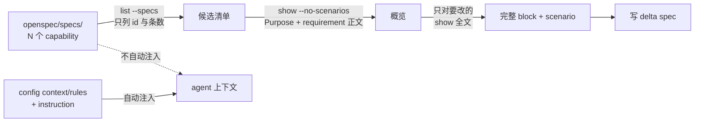
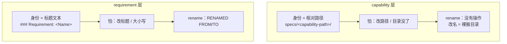
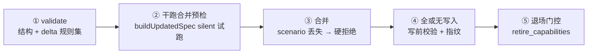

# 09 · 高级：治理边界与漂移维护

> **高级篇**（当前行为基线以 [`_digested/README.md`](../_digested/README.md) 的「当前源码基线」为准，本章用现在时描述当前行为）。这一章按五层递进回答一个问题：**OpenSpec 到底强制什么、只是建议什么**？→ **agent 每次到底看到多少东西**？→ **specs 靠什么组织和定位**？→ **机器在归档那一刻挡住哪些漂移**？→ **挡不住的那些，你怎么守**？
> **v1.13.0 漂移巡检提示。** delta parser 大修后，`*`/`+` 列表标记的 REMOVED/RENAMED 现在真正生效、重复 delta section 全部应用、仅大小写不同的 requirement 名被 archive 拒绝。历史 change 中若有曾"静默没生效"的操作，升级后重跑 validate 可以暴露出来。

## 先回答：为什么"它到底管不管"比"它怎么设计"更重要

很多人读到这里，脑子里已经装了一套很整齐的机制：`config.yaml` 是项目宪法、`specs/` 是事实层、`validate` 是检查、`archive` 是合并。**于是默认"我写错了工具会拦住我"。这个默认是错的，而且代价不小。**

先看一个后果：你在 `config.yaml` 的 `context:` 里贴了整份架构文档，指望 agent 每次都读到。它超了 50 KB——**CLI 不会截断它，而是整段丢弃，只在 stderr 打一行警告**。你以为的"项目常识已注入"，实际是"什么都没注入"，而 `validate` 干干净净、`archive` 一路绿灯。

再看一个：你在 proposal 里写了一句"本 change 必须遵守既有授权模型"。这句话在 `rules.proposal` 里是**强规则**（每次注入），在 `proposal.md` 的散文里就只是**文本**——没有任何工具会拿它去和后续 artifacts 对账。

**本章的第一条论点：OpenSpec 的能力分成两层——机器判定的一层和写给模型看的一层。分不清这两层，你会系统性地高估它的保护力度。**

## 硬能力与软能力：读这套手册的分析轴

两层的差别不在"是否随包下发"（都下发），而在**违反时会发生什么**：

| | 硬能力 | 软能力 |
|---|---|---|
| **本质** | 代码判定 | prompt 文字（schema instruction、workflow 模板） |
| **含什么** | `validate` 规则集、scenario 丢失双闸、archive 合并硬拒绝、全或无写入、50 KB 预算、rules 键对账、artifact DAG 门控 | `update` 的双向一致性复核、`apply` 的范围漂移守卫、`explore` 禁写代码、`verify` 三维检查、`propose` 的 re-read-from-disk |
| **违反后** | exit 1 / 拒绝合并 / 丢弃字段 | **什么都不会发生** |
| **可靠性** | 你无法绕过，也不依赖模型是否听话 | 模型不听话或上下文被压缩时，静默失效 |

这条轴解释了本章后面所有"为什么它能守住 / 为什么它守不住"的判断。**一个经验法则：凡是"纪律"性质的规则，先去代码里确认它是不是硬的；不是硬的，就自己加一道外部检查。**

## agent 每次到底看到多少

漂移的第一个来源是**信息不对称**：你以为 agent 看到了什么，和它实际拿到了什么，往往不是一回事。

### 注入的是导航简报，不是 spec 正文

把一个 change 的 specs artifact 指令拉出来看（`openspec instructions specs --change <name> --json`），agent 实际拿到的字段是：

| 字段 | 内容 |
|---|---|
| `instruction` | 该 artifact 的写作指令（来自 schema） |
| `template` | 模板 |
| `context` | `config.yaml` 的 `context:` 全文 |
| `rules` | `config.yaml` 里**本 artifact 对应**的 rules |
| `contextFiles` | **本 change 各 artifact 的绝对路径**（不是内容） |
| `dependencies` / `unlocks` | 上游 artifact 及完成状态 / 本 artifact 解锁谁 |
| `existingOutputPaths` | 已存在的产出文件（防重写） |
| `planningHome` | 解析后的 OpenSpec root（store 场景下不是当前仓库） |
| `state` / `missingPrerequisites` | 门控状态 |

关键在 `contextFiles`：**它只指本 change 目录下的文件，完全不指 `openspec/specs/`。**

```text
contextFiles = {
  "proposal": ["…/changes/<name>/proposal.md"],
  "specs":    ["…/changes/<name>/specs/<capability-path>/spec.md"],
  "tasks":    ["…/changes/<name>/tasks.md"]
}
```

所以**注入体的大小与 `openspec/specs/` 的规模无关**：main specs 堆到几百 KB，每次注入还是那几 KB（实测这一项约 9 KB，其中写作指令本身占了大头）。main specs 是 agent **按需去取**的，不是自动灌进来的。

> **实操含义**：agent 不会"自动知道"项目现在有什么 capability。它得先盘点、再按需读——这正是下一节那套读法的用途。

### 分级过滤读：把"取多少"变成你的决定

| 层级 | 命令 | 用途 |
|---|---|---|
| 全库盘点 | `openspec list --specs --json` | 拿到所有 capability 的 id 与 requirement 数（实测约 2.7 KB，与 spec 正文长度无关） |
| 过滤读 | `openspec show <path> --type spec --json --no-scenarios` | 只要 Purpose 与 requirement 正文，丢掉 scenario（实测可省约 80%） |
| 单条直取 | `openspec show <path> --type spec --json -r <n>` | 按 1-based 序号只取一条 requirement |
| 全文 | `openspec show <path> --type spec` | 要 MODIFIED/REMOVED/RENAMED 时才读 |

schema 原文对这条纪律说得很直白：

> The filtered read is only an overview. Before deciding what is already covered or what should change, **read each relevant spec in full, including scenarios**.

**注意这句是软能力**——它写在 instruction 里，不是强制。你（或你的 agent）跳过全文读、直接凭 `--no-scenarios` 的概览写 MODIFIED，工具不会拦你；它会等到 archive 那一刻，用 scenario 丢失检查来拦（见后文）。

### 50 KB：唯一的字节闸门

`config.yaml` 的 `context:` 有 50 KB 上限，**超限是整段丢弃而非截断**——设计意图是"它每次请求都注入，宁可没有也不要半个"。跨仓 references 的索引共享同一个额度，超限时按二分查找截断，并在诊断里告诉你用 `openspec list --specs --store <id>` 去列剩余部分。

这是**硬能力**：超了就是没有。所以 `context:` 要写"高杠杆、可判断、长期稳定"的内容（06 展开过），而不是把文档搬进来。

### `rules` 按 artifact 分流

`config.yaml` 的 `rules:` 是 **map，键是 artifact id**，每个 artifact 只拿到自己那一份：

```yaml
rules:
  proposal:
    - 新 capability 的 path 必须先在 specs/ 下确认不存在近义项
  specs:
    - 涉及路径的 requirement 必须写跨平台行为
  tasks:
    - 涉及文件路径的 change 必须包含 Windows CI 验证任务
```

`proposal` 拿不到 `specs` 的规则，反之亦然。这样"项目长期纪律"能沉淀进 config 而不必每次在对话里重讲，也不会把无关约束灌给每个 artifact。键写错（没有 schema 声明这个 artifact id）会 warning 并列出合法 id——不会静默失效。

### 结构约束是硬的，但"新鲜度"没有

artifact 依赖是 DAG，`openspec status` 会给出每个 artifact 的 `status`（`done`/`skipped`/`ready`/`blocked`）、`requires`、`missingDeps` 与 `unlocks`，`nextSteps` 直接告诉你下一个该写哪个。依赖是**使能器不是闸门**：`specs` 和 `design` 都只依赖 `proposal`，可以并行，改一个也不会连锁重锁另一个。

**但有一条必须说清：`status` 判的是"文件在不在"，不是"还算不算数"。** 它按文件存在性判定；把 `tasks.md` 提前写出来，`tasks` 就显示 `done`，哪怕 `specs` 从未写过。更麻烦的是：**你改了 `proposal.md`，`tasks.md` 不会因此被标记为陈旧**——没有任何机制做这件事。



> **所以"改了上游要不要回头改下游"这件事，工具不会提醒你。** 这是 `update` 这个 workflow 存在的理由：它做的就是"把现有 artifacts 互相对一遍、找矛盾、找缺口、找重复"——但它是**软能力**，靠你主动触发、靠模型执行。

## capability 的身份 = 它的相对路径

很多人把 `openspec/specs/` 笼统当成"spec 基线"。但它不是一堆平铺的文档：v1.8.0（v1.7.0 起）会递归发现任意深度的 `spec.md`，并按 capability 切分目录：

```text
openspec/specs/
├── auth/spec.md                    ← ID = "auth"
├── identity/
│   ├── login/spec.md               ← ID = "identity/login"
│   └── session/spec.md             ← ID = "identity/session"
└── data-export/spec.md
```

**一个 capability 的身份，就是它在 `specs/` 下的相对目录路径**（`auth`、`identity/session`）。路径同时承担四个角色：

| 角色 | 说明 |
|------|------|
| **组织单位** | main specs = 一组 `specs/<capability-path>/spec.md`，按行为合同切分管理 |
| **proposal↔specs 的契约** | proposal 列的每个 capability path，specs 阶段生成同路径 `specs/<path>/spec.md`；默认文案仍偏 flat，团队采用 nested layout 时应明确约定 |
| **delta 的靶心** | delta 写在 `changes/<id>/specs/<path>/spec.md`，archive 时打 `openspec/specs/<path>/spec.md`——**相对路径相同才命中** |
| **没有别的身份** | capability **没有稳定 ID**，就靠这个相对路径维系 |

目录层次只是一种命名空间，不带父子继承、自动聚合或依赖推导；`identity` 和 `identity/session` 是两个独立 capability。archive 能把 delta 合并进主 spec，靠的就是**相对路径寻址**——不是魔法，是契约。这也意味着：**改一个 capability path，是个大事**（见下文）。

### 先把 capability 切对：它是行为合同，不是代码文件夹

一个 capability 最实用的定义是：**它能独立说明用途、独立承受行为变化，并由一组 requirements/scenarios 独立验证。** 这一规定故意不按源文件、数据库表、页面或团队分工来切——一份真正的行为合同经常横跨这些实现层。

| 候选切法 | 应问的问题 | 判断 |
|---|---|---|
| 按 UI 页面或 `src/` 目录 | 这个实现位置改变时，用户合同一定独立吗？ | 通常不是；别把实现结构直接当 taxonomy |
| 一个新的用户/调用方行为 | 它能否有自己的 scenario、失败路径和演进节奏？ | 是，适合独立 capability |
| 两组 requirement | 它们是否总要同改、同测、同读才能解释？ | 是，先留在同一 capability，别为树形漂亮而碎片化 |
| 新 adapter、换库、纯重构 | 可观察行为是否没有变？ | 通常不是新 capability；必要时用 `skip_specs: true` |

推荐从**一层 domain + 一层 capability**开始：

```text
identity/login
identity/session
billing/invoices
data-export
```

只有第三层本身也长期稳定、并能帮助未来读者导航时才继续加深，例如 `platform/observability/audit-events`。segment 用语义明确的 kebab-case；避免 `common`、`misc`、`utils`、`core` 这类"边界没想清楚"的垃圾桶名。domain 只承担命名和 discovery，不是父合同。

在建新 path 前，先搜索既有 path、Purpose 和 requirement 标题。能修改已有行为合同，就不要创建近义 capability；只有确有独立合同与独立演进节奏时才新建。新 capability 的 delta 请写可读的 `## Purpose`，v1.8.0（v1.7.0 起）在 archive 创建 main spec 时会把它带入，而不是一律写成 `TBD`。

> 以 BuildFlow 为例——你已经有了 `inspection/requests`（报验申请）和 `inspection/approvals`（审批），现在要做"整改通知单"。它有自己的生命周期、自己的失败路径（超期未整改）、自己的查询场景，所以是**新 capability** `inspection/rectifications`；但如果它只是给审批加一个字段，就该 MODIFIED `inspection/approvals`，不该新建。

### specs 很多以后：catalog 帮你找，main spec 才能定

recursive discovery 让 OpenSpec 能识别任意深度的 `spec.md`，却**不会**自动完成"找相关 spec → 读够上下文 → 记录选择理由"这条链。不要把所有 main specs 塞进 prompt，也不要把完整 requirements 复制到 `config.context`。

项目可在 `openspec/specs/README.md` 或独立文档保留一张薄 catalog：

```markdown
| path | Purpose | keywords | boundary / neighbor |
|---|---|---|---|
| identity/session | 建立、刷新、失效用户会话 | JWT, refresh, expiry | 不负责授权策略；相邻 identity/login |
| billing/invoices | 创建、投递、查询发票 | invoice, tax, PDF | 不负责订阅扣款 |
```

catalog 只能导航，不能成为第二份行为规范；任何冲突都以 main spec 为准。一个局部 change 的最小 discovery 协议是：

1. 先读短小项目 context，知道全局不能破坏什么。
2. 读 catalog 或运行 `openspec list --specs --json`，列出候选 path，而不是把正文全读进来。
3. 用用户意图、关键术语和代码调查缩小候选；在 proposal 中标记每个 path 是 New、Modified、verify only 还是排除，并写一句理由。
4. 用 `openspec show <path> --type spec --json --requirements` 先看 requirement 标题；只有要 MODIFIED/REMOVED/RENAMED 时才读完整 block 与 scenarios。
5. delta 使用 proposal 中声明的**同一完整相对 path**；不确定边界就回 Explore，不要临时发明近义名称。

这是一条项目治理协议，而非 v1.8.0（v1.7.0 起）已自动保证的 retrieval 功能。把 path convention、catalog 位置和这几个步骤写进项目 `AGENTS.md` 或 `rules.proposal`；只把跨所有 change 都成立的短原则留在 config。详细模板见 [`_digested/spec-driven-capability/capability-governance-template.md`](../_digested/spec-driven-capability/capability-governance-template.md)。

### 两层「以名字为身份」模型（无稳定 ID）

OpenSpec 的身份模型是**「以名字为身份」（name-as-identity），分两层，都没有稳定 ID**：



两个推论，直接关系到 specs 会不会漂：

1. **都怕改名，且没有 ID 兜底。** 传统系统里改个名字，ID 不变，引用不断链。OpenSpec **没有 ID**——名字一改，所有指向旧名字的引用全部失配，而且**没有任何工具告诉你断了**。
2. **capability 比 requirement 更脆。** requirement 至少有 `RENAMED` 操作（`FROM: ### Requirement: 旧` / `TO: ### Requirement: 新`），改名是个一等动作；**capability 没有任何 rename 操作**——改 capability path 只能靠你手动搬目录，然后所有指向旧路径的 delta 默默变成"悬空目标"。

> 一句话：**requirement 改名有"正规手续"（RENAMED）；capability 改名没有手续，是裸操作。** 所以完整 capability 相对 path 要当**稳定性契约**对待——能不改就不改。

## 这就是 specs 漂移的根源

`openspec/specs/` 号称 source of truth，但用着用着就和代码对不上了。根因就是上面这套身份模型 + 一个事实：**没有任何工具持续对账**（`validate` 只做结构检查、不做跨文件对账——v1.8.0 起仅在 `validate <change>` 对 MODIFIED 块做 scenario-loss 前置检测时读主 spec，v1.9.0 起任何 `####` 子标题都算；`archive` 只在那一刻匹配一次）。

漂移，就是**两层"名字身份"失配**：

- **capability 层失配**：delta 指向的 capability 相对路径，在 `openspec/specs/` 里对不上——要么"设计了没建"、要么"路径改名了"、要么"早删了"。**表现：archive 一个 change 时，目标 spec 不存在或对不上；或一堆 change 悬空挂在 active。**
- **requirement 层失配**：delta 的 `MODIFIED`/`REMOVED` 指向的标题，在当前主 spec 里找不到——标题被别的 archive 改写过、大小写变了、或手改过。**表现：archive 报 `... not found`，整批在 mutation 前中止。**

两层是**同一个病**（名字身份失配），只是发生在不同层。再加上"有代码无 spec"（反向漂移：capability 上线了 specs 没记）、"废弃 change 仍挂 active"（噪声）等，specs 就慢慢配不上"source of truth"这个名号了——而 agent 还把它当事实读，于是被带偏。

更要命的是**漂移会复利**：脏的 specs 让 agent 产出更不准的 change，archive 回去又把更不准的"事实"焊进真相——一轮比一轮偏。

## 归档那一刻：五道机器闸门

漂移的最终出口是 archive。**OpenSpec 的全部硬能力都收敛在这里。** 值得逐道看清哪道挡什么：



### ① `validate` 的规则集

**ERROR（默认就失败）**：requirement 名在同一文件内重复；主 spec 里出现 delta 头；requirement 落在 `## Requirements` 之外；requirement 无正文；零 scenario；**MODIFIED 丢了主 spec 仍有的 scenario**；跨节声明冲突（MODIFIED+REMOVED / MODIFIED+ADDED / ADDED+REMOVED）；`FROM`/`TO` 不配对；`specs/` 根下放 delta `spec.md`；非 `spec.md` 里写 delta 段；`skip_specs` marker 与 `specs/` 下有文件冲突；零 delta（除非 `skip_specs`）。

**WARNING（只有 `--strict` 才失败）**：requirement 正文超长（>500 字符）；正文缺 `SHALL`/`MUST`；Purpose 是占位符；Purpose 过短；未知元数据键。

`--strict` 的语义是"WARNING 也算失败"。**而 archive 内部用的是非严格校验器**——所以 WARNING 永远不挡归档。这就是"`validate --all` 干净不等于能安全 archive"的原因。

### ② scenario 丢失：全库最硬的一道

`MODIFIED` requirement 是**整块替换**。漏抄主 spec 里的 scenario，它就永久消失。所以设了两道：

| 时机 | 行为 |
|---|---|
| 写作期 `validate` | **ERROR 级**，直接失败：`MODIFIED "X" omits scenario(s) the current spec still has: … Copy the omitted scenarios into the MODIFIED block (a MODIFIED requirement replaces the whole block, so archive refuses to drop them).` |
| 归档期 `archive` | **硬抛错拒绝合并**：`… current spec contains scenario(s) not present in the modified block … Refresh the change spec before archiving to avoid dropping scenarios.` |

两侧共用同一个判定函数，所以不可能给出不一致的结论；而且它是**多重集感知**的——同名 scenario 出现 2 次 vs 1 次也会被算出来，不会因为"名字出现过"就放过。

**这道闸门直接命中"隔一阵子回来、主 spec 已经往前走"的场景**：你手里陈旧的 delta 想合并，工具不让你静默覆盖，它让你先 refresh。

### ③ 干跑合并预检（免费）

`validate` 会对每个 delta **真的试跑一次**合并构建，失败就报 `Archive would refuse this delta: ...`。它是 **INFO 级、不阻塞**——因为"目标不存在"可能只是笔误，也可能是兄弟 change 还没归档。**这是你"离开一阵子"最该看的一行输出。**

### ④ 全或无写入

每个重建的 spec 在**任何文件被写之前**先过校验；零计数的合并**跳过写入**（避免把归一化差异搅进文件）；输入做指纹。**不可能半应用，也不会覆盖并发编辑。**

### ⑤ 退场门控

capability 的唯一退场通道：delta 的 REMOVED 拿走最后一条 requirement 时，archive **删除该 capability 的主 spec**——但必须由作者显式声明：

```yaml
# changes/<name>/.openspec.yaml
retire_capabilities: true
```

理由很明确：删除无法从工作树恢复、只能从 git 恢复，**所以这是作者的判断，不是从 delta 形状推断的**。还需通过校验器 oracle（唯一 error 必须是"spec 至少要有一条 requirement"）+ 全文件未归属内容否决。

## 方向漂移：它没有概念，但你可以自己造

上面五道闸门判的是"**这一次归档是否正确**"。它们管不到一件更早的事：**这条 change 的方向，和上一个月的方向，还是同一个吗？**

### 缺口：跨 change 什么都没有

- **没有跨 change 依赖与重叠检测**。同一批 active change 里，多个同时改同一个 capability 是常见状态，而 `validate --all` 不会就此说一个字。
- **重叠冲突只在 archive 那一刻以 git 冲突的形式浮现**。团队文档的说法很直白：两个 change 都改同一条 requirement，第二个 archive 时会在主 spec 上冲突——"这是 git 在告诉你两个 change 对系统行为有分歧"。
- **近似重复的 capability 零检测**。所有重复检查都只在一个文件内。更危险的是：**ADDED-only 的 delta 写错 capability 路径，会静默新建一个 capability**，连"你是不是想写 X"都没有。
- **三个静默 no-op**：REMOVED 一个不存在的名字（仅 warning，exit 0）；RENAMED 已同步（无警告）；ADDED 与现有块完全相同（无警告）。**陈旧的 delta 看起来和成功一样。**
- **没有陈旧、废弃、TTL、墓碑**。删除一个 capability 后，`openspec/specs/` 里没有任何记录说明它曾存在——只能靠 git 历史。

### 出路：用自定义 schema 把"方向"变成硬前置

08 讲过 fork schema、增删 artifact（Level 3）。**把它用在"方向"上，就能给方向建一道机器门控**——这是内置能力里唯一的路：

```yaml
# openspec/schemas/<name>/schema.yaml（节选）
artifacts:
  - id: direction
    generates: direction.md
    description: Locked direction this change must stay consistent with
    requires: []                       # 起点，先于一切
  - id: proposal
    generates: proposal.md
    requires:
      - direction                      # 方向成为 proposal 的硬前置
```

效果是实的：`proposal` 在 `direction.md` 存在之前**根本写不出来**——

```text
[ ] direction
[-] proposal (blocked by: direction)
[-] tasks    (blocked by: proposal)
```

`status --json` 会给出 `missingDeps: ["direction"]`，`instructions proposal` 会把 `direction` 作为 `dependencies` 注入，`nextSteps` 也先指向它。schema 落在 `openspec/schemas/<name>/`，**随 git 提交、团队共享**。

**但边界必须说清：门控的是「存在」，不是「一致」。** 写一个只有 `# Direction` 一行的空 `direction.md`，`openspec validate` 照样回 `Change '...' is valid`——**validate 根本不读非 spec 的自定义 artifact**。所以这条路能保证"你先写下了方向、再写提案"，**不能**保证"提案与方向不矛盾"，也**不能**跨 change。

> **一句话取舍**：想要"方向必须先落纸"这道纪律，用自定义 schema，是硬能力；想要"提案不许和方向矛盾"，自带能力里没有，只能靠人 review 或另加外部检查。

## 平时怎么守住（handbook 通俗版）

不必背一堆手段，记住几条就够：

- **做完一个 change 就 `archive`，别让它卡在 active 状态。** specs 只在 archive 那一刻更新；不 archive，specs 永远停在旧版本。
- **requirement 改名走 `RENAMED`**，别"删旧 + 加新"（那会掐断历史，让老 delta 失配）。
- **capability path 尽量别改。** 没有正规 rename 操作，改路径 = 裸搬目录，要同步所有引用它的 delta——当稳定性契约对待。
- **apply 改代码时，顺手想一句"这段 spec 还准吗"。** 这是最廉价的对齐动作。
- **归档前跑 `validate --strict`，并读一次 INFO 里的 `Archive would refuse this delta`。** 后者是免费的合并预检，专抓"主 spec 已被别的 change 改动"。
- **偶尔巡检**：`openspec list` / `openspec validate --all` 能抓结构坏死（僵尸 change）；但**别把"validate 干净"当成"specs 对齐"**——它查不出 capability/requirement 的名字失配和 specs↔代码漂移。
- **别手改主 spec 文件**。要改就写 change（delta）再 archive；手改没有任何工具追踪，下次 delta 一撞就 `not found`。
- **多个 change 同时改一个 capability 时，自己列一张重叠表。** 这是自带能力之外的工作——没有命令会替你查。

### 退役前先证明“可干净合并”

删除最后一个 requirement 不等于整个文件只剩可安全删除的标准结构。退役 review 至少检查：

1. 所有 REMOVED requirement 都能精确命中最新 main spec。
2. main spec 没有 `## Notes`、orphan paragraph、非 canonical section 或残留 `###` heading。
3. 其他 active change 没有继续 MODIFIED 这个 capability。
4. 清理后才在合法 `.openspec.yaml` 声明 `retire_capabilities: true`。

若有未归属内容，archive 会列出 blocking lines 并拒绝删除；marker 此时不是出路。把仍有价值的治理信息迁入 `## Purpose` 或 canonical requirement，或者经 review 手工删除，再重跑 archive。详细反例与修复步骤见 [12](52-实战-如何正确修改-artifacts.md)。

### sync 失败不归档：archive 现在替你把住半途状态

archive 流程里最坏的一种结局不是失败，而是"半途"：main specs 没更新，change 却已经进了 archive。v1.14.0 起 archive 工作流把这条线焊死了：

- **sync 阶段报任何 stop/blocking 一律视为 sync 失败，立即停止归档**——不做 post-sync 内容比对、不移动 `changeRoot`，change 和 main specs 一切保持原样；你修好 delta 后重跑 archive 即可，不需要手工回滚。
- **sync 后有结构验证**：主 spec 不得残留 `## ADDED/MODIFIED/REMOVED/RENAMED Requirements` 这类 delta 段；REMOVED 的 requirement 必须确已删掉；最后一个 requirement 被移除、`## Requirements` 变空的 capability，其主 spec 会被**删除而不是留一个空壳**（与上面的 `retire_capabilities` 授权路径衔接）。
- **inline sync 不能委托后台**：archive 的后续步骤会把 `changeRoot` 移走，若 sync 被丢给后台任务，就会留下"已归档但主 specs 没更新"的状态——只能同步等待 sync 完成再继续。

这层守卫改变的是失败形态，不是审查范围：它保证"归档成功 = main specs 已按 delta 更新"，但 specs↔代码漂移仍要靠人巡检。

### 行尾保持：Windows 仓库的噪声 diff 少了一大类

写回 main spec 时，CLI 会保持文件原有行尾（CRLF 文件写回仍是 CRLF，只有新文件才写 LF）。在此之前，一次只改几行的小 delta 在 Windows 仓库可能表现为"整个文件被重写成 LF"的 diff——噪声淹没真实改动，review 与 blame 都被污染，还容易被误读成"specs 被大面积重写"的失真信号。现在行尾不再漂移，diff 只反映真实的内容变化。

### 写进 delta 的散文不会进主 spec（v1.14.2 起会告警）

delta spec 里有些文本 archive **永远不会带走**：第一个 `## ` 之前的正文、`## ADDED/MODIFIED Requirements` 里第一个 requirement 之前的散文、以及 Purpose 与四类 delta 段之外的任何 `## ` 段（比如你自己加的 `## Notes`、`## Migration`）。

以前它们静默消失，作者以为"我写在 spec 里了"。现在 `validate` 报 WARNING、`archive` 也 `warn()`，文案直说：`... is not carried into the main spec by archive. Move it into a requirement, or into proposal.md or design.md.`

看到这条不要靠 `--strict` 之外的办法压掉它，而是判断这段内容属于谁：

| 内容性质 | 该去哪 |
|---|---|
| 对行为的约束、边界、例外 | 写进 requirement（必要时新建一个） |
| 为什么这么改、取舍、被否掉的方案 | proposal 或 design |
| 一次性说明、给 reviewer 的备注 | 删掉（它本来就该是 PR 描述） |

HTML 注释、`# ` 标题、Purpose 段、REMOVED/RENAMED 的正文都不告警——这些位置的内容本来就有明确归属。

### spec 文件可以是项目内的 symlink（v1.14.3 起）

`openspec/specs/<capability-path>/spec.md` 可以是一个指向**项目内**其他位置的相对 symlink（这一类**必须**在项目内；上表第一行说的目录级链接不受此限）。典型场景：你已经有产品文档站，希望 spec 和它住在一起，而不是复制一份。

| 允许 | 不允许 |
|---|---|
| `openspec/`、`changes/`、`specs/` 本身是 symlink（目标可在项目外，父目录须合法、目标须存在） | `archive/` 是链接（它必须真的在所在 changes 目录里） |
| 单条 `spec.md` 指向项目内文件（含多级父目录链接） | 链接指向项目外、或链接是悬空的 |

对有漂移治理含义的地方在于：**它让"有人直接编辑了 spec 文件"变得更可能**——链接指向的文件谁都能改，而 OpenSpec 依然没有 hash、没有变更记录。约束没变：改主 spec 走 change + archive，不要直接改链接目标。写侧至少保证了 archive 不会因链接被换向而写到未校验的文件（canonical path 在写入前后各查一次）。

## 真要拆分、合并或改 path：把它当成 rebaseline，不是普通 archive

requirement 有 `RENAMED` 操作，capability 没有。把 `auth` 改为 `identity/login`、将一个大 spec 拆成两个 path、或合并两个 path，都会改变 capability ID；archive 只会看到旧 ID 和新 ID，不会自动迁移 active delta、catalog、文档或调用方约定。

因此结构变化必须单开一项受控 rebaseline。最小顺序是：

1. 写出旧 path → 新 path 的映射，以及每个 requirement 最终归属和迁移理由。
2. 列出所有触及旧/新 path 的 active changes；完成、取消、冻结或逐个重基线，不能让它们继续指向旧地址。
3. 以当前 main specs 为共同基线，人工审阅后移动或重建 main spec；不要仅靠历史 delta 猜内容。
4. 同步更新仍需保留的 active delta、catalog、AGENTS/config 约定、文档链接和外部引用。
5. 用 `openspec list --specs --json` 核对 identity；对 main specs 与每个受影响 change 做 strict validation；最后人工 review 后再恢复正常 archive。

```bash
openspec list --specs --json
openspec validate --specs --strict
openspec validate <affected-change> --type change --strict
```

同样地，两个 active changes 同时改同一 capability path 时，后 archive 的 change 必须基于前一个 archive 后的 main spec 重新核对 requirement block。可完全一致的 early sync 在 v1.8.0（v1.7.0 起）可以成为 no-op，但它不是用来绕过并发协调、review 或结构迁移的捷径。

### 一个够用的维护节奏

| 时机 | 至少检查什么 |
|---|---|
| 每个 proposal | 查过 catalog/既有 path；New 或 Modified 有理由；近义 capability 已排除；与既有 active change 有无重叠 |
| 每个 apply 之前 | 清一次上下文，让 agent 从 artifacts 重新起读，而不是续着上一轮的对话记忆 |
| 每个 archive | delta path 与 main path 一致；新 capability 有可读 Purpose；没有遗留 active change 指向旧 path；`validate --strict` 通过；INFO 里的合并预检已读 |
| 跨 domain change | 用 impact matrix 说明哪些 path 修改、仅验证或明确排除 |
| 定期巡检 | 是否有过粗 spec、同义 path、`TBD` Purpose（v1.11.0 `openspec validate` 会自动检测 archive 遗留的 placeholder，warning 级）、失效 catalog 条目或长期 active delta |
| taxonomy 重构前 | rebaseline 计划、active-change inventory、迁移验证与明确 owner |

## 判断锚点：三个高频问题

### 「这条规则工具会拦住我吗？」

去查它是什么。三种可能：

- **写在 `validate` 的规则里** → 硬，会失败。
- **写在 schema 的 instruction / workflow 模板里** → 软，只是给模型的话；模型忽略时你要靠 review 或外部 CI。
- **只写在你自己的 artifact 散文里** → 连软能力都不算，没有任何东西读它。

判断方法很直接：如果一句话没有对应的 ERROR/WARNING、没有对应的命令退出码，那它就是软能力或纯文本。

### 「agent 说它读过 specs 了，我该信吗？」

看它读了哪一层。`list --specs` 只给 id 和条数；`--no-scenarios` 只给 Purpose 和 requirement 正文。**要写 MODIFIED，它必须读过全文 block 与 scenario**——否则 archive 会在 scenario 丢失检查上拦下来。所以更好的问法不是"你读了吗"，而是"你读到了哪一层、有没有读全文"。

### 「这条 change 放了三个月，方向还成立吗？」

自带能力不会回答这个问题。你能做的三件事：把 `direction` 变成自定义 schema 的 artifact（硬前置，但只门控存在性）；用 `update` 让 artifacts 互相对一遍（软能力，要主动触发）；归档前看 INFO 合并预检有没有报 `Archive would refuse this delta`（硬信号，说明主 spec 已经变了）。

## 压缩结论

1. **能力分两层，先分清再谈保护力度。** 硬能力（validate 规则集、scenario 双闸、合并硬拒绝、50 KB 预算、DAG 门控）违反就失败；软能力（instruction、workflow 模板）违反什么都不会发生。混淆两者会系统性高估 OpenSpec。
2. **注入的是导航简报不是 spec 正文。** `contextFiles` 只指本 change 的文件；main specs 靠 `list --specs` → `--no-scenarios` → 全文三级按需读。注入体不随 specs 规模增长。
3. **capability 的身份是它在 `specs/` 下的相对路径；requirement 的身份是标题文本。** 两层都没有稳定 ID，都怕改名；capability 连 `RENAMED` 都没有。这是 specs 漂移的根源。
4. **全部硬闸门都收敛在归档那一刻**，且判的是"结构可合并"，不是"语义仍正确"；archive 用非严格校验器，所以 WARNING 从不挡归档——`--strict` 要自己跑。
5. **方向没有内置概念。** 跨 change 依赖与重叠零检测、近似重复 capability 零检测、三个静默 no-op、无陈旧/废弃/墓碑。唯一的内置出路是自定义 schema 加 `direction` artifact——它门控的是**存在**，不是**一致**。
