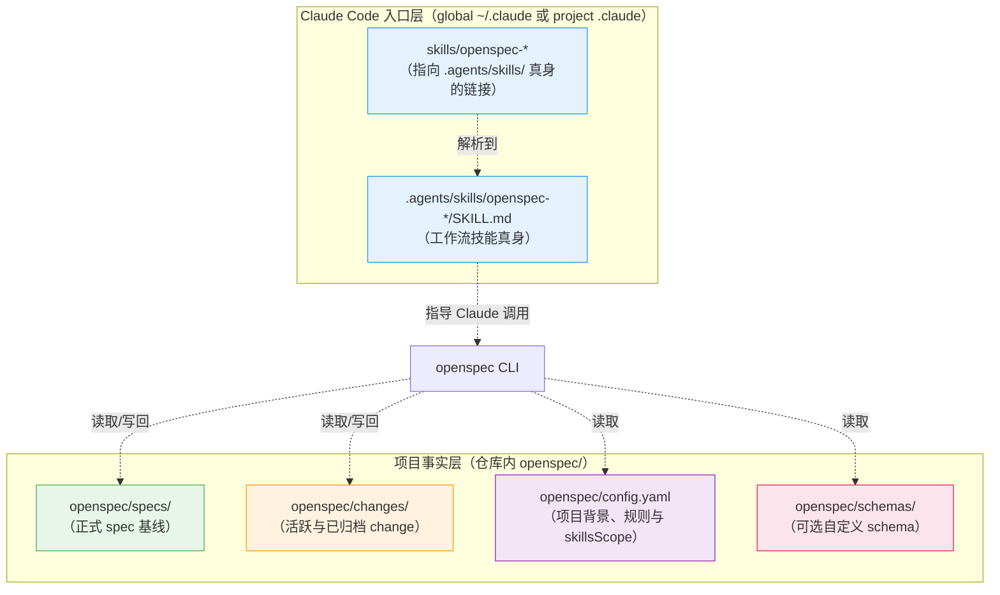
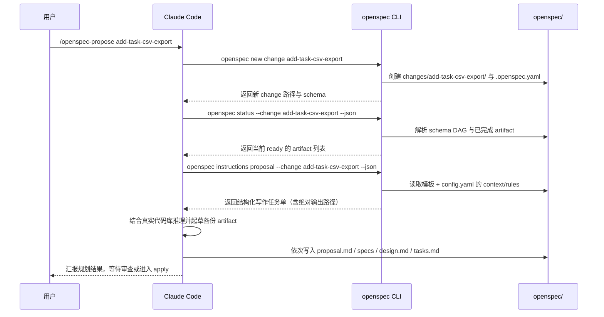

# 50 · 实战：Claude Code 里的 OpenSpec 到底怎么落地

> 这一篇解决的不是抽象概念，而是把 OpenSpec 放进 Claude Code 后，你的本机目录、项目目录与调用链路到底长什么样（适用 openspec 2.1.1）。

---

## 先把最容易想错的地方说透

很多人第一次在 Claude Code 里接入 OpenSpec，容易产生三个误解：

- 以为 `.claude/skills/` 里的技能文件就是 OpenSpec 本体
- 以为 `CLAUDE.md` 会被 OpenSpec 接管或塞满工作流提示词
- 以为还在找 1.x 时代的 `.claude/commands/opsx/` 斜杠命令文件（v2.0.0 起命令文件与 `delivery` 配置已整体移除，统一收敛为 skills）

其实都不对。**在 Claude Code 里，OpenSpec 始终拆成互不耦合的两层：项目事实永远留在仓库的 `openspec/`，而 Claude Code 入口层只是一组可随时重建或升级的 `openspec-*` skills。**

### 为什么坚持拆成两层？

把项目事实与宿主入口拆开，是为了让工程资产不被绑死在单一 coding agent 上：

| 如果混在一层（如全塞进 `.claude/`） | 后果 |
|---|---|
| 换工具就要搬家 | 团队有人用 Claude Code、有人用 Codex 或 Cursor，`specs/` 无法直接共用 |
| 长期资产与临时入口混杂 | Git 历史里分不清哪些是业务行为基线，哪些只是工具侧提示词 |
| 升级 CLI 时不敢覆盖 | 工具工作流模板升级时，容易误伤项目自己的业务规范 |

拆成两层之后，分工一目了然：

```text
项目事实层（openspec/）          ← 提交进 Git，全团队与多工具共享唯一真相
  ↓ 通过 openspec CLI 读取/写回
宿主入口层（openspec-* skills）  ← 默认装在本机 ~/.agents/skills/，也可按需锁进项目
```

---

## 第一层：项目事实层（`openspec/`）

无论你用什么作用域安装技能，项目根目录下的 `openspec/` 结构都完全一致：

```text
openspec/
├── config.yaml      # 项目级背景、artifact 规则与可选 skillsScope
├── specs/           # 当前正式行为基线（capability specs）
├── changes/         # 进行中的增量工作区
│   └── archive/     # 已结案归档的历史 change
└── schemas/         # 可选：项目自定义工作流 schema
```

这层保存正式基线、进行中的 change 及其 `proposal.md` / `specs/` / `design.md` / `tasks.md`，是 OpenSpec 真正的核心资产。

---

## 第二层：Claude Code 入口层（2.1.1 的两种技能作用域）

在 OpenSpec 2.1.1 中，工作流入口只有 **skill** 一种形态。默认 `core` profile 包含 6 个技能：

- `openspec-propose`
- `openspec-explore`
- `openspec-apply-change`
- `openspec-update-change`
- `openspec-sync-specs`
- `openspec-archive-change`

运行 `openspec init` 时，这 6 个技能装在哪里，取决于你选择的**作用域（scope）**。

### 方式 1：默认全局作用域（`global` scope，推荐大多数团队）

在一个全新的项目里运行：

```bash
cd my-app
openspec init --tools claude
```

v2.1 起，新项目默认采用 **`global` 作用域**——技能在本机只装一份，所有项目共用；你的业务仓库保持极度干净，只新增 `openspec/`：

```text
# 项目仓库内（提交进 Git 的只有 openspec/）
my-app/
├── CLAUDE.md                        # 你自己的 Claude Code 项目指令（OpenSpec 不改写）
├── src/
├── tests/
└── openspec/
    ├── config.yaml
    ├── specs/
    └── changes/
        └── archive/

# 本机主目录内（每台机器装一次，不进项目 Git）
~/.agents/
├── .skill-lock.json                 # 记录已安装的全局技能与目录树哈希（若设了 $XDG_STATE_HOME 则在 $XDG_STATE_HOME/skills/.skill-lock.json）
└── skills/
    ├── openspec-propose/SKILL.md    # 唯一真身（共 6 个 core 技能目录）
    ├── openspec-explore/SKILL.md
    ├── openspec-apply-change/SKILL.md
    ├── openspec-update-change/SKILL.md
    ├── openspec-sync-specs/SKILL.md
    └── openspec-archive-change/SKILL.md

~/.claude/
└── skills/
    ├── openspec-propose -> ../../.agents/skills/openspec-propose
    ├── openspec-explore -> ../../.agents/skills/openspec-explore
    ├── openspec-apply-change -> ../../.agents/skills/openspec-apply-change
    ├── openspec-update-change -> ../../.agents/skills/openspec-update-change
    ├── openspec-sync-specs -> ../../.agents/skills/openspec-sync-specs
    └── openspec-archive-change -> ../../.agents/skills/openspec-archive-change
```

自 v2.1.1（`#2283`）起，`init` 与 `update` 直接从已安装的 `@fission-ai/openspec` npm 包内置模板离线安装技能，不再联网或调用 Git clone，离线环境可直接完成初始化，且技能正文与当前 CLI 版本严格一致。

### 方式 2：项目作用域（`--scope project`，随仓库提交共享）

如果团队希望把技能文件随仓库一起版本化，或者仓库接入了只读仓库文件、读不到开发者主目录的云端代理（如 GitHub 托管的 Copilot coding agent），显式指定 `--scope project`：

```bash
cd my-app
openspec init --scope project --tools claude
```

此时技能真身落在项目内的 `.agents/skills/`，`.claude/skills/` 下生成逐技能的相对符号链接（Windows 项目安装或无法建链接时自动退化为普通文件拷贝）：

```text
my-app/
├── CLAUDE.md
├── src/
├── tests/
├── openspec/
│   ├── config.yaml                  # 记入 skillsScope: project 后，队友跑 update 不再重复询问
│   ├── specs/
│   └── changes/
├── .agents/
│   └── skills/
│       ├── .openspec-target         # 记录已配置工具清单，此处为：claude own-files
│       ├── openspec-propose/
│       │   └── SKILL.md             # 项目内唯一真身（已剥离易变的 generatedBy 行）
│       ├── openspec-explore/
│       │   └── SKILL.md
│       ├── openspec-apply-change/
│       │   └── SKILL.md
│       ├── openspec-update-change/
│       │   └── SKILL.md
│       ├── openspec-sync-specs/
│       │   └── SKILL.md
│       └── openspec-archive-change/
│           └── SKILL.md
└── .claude/
    └── skills/
        ├── openspec-propose -> ../../.agents/skills/openspec-propose
        ├── openspec-explore -> ../../.agents/skills/openspec-explore
        ├── openspec-apply-change -> ../../.agents/skills/openspec-apply-change
        ├── openspec-update-change -> ../../.agents/skills/openspec-update-change
        ├── openspec-sync-specs -> ../../.agents/skills/openspec-sync-specs
        └── openspec-archive-change -> ../../.agents/skills/openspec-archive-change
```

这里有两个值得留意的工程细节：

- **`.agents/skills/.openspec-target`**：1.x 时代它只写单个工具 ID 来仲裁谁写共享目录；2.0 起 `.agents/skills/` 成为所有工具的唯一真身，该文件升级为**项目已配置工具清单**（每行一个工具，带自有链接/文件的工具记为 `claude own-files`），供后续 `openspec update` 识别哪些工具需要同步维护。
- **`skillsScope: project`**：从已有项目级技能的仓库运行交互式 `openspec update` 时，CLI 会问一次技能保留在项目内还是切到本机全局。选 **Keep in this project** 后，CLI 会把 `skillsScope: project` 写进 `openspec/config.yaml`；提交该文件后，全队后续运行 `openspec update` 都直接就地刷新，不再反复弹窗。

### 两层架构可视化



---

## Claude Code 里四个常见文件层分别管什么

把日常在 Claude Code 项目里会见到的四层放在一张表里对照，边界最清楚：

| 层次 | 典型位置 | 谁拥有 | 作用 |
|---|---|---|---|
| **Claude 项目指令层** | `CLAUDE.md` | 你与团队 | 写通用工程习惯、构建命令、代码风格。OpenSpec 2.x 绝不创建或改写它（仅在升级 0.x 老项目时可清理历史遗留的 `<!-- OPENSPEC:START -->` 标记块，且永不删文件） |
| **OpenSpec 技能入口层** | `~/.claude/skills/openspec-*` 或 `.claude/skills/openspec-*`（链接到 `.agents/skills/`） | `openspec init` / `update` 生成 | 告诉 Claude Code 何时自动选用某条 OpenSpec 工作流，同时提供 `/openspec-propose` 等显式斜杠调用入口 |
| **OpenSpec CLI 运行时** | `openspec status --json`、`openspec instructions --json`、`openspec validate`、`openspec archive` | `@fission-ai/openspec` | 计算 artifact 依赖图、组装模板与 `config.yaml` 规则、执行确定性校验与归档合并 |
| **OpenSpec 项目事实层** | `openspec/specs/`、`openspec/changes/`、`openspec/config.yaml` | 你与团队（Git 版本化） | 保存系统正式行为合同、每次变更的规划产物与历史归档 |

> **1.x 升级对照**：OpenSpec 1.x 曾同时在 `.claude/commands/opsx/` 下生成 `propose.md`、`apply.md` 等命令文件（调用写法 `/opsx:propose`）。v2.0.0 起命令文件已移除，Claude Code 直接把 `openspec-*` skills 同时作为自然语言技能和 `/openspec-propose` 斜杠入口使用——看到旧资料里的 `/opsx:propose`，直接对应到 `/openspec-propose` 即可。

---

## `init` 与 `update` 在日常维护中具体做什么

当你升级了 OpenSpec CLI，或者通过 `openspec config profile` 增删了工作流（例如在 6 个 `core` 技能之外开启 `verify`、`continue`、`ff`、`bulk-archive`、`new`、`onboard`），在终端运行：

```bash
openspec update --dry-run   # 先预演会新增、更新或删除哪些文件，不落盘
openspec update             # 正式刷新技能并清理旧版遗留产物
```

`init` 与 `update` 有几条非常实用的工程行为：

1. **空目录写 `.gitkeep`**：`openspec init` 会给空骨架目录写入 `.gitkeep`，保证刚初始化的 `openspec/` 提交进 Git 后目录结构不丢失；重跑不会覆盖已有文件，也不会跨符号链接乱写。
2. **明确提示未启用的可选工作流**：`init` / `update` 结束时会点名 `new`、`continue`、`ff`、`bulk-archive`、`verify`、`onboard` 可通过 `openspec config profile` 按需开启，不会让你误以为漏装了文件。
3. **按指纹清理旧 1.x 命令文件，保护手改内容**：从 1.x 升级到 2.x 时，`openspec update` 会用内置历史版本指纹库比对 `.claude/commands/opsx/*.md` 等旧命令文件——**未被改过的原厂文件自动删除；你手工编辑过的命令文件一律保留并打印清单**，方便你把自定义规则迁入 `openspec/config.yaml` 后再手动删除。
4. **整目录刷新内置 `openspec-*` 技能**：与旧命令文件不同，`.agents/skills/openspec-*/` 属于受管内置技能目录，`update` 会将其整体刷新为当前 CLI 版本的 `SKILL.md`。不要直接手改内置 `SKILL.md`——项目定制请写进 `openspec/config.yaml` 的 `context` / `rules`，或自建不同名的技能目录（如 `.agents/skills/team-review/`）。
5. **按需提示重启宿主**：只有本次实际写入了需要重载窗口的 IDE 工具（如 Cursor、Cline、Kiro）时，CLI 才会提示重启 IDE；Claude Code CLI 如未看到技能列表更新，重开当前会话即可。模型切换、API Endpoint 等均属 Claude Code 自身环境配置，不影响 OpenSpec 状态与 artifacts，切勿把密钥写进 `openspec/config.yaml`。

---

## Claude Code 里敲下 `/openspec-propose` 背后发生了什么

在 Claude Code 对话框输入 `/openspec-propose add-task-csv-export`（或直接用自然语言说“帮我为施工任务 CSV 导出发起一个 OpenSpec change”），背后并不是调一条不存在的 `openspec propose` 子命令，而是由 skill 驱动多步 CLI 交互：



看清这条链路，你就不会再把 `.claude/skills/` 当成黑盒：Claude Code 负责读代码和写文档，`openspec` CLI 负责提供确定性的状态、路径、模板与校验闸门。

---

## Claude Code 落地最容易踩的 5 个坑

| 坑 | 典型现象 | 原因 | 正确做法 |
|---|---|---|---|
| **还在敲 `/opsx:propose`** | Claude Code 提示找不到命令 | 2.0 起 `.claude/commands/opsx/` 命令文件已移除 | 改用技能入口 `/openspec-propose`，或直接用自然语言描述任务 |
| **脚本断言仓库里有 `.claude/skills/` 失败** | 新项目跑 `openspec init --tools claude` 后工作树里只有 `openspec/` | 2.1 起新项目默认使用 `global` 作用域，技能装在 `~/.agents/skills/` | 若 CI 或团队脚本需要把技能提交进仓库，显式加 `--scope project` |
| **直接手改 `openspec-propose/SKILL.md`** | 下次跑 `openspec update` 后修改全部消失 | `update` 会整目录刷新内置 `openspec-*` 技能以对齐 CLI 版本 | 把团队规范写进 `openspec/config.yaml` 的 `context` / `rules`，或新建独立命名的自定义 skill |
| **升级后旧 `.claude/commands/opsx/apply.md` 还在** | 斜杠列表里同时出现旧命令与新技能 | 你以前手改过该命令文件，`update` 按指纹识别后特意保留以防丢内容 | 把有价值的补充迁入 `openspec/config.yaml`，然后手动删掉残留旧命令文件 |
| **把业务合同全塞进 `CLAUDE.md`** | `CLAUDE.md` 越写越长，却没法按 capability 做增量合并与校验 | `CLAUDE.md` 是会话级通用提示，不是结构化行为基线 | 通用开发习惯留给 `CLAUDE.md` / `config.yaml`，系统行为合同归入 `openspec/specs/` |

---

## 最该带走的 6 句话

1. **事实与入口分离**：业务行为与变更历史永远在 `openspec/`，Claude Code 里的 `openspec-*` 只是触发工作流的薄入口。
2. **2.0+ 只有 skills**：1.x 的 `/opsx:*` 命令文件与 `delivery` 配置已移除，Claude Code 里统一通过 `/openspec-*` 或自然语言触发技能。
3. **2.1 默认装本机全局**：新项目跑 `openspec init --tools claude` 只在仓库建 `openspec/`，6 个核心技能装在 `~/.agents/skills/` 并链接到 `~/.claude/skills/`。
4. **需要随库共享就加 `--scope project`**：项目级技能真身在 `.agents/skills/`、链接在 `.claude/skills/`，并可通过 `openspec/config.yaml` 的 `skillsScope: project` 为全队固化选择。
5. **`CLAUDE.md` 仍归你自己**：OpenSpec 2.x 不会创建或篡改 `CLAUDE.md`，通用编码约定与正式 spec 各司其职。
6. **不要手改内置 `SKILL.md`**：升级 CLI 后跑 `openspec update`（可先 `--dry-run`）会刷新内置技能并按指纹清理未改动的历史旧文件；项目定制一律放进 `openspec/config.yaml` 或自建同名外的独立 skill。
