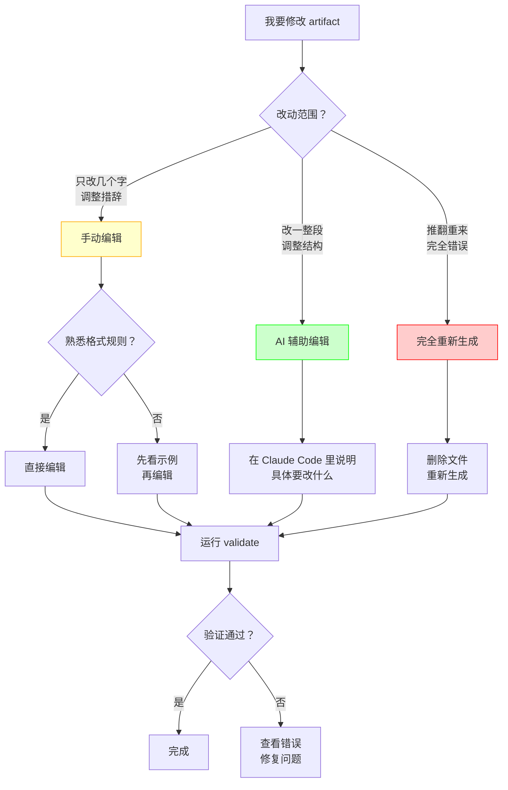

# 52 · 实战：如何正确修改 Artifacts

> 这一篇解决新手最困惑的问题：**OpenSpec 的 artifacts 到底该怎么改？** 和别的 SDD 工具不同，OpenSpec 是**弱约束**——artifacts 归你所有，可以手改、可以让 AI 重写、改完跑 `validate`（适用 openspec 2.1.1）。本文教你在这个自由度下，按文件类型安全地改、不踩格式坑。core profile 是默认前提，见下方专节。

---

## 重要前提：Profile 说明

**OpenSpec 的所有 artifacts 都是受结构化规则保护的普通文本文件：只要守住各文件的语法骨架并在改后跑通 `openspec validate`，手改、AI 局部修订与整份重建可以随时切换。**

OpenSpec 有两种 profile（工作流配置模式）。这里列出的 `/openspec-*` 是 Claude Code 等宿主里调用 OpenSpec **skill（技能）** 的写法（Codex 用 `$openspec-*`，也可以直接用自然语言描述任务由 agent 自动选用），不是另一套叫 OPSX 的独立工具，也不是宿主 adapter 命令文件（1.x 的 `/opsx:*` 命令文件已在 v2.0.0 移除）。终端里的底层运行时始终是 `openspec ...` CLI。

> **artifact 与 update 边界。** specs 支持嵌套 capability path；`skip_specs: true` 用于声明“本次 change 无 spec 级行为变化”。每条 task 在同一行 checkbox 内写明 verification；capability 退役若仍有未归属内容会被阻止。配置上，artifact `rules` 只注入对应 artifact 生成，Apply/Archive 读取项目的 `context` 与 `operations.apply/archive.guidance`。调用 `/openspec-update-change` 时，agent 会先起草修订方案并经你确认后才落盘写入——与 `explore` 的 capture 确认同属“写前确认”护栏。

> **升级 OpenSpec CLI 后先跑一次 `openspec update`。** 你用来改 artifacts 的工作流技能是由 CLI 按**当前版本内置模板**离线安装的；升级 CLI 后跑一次 `openspec update` 才能让本机或项目里的 `openspec-*` 技能同步跟上。这一步能从 **0.12 以来任意旧版本一次升级到位**，不再需要 `--force`：未改动过的 1.x 旧命令文件靠历史内容指纹自动清理，你手改过的旧命令文件保留并列出；清理流程绝不跨符号链接误删项目外目标，而在 `--scope project` 模式下则会安全维护各工具目录指向 `.agents/skills/` 的相对技能链接（保留用户自改拷贝或自定义链接）。升级后第一次 `validate` 若报出新错误，见 [99 FAQ Q27i](99-FAQ-常见问题.md#q27i-升级后-validate-突然报错了是回归吗)。

| Profile | 技能数量 | 适用场景 | 是否默认 |
|---------|---------|---------|---------|
| **core** | 6 个技能 | 日常快速迭代，覆盖完整主线 | 是（默认） |
| **custom** | 最多 12 个技能 | 复杂项目，按需开启细粒度动作 | 否 |

### 检查你当前的 Profile

```bash
# 查看当前 profile
openspec config profile

# 输出示例
# profile: core
```

### Core Profile 的 6 个技能

```text
/openspec-propose <name>          # 创建 change + 生成规划 artifacts
/openspec-explore                 # 探索/调研模式
/openspec-apply-change [name]     # 按 tasks 推进实现
/openspec-update-change [name]    # 自洽更新已有 planning artifacts
/openspec-sync-specs [name]       # 提前同步 delta specs 到主 specs/
/openspec-archive-change [name]   # 校验、合并 specs 并归档 change
```

### Custom Profile 的额外可选技能

```text
/openspec-new-change <name>       # 只创建 change 目录脚手架
/openspec-continue-change         # 按依赖图逐个生成下一个 ready artifact
/openspec-ff-change               # 一次快进生成所有剩余规划 artifacts
/openspec-verify-change           # 验证代码实现与 specs 一致性
/openspec-bulk-archive-change     # 批量归档多个 changes
/openspec-onboard                 # 引导新成员快速走通首个小练习
```

### 如何切换到 Custom Profile

```bash
# 步骤 1：切换 profile
openspec config profile
# 选择 "custom" 并勾选你想启用的 workflows

# 步骤 2：更新 AI 工具的 skills（可先 --dry-run 预演）
openspec update --dry-run   # 只报告会 add/update/delete 哪些文件，不落盘
openspec update

# 步骤 3：只在 update 实际刷新了 IDE 驻留工具的 skills 且 CLI 给出提示时重启 IDE
```

`openspec update` 的重启提示是条件性的：Cursor、Cline、Kiro 等 IDE 驻留入口实际更新了技能文件时才提示重启；Claude Code、Codex、OpenCode 等 CLI 宿主重开会话或直接读取即可，不必笼统重启所有工具。

`--dry-run` 和真实 `openspec update` 走同一条写入路径（`UpdateFileOps`：真实运行走 `realFileOps`，预演走 `UpdatePlanRecorder`），所以计划里的 `add` / `update` / `delete` 就是非交互真跑会执行的动作（交互式运行还会有 `notes` 里列出的确认项）。

### 本文档的假设

**本文档中的部分重生成示例会提到 custom profile 的 `/openspec-continue-change`**。如果你使用默认的 **core profile**，请直接参考每个场景下的“Core Profile 替代方案”（或使用 `/openspec-update-change` 修订已有文件）。

## 改 spec 前的第一步：先定位 capability path，再动 requirement

手改 artifact 的最大风险不只是少写一个 `#`，还包括“改对了文字、改错了合同”。spec-driven 把 capability 的完整相对 path 当 identity：`changes/<change>/specs/<path>/spec.md` 只会同步到 `openspec/specs/<path>/spec.md`。

因此每次准备修改 specs 时，先按这个顺序：

```bash
openspec list --specs --json
openspec show <candidate-path> --type spec --json --requirements
openspec show <candidate-path> --type spec --json --requirement <n>
```

先列候选 path，查看 requirement 标题；只有要 `MODIFIED`、`REMOVED` 或 `RENAMED` 时才读取完整 block 与 scenarios。不要因为“页面上有一个导出按钮”就新建 `export-button` path：先判断它是已有合同的修改，还是有独立行为、场景和演进节奏的新 capability。

| 这次实际变化 | 应编辑什么 |
|---|---|
| 已有 capability 的可观察行为改变 | 同 path 下的 delta，`MODIFIED`/`ADDED` 等操作写完整 requirement contract |
| 新的独立行为合同 | 新 path 的 delta，并写可读 `## Purpose` |
| 纯重构、换实现、工具/文档工作 | `.openspec.yaml` 的 `skip_specs: true`，且移除所有 delta spec 文件 |
| 要拆分、合并或移动 capability path | 停止把它当普通 artifact 编辑；做受控 rebaseline，先处理 active changes |

目录层次不提供继承或自动 retrieval；catalog 只能帮助你找到 path，main spec 才是行为真相。完整规划方法见 [26](26-高级-治理边界与漂移维护.md)。

---

## 为什么需要这一篇

如果你已经读过前面的文档，会用 `/openspec-propose`、`/openspec-apply-change`、`/openspec-archive-change`，但可能还有这些困惑：

| 困惑 | 典型问题 |
|------|---------|
| **config.yaml 怎么改？** | 手改怕破坏格式，但没有"推荐修改方式" |
| **proposal.md 怎么改？** | 直接手改？还是让 AI 重新生成？ |
| **specs 有问题怎么调整？** | 改了会不会破坏 delta spec 格式？ |
| **design.md 怎么调整？** | 实现过程中发现设计不对，怎么办？ |
| **tasks.md 怎么调整？** | 任务拆分不合理，怎么改？ |
| **.openspec.yaml 怎么调整？** | 这个文件是干什么的？能改吗？ |

这一篇重点展开最常改、也最容易改坏的两类文件：`config.yaml` 和 `proposal.md`。后面的 specs/design/tasks/.openspec.yaml 会给出安全修改原则，避免把本文变成逐字段手册。

---

## 修改 Artifacts 的三种方式

在开始具体讲解之前，先理解修改 artifacts 的三种基本方式：

### 方式对比表

| 方式 | 适用场景 | 优点 | 缺点 | 风险等级 |
|------|---------|------|------|---------|
| **手动编辑** | 小改动、微调措辞、添加细节 | 快速、精确、保留上下文 | 可能破坏格式、需要熟悉规则 | 中等 |
| **AI 辅助编辑** | 中等改动、调整结构、重写某段 | 平衡灵活性和安全性 | 需要明确指令 | 低 |
| **完全重新生成** | 大改动、推翻重来、格式完全错误 | 保证格式正确、省心 | 丢失之前的手动修改 | 高 |

### 决策树：我该用哪种方式？



### 三种方式的详细说明

#### 方式 1：手动编辑

**什么时候用**：
- 修改几个字、调整措辞
- 添加一个新的 requirement 或 scenario
- 修改 Out of Scope
- 调整任务顺序

**优点**：
- 最快速
- 保留所有上下文
- 精确控制

**缺点**：
- 可能破坏格式（如果不熟悉规则）
- 需要手动保持一致性

**示例场景**：
```markdown
# 场景：proposal 的 Why 部分写得不够清楚

# 原文
## Why
Users want to export data.

# 手动改成
## Why
Project managers and site supervisors need to export filtered construction task records to CSV
for offline milestone reconciliation and weekly progress reviews with client representatives.
```

#### 方式 2：AI 辅助编辑

**什么时候用**：
- 需要重写一整段
- 调整结构但保留大部分内容
- 不确定格式规则
- 需要添加复杂的 scenarios

**优点**：
- 保证格式正确
- 可以保留部分内容
- 不需要深入了解格式规则

**缺点**：
- 需要明确的指令
- 可能需要多次迭代

**示例场景**：
```markdown
# 场景：specs 里的 scenarios 不够完整

# 在 Claude Code 里说：
"请帮我在 specs/task-tracking/spec.md 的 'Filtered Task CSV Export' requirement 里，
添加以下 scenarios：
1. 导出空列表时的处理
2. 导出超过 10000 条记录时的限制
3. 导出失败时的错误提示"
```

**完整操作步骤**：
1. 在 Claude Code 的聊天框里输入上述指令
2. AI 会读取当前的 spec 文件
3. AI 会分析并添加新的 scenarios
4. AI 会保持 delta spec 格式（ADDED/MODIFIED/REMOVED）
5. 检查 AI 的修改是否符合预期
6. 运行 `openspec validate <change-name>` 验证格式

#### 方式 3：完全重新生成

**什么时候用**：
- 整个 artifact 完全错误
- 需求发生重大变化
- 格式完全混乱无法修复
- 想从头开始

**优点**：
- 保证格式完全正确
- 省心，不需要手动修复

**缺点**：
- 丢失所有手动修改
- 需要重新审查内容

**示例场景（Custom Profile）**：
```bash
# 场景：proposal 完全偏离了需求，需要重写

# 步骤 1：删除文件
rm openspec/changes/add-task-csv-export/proposal.md

# 步骤 2：在 Claude Code 里重新生成
/openspec-continue-change
```

**示例场景（Core Profile 替代方案）**：
```bash
# 场景：proposal 完全偏离了需求，需要重写

# 步骤 1：删除文件
rm openspec/changes/add-task-csv-export/proposal.md

# 步骤 2：在 Claude Code 里说：
"请重新生成 proposal.md，需求是：[描述你的需求]"

# 或者，如果想重新开始整个 change
rm -rf openspec/changes/add-task-csv-export/
/openspec-propose add-task-csv-export
```


---

## `/openspec-update-change`：修改 artifact 的正式工作流

上面三种方式告诉你"怎么动手改"，但它们各自独立——手动改了 proposal，design 和 tasks 可能已经不一致了。`/openspec-update-change` 解决的就是这个问题。

### 它做什么

`/openspec-update-change` 读一遍 change 的全部已有 artifact，按你的意图改目标文件，然后**检查并修复其他 artifact 的一致性**。它不创建新 artifact（那是 `/openspec-continue-change` 的事），也不改代码（那是 `/openspec-apply-change` 的事）——它的边界就是"planning artifact 内部的自洽"。

```text
propose 产出第一版 → explore 发现漏洞 → update 修 proposal + specs + design + tasks
                                                      ↓
                                          全部一致了才 apply
```

### 为什么需要它，而不是手改

手改的风险在于**单向思维**——你改 design 的时候脑子里只有 design，很难同时检查 proposal 和 tasks 是否还跟它一致。而 `update` 是双向检查：改 design 会影响 tasks，反过来你在实现中推翻的设计假设也应该回流到 proposal。

实际场景：

> 以 BuildFlow 为例——`add-qc-check` 这个 change 的 proposal 说"质检员在 App 上打勾就行"，design 写了一套拍照+GPS 定位的验收流程。propose 阶段没人发现这个矛盾。跑完 explore 后你意识到 proposal 太乐观了，`/openspec-update-change add-qc-check` 会同时修 proposal（把约束写实）和 design（让拍照流程能追溯到 proposal 里的 requirement），而不是改一个留一个。

### 什么时候用它

| 场景 | 用什么 |
|------|--------|
| explore 后发现 proposal 不够 | **update** |
| 实现中发现 design 不现实，要回头改 | **update**（改完再 apply） |
| 说"update"看看有没有不一致 | **update**（先做 coherence review） |
| 要加一个全新的 artifact（比如补 design） | `/openspec-continue-change`，不是 update |
| 整个 change 的方向错了 | `/openspec-new-change`，不是 update |

核心判断：**改的是已有 artifact 的内容 → update；要创建还不存在的 artifact → continue**。

### 两个 glob 相关的细节

`specs` 这类 artifact 的输出是一个 pattern（`specs/**/*.md`），不是单个文件。这带来两处容易踩的边界，update 的模板对它们都有明确规则：

| 情形 | 规则 |
|---|---|
| 改已有文件 | 只编辑 `artifactPaths.<id>.existingOutputPaths` 里列出的**具体文件**；glob 的 `resolvedOutputPath` 还是 pattern，绝不能当写入目标 |
| 某个 capability 确实少了 spec 文件 | 这是一条**明确的例外**：先起草 → 问用户确认 → 在 change 目录内选一个不存在的具体路径（要匹配 `outputPath`、且解析 symlink 后仍在 change 目录内）创建。这也是 update 唯一允许建新文件的口子，其余"还没有文件"的 artifact 交给 `/openspec-continue-change` |

顺带说明为什么这个例外要写两遍：step 2 原本只说"只编辑 `existingOutputPaths`"，而例外要建的文件按定义不在其中——照字面执行会把流程自己要求做的事否掉。所以现在 step 2 与 guardrails 两处口径一致。

### 一句话

`/openspec-update-change` 是"迭代打磨 planning"的正式入口。它把"改 proposal → 改 design → 改 tasks"这个容易三步各写各的流程，锁成一次自洽操作。

---

## 每个 Artifact 的详细修改指南

现在我们逐个讲解每个 artifact 的修改方法，包含大量真实场景和完整示例。

### 1. config.yaml — 项目级配置

#### 文件位置
```text
openspec/config.yaml
```

#### 这个文件是干什么的？

`config.yaml` 是**项目级配置文件**，定义：
- 项目背景（技术栈、测试策略）
- 全局约束规则（编码规范、回归要求）
- 默认 schema 选择

**关键特点**：
- 影响**所有 change** 的生成质量
- 修改后，新创建的 change 会使用新配置
- 已存在的 change 不受影响

#### 可以手动改的内容

| 内容 | 示例 | 风险 |
|------|------|------|
| **context** | 添加技术栈信息 | 低 |
| **rules** | 添加项目约束 | 低 |
| **schema** | 改变默认 schema | 中 |

#### 不建议手动改的内容

| 内容 | 原因 | 替代方案 |
|------|------|---------|
| **YAML 结构** | 容易出错 | 让 AI 帮你改 |
| **复杂的嵌套规则** | 难以维护 | 用简单的列表 |

#### 完整示例：从空配置到强配置

**场景**：你刚 `openspec init`，得到一个最基础的 config.yaml

**初始状态**（空配置）：
```yaml
schema: spec-driven
```

**问题**：AI 生成的 artifacts 过于笼统，不符合项目特点。

**改进步骤**：

**步骤 1：添加项目背景**
```yaml
schema: spec-driven

context: |
  Project: BuildFlow
  Tech stack: TypeScript, React, Node.js, PostgreSQL
  Testing: Vitest (unit) + Playwright (e2e)
```

**效果**：AI 生成的 design.md 会考虑 TypeScript 和 React 的特点。

**步骤 2：添加基本约束**
```yaml
schema: spec-driven

context: |
  Project: BuildFlow
  Tech stack: TypeScript, React, Node.js, PostgreSQL
  Testing: Vitest (unit) + Playwright (e2e)
  Deployment: Vercel
  Compatibility: Support last 2 major versions

rules:
  specs:
    - New user-visible behavior must be reflected in specs before implementation
  tasks:
    - Core business logic should be developed test-first
  design:
    - Do not bypass domain module boundaries
```

**效果**：AI 生成的 tasks.md 会包含"先写测试"的任务。

**步骤 3：添加具体的 artifact 约束**

**注意**：OpenSpec 的 config.yaml 支持**结构化 rules 格式**（按 artifact 分类）：

```yaml
schema: spec-driven

context: |
  Project: BuildFlow
  Tech stack: TypeScript, React, Node.js, PostgreSQL
  Testing: Vitest (unit) + Playwright (e2e)
  Deployment: Vercel
  Compatibility: Support last 2 major versions

rules:
  proposal:
    - Include rollback plan if behavior changes existing flow
    - Estimate implementation time
  specs:
    - Add unhappy-path scenarios (error cases)
    - Include authorization checks
  design:
    - Explain migration risk when schema changes
    - Consider performance impact
  tasks:
    - Break down into tasks < 2 hours each
    - Include testing tasks
```

**效果**：每个 artifact 都会遵循这些约束。

**验证**：查看 OpenSpec 仓库的 `openspec/config.yaml` 可以看到真实的结构化 rules 示例。

#### 真实场景 1：添加新的技术栈约束

**场景**：项目引入了 tRPC，需要让 AI 知道这个约束。

**修改前**：
```yaml
context: |
  Tech stack: TypeScript, React, Node.js
```

**修改后**：
```yaml
context: |
  Tech stack: TypeScript, React, Node.js
  API: tRPC (type-safe RPC)
  Rules: All API calls must use tRPC procedures, no direct fetch
```

**如何修改**：

**方式 1：手动编辑**（推荐）
```bash
# 直接编辑文件
vim openspec/config.yaml
```

改完后先运行 `openspec validate --all` 检查 `config.yaml` 的可读性与 YAML 语法（损坏会直接以退出码 `1` 报错），再运行 `openspec schemas` 核对 `schema:` 解析来源。

**方式 2：让 AI 帮你改**
```markdown
# 在 Claude Code 里说：
"请帮我更新 openspec/config.yaml，在 context 里添加：
- API: tRPC (type-safe RPC)
- Rules: All API calls must use tRPC procedures, no direct fetch"
```

#### 真实场景 2：添加回归测试要求

**场景**：团队决定，所有涉及施工任务与工序验收的 change 都必须保证回归测试通过。

**修改前**：
```yaml
rules:
  tasks:
    - Write tests for new features
```

**修改后**：
```yaml
rules:
  tasks:
    - Write tests for new features
    - Changes touching task domain must preserve task creation regression tests
    - Changes touching inspection flow must preserve inspection approval authorization tests
```

**效果**：AI 生成的 tasks.md 会包含"运行回归测试"的任务。

#### 真实场景 3：改变默认 schema

**场景**：你的项目不需要 design.md，想用更简单的 schema。

**修改前**：
```yaml
schema: spec-driven
```

**注意**：
- OpenSpec 支持 package、user、project 三层 schema 来源
- 如果你需要不同的 artifact 结构，优先在项目内创建 `openspec/schemas/<name>/`
- 运行 `openspec schemas` 查看可用 schema，运行 `openspec schema which <name>` 查看解析来源

**如何验证修改是否生效**：
```bash
# 创建一个新 change
/openspec-propose test-new-schema

# 检查生成的 artifacts
ls openspec/changes/test-new-schema/

# 应该看到不同的 artifact 结构
```

#### 常见错误和修复

**错误 1：YAML 格式错误**
```yaml
# 错误：缩进不对
rules:
- Write tests
  - Add docs
```

**修复**：
```yaml
# 正确：统一缩进
rules:
  tasks:
    - Write tests
    - Add docs
```

**错误 2：context 和 rules 混淆**
```yaml
# 错误：把约束写在 context 里
context: |
  Tech: TypeScript
  You must write tests
```

**修复**：
```yaml
# 正确：约束放在 rules 里
context: |
  Tech: TypeScript

rules:
  tasks:
    - Write tests for all new features
```

**错误 3：规则太模糊**
```yaml
# 错误：太模糊
rules:
  - Write good code
  - Be careful
```

**修复**：
```yaml
# 正确：具体明确
rules:
  design:
    - Keep domain code grouped by capability, not by technical layer
    - Do not bypass published module interfaces
```

#### 验证 config.yaml 的修改

**步骤 1：检查 `config.yaml` 语法与 schema 解析**

自 v1.16.0（`#2127`）起，**`openspec validate` 是唯一对坏配置硬失败的 CLI 命令**——如果 `openspec/config.yaml`（或 `.yml`）不可读或 YAML 语法损坏，`openspec validate` 会直接以退出码 `1` 失败（`--json` 下返回 `unreadable_config` 或 `unparseable_config`）；而 `openspec schemas` 等其他命令遇到坏配置只会打印警告并回退默认值。因此改完 `config.yaml` 后，按这个顺序检查：

```bash
# 1) 先抓 config.yaml 可读性与 YAML 语法错误（坏配置直接退出 1）
openspec validate --all

# 2) 若改过 schema:，再确认 schema 存在且来自预期层级（project/user/package）
openspec schemas
openspec schema which <schema-name>
```

此外，`rules` 若写了任何可用 schema 里都不存在的未知 artifact ID，首次运行 `openspec instructions` 时会在 stderr 打印告警。

**它能帮你发现**：
- `config.yaml` / `config.yml` 无法读取或 YAML 语法损坏（`openspec validate --all` 退出 1）
- `schema` 指向不存在的 schema，或解析来源不是你预期的层级（`openspec schema which`）
- `rules.<artifact>` 写错了 artifact ID（`openspec instructions` 告警）

**它不会检查**：
- rules 文案本身是否合理、粒度是否合适
- context 背景是否完整

**步骤 2：检查 context/rules 是否真正注入到运行时指令**

创建一个临时 change（或指定已有活跃 change），用 `openspec instructions <artifact> --change <name>` 查看实际注入结果：

```bash
# 查看 AI 生成 proposal 时实际收到的 context 与 rules
openspec new change test-config-runtime
openspec instructions proposal --change test-config-runtime --json | jq '.context, .rules'

# 检查完后删除临时 change
rm -rf openspec/changes/test-config-runtime/
```

**步骤 3：创建测试 change 验证**

**Custom Profile**：
```bash
# 创建一个测试 change
/openspec-propose test-config-output

# 检查生成的 proposal 是否符合新的 rules
cat openspec/changes/test-config-output/proposal.md

# 如果满意，删除测试 change
rm -rf openspec/changes/test-config-output/
```

**Core Profile**：
```bash
# 创建一个测试 change（会生成所有 artifacts）
/openspec-propose test-config-output

# 检查生成的 proposal 是否符合新的 rules
cat openspec/changes/test-config-output/proposal.md

# 如果满意，删除测试 change
rm -rf openspec/changes/test-config-output/
```


### 2. proposal.md — change proposal

#### 文件位置
```text
openspec/changes/<change-name>/proposal.md
```

#### 这个文件是干什么的？

`proposal.md` 是**change proposal**，回答：
- **Why**：为什么要做这个 change？
- **What Changes**：要改什么？
- **Capabilities**：新增/修改哪些 capability（决定要几个 spec 文件）
- **Impact**：影响面
- **Out of Scope**（可选，自加）：明确不做什么？
- **Approach**（可选，自加）：大致怎么做？

**关键特点**：
- 是整个 change 的**起点**
- 定义了 change 的**边界**
- 其他 artifacts（specs/design/tasks）都基于它

#### 必须保留的结构

```markdown
## Why
<为什么做这个 change>

## What Changes
<要改什么>

## Capabilities
### New Capabilities
<新增能力>
### Modified Capabilities
<修改既有能力>

## Impact
<影响面>
```

**`## Capabilities` 不能省**：它决定这个 change 需要几个 specs 文件——proposal 里列的每个 capability 对应一个 `specs/<capability-path>/spec.md`。模板与 schema instruction 里没有 `## Out of Scope`，需要时自行加一节即可（它不是必须保留的结构）。

**注意**：标题（`## Why` 等）必须保留，但内容可以自由修改。v1.13.1 起生成的 artifact 文件以顶层 `# Proposal`/`# Spec Delta`/`# Design`/`# Tasks` 标题开头（markdownlint MD041 友好）——编辑时保留这个顶层标题即可。

#### 真实场景 1：Why 部分太简单，需要补充背景

**场景**：AI 生成的 proposal 太简单，没有说清楚业务背景。

**原始内容**：
```markdown
## Why
Users want to export tasks.
```

**问题**：
- 哪些用户？
- 为什么要导出？
- 解决什么问题？

**修改方式 1：手动编辑**（推荐）
```markdown
## Why
Project managers and site supervisors need to export filtered construction task records to CSV for:
1. Offline progress reconciliation against milestone schedules
2. Sharing weekly progress tables with client representatives
3. Auditing delayed work zones with complete status history

Current pain point: staff have to manually copy-paste rows from the UI,
which is error-prone and time-consuming (30+ minutes per weekly report).
```

**修改方式 2：让 AI 辅助**

**Custom Profile / Core Profile（操作相同）**：
```markdown
# 在 Claude Code 里说：
"请帮我扩展 proposal.md 的 Why 部分，补充以下信息：
- 用户是项目经理与现场监理团队
- 用途是里程碑进度核对、甲方周报同步、延期工区排查
- 当前痛点是手动逐页复制粘贴，每份周报耗时 30 分钟以上"
```

**完整操作步骤**：
1. 在 Claude Code 的聊天框里输入上述指令（或调用 `/openspec-update-change`）
2. AI 会读取当前的 proposal.md 并先给出起草修改
3. 确认无误后写回文件
4. 检查修改是否符合预期；如果不满意，继续给出更具体的指令

#### 真实场景 2：Out of Scope 不够明确

**场景**：担心 scope 失控，需要明确不做什么。

**原始内容**：
```markdown
## Out of Scope
- Advanced features
```

**问题**：太模糊，"advanced features" 是什么？

**修改后**：
```markdown
## Out of Scope
- XLSX export (only CSV in this change)
- Scheduled/automated exports (manual only)
- Background export jobs (synchronous only)
- Email delivery of exported files
- Custom column selection (export fixed columns)
- Export history tracking
```

**为什么这样改**：
- 具体列出不做的功能
- 避免后续 scope 蔓延
- 让 AI 和团队都清楚边界

#### 真实场景 3：发现需求变了，需要调整 What Changes

**场景**：实现过程中，产品经理说"还要支持导出带签章排版的 PDF"。

**原始内容**：
```markdown
## What Changes
- Add CSV export button to Construction Tasks page
- Export filtered construction task data
```

**选择 1：扩大 scope（不推荐）**
```markdown
## What Changes
- Add export button to Construction Tasks page
- Support CSV and signed PDF formats
- Export filtered construction task data
```

**问题**：scope 变大了，可能影响工期。

**选择 2：保持 scope，创建新 change（推荐）**
```markdown
# 保持当前 proposal 不变
## What Changes
- Add CSV export button to Construction Tasks page
- Export filtered construction task data

# 创建新的 change
/openspec-propose add-signed-task-pdf-export
```

**为什么推荐选择 2**：
- 保持每个 change 小而聚焦
- 可以分批上线
- 降低风险

#### 真实场景 4：Approach 部分需要调整

**场景**：实现过程中发现超大型工地同步导出会阻塞，需要改成异步任务。

**原始内容**：
```markdown
## Approach
Generate CSV on demand and return as file download.
```

**修改后**：
```markdown
## Approach
~~Generate CSV on demand and return as file download.~~

**Updated approach** (discovered during implementation):
- Use background job for CSV generation (avoid blocking)
- Show progress indicator while generating
- Download link available when complete
- Job timeout: 5 minutes

**Reason for change**:
Synchronous generation blocks the UI for mega-project datasets (10k+ tasks).
Background job provides better UX.
```

**如何修改**：

**方式 1：手动编辑**（推荐）
```bash
# 直接编辑文件
vim openspec/changes/add-task-csv-export/proposal.md

# 用删除线标记旧内容，添加新内容（同时记得用 /openspec-update-change 同步检查 design.md 与 tasks.md）
```

**方式 2：让 AI 帮你更新**
```markdown
# 在 Claude Code 里说（推荐触发 /openspec-update-change）：
"我发现超大型工地同步导出会阻塞 UI，请帮我更新 proposal.md（并同步检查 design/tasks），
把导出方案改成异步后台任务：
- 后台任务生成 CSV
- 显示进度条
- 完成后提供下载链接
- 超时 5 分钟

并说明原因：10k+ 施工任务时同步生成会阻塞 UI"
```

#### 完整示例：一个好的 proposal.md

注意这里完整保留了上文要求的 **`## Why`、`## What Changes`、`## Capabilities`、`## Impact`** 四大标准段落，并在其基础上补充了 `## Out of Scope` 与 `## Approach`：

```markdown
# Proposal: Add Construction Task CSV Export

## Why
Project managers and site supervisors need to export filtered construction task records to CSV for:
1. Offline progress reconciliation against milestone schedules
2. Sharing weekly progress tables with client representatives
3. Auditing delayed work zones with complete status history

**Current pain point**:
Staff manually copy-paste rows page by page from the UI, which is error-prone
and time-consuming (30+ minutes per weekly report).

## What Changes
- Add an "Export CSV" button to the Construction Tasks page next to filter controls
- Export all construction task rows matching the active filter criteria
- Include columns: Task ID, Work Zone, Assignee, Planned Date, Status, Inspection Stage
- Restrict CSV export to authorized project staff

## Capabilities

### New Capabilities
<!-- None -->

### Modified Capabilities
- `task-tracking`: Add filtered construction task CSV export for authorized project staff

## Impact
- Frontend: `src/tasks/TaskListPage.tsx`, `src/tasks/api/exportTasksCsv.ts`
- Backend: `src/tasks/server/exportTasksCsvHandler.ts`

## Out of Scope
- XLSX export (CSV only in this change)
- Scheduled/automated exports (manual trigger only)
- Background export jobs (synchronous streaming up to 1,000 tasks)
- Email delivery of exported files
- Custom column selection (fixed column set)

## Approach
Stream CSV rows on demand from the filtered task query and return as a file download, sanitizing cell values against spreadsheet formula injection.
```

#### 常见错误和修复

**错误 1：删除了必需的标题**
```markdown
# 错误：删除了 ## Why 与 ## Capabilities
This change adds CSV export.
```

**修复**：
```markdown
# 正确：保留 ## Why、## What Changes、## Capabilities、## Impact
## Why
This change adds CSV export so project managers can reconcile weekly task schedules.
```

**错误 2：Out of Scope 太模糊**
```markdown
# 错误
## Out of Scope
- Other stuff
```

**修复**：
```markdown
# 正确
## Out of Scope
- XLSX export
- Scheduled exports
- Background jobs
```

**错误 3：What Changes 和 Approach 混淆**
```markdown
# 错误：把实现细节写在 What Changes
## What Changes
- Use streaming CSV generation with Papa Parse library
- Add button with onClick handler
```

**修复**：
```markdown
# 正确：What Changes 写"做什么"，Approach（或 design.md）写"怎么做"
## What Changes
- Add CSV export button on the Construction Tasks page
- Export filtered construction task data

## Approach
Use streaming CSV generation with Papa Parse library.
```

#### 何时需要重新生成 proposal？

| 场景 | 是否重新生成 | 推荐做法 |
|------|-------------|---------|
| 微调措辞 | 不需要 | 手动编辑 |
| 补充背景信息 | 不需要 | 手动编辑或 AI 辅助 |
| 调整 Out of Scope | 不需要 | 手动编辑 |
| 需求完全变了 | 需要 | 删除后让 AI 重新生成 |
| 格式完全乱了 | 需要 | 删除后让 AI 重新生成 |

**重新生成的步骤（Custom Profile）**：
```bash
# 1. 删除文件
rm openspec/changes/add-task-csv-export/proposal.md

# 2. 在 Claude Code 里重新生成
/openspec-continue-change
```

**重新生成的步骤（Core Profile）**：
```bash
# 1. 删除文件
rm openspec/changes/add-task-csv-export/proposal.md

# 2. 在 Claude Code 里说：
"请重新生成 proposal.md，需求是：[详细描述你的需求]"

# 或者，重新开始整个 change
rm -rf openspec/changes/add-task-csv-export/
/openspec-propose add-task-csv-export
```

---

### 3. specs/design/tasks/.openspec.yaml — 其他文件怎么改

这几类文件也能改，但修改原则不一样：

| 文件 | 推荐修改方式 | 关键风险 |
|------|--------------|----------|
| `specs/<capability>/spec.md` | 小步编辑 delta spec，保留 `ADDED/MODIFIED/REMOVED/RENAMED` 结构和 scenarios | 把 delta spec 写成全量重写；REMOVED 最后一个 requirement 时，先清理未归属内容，再用合法 `retire_capabilities: true` 明确授权删除 |
| `design.md` | 实现发现方案变化时及时回头修改，说明原因和风险 | 只改代码不改设计，后人看不到真实取舍 |
| `tasks.md` | apply 过程中同步更新 checkbox，必要时拆细任务 | 任务状态和实现状态脱节；**v1.8.0 起缩进的子任务也计入进度**（`  - [ ] 1.1.1` 会阻止 "✓ Complete"），别只盯顶层 checkbox |
| `.openspec.yaml` | 一般不手动改；只在明确要改 schema 绑定或元数据时改 | 改错 schema 会影响后续 status/instructions 解析（`retire_capabilities` 与 `schema:` 并存，见上）；**未知键会告警**——白名单键是 `schema`/`created`/`goal`/`affected_areas`/`initiative`/`skip_specs`/`retire_capabilities`，**外加 v1.14.2 起豁免的小写 `x-*` 扩展键**（`x-tracker: PROJ-12` 不告警、`--strict` 也通过；大写的 `X-Tracker`、裸 `x-`、`x- tracker` 仍算未知键），写错的键在 status/validate/archive 都会提示，`validate --strict` 直接失败 |

一条实用判断准则：

- 行为承诺变了，优先改 delta spec
- 技术路径变了，优先改 design
- 执行拆解变了，优先改 tasks
- change 的 schema/元数据变了，才考虑 `.openspec.yaml`

两个影响 diff 观感的守卫：

- **行尾保持**：写回文件时 CLI 保持原有行尾（CRLF 文件写回仍是 CRLF，只有新文件才写 LF）。在 Windows 仓库手改或让 AI 重写 artifact，不会再出现"整文件被重写成 LF"的噪声 diff——review 时看到的差异就是真实的内容改动。
- **未知键告警**：`.openspec.yaml` 写进白名单之外的键不会静默被忽略，status/validate/archive 都会点名；用 `validate --strict` 可以把它变成硬失败，适合放进 CI。

#### scenario 必须有 WHEN/GIVEN 和 THEN（v1.16.0 起会告警）

写 `#### Scenario:` 时，正文要给**触发步**和**结果步**：

```markdown
#### Scenario: Export succeeds
- **WHEN** a user exports the selected rows
- **THEN** the legacy file is returned
```

v1.16.0 起（#2079），缺 WHEN/GIVEN 或 缺 THEN 会报 **WARNING**。级别要记准：普通 `validate` 和 `archive` **行为不变**，只有 `validate --strict` 失败。这个检查对 delta spec 和主 spec 走同一套判断，所以“什么都不断言”的 scenario 在哪个位置都会被点出来。

只写 `**AND**` 行、或整段散文，仍然是合法的 scenario（不会被判结构错误），但会被标警告——它至少没有说清“什么时候”和“结果是什么”。

> **别把段落标题写错。** requirement 必须落在 `## ADDED Requirements` / `## MODIFIED Requirements` / `## REMOVED Requirements` / `## RENAMED Requirements` 四者之一下面。写成 `## DEPRECATED Requirements`、`## Add Requirements` 这类“读起来像 delta 操作但不是合法段”的标题时，v1.16.1 起是 **ERROR**（`validate` 报错、`archive` 拒绝），因为以前它会**警告后把那条 requirement 静默丢掉**。想写备注就用 `## Notes`、`## Behavior` 这类不含 Requirements 的标题——那里的孤立 requirement 只是 WARNING。

#### tasks：可追踪不等于可验证

v1.10.0 的内置 tasks instruction 要求每个 checkbox 自己回答“如何证明完成”。下面这种写法能被进度 parser 追踪，却不符合生成契约：

```markdown
## 1. Export
- [ ] 1.1 Implement CSV export
- [ ] 1.2 Add tests
```

应改成：

```markdown
## 1. Export
- [ ] 1.1 Implement filtered CSV export — verify: API integration test returns only rows matching status/date filters
- [ ] 1.2 Add authorization guard — verify: unauthorized request returns 403 and creates no export

## 2. Integration Verification
- [ ] 2.1 Exercise UI → API → download end to end — verify: `pnpm test:e2e -- --grep "filtered CSV export"` passes
```

verification 可以是 test、command、可观察行为或交付 artifact；只有最后一条这种跨多个 implementation tasks 的系统检查才单列。`openspec validate` 会检查 Markdown/delta 的结构和最低门槛，但不会因 `1.1` 没写 verification 而新增专门硬错误；这仍是 schema instruction 与 reviewer 应守的质量合同。

#### capability 退役：marker 不是万能绕过开关

先看这个 main spec 尾部：

```markdown
## Requirements

### Requirement: Legacy Export
The system SHALL provide the legacy export.

#### Scenario: Export succeeds
- **WHEN** a user exports
- **THEN** the legacy file is returned

## Notes

Owned by the platform team.
```

若 delta REMOVED 最后一个 requirement，archive 有三种分支：

| 重建结果 | 正确处理 |
|---|---|
| 只剩标准 Purpose/空壳，且未声明 marker | CLI 才会建议在合法 `.openspec.yaml` 加 `retire_capabilities: true` |
| 仍有 `## Notes`、orphan paragraph/section 等未归属内容 | archive 列出 blocking lines；此时加 marker也不会放行 |
| marker 已写但 metadata 类型/schema 无效，或 marker 已变更 | CLI 报 `cannot be honored` / 授权变化原因，不删除文件 |

blocking content 的三步修复：

1. 打开 CLI 列出的 main spec，而不是只改 delta。
2. 把仍有行为意义的内容移进 `## Purpose` 或某个 canonical requirement；无意义内容经 review 后删除。不要把 `## Notes` 机械改名来蒙混。
3. 重新 validate/archive；只有清理后确实只差删除授权，才加 `retire_capabilities: true`。

输出只展示前 3 条 blocking lines；控制字符会替换为 `?`，单行最多展示 200 个 code points，剩余行以计数说明。这既防终端注入，也不会让超长 note 淹没修复建议。任何失败路径都保持 main spec 和 active change 不变。

改完这些文件后，再运行：

```bash
openspec validate <change-name>
openspec status --change <change-name> --json
```

前者检查 change/spec 结构，后者检查当前 artifact 状态和下一步运行时上下文。

---

## 最该带走的 7 句话

1. **Artifacts 归你支配**：小措辞直接手改，跨文件联动交给 `/openspec-update-change`，方向全偏再删文件重建。
2. **改 spec 先认准 capability path**：先用 `openspec list --specs` 与 `openspec show <spec> --type spec` 查准既有合同，不要随手造近义目录。
3. **改 `config.yaml` 后先跑 `openspec validate --all`**：它会硬拦不可读或 YAML 语法损坏的配置文件（退出码 `1`），再用 `openspec instructions` 核对 `context` 与 `rules` 是否如期注入。
4. **`proposal.md` 守住四大标准段**：保留 `## Why`、`## What Changes`、`## Capabilities`、`## Impact`，新冒出的旁支需求优先拆成新 change。
5. **delta spec 严守四类操作标题**：只用 `ADDED` / `MODIFIED` / `REMOVED` / `RENAMED Requirements`，每条 scenario 写清 `WHEN`/`GIVEN` 触发步与 `THEN` 结果步。
6. **`tasks.md` 既要可追踪也要可验证**：每条实现 checkbox 内嵌验证标准，并留意缩进子任务同样计入完成进度。
7. **升级 CLI 后跑一次 `openspec update`**：让本机或项目内的 `openspec-*` 技能跟上当前 CLI 版本（可先 `--dry-run` 预演）。

