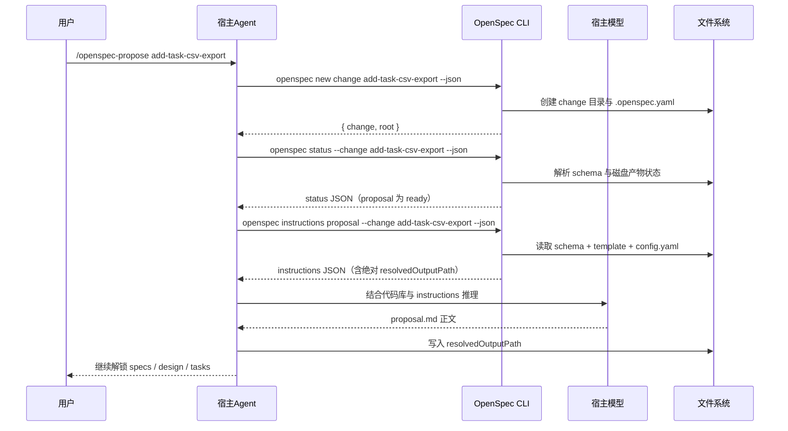

# 90 · 附录：给机器看的 Agent 协议

> 这一篇不是给第一次上手的人看的，而是给集成开发者与想研究“OpenSpec 怎样把结构化上下文喂给宿主 agent”的人看的（适用 openspec 2.1.1，字段契约对齐 `docs/agent-contract.md` 与 `src/` 实现）。

---

## 先明确三方角色与通用协议约定

```text
用户  ←→  宿主 Agent（Claude Code / Codex / Cursor 等）  ←→  OpenSpec CLI
```

三者分工非常明确：

- **用户**：提出意图、拍板边界、审查规划与代码产物
- **宿主 Agent**：加载 `openspec-*` skill，调用 `openspec ... --json` 读取状态与任务单，驱动模型推理并读写文件
- **OpenSpec CLI**：解析 root 与 schema DAG、组装模板与 `config.yaml` 约束、执行确定性校验与归档合并

**OpenSpec 自己不是大模型包装器，而是宿主无关的状态引擎与结构化上下文编排器。**

在解析任何 `--json` 输出前，集成方需要掌握 `docs/agent-contract.md` 的四条通用契约：

1. **单次调用只输出一个 JSON 文档**：`--json` 模式下，`stdout` 严格只打印一个 2 空格缩进的合法 JSON 文档；人类提示、spinner、store 横幅走 `stderr`，首次遥测提示与 shell 补全提示在 `--json` 下自动延后（defer），绝不污染 `stdout`。
2. **字段命名规范按命令族区分**：`store` / `doctor` / `context` 命令族使用 `snake_case`；工作流命令族（`list`、`show`、`validate`、`status`、`instructions`、`new change`、`archive`）使用 `camelCase`——**唯一例外是内嵌的 `root` 对象，其 `root.store_id` 在所有表面恒为 `snake_case`**。
3. **可选键默认省略而非填 `null`**：例如非 store 模式下省略 `root.store_id`；只有命令失败的 null-shape（如 `root: null`、`archive: null`）或 `store doctor` 的探测三态字段才显式使用 `null`。
4. **统一的错误诊断信封（`StoreDiagnostic`）**：`--json` 模式下命令失败时退出码为 `1`，并在 `stdout` 输出该命令的 null-shape 加 `status` 数组：

```json
{
  "status": [
    {
      "severity": "error",
      "code": "change_error",
      "message": "Missing required option --change (or --all for every active change). Available changes:\n  add-task-csv-export"
    }
  ]
}
```

**字段说明**：
- `severity`：`error` | `warning` | `info`（在 `doctor` / `context` 等健康检查里可作为顶层或条目级诊断数组出现且退出码仍为 `0`；作为命令失败抛出时退出码为 `1`）。
- `code`：稳定的 `snake_case` 机器错误码（如 `unknown_item`、`unparseable_config`、`archive_tasks_incomplete`）。
- `message`：人类可读的错误说明；可选附带 `target`（出错位置）与 `fix`（可直接粘贴执行的修复建议）。

---

## 核心运行时查询清单

宿主 agent 在工作流中主要消费以下结构化查询：

| 命令 | 机器拿来做什么 | 人类可理解成 |
|------|---------------|-------------|
| `openspec status --change "<name>" --json` | 查询单个 change 的 schema、绝对路径表、DAG 状态与下一步命令（批量巡检用 `status --all --json`） | 看单个 change 的仪表盘 |
| `openspec instructions <artifact> --change "<name>" --json` | 生成某个规划 artifact 时获取模板、`context`、`rules`、依赖状态与绝对输出路径 | 拿到一份“写作任务单” |
| `openspec instructions apply --change "<name>" --json` | 获取实施阶段状态（`blocked` / `ready` / `all_done`）、带行号的任务列表、`contextFiles` 与 `operationGuidance` | 拿到一份“施工任务单” |
| `openspec instructions archive --change "<name>" --json` | 只读获取归档前的项目 `context` 与 `operations.archive.guidance` | 拿到一份“归档前置提醒” |
| `openspec validate --all --strict --json` | 校验 `config.yaml` 语法及全部活跃 change / main spec 结构（精简输出可加 `--report findings`） | 跑结构与契约门禁 |
| `openspec schemas --json` / `openspec templates --json` | 查询可用 schema 列表与各 artifact 模板来源路径 | 查工作流骨架与模板表 |

> **`--change` 必填陷阱**：只要项目里有 **1 个及以上**活跃 change，`status`（未加 `--all` 时）与三条 `instructions` 命令漏传 `--change` 都会以退出码 `1` 失败。当项目有 **0 个**活跃 change 时，`openspec status --json` 则合法返回退出码 `0`：
>
> ```json
> {
>   "changes": [],
>   "message": "No active changes.",
>   "root": { "path": "/srv/stores/platform-api", "source": "nearest" }
> }
> ```
>
> 所以“在空仓库里不带 `--change` 试通了”不能证明调用方代码正确——自动化调用单 change 状态时永远显式传 `--change "<name>"`，批量扫描永远显式传 `--all`。

---

## 一次典型执行链

以用户在宿主里调用 `/openspec-propose add-task-csv-export` 为例：



---

## 关键 JSON 载荷与字段说明

### 1. `openspec status --change <name> --json`（及 `--all`）

```json
{
  "changeName": "add-task-csv-export",
  "schemaName": "spec-driven",
  "planningHome": {
    "kind": "repo",
    "root": "/srv/stores/platform-api",
    "changesDir": "/srv/stores/platform-api/openspec/changes",
    "defaultSchema": "spec-driven"
  },
  "changeRoot": "/srv/stores/platform-api/openspec/changes/add-task-csv-export",
  "artifactPaths": {
    "proposal": {
      "outputPath": "proposal.md",
      "resolvedOutputPath": "/srv/stores/platform-api/openspec/changes/add-task-csv-export/proposal.md",
      "existingOutputPaths": ["/srv/stores/platform-api/openspec/changes/add-task-csv-export/proposal.md"]
    },
    "specs": {
      "outputPath": "specs/**/*.md",
      "resolvedOutputPath": "/srv/stores/platform-api/openspec/changes/add-task-csv-export/specs/**/*.md",
      "existingOutputPaths": ["/srv/stores/platform-api/openspec/changes/add-task-csv-export/specs/task-tracking/spec.md"]
    }
  },
  "isPlanningComplete": false,
  "isComplete": false,
  "applyRequires": ["tasks"],
  "nextSteps": [
    "Run openspec instructions design --change \"add-task-csv-export\" --json before writing that artifact."
  ],
  "actionContext": {
    "mode": "repo-local",
    "sourceOfTruth": "repo",
    "planningArtifacts": ["proposal", "specs", "design", "tasks"],
    "linkedContext": [],
    "allowedEditRoots": ["/srv/stores/platform-api"],
    "requiresAffectedAreaSelection": false,
    "constraints": ["Repo-local change artifacts and implementation edits are scoped to this project."]
  },
  "artifacts": [
    { "id": "proposal", "outputPath": "proposal.md", "status": "done", "requires": [] },
    { "id": "specs", "outputPath": "specs/**/*.md", "status": "done", "requires": ["proposal"] },
    { "id": "design", "outputPath": "design.md", "status": "ready", "requires": ["proposal"] },
    { "id": "tasks", "outputPath": "tasks.md", "status": "blocked", "requires": ["specs", "design"], "missingDeps": ["design"] }
  ],
  "root": {
    "path": "/srv/stores/platform-api",
    "source": "nearest"
  }
}
```

**字段说明**：
- `planningHome` 与 `root`：标识本次解析到的 OpenSpec 根目录（`root.source` 为 `store` | `declared` | `global_default` | `nearest` | `implicit`；命中 store 时额外带 `root.store_id`）。读取主 spec 时一律以 `<planningHome.root>/openspec/specs/<capability-path>/spec.md` 为准。
- `artifactPaths.<id>`：给出 schema 声明的相对 `outputPath`、拼接 `changeRoot` 后的**绝对** `resolvedOutputPath`（glob 工件仍含通配符），以及磁盘上已匹配的**绝对文件路径数组** `existingOutputPaths`。
- `isPlanningComplete` / `isComplete`：所有非 `skipped` 规划产物均已落盘时为 `true`（`isComplete` 是保持同值的兼容别名；它只代表规划齐备，不代表 `tasks.md` 实现任务已完成）。`applyRequires` 列出进入 `apply` 所需的直连前置产物 ID。
- `artifacts[]`：严格按拓扑依赖序排列（同时就绪的产物按 `schema.yaml` 声明顺序打破平局，绝不按字母序重排），因此第一个 `status: "ready"` 的元素就是要写的下一个产物。每项始终携带直接依赖数组 `requires`；仅在 `blocked` 时携带 `missingDeps`；change 声明 `skip_specs: true` 时，`specs/` 下的产物状态为 `skipped`。
- `actionContext.allowedEditRoots`：限定允许编辑的根目录；若当前项目通过 `store:` 指针声明了外部 planning store，数组会同时包含 `[<当前代码仓库>, <外部 store>]`。
- **批量模式 `openspec status --all --json`**：与 `--change` 互斥，返回 `{ "changes": [ ... ], "root": { ... } }`（每个元素与单 change 结构一致但去掉重复的内层 `root`，按 `changeName` 排序）。若其中某个 change 损坏或嵌套错误，该位置输出 `{ "changeName": "...", "status": [diagnostic] }`，整轮扫描不中断，最终退出码置为 `1`。

---

### 2. `openspec show <item> --json` 的规范化 `name` 契约

```json
{
  "id": "task-tracking",
  "title": "Task Tracking Specification",
  "overview": "Tracks construction tasks across BuildFlow projects...",
  "requirementCount": 1,
  "requirements": [
    {
      "name": "Task List Visibility",
      "text": "The system SHALL allow authorized project staff to view the construction task list.",
      "scenarios": [
        {
          "name": "Staff user opens task list",
          "rawText": "- **WHEN** an authenticated project staff user opens the Construction Tasks page\n- **THEN** the system displays recent construction tasks for the project"
        }
      ]
    }
  ],
  "metadata": { "version": "1.0.0", "format": "openspec" },
  "root": { "path": "/srv/stores/platform-api", "source": "nearest" }
}
```

**字段说明**：
- `requirements[].name`：经 `normalizeRequirementName` 规范化后的精确名称（剥离 `Requirement:` 前缀与行尾空白分隔的闭合 `#` 串）。**`archive` 匹配 `MODIFIED` / `REMOVED` / `RENAMED` 时完全按此字符串做区分大小写的精确比对**，调用方绝不要从 `text` 句子里自行猜测标题。
- `scenarios[].name`：剥离四井号 `#### Scenario:` 前缀与闭合 `#` 串后的场景名称，`validate` 与 `archive` 的 `MODIFIED` scenario-loss 检查即按此名称比对；`rawText` 保留场景正文原貌。

---

### 3. `openspec instructions <artifact> --change <name> --json`

```json
{
  "changeName": "add-task-csv-export",
  "artifactId": "design",
  "schemaName": "spec-driven",
  "changeDir": "/srv/stores/platform-api/openspec/changes/add-task-csv-export",
  "planningHome": {
    "kind": "repo",
    "root": "/srv/stores/platform-api",
    "changesDir": "/srv/stores/platform-api/openspec/changes",
    "defaultSchema": "spec-driven"
  },
  "outputPath": "design.md",
  "resolvedOutputPath": "/srv/stores/platform-api/openspec/changes/add-task-csv-export/design.md",
  "existingOutputPaths": [],
  "description": "Technical design document with implementation details",
  "instruction": "Create the design document that explains HOW to implement the change...",
  "context": "Project: BuildFlow\nStack: TypeScript, React, Node.js, PostgreSQL",
  "rules": [
    "Explain migration risk when behavior changes existing flow",
    "Do not bypass domain module boundaries"
  ],
  "template": "# Design\n\n## Context\n\n## Goals / Non-Goals\n\n## Decisions\n\n## Risks / Trade-offs\n",
  "dependencies": [
    {
      "id": "proposal",
      "done": true,
      "path": "proposal.md",
      "description": "Initial proposal document outlining the change"
    }
  ],
  "unlocks": ["tasks"],
  "root": {
    "path": "/srv/stores/platform-api",
    "source": "nearest"
  }
}
```

**字段说明**：
- `resolvedOutputPath` 与 `existingOutputPaths`：**均为绝对路径**（基于 `changeDir` 解析，而非相对工作目录路径）！单文件产物可直接写入 `resolvedOutputPath`；glob 产物（如 `specs/**/*.md`）则必须在 `changeDir` 内构造匹配 `outputPath` 的具体子路径（如 `specs/<capability-path>/spec.md`），更新已有文件时只改 `existingOutputPaths` 中列出的具体文件。
- `description`、`instruction`、`template`：均来自生效 schema 的产物定义与模板文件。
- `context` 与 `rules`：从生效 root 的 `openspec/config.yaml` 按需提取（`context` 有 50 KB 上限；`rules` 仅过滤出当前 `artifactId` 对应的规则列表，无配置时这两个可选键直接省略）。若配置了跨仓库 `references:`，还会附带上限 50 KB 的 `references` 索引数组。
- `dependencies[]` 与 `unlocks[]`：前置依赖产物的状态（若某依赖因 `skip_specs: true` 被跳过，会带 `"skipped": true`，agent 不应尝试读取其文件）以及本产物完成后按 schema 声明序解锁的下游产物 ID。

---

### 4. `openspec instructions apply --change <name> --json`（及 `archive`）

```json
{
  "changeName": "add-task-csv-export",
  "changeDir": "/srv/stores/platform-api/openspec/changes/add-task-csv-export",
  "schemaName": "spec-driven",
  "contextFiles": {
    "proposal": ["/srv/stores/platform-api/openspec/changes/add-task-csv-export/proposal.md"],
    "specs": ["/srv/stores/platform-api/openspec/changes/add-task-csv-export/specs/task-tracking/spec.md"],
    "design": ["/srv/stores/platform-api/openspec/changes/add-task-csv-export/design.md"],
    "tasks": ["/srv/stores/platform-api/openspec/changes/add-task-csv-export/tasks.md"]
  },
  "progress": { "total": 2, "complete": 1, "remaining": 1 },
  "tasks": [
    {
      "id": "1",
      "description": "1.1 Add export endpoint for filtered construction tasks — verify: endpoint integration test returns a CSV response",
      "done": true,
      "sourcePath": "/srv/stores/platform-api/openspec/changes/add-task-csv-export/tasks.md",
      "line": 4
    },
    {
      "id": "2",
      "description": "1.2 Reuse existing task filter parsing — verify: filter parity test covers status and date range",
      "done": false,
      "sourcePath": "/srv/stores/platform-api/openspec/changes/add-task-csv-export/tasks.md",
      "line": 5
    }
  ],
  "taskTrackingConfigured": true,
  "state": "ready",
  "instruction": "Read context files, work through pending tasks, mark complete as you go.\nPause if you hit blockers or need clarification.",
  "context": "Project: BuildFlow\nStack: TypeScript, React, Node.js, PostgreSQL",
  "operationGuidance": "Run targeted unit tests before marking any backend task complete.",
  "root": {
    "path": "/srv/stores/platform-api",
    "source": "nearest"
  }
}
```

**字段说明**：
- `state`：`blocked`（缺前置产物或任务文件无有效任务；此时附带直接阻塞项 `missingArtifacts` 与按构建序展开的完整传递闭包 `missingPrerequisites`）| `ready`（可执行待办任务）| `all_done`（所有已追踪 checkbox 均已勾选，提示归档前先做复核/验证）。
- `contextFiles`：仅给出各已存在规划产物的**绝对路径数组**，不内联全文，避免撑爆上下文窗口。
- `tasks[]` 与 `progress`：从 `schema.apply.tracks` 匹配到的任务文件中解析出的待办项，每项携带绝对 `sourcePath`、1-based 起始行号 `line` 以及完整多行 `description`（含续行内容，`#2228`）。无描述文字的空 `- [ ]` 仍计入 `progress`，但不会进入 `tasks[]`。
- `context` vs `operationGuidance`：`context` 是必须遵循的项目事实与工程约束；`operationGuidance` 来自 `config.yaml` 的 `operations.apply.guidance`，属于与内置流程兼容时采纳的补充指引。
- **配套的 `openspec instructions archive --change <name> --json`**：只读返回 `{ "changeName", "context"?, "operationGuidance"?, "root" }`（读取 `operations.archive.guidance`），本身不合并 spec 也不移动目录；真正执行非交互归档使用 `openspec archive <name> --yes --json`。

---

### 5. `openspec validate --json`

```json
{
  "items": [
    {
      "id": "add-task-csv-export",
      "type": "change",
      "valid": true,
      "issues": [],
      "durationMs": 4
    }
  ],
  "summary": {
    "totals": { "items": 1, "passed": 1, "failed": 0 },
    "byType": {
      "change": { "items": 1, "passed": 1, "failed": 0 }
    }
  },
  "version": "1.0",
  "root": {
    "path": "/srv/stores/platform-api",
    "source": "nearest"
  }
}
```

**字段说明**：
- `items[]`：每个被校验的 `change` 或 `spec` 一条记录，`issues[]` 含 `level`（`ERROR` | `WARNING` | `INFO`）、`path`、`message` 及可选 `line` / `column`。普通模式下仅 `ERROR` 使 `valid: false`；`--strict` 模式下 `WARNING` 同样判为失败。任一条目 `valid: false` 时退出码为 `1`。
- `version`：固定为 `"1.0"`（目前唯一携带顶层 `version` 字段的命令表面）；若批量巡检传入 `--report findings --json`，则只返回有问题的 `itemFindings` 并以 `report: { kind: "validation-findings", version: "1.0", scope, returnedItems, totalItems }` 标识。
- **前置 `config.yaml` 门禁**：若 `openspec/config.yaml`（或 `.yml`）不可读或 YAML 语法损坏，`validate --json` 在扫描条目前直接输出 `{ "status": [{ "severity": "error", "code": "unreadable_config" | "unparseable_config", ... }] }` 并以退出码 `1` 终止。

---

### 6. 元信息、升级预演与个人视图的 JSON 表面

除核心工作流外，自动化脚本与工具集成还常调用以下四组机器接口：

```json
{
  "schemaVersion": 1,
  "version": "2.1.1",
  "install": {
    "location": "/opt/homebrew/Cellar/openspec/2.1.1/libexec/lib/node_modules/@fission-ai/openspec",
    "packageManager": "homebrew",
    "scope": "global"
  },
  "update": {
    "status": "current",
    "latest": "2.1.1",
    "command": null,
    "canSelfUpgrade": false
  }
}
```

**字段说明（含其余三组辅助 `--json` 接口）**：
- `openspec version [--check] --json`（如上示例）：报告 `schemaVersion: 1`、当前 `version` 与安装归属 `install`（`packageManager` 可识别 `npm` | `pnpm` | `bun` | `yarn` | `volta` | `homebrew` | `nix`，standalone 单文件则 `scope: "standalone"` 且 `packageManager: null`）。显式加 `--check` 时才会请求远端并返回 `update`（`status` 为 `available` | `current` | `disabled` | `offline`，有新版本时按安装方式给出精确升级命令，如 Homebrew 给 `brew upgrade openspec`、Nix 给 `null`）。
- `openspec update --dry-run --json`（`--json` 必须与 `--dry-run` 同用，单独传 `--json` 直接退出 `1`）：复用真实更新的同一条 `UpdateFileOps` 路径返回 `{ "changes": [{ "path", "action": "add"|"update"|"delete", "tool" }], "notes": [{ "code", "message" }], "failures": [{ "tool", "error" }] }`，零磁盘写入。
- `openspec schemas --json` 与 `openspec templates --json`：`schemas --json` 成功时保持兼容性的**顶层裸数组** `[{ "name", "description", "artifacts", "source" }]`（支持 `--store <id>`，仅在 root 解析失败时返回 `{ "schemas": [], "root": null, "status": [d] }` 退出 `1`）；`templates --json` 基于当前工作目录返回映射对象 `{ "<artifactId>": { "path", "source" } }`。
- `openspec workset create|list|remove --json`：分别返回 `{ "workset": {...}, "status": [] }`、`{ "worksets": [...], "status": [] }` 与 `{ "removed": { "name" }, "status": [] }`（非交互 `remove` 须带 `--yes`）。唯独 **`openspec workset open` 不支持 `--json`**——因为它要把当前终端或窗口移交给目标工具，传入 `--json` 会立即返回 `workset_open_json_unsupported` 并退出 `1`。

---

## v2.1.1 的技能投递与安装层架构

理解机器协议时，还要把 **workflow**、**skill** 与**安装层实现**区分清楚：

| 概念 | 在 v2.1.1 中的真实形态 |
|---|---|
| **workflow** | 逻辑动作 ID（`core` 默认 6 个：`propose`、`explore`、`apply`、`update`、`sync`、`archive`；`custom` 另含 `new`、`continue`、`ff`、`verify`、`bulk-archive`、`onboard`） |
| **skill** | **唯一的宿主投递形态**（`openspec-<workflow>/SKILL.md`）。1.x 的 `/opsx:*` 命令文件与 `delivery` 配置已在 v2.0.0 彻底移除 |
| **安装引擎（`skills@1.8.1`）** | 运行时依赖 `skills` 包负责跨工具落盘；v2.1.1（`#2283`）直接从本地已安装的 npm 包内置模板写入临时源目录后离线安装，不依赖网络与 Git |

当前 `src/core/config.ts` 的 `AI_TOOLS` 共暴露 **87 个工具目标**，按读取技能的目录机制分为两类：

1. **33 个通用目录工具（universal tools）**：原生直接读取 `.agents/skills/`，无需额外建链接——包括 `codex`（`$openspec-*` 调用）、`zed`、`opencode`、`cursor`、`github-copilot`、`antigravity`、`amp`、`gsd`、`dsh`、`warp`、`veai` 以及兜底的 vendor-neutral 目标 `agents` 等。
2. **54 个独立目录链接工具（`SKILL_LINKED_TOOL_IDS`）**：工具只读自己的技能目录（如 Claude Code 读 `.claude/skills/`、Kiro 读 `.kiro/skills/`、Cline 读 `.cline/skills/`、Grok Build 读 `.grok/skills/`）。OpenSpec 仍在 `.agents/skills/` 写唯一真身，再在工具目录下为每个技能创建指向真身的**相对符号链接**（Windows 项目级安装或文件系统不支持符号链接时自动退化为普通文件拷贝；Vercel `eve` 则写入剥离 `allowed-tools` 后的专用副本）。

配套的四个底层状态细节，排查项目文件时会经常遇到：

- **`global` vs `project` 作用域**：新项目 `openspec init` 默认走 `global`（写 `~/.agents/skills/` + 全局工具链接 + `~/.agents/.skill-lock.json` 或 `$XDG_STATE_HOME/skills/.skill-lock.json`）；加 `--scope project` 则写入仓库 `.agents/skills/`，在 `.agents/skills/.openspec-target` 按行记录已配置工具（带自有链接的工具标 `claude own-files`），并可通过 `openspec/config.yaml` 的 `skillsScope: project` 固化团队选择。
- **剥离易变头部（`stripVolatileFrontmatter`）**：写入磁盘的 `SKILL.md` 移除了 `generatedBy:` 版本号行，只要工作流正文没变，跨小版本 `openspec update` 不会制造无意义的 Git diff。
- **保留的 34 个命令适配器（`src/core/command-generation/adapters/`）**：命令生成逻辑已在 2.0 删除，但这 34 个适配器文件仍保留在源码中——唯一职责是告诉清理器“1.x 时代旧命令文件曾经写在哪条路径”，配合历史发布指纹库安全删除未改动的旧文件、保留用户手改文件。
- **结构化工具退役（`RETIRED_TOOLS`）与改名别名（`TOOL_ID_ALIASES`）**：无法加载 skills 的 `amazon-q` 已退役，`init --tools amazon-q` 直接报错并指引改用 `openspec init --tools kiro`；已更名的 `--tools windsurf` 则自动解析到 `devin`。

---

## 压缩结论：给人的三句话翻译

如果你不打算自己写宿主集成脚本，把整篇机器协议浓缩成这三句话就够了：

1. **宿主里的 `/openspec-*` 或 `$openspec-*` 只是技能壳**：真正的项目状态、绝对输出路径、模板与 `config.yaml` 规则，全靠 agent 在后台实时调用 `openspec status --json` 与 `openspec instructions --json` 拿到。
2. **JSON 契约把“猜路径、猜名字”变成了确定性字段**：写文件认准绝对路径 `resolvedOutputPath` / `existingOutputPaths`，改主 spec 认准 `planningHome.root` 与规范化 `requirements[].name`。
3. **OpenSpec 输出之所以比纯提示词稳得多**，是因为它把自由发挥的大模型关进了一个有 DAG 门控、有 `validate --strict` 校验闸门、有原子化 `archive` 合并的确定性状态机里。
